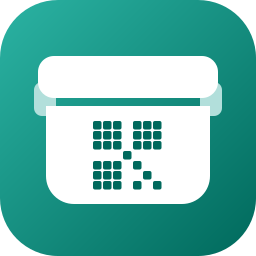
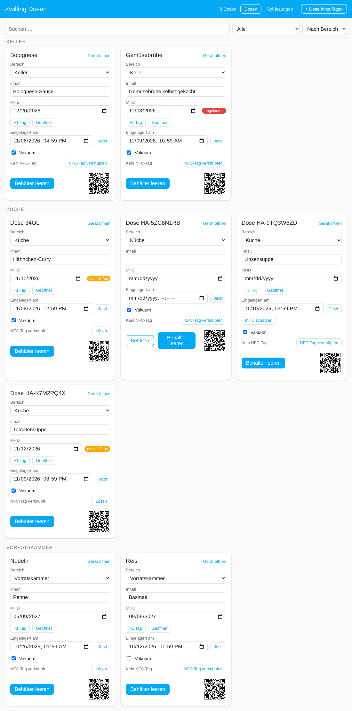
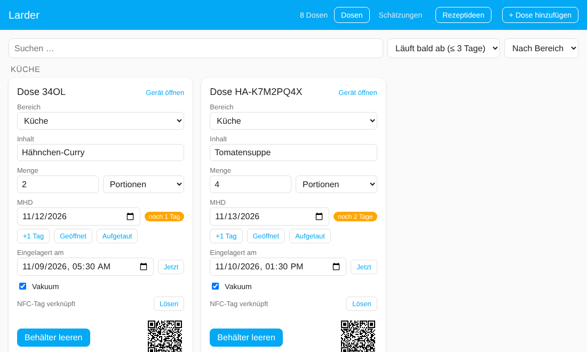
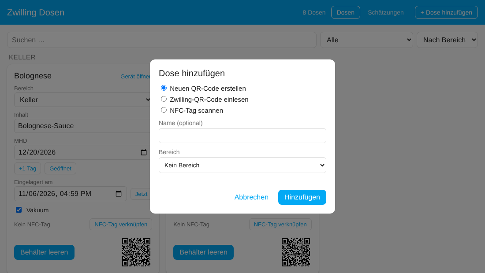
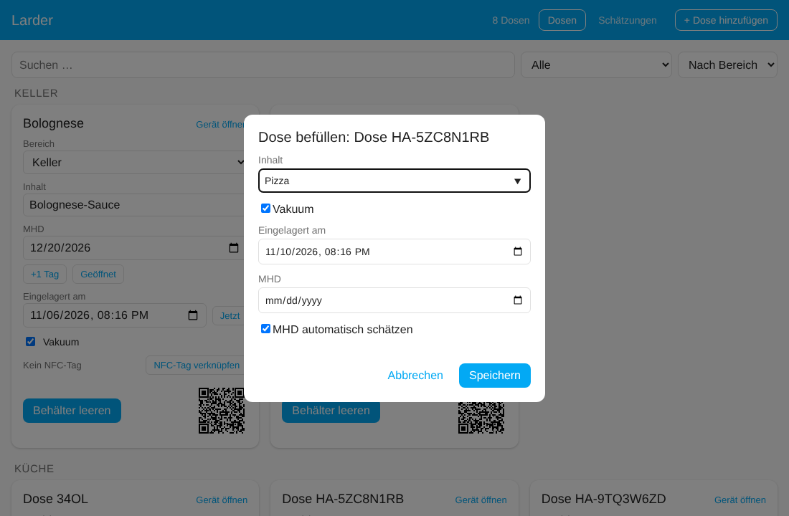
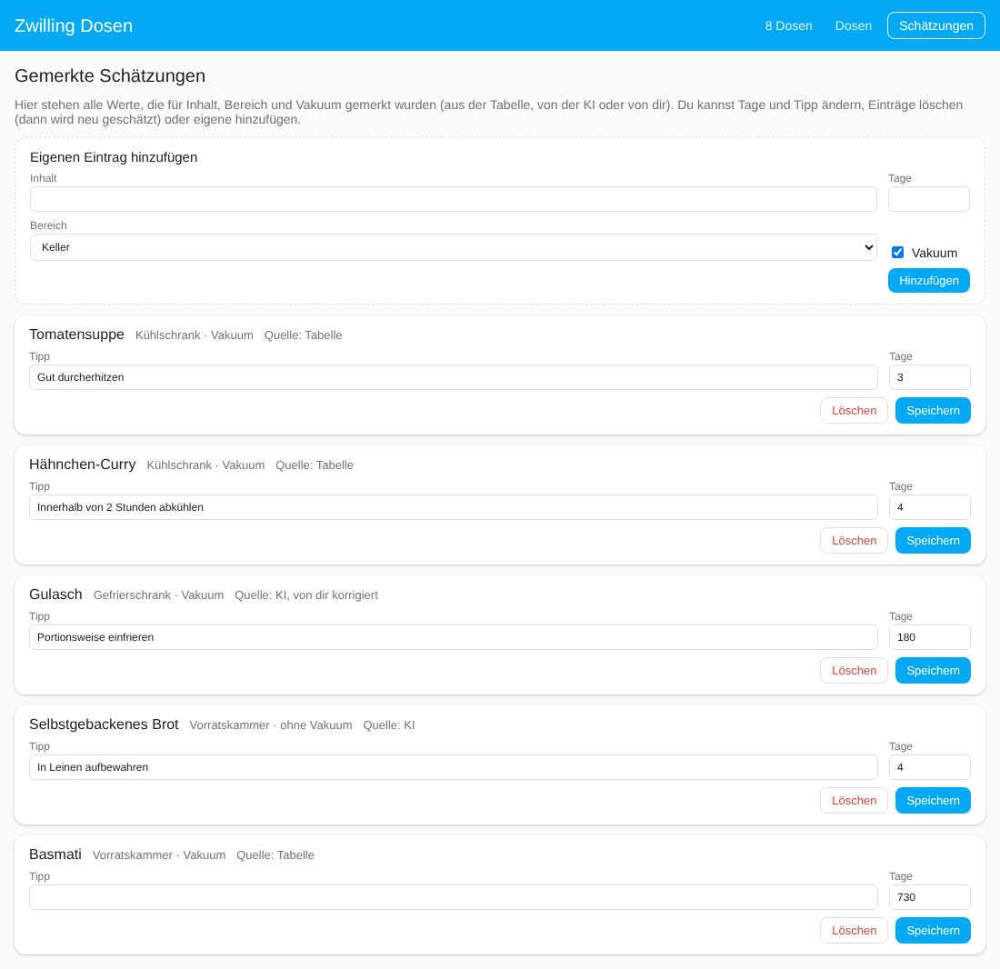
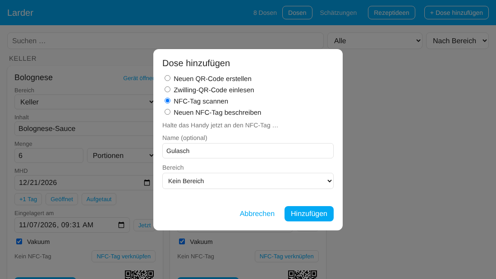
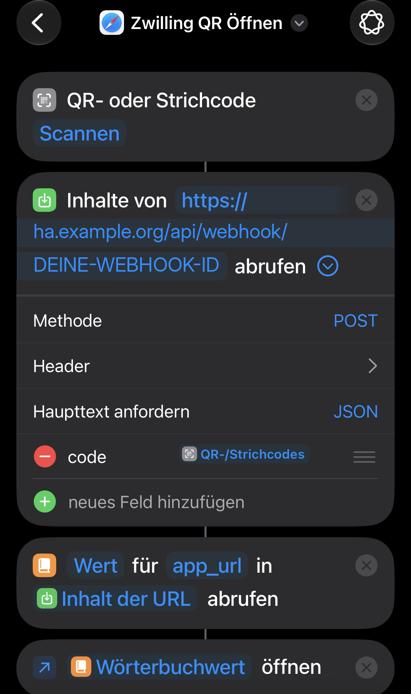

# Home Assistant Larder

**Food storage tracker** · früher *Zwilling Food Storage*



🇩🇪 Deutsch · [🇬🇧 English](README.md)

Home-Assistant-Integration für wiederverwendbare Vorratsdosen: Inhalt und Haltbarkeit festhalten, vor dem Ablauf erinnert werden und jede Dose per Scan wiederfinden.

## Highlights

- 🖥️ **[Eigenes Dashboard](#dashboard-larder)** in der Seitenleiste: alle Dosen auf einen Blick, alles anlegen und bearbeiten, aktualisiert sich selbst
- 🔖 **[Zwilling-Fresh-&-Save-QR-Codes](#ios-kurzbefehl-für-die-originalen-zwilling-codes)**: die originalen Codes auf den Deckeln funktionieren weiter (iOS-Kurzbefehl)
- 🏷️ **[Eigener QR-Code für jede Dose](#dose-anlegen)**: für jede beliebige Box, mit eindeutiger ID und fertigem Bild
- 📲 **[NFC-Tag-Integration](#nfc-tags)**: Tag auf die Box kleben statt einen Code zu drucken
- ✏️ **[Schnelles Befüllen](#dose-schnell-befüllen)**: Inhalt, MHD und Vakuum in wenigen Taps, mit Vorschlägen aus früheren Inhalten
- 🧮 **[MHD-Schätzung](#mhd-schätzen-eingebaute-tabelle-und-optional-ki)**: eingebaute Haltbarkeitstabelle, optional mit KI
- 🔔 **[Ablauf-Benachrichtigungen](#ablauf-benachrichtigungen)**: tägliche Zusammenfassung per Blueprint, still, wenn nichts abläuft
- 📅 **[Kalendereinträge](#mhd-im-kalender)**: MHDs erscheinen in deinem Kalender
- 🌍 In Deutsch und Englisch verfügbar

<p align="center"></p>

## Warum dieses Projekt?

Alles begann mit dem Kauf der Zwilling Fresh & Save Family Box. Dabei fiel mir der QR-Code auf den Deckeln auf, der jede Box mit dem Verwaltungssystem in der Zwilling-App verknüpft. Dann musste ich feststellen, dass die App und ihre Funktionen zum 31.12.2026 eingestellt werden.

Ein Ersatz musste her, und da ich Home Assistant ohnehin im Einsatz habe, lag es nahe, dort eine Integration zu bauen.

Dann kam eine zweite Idee: Auch gewöhnliche Boxen sollten einen QR-Code bekommen. Den muss man aber umständlich ausdrucken, und weil ich noch einige NFC-Aufkleber herumliegen hatte, war die Idee der NFC-Tag-Integration geboren.

## Entitäten

Pro Dose entsteht ein Gerät (eindeutig über die ID, den Parameter `cc` eines Zwilling-QR-Codes) mit:

| Entität | Typ | Zweck |
| --- | --- | --- |
| **Befüllt am** | `datetime` | Wann wurde die Dose befüllt? |
| **MHD** | `date` | Mindesthaltbarkeitsdatum |
| **Inhalt** | `text` | Was ist in der Dose? |
| **Behälter leeren** | `button` | Setzt die Dose komplett zurück: **Inhalt** wird leer, **MHD** und **Befüllt am** werden gelöscht. **Vakuum** bleibt bewusst erhalten, es ist eine Eigenschaft der Dose und nicht des Inhalts |
| **Vakuum** | `switch` | Ist die Dose vakuumiert? Bei neuen Dosen standardmäßig an; die Vorbelegung änderst du unter **Konfigurieren**, wenn die meisten deiner Boxen nicht vakuumiert sind. Wird für die Schätzung verwendet |
| **Tage bis MHD** | `sensor` | Verbleibende Tage bis zum MHD (negativ = abgelaufen). Das Attribut `status` ist `ok`, `soon` (3 Tage oder weniger), `expired` oder `none` |
| **QR-Code** | `image` | QR-Code der Dose als Bild: Scannen mit der Kamera-App öffnet direkt das Gerät in der Home-Assistant-App |

Die Werte bleiben über Neustarts erhalten. „Behälter leeren“ ist eine normale Button-Entität, lässt sich also auf Dashboards und in Automationen über `button.press` verwenden.

**Einzelnes Feld leeren:** Die Datums-Entitäten von Home Assistant lassen sich im Entitäts-Dialog selbst nicht leeren (der Button „Löschen“ im Datumsfeld bewirkt dort nichts). Nutze stattdessen eines davon: das Feld im Dashboard leeren, **Behälter leeren** für alles zusammen, oder die Services `larder.clear_best_before` bzw. `larder.clear_filled_at` (z. B. in den Entwicklerwerkzeugen oder in einer Automation).

## Installation über den Marketplace (HACS)

Seit Home Assistant 2026.11 ist der Community Store HACS als **Marketplace** fest eingebaut. Larder ist noch nicht im Standardkatalog, daher fügst du es als benutzerdefiniertes Repository hinzu:

1. **Einstellungen → Marketplace** → **Über Link hinzufügen**
2. URL: `https://github.com/yan14/ha-larder`, Kategorie **Integration**
3. „Larder“ herunterladen (für ein eigenes Repository braucht es eine GitHub-Verbindung; Home Assistant zeigt dafür einen Code, den du bei GitHub eingibst).
4. Einrichten unter **Einstellungen → Geräte & Dienste → Integration hinzufügen → Larder** (siehe unten).

<details>
<summary>Home Assistant vor 2026.11 (klassisches HACS)</summary>

1. HACS → Drei-Punkte-Menü → **Benutzerdefinierte Repositories**
2. URL: `https://github.com/yan14/ha-larder`, Kategorie **Integration**
3. „Larder“ installieren, Home Assistant neu starten.

</details>

> **Du kommst vom alten „Zwilling Food Storage“ (bis 0.10)?** Larder ist eine neue Integration (Domain `larder`). Entferne die alte Integration, füge Larder hinzu und lege deine Dosen neu an.

## Dose anlegen

Einstellungen → Geräte & Dienste → **Integration hinzufügen** → „Larder“. Dann gibt es zwei Wege:

**Neuen QR Code erstellen**

Für Dosen ohne (lesbaren) Zwilling-Code. Die Integration erzeugt eine neue, eindeutige ID im Format `HA-XXXXXXXX` (8 Zeichen ohne die leicht verwechselbaren 0/O und 1/I). Das Präfix `HA-` hält sie klar von den Zwilling-IDs getrennt (z. B. `34OL`), eine Überschneidung ist damit ausgeschlossen. Du kannst optional einen Namen vergeben. Den QR-Code findest du danach als Bild am Gerät (siehe „QR-Code direkt scannen“).

**Zwilling QR Code einlesen**

Für vorhandene Zwilling-Dosen. Dort den Inhalt des QR-Codes einfügen, z. B.

```
zwilling://zwillingapp/food-storage/in/?tc=42ML30&s=m&cc=34OL
```

Es reicht auch nur die ID (`cc`, hier `34OL`). Optional kannst du einen Namen vergeben. Jede Dose lässt sich nur einmal anlegen.

Home Assistant bietet im Dialog keine Kamera zum Scannen. Den Text liest du unter iOS mit dem Kurzbefehl aus (nächster Abschnitt) und fügst ihn ein.

Dosen lassen sich auch im Dashboard in der Seitenleiste hinzufügen (Button **+ Dose hinzufügen**), siehe [unten](#dose-im-dashboard-hinzufügen). Das ist der schnellste Weg, sobald die erste Dose existiert.

## QR-Code direkt scannen

Jede Dose hat die Bild-Entität **QR-Code**. Sie enthält einen Link, der die Home-Assistant-App direkt auf die Geräteseite der Dose springen lässt (`homeassistant://navigate/config/devices/device/<Geräte-ID>`). Dafür brauchst du keinen Kurzbefehl.

1. Öffne das Gerät der Dose in Home Assistant (oder das Panel „Larder“, dort ist der QR-Code klein zu sehen) und öffne die Entität **QR-Code**. Bild speichern oder ausdrucken und auf die Dose kleben. Der Inhalt des Codes steht auch im Attribut `qr_content` der Entität.
2. Scanne den Aufkleber mit der Kamera-App. iOS bietet an, den Link in der Home-Assistant-App zu öffnen, und die App zeigt die Dose.

Der Code verweist auf die Geräte-ID in Home Assistant. Wird die Dose gelöscht und neu angelegt, bekommt sie eine neue Geräte-ID, und der Aufkleber muss neu gedruckt werden. Hast du mehrere Home-Assistant-Server in der App, fragt sie beim Öffnen, welcher gemeint ist.

## Dashboard „Larder“

Sobald mindestens eine Dose angelegt ist, erscheint in der Seitenleiste der Eintrag **Larder**. Er braucht keine Konfiguration und zeigt jede Dose auf einer Karte (Screenshot ganz oben):

*Die Screenshots zeigen Demo-Daten. Das Panel passt sich an Theme und Sprache von Home Assistant an (Deutsch und Englisch).*

- Alle Dosen der Integration, gruppiert nach **Bereich** (Area des Geräts) und sortiert nach Name.
- Pro Dose: Bereich, **Inhalt**, **MHD** (mit Hinweis „abgelaufen“ oder „noch n Tage“ ab 3 Tagen davor), **Eingelagert am** (= „Befüllt am“), der Button **Behälter leeren** und der QR-Code als kleines Bild.
- Inhalt, MHD und Datum lassen sich direkt im Panel ändern. „Jetzt“ setzt „Eingelagert am“ auf die aktuelle Zeit.
- Den **Bereich** einer Dose änderst du über das Auswahlfeld auf ihrer Karte, ohne Umweg über die Geräteseite.
- Das Häkchen **Vakuum** schaltet die Vakuum-Eigenschaft der Dose um.
- Ist die [Schätzung](#mhd-schätzen-eingebaute-tabelle-und-optional-ki) aktiviert, erscheint unter dem Datum der Button **MHD schätzen**, sobald ein Inhalt eingetragen und noch kein MHD gesetzt ist.
- **+ Dose hinzufügen** (oben rechts) legt eine Dose an: entweder *Neuen QR-Code erstellen* oder *Zwilling-QR-Code einlesen*, mit optionalem Namen und Bereich. Es ist derselbe Ablauf wie unter Einstellungen → Geräte & Dienste.
- Unter dem Datum: **+1 Tag** verschiebt das MHD um einen Tag, **Geöffnet** kürzt es auf die in den Einstellungen gesetzte Zahl Tage (Standard 3). Ohne Datum wird eines gesetzt.
- **Suche, Filter und Sortierung** über den Karten: Suche in Name, Inhalt und Bereich; Filter nach *läuft bald ab*, *abgelaufen*, *befüllt* oder *leer*; Sortierung nach Bereich, MHD (frühestes zuerst) oder Name. Deine Auswahl wird im Browser gemerkt.
- Eine leere Dose zeigt **Befüllen**, einen schnellen Dialog für Inhalt, Vakuum und MHD (siehe [unten](#dose-schnell-befüllen)).
- Administratoren sehen außerdem den Reiter **Schätzungen** (siehe [unten](#gemerkte-schätzungen-verwalten)).
- Neue Dosen, geänderte Werte und geänderte Bereiche erscheinen sofort, ohne dass du etwas neu laden musst.

<p align="center"></p>


Das Panel ist für alle Nutzer sichtbar, aber nur **Administratoren** können Dosen hinzufügen und Bereiche ändern (dieselbe Einschränkung wie in den Einstellungen). Andere Nutzer sehen den Bereich als Text. Es ist kein klassisches Lovelace-Dashboard und lässt sich nicht mit dem Karten-Editor bearbeiten. Dafür aktualisiert es sich selbst.

### Dose im Dashboard hinzufügen

**+ Dose hinzufügen** öffnet einen Dialog:

<p align="center"></p>

- **Neuen QR-Code erstellen** erzeugt eine neue eindeutige ID. Danach die Karte (oder das Gerät) öffnen und den QR-Code ausdrucken.
- **Zwilling-QR-Code einlesen** braucht den Inhalt des originalen Codes oder nur die ID. Kommst du vom iOS-Kurzbefehl, ist das Feld schon ausgefüllt.
- Name und Bereich sind optional. Beides lässt sich später ändern (den Bereich direkt auf der Karte).

## MHD schätzen (eingebaute Tabelle und optional KI)

Die Integration kann dir ein Mindesthaltbarkeitsdatum vorschlagen. Es gibt zwei Quellen, und du entscheidest, welche genutzt wird (Einstellungen → Geräte & Dienste → **Larder** → **Konfigurieren**):

| Modus | Was passiert |
|---|---|
| **Aus** | Keine Schätzung, der Button ist ausgeblendet. |
| **Nur Tabelle** (Standard) | Eine eingebaute Haltbarkeits-Tabelle. Funktioniert offline, braucht keinen KI-Dienst und kostet nichts. |
| **Tabelle, sonst KI** | Zuerst die Tabelle. Hat sie zum Inhalt keinen Eintrag oder kann den Bereich nicht einordnen, wird die KI gefragt. |
| **Nur KI** | Immer die KI (braucht die Integration *AI Task*, siehe unten). |

Von dir korrigierte Werte haben immer Vorrang (siehe „Merken“).

### Die Tabelle

Über 50 Einträge für gängige Lebensmittel: Gerichte und Reste, Suppen, rohes Fleisch, Fisch, Wurst, Milchprodukte, Käse, Eier, Obst und Gemüse, Brot und Kuchen, Nudeln, Reis, Mehl, Nüsse, Kaffee, Tee, Gewürze und mehr. Zu jedem Eintrag kennt sie die Haltbarkeit im **Kühlschrank**, im **0-Grad-Fach**, im **Gefrierschrank** und im **Vorrat**. Gehört ein Lebensmittel nicht an einen Ort (z. B. Salat in den Gefrierschrank oder rohes Fleisch in den Vorrat), sagt sie das und denkt sich **kein** Datum aus.

So wird eine Dose zugeordnet:

- **Inhalt:** über Stichwörter auf Deutsch und Englisch, z. B. „Tomatensuppe“, „Penne“, „leftover chicken curry“. Der genaueste Treffer gewinnt („gekochte Eier“ schlägt „Eier“).
- **Lagerort:** aus dem Bereich. Zuerst ein Temperatursensor am Bereich, dann eine Temperatur im Label oder im Bereichsnamen (z. B. „ca. -18 °C“), dann Wörter wie *Kühlschrank*, *0-Grad-Fach*, *Gefrierschrank*, *Gefrierfach* (etwas weniger kalt, daher kürzer), *Vorrat*, *Keller*. Kann sie den Bereich nicht einordnen, sagt sie es, statt zu raten.
- **Vakuum** verlängert die Zeit (rund +30 % gekühlt, +50 % im Gefrierschrank und im Vorrat). Leicht verderbliche Speisen im Kühlschrank (Hack, Fisch, Wurst, Reste, Weichkäse, …) bekommen **keinen** Bonus, denn Vakuum macht sie nicht sicherer.

Die Werte sind bewusst vorsichtig gewählt und orientieren sich an gängigen Empfehlungen (etwa der USDA/FSIS-Kühllagertabelle und den Verbraucherzentralen). Es sind Faustwerte für zu Hause, **keine Garantie für Lebensmittelsicherheit**. Bei gekauften Produkten ist das aufgedruckte MHD verlässlicher. Schreibe „gekocht“ oder „geöffnet“ in den Inhalt, wenn es darauf ankommt. Ein Wert passt nicht oder ein Lebensmittel fehlt? Die Einträge stehen in `custom_components/larder/shelf_life.py`; Issues und Pull Requests sind willkommen.

### KI (optional)

Der KI-Modus nutzt die Funktion **AI Task** von Home Assistant und arbeitet deshalb mit dem KI-Dienst, den du dort eingerichtet hast (zum Beispiel Anthropic, OpenAI, Google oder ein lokales Ollama).

1. Richte in Home Assistant einen KI-Dienst mit einer *AI Task* ein (Einstellungen → Geräte & Dienste). Dafür braucht es eine Home-Assistant-Version, die die Integration AI Task enthält.
2. Wähle in den Einstellungen **Tabelle, sonst KI** oder **Nur KI**. Das Feld „KI-Aufgabe“ brauchst du nur, wenn du mehrere eingerichtet hast.

Die KI bekommt den Bereichsnamen und versteht deshalb „0-Grad-Fach“ oder „Gefrierschrank“ von selbst. Genauere Hinweise kannst du so mitgeben:

- **Temperatursensor am Bereich:** In den Bereichseinstellungen lässt sich ein Temperatursensor zuweisen. Hat er einen gültigen Wert, wird er mitgegeben (z. B. die echte Temperatur im Gefrierschrank). Auch die Tabelle nutzt ihn.
- **Label mit Beschreibung:** Weise dem Bereich ein Label zu und schreibe in dessen Beschreibung einen Hinweis, z. B. „ca. -18 °C, Fleisch und Fisch“. Name und Beschreibung werden mitgegeben.

Gesendet werden nur der Inhaltstext, der Bereichsname mit seinen Hinweisen, Vakuum Ja/Nein und das Befüll-Datum, und zwar an den KI-Dienst, den du gewählt hast. Je nach Anbieter kann das einen kleinen Betrag kosten. Im Modus „Nur Tabelle“ wird nichts gesendet.

### Benutzen

Stelle **Vakuum** pro Dose ein und weise jede Dose einem **Bereich** zu, der den Lagerort beschreibt, z. B. „Kühlschrank“, „0-Grad-Fach“, „Gefrierschrank“ oder „Vorratskammer“. Ohne Bereich wird die Schätzung mit einem Hinweis abgelehnt.

Im Dashboard erscheint der Button **MHD schätzen**, sobald ein Inhalt eingetragen und das MHD leer ist. Er zeigt an, woher der Wert stammt: *Tabelle*, *KI* oder *Tabelle, von dir korrigiert* bzw. *KI, von dir korrigiert*, wenn du das Datum danach geändert hast. Den Service kannst du auch in Automationen, Skripten oder den Entwicklerwerkzeugen aufrufen:

```yaml
action: larder.estimate_best_before
target:
  entity_id: date.dose_34ol_best_before
data:
  apply: true       # false: nur den Vorschlag zurückgeben
  overwrite: false  # true: auch schätzen, wenn schon ein Datum gesetzt ist
response_variable: result
```

Das Ergebnis enthält `best_before`, `days`, `tip` (ein kurzer Lagertipp), `source` (`table`, `ai` oder `learned`), `basis` (bei der Tabelle: erkanntes Lebensmittel und Ort), `cached` und `applied`. Gezählt wird ab **Befüllt am** (oder ab heute, wenn das leer ist). **Ein bereits gesetztes MHD wird nie überschrieben**, außer du setzt `overwrite`.

**Merken.** Jedes Ergebnis wird für die Kombination *Inhalt + Bereich + Vakuum* gespeichert und nicht erneut berechnet oder abgefragt. Änderst du ein vorgeschlagenes Datum danach selbst, merkt sich die Integration deinen Wert für dieselbe Kombination, und er gewinnt gegen Tabelle und KI. Die Daten liegen in `.storage/larder.estimator` von Home Assistant.

### Dose schnell befüllen

<p align="center"></p>

Eine leere Dose zeigt den Button **Befüllen**. Er öffnet einen kleinen Dialog: **Inhalt** (mit Vorschlägen aus früheren Eingaben, neueste zuerst, danach deine gemerkten Schätzungen), **Vakuum**, **Befüllt am** (vorbelegt mit jetzt), optional ein **MHD** und **MHD automatisch schätzen** (nur wenn die Schätzung aktiv und das MHD leer ist). **Speichern** setzt alles und schätzt das MHD.

Der Dialog öffnet sich auch von selbst nach einem Scan: wenn der Kurzbefehl `app_url` öffnet oder du die NFC-Benachrichtigung antippst und die Dose leer ist. Hat die Dose schon einen Inhalt, wird sie nur hervorgehoben. Das funktioniert für alle Nutzer, nicht nur für Administratoren.

### Gemerkte Schätzungen verwalten

<p align="center"></p>

Administratoren sehen im Dashboard einen zweiten Reiter, **Schätzungen**. Er listet alles, was für eine Kombination aus Inhalt, Bereich und Vakuum gemerkt ist, samt Quelle (Tabelle, KI oder von dir korrigiert mit ursprünglicher Quelle). Dort kannst du

- **Tage und Tipp** eines Eintrags ändern (er gilt dann als von dir korrigiert),
- einen Eintrag **löschen**; die nächste Schätzung für diese Kombination wird dann neu berechnet (Tabelle oder KI),
- einen **eigenen Eintrag** für eine Kombination aus Inhalt, Bereich und Vakuum hinzufügen.

Die eingebaute Tabelle selbst wird hier nicht bearbeitet. Eigene und geänderte Einträge haben nur für genau diese Kombination Vorrang vor ihr.

**Update von 0.5:** War „Per KI schätzen“ an, wird daraus **Nur KI** (wie bisher); war es aus, wird es **Nur Tabelle**.

## Ablauf-Benachrichtigungen

Der Service `larder.get_expiring` listet alle Dosen, deren MHD bald abläuft oder abgelaufen ist, und liefert einen fertigen Text in der Sprache von Home Assistant:

```yaml
action: larder.get_expiring
data:
  days: 3               # Dosen, die innerhalb von 3 Tagen ablaufen
  include_expired: true
response_variable: result
# result.count, result.expired, result.summary (Text), result.items (name, content, area, best_before, days_left, status)
```

Am einfachsten geht es mit dem mitgelieferten Blueprint, der einmal täglich eine Benachrichtigung schickt und schweigt, wenn nichts abläuft:

[](https://my.home-assistant.io/redirect/blueprint_import/?blueprint_url=https%3A%2F%2Fgithub.com%2Fyan14%2Fha-larder%2Fblob%2Fmain%2Fblueprints%2Fautomation%2Flarder%2Fexpiry_notification.yaml)

Wähle eine Benachrichtigungs-Aktion wie `notify.mobile_app_dein_iphone` (Entwicklerwerkzeuge → Aktionen), die Uhrzeit und wie viele Tage im Voraus geschaut wird. Für eigene Dashboards oder Automationen gibt es außerdem den Sensor **Tage bis MHD** an jeder Dose.

## MHD im Kalender

Unter Einstellungen → Geräte & Dienste → **Larder** → **Konfigurieren** kannst du einen vorhandenen **Kalender** wählen (Google, CalDAV, *Lokaler Kalender* …). Jede Dose bekommt dann einen Ganztags-Termin „MHD: Pizza“ am Tag des MHD. Der Termin wird angelegt, sobald ein Datum gesetzt ist, verschoben, wenn sich Datum oder Inhalt ändern, und gelöscht, wenn das Datum gelöscht, die Dose geleert oder entfernt oder ein anderer Kalender gewählt wird. Eigene Termine werden an einer Kennung in der Beschreibung erkannt, andere Termine werden nie angefasst.

Der Kalender muss Termine anlegen **und** löschen können. Reine Lese-Kalender (z. B. ein iCal-Link) gehen nicht; die Integration *Lokaler Kalender* ist eine gute Wahl, wenn du keinen anderen hast.

## NFC-Tags

<p align="center"></p>

Statt einen QR-Code zu drucken, kannst du einen NFC-Tag auf die Dose kleben. Dafür werden die **Tags** von Home Assistant genutzt: Jeder Scan löst ein `tag_scanned`-Ereignis aus, und die Integration merkt sich, welcher Tag zu welcher Dose gehört. Andere Tags im Haus werden ignoriert.

**Der schnellste Weg (in der Home-Assistant-App):** Dashboard öffnen, **+ Dose hinzufügen → Neuen NFC-Tag beschreiben** wählen, einen Namen eingeben und **Hinzufügen** drücken. Larder legt die Dose an, erstellt einen neuen Tag in Home Assistant und verknüpft beides. Danach öffnet die App das Beschreiben: Handy an einen leeren NFC-Tag halten, fertig. Die Option erscheint nur in der Companion-App auf einem Handy, das NFC-Tags beschreiben kann (nicht im Browser am Rechner).

Hast du schon einen mit der Home-Assistant-App beschriebenen Tag (Einstellungen → Companion-App → NFC, oder Einstellungen → Tags), verknüpfst du ihn stattdessen:

1. **Mit einer Dose verknüpfen** im Dashboard (Administratoren): Auf der Karte **NFC-Tag verknüpfen** drücken und das Handy an den Tag halten. Oder **+ Dose hinzufügen → NFC-Tag scannen**: Das legt eine neue Dose an und verknüpft den Tag gleich mit.
2. **Später scannen.** Ist das Dashboard offen, springt es zur Dose und hebt sie hervor. Sonst bekommt das scannende Handy (Companion-App) eine Benachrichtigung, deren Antippen das Dashboard bei dieser Dose öffnet. Das iPhone zeigt nach dem Lesen eines Tags ein eigenes Banner, das zuerst angetippt wird.

Für eigene Automationen löst ein verknüpfter Scan das Ereignis `larder_dose_scanned` aus (`cc`, `device_id`, `name`, `scanned_by`). Die Benachrichtigung lässt sich in den Einstellungen abschalten („NFC: Handy benachrichtigen“). Eine Dose hat höchstens einen Tag, und ein Tag gehört zu genau einer Dose.

## iOS-Kurzbefehl für die originalen Zwilling-Codes

Dieser Weg ist für die **aufgedruckten Zwilling-QR-Codes** gedacht. Für selbst erstellte Codes brauchst du ihn nicht, dort scannst du einfach mit der Kamera-App.

Der QR-Code enthält einen Link mit dem Schema `zwilling://`, der zur eingestellten Zwilling-App gehört. Die **Kamera-App ist dafür ungeeignet**: Sie will den Link in der Zwilling-App öffnen und liefert den Text nicht zum Kopieren. Der Kurzbefehl liest dagegen nur den Text aus und öffnet den Link nicht.

### 1. Webhook-URL herausfinden

Einstellungen → Geräte & Dienste → **Larder** → bei einer Dose **Konfigurieren**. Der Dialog zeigt die Webhook-URL, die nach dem Muster `https://<deine-HA-URL>/api/webhook/<lange-geheime-ID>` aufgebaut ist. Die URL gilt für alle Dosen, du brauchst sie nur einmal. Das Konfigurieren-Fenster kannst du danach mit „Senden“ schließen, es ändert nichts.

Die lange ID ist der Zugriffsschutz, behandle die URL also wie ein Passwort. Welche Adresse vorne steht (intern oder extern), richtet sich nach deiner Home-Assistant-Konfiguration. Unterwegs funktioniert der Kurzbefehl nur mit einer von außen erreichbaren Adresse.

### 2. Kurzbefehl anlegen (einmalig)

App **Kurzbefehle** → neuer Kurzbefehl mit diesen Aktionen, in dieser Reihenfolge:

1. **„QR-/Barcode scannen“** (*Scan QR/Bar Code*)
2. **„Inhalt von URL abrufen“** (*Get Contents of URL*):
   - URL: deine Webhook-URL aus Schritt 1
   - „Mehr anzeigen“ antippen, Methode **POST**, Anfragetext **JSON**
   - „Neues Feld hinzufügen“: Typ **Text**, Schlüssel `code`, Wert: das Ergebnis aus Aktion 1 (die Variable „QR-/Barcode“ aus der Variablenleiste wählen)
3. **„Wörterbuchwert abrufen“** (*Get Dictionary Value*, in der Suche nach „Wörterbuch“ suchen): Schlüssel `app_url`, aus „Inhalt von URL“. Nicht zu verwechseln mit „Gespeicherten Inhalt abrufen“, das ist eine andere Aktion.
4. **„URLs öffnen“** (*Open URLs*): öffnet den Wert aus Aktion 3

<p align="center"></p>

Der Screenshot zeigt den fertigen Kurzbefehl. Ersetze `ha.example.org` und `DEINE-WEBHOOK-ID` durch deine eigene Adresse und die ID aus Schritt 1.

Namen vergeben, z. B. „Dose scannen“. Über das Teilen-Symbol lässt er sich zum Home-Bildschirm hinzufügen oder auf die Aktionstaste legen. Beim ersten Lauf fragt iOS nach dem Kamerazugriff und ob der Kurzbefehl die URL aufrufen darf.

### 3. Benutzen

Kurzbefehl starten, QR-Code auf der Dose scannen. Die Home-Assistant-App öffnet sich dann:

- **Dose bekannt:** im Dashboard „Larder“, wo die Dose hervorgehoben wird. Eine leere Dose öffnet gleich den Dialog **Befüllen** (siehe [Dose schnell befüllen](#dose-schnell-befüllen)).
- **Dose neu:** im Dashboard „Larder“. Dort öffnet sich der Dialog **Dose hinzufügen** mit bereits eingetragenem Code. Optional Name und Bereich eingeben und **Hinzufügen** tippen. Das geht nur mit einem Administrator-Konto, andere Nutzer sehen einen Hinweis mit dem gescannten Code.

Hast du mehrere Home-Assistant-Server in der App, fragt sie beim Öffnen, welcher gemeint ist.

## Webhook-Schnittstelle

Der Webhook ist ein normaler Home-Assistant-Webhook und akzeptiert `POST` (und `GET`).

Anfrage, eine der folgenden Formen:

```
POST /api/webhook/<ID>   {"code": "zwilling://zwillingapp/food-storage/in/?tc=42ML30&s=m&cc=34OL"}
POST /api/webhook/<ID>   {"cc": "34OL"}
POST /api/webhook/<ID>   zwilling://zwillingapp/food-storage/in/?tc=42ML30&s=m&cc=34OL   (Klartext)
GET  /api/webhook/<ID>?code=34OL
```

Antwort (`200`, JSON):

```json
{
  "known": true,
  "cc": "34OL",
  "name": "Dose 34OL",
  "device_id": "0a1b2c…",
  "path": "/larder?open=0a1b2c…",
  "app_url": "homeassistant://navigate/larder?open=0a1b2c…",
  "device_path": "/config/devices/device/0a1b2c…",
  "device_app_url": "homeassistant://navigate/config/devices/device/0a1b2c…"
}
```

Bei bekannter Dose öffnen `path` und `app_url` das Dashboard bei dieser Dose (eine leere Dose bekommt gleich den Befüll-Dialog, siehe „Dose schnell befüllen“); `device_path` und `device_app_url` zeigen stattdessen auf die Geräteseite. Bei unbekannter Dose ist `known` gleich `false`, `path` und `app_url` zeigen auf das Dashboard mit dem Hinzufügen-Dialog (`/larder?add=<ID>`). Enthält die Anfrage keine gültige ID, antwortet der Webhook mit `400` und `{"error": "invalid_code"}`. Der Webhook liest nur und ändert keine Werte.

## Alternativen

Diese Integration verwaltet den **physischen, wiederverwendbaren Behälter** (ein Gerät pro Dose mit eigenem QR-Code). Wenn du lieber **Produkte und Bestände** verwalten möchtest, passen vielleicht diese Projekte besser:

- [Fridge Assistant](https://github.com/MaxGramser/fridge_assistant): Inventar für Kühlschrank, Gefrierschrank und Vorrat mit Barcode-Scan, KI-Haltbarkeitsschätzung und gedruckten Etiketten.
- [Grocy](https://github.com/custom-components/grocy): die Home-Assistant-Integration für den selbst gehosteten Grocy-Server (Bestand, MHD, Einkaufslisten, Aufgaben).

## Entwicklung

Releases entstehen automatisch: Ist `version` in `manifest.json` auf `main` neu, legt ein GitHub-Workflow den Tag `v<Version>` und einen Release mit generierten Notizen an.

```
pip install -r requirements_test.txt
pytest

npm install
npm test        # Tests für das Panel (jsdom)
```

Die Screenshots stammen aus dem echten Panel-Code mit Demo-Daten: Repository per `python -m http.server` bereitstellen, `docs/demo/index.html?lang=de` (oder `en`, mit `&dialog=scan` für den Dialog) öffnen und einen Screenshot machen.
