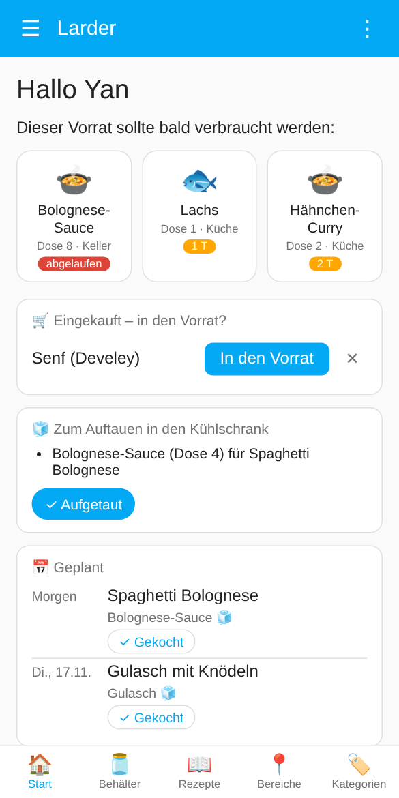
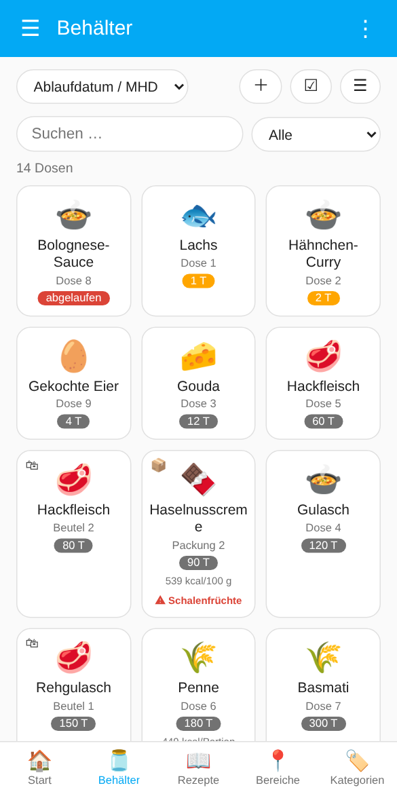
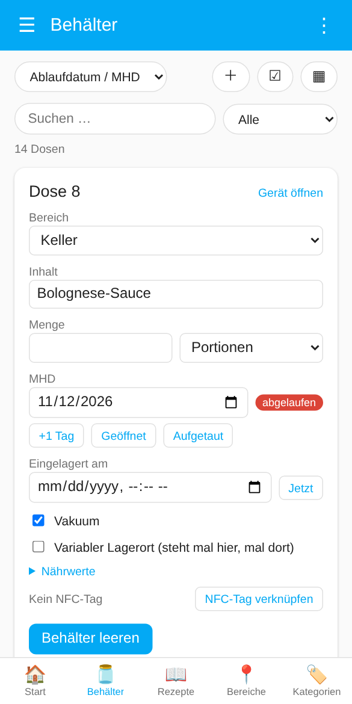
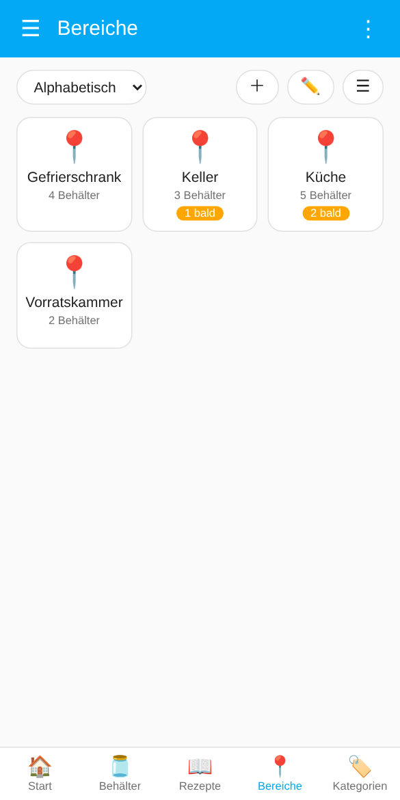
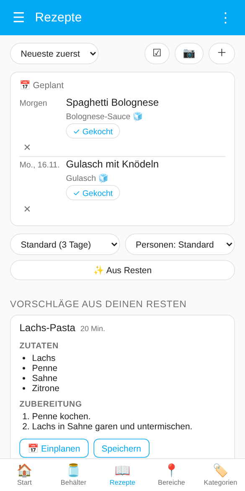
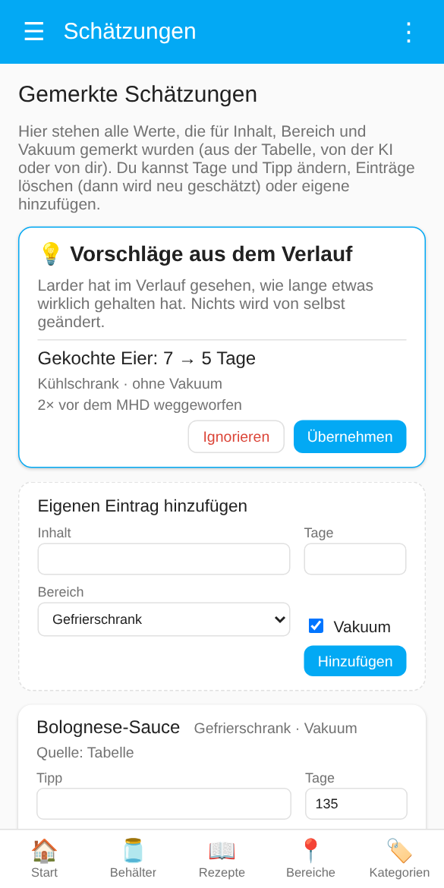
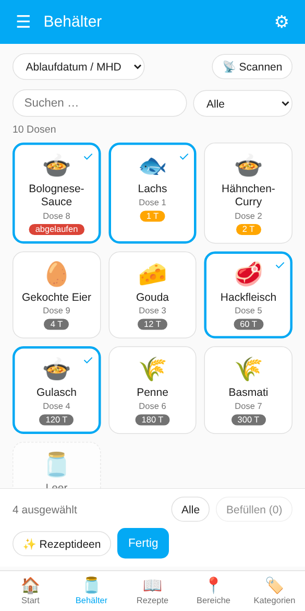

# Home Assistant Larder

**Food storage tracker** · früher *Zwilling Food Storage*


🇩🇪 Deutsch · [🇬🇧 English](README.md)

Home-Assistant-Integration für wiederverwendbare Vorratsdosen: Inhalt und Haltbarkeit festhalten, vor dem Ablauf erinnert werden und jede Dose per Scan wiederfinden.

## Highlights

- 🖥️ **[Eigenes Dashboard](#dashboard-larder)** in der Seitenleiste, gemacht fürs Handy: Startseite, Dosen als Kacheln, Liste oder Karten mit allen Details, Bereiche, Kategorien und Rezeptbuch; aktualisiert sich selbst
- 🔖 **[Zwilling-Fresh-&-Save-QR-Codes](#scannen-in-der-app)**: die originalen Codes auf den Deckeln funktionieren weiter, mit dem 📷-Scanner in der App (iOS und Android) oder einem [iOS-Kurzbefehl](#ios-kurzbefehl-für-die-originalen-zwilling-codes)
- 🏷️ **[Eigener QR-Code](#eigene-qr-codes)** und **[NFC-Tags](#nfc-tags)** für jede beliebige Dose: Scannen öffnet die Dose im Dashboard; QR-Codes lassen sich als [A4-Etikettenbogen](#etikettenbogen) drucken
- ✏️ **[Schnelles Befüllen](#dosen-befüllen)**: Inhalt, Menge, MHD und Vakuum in wenigen Taps, auch für mehrere Dosen auf einmal und per [Serien-Scan](#mehrere-dosen-auswählen)
- 🧮 **[MHD-Schätzung](#mhd-schätzung)**: eingebaute Haltbarkeitstabelle, optional mit KI, mit Grenzen pro Lagerort
- 🍳 **[Rezepte](#rezepte)**: Ideen aus dem, was bald abläuft, oder aus gewählten Dosen, ein Rezeptbuch und Rezepte vom Foto
- 🔔 **[Tägliche Zusammenfassung](#tägliche-zusammenfassung)**: Push mit Knöpfen an mehrere Handys und als Ansage auf Alexa oder anderen Lautsprechern, optional bei der ersten Bewegung in der Küche
- 🛒 **[Einkaufsliste](#einkaufsliste)**: auf Wunsch landet der Inhalt einer geleerten Dose auf einer To-do-Liste, Reste nie
- 📅 **[Kalendereinträge](#mhd-im-kalender)**: MHDs in deinem Kalender (Lokaler Kalender, Google, CalDAV …)
- 🌍 In Deutsch und Englisch verfügbar

<p align="center">



</p>

> **Neu in 2.0:** Das Dashboard, das bisher *Larder experimental* hieß, ist jetzt das normale **Larder**-Dashboard. Alles aus dem bisherigen Dashboard steckt darin (die Karten mit allen Feldern unter *Behälter → Karten*, die gemerkten Schätzungen unter ⚙). Siehe [Changelog](CHANGELOG.md).

## Inhalt

- [Warum dieses Projekt?](#warum-dieses-projekt)
- [Installation](#installation) · [Erste Schritte](#erste-schritte) · [Dose anlegen](#dose-anlegen) · [Bereiche und Labels](#bereiche-und-labels) · [Einstellungen](#einstellungen)
- [Dashboard „Larder“](#dashboard-larder) · [Mehrere Dosen auswählen](#mehrere-dosen-auswählen) · [Dosen befüllen](#dosen-befüllen) · [Larder experimental](#larder-experimental)
- [MHD-Schätzung](#mhd-schätzung) · [Rezepte](#rezepte) · [Tägliche Zusammenfassung](#tägliche-zusammenfassung) · [Einkaufsliste](#einkaufsliste) · [Kalender](#mhd-im-kalender) · [Export und Import](#export-und-import) · [Statistik](#statistik) · [Reparaturhinweise](#reparaturhinweise)
- [Scannen](#scannen): [in der App](#scannen-in-der-app), [eigene QR-Codes](#eigene-qr-codes), [NFC-Tags](#nfc-tags), [Zwilling-Codes (iOS-Kurzbefehl)](#ios-kurzbefehl-für-die-originalen-zwilling-codes)
- [Referenz](#referenz): [Entitäten](#entitäten), [Dienste und Ereignisse](#dienste-und-ereignisse), [Webhook](#webhook-schnittstelle)
- [Alternativen](#alternativen) · [Entwicklung](#entwicklung)

## Warum dieses Projekt?

Alles begann mit dem Kauf der Zwilling Fresh & Save Family Box. Dabei fiel mir der QR-Code auf den Deckeln auf, der jede Box mit dem Verwaltungssystem in der Zwilling-App verknüpft. Dann musste ich feststellen, dass die App und ihre Funktionen zum 31.12.2026 eingestellt werden.

Ein Ersatz musste her, und da ich Home Assistant ohnehin im Einsatz habe, lag es nahe, dort eine Integration zu bauen.

Dann kam eine zweite Idee: Auch gewöhnliche Boxen sollten einen QR-Code bekommen. Den muss man aber umständlich ausdrucken, und weil ich noch einige NFC-Aufkleber herumliegen hatte, war die Idee der NFC-Tag-Integration geboren.

## Installation

Seit Home Assistant 2026.11 ist der Community Store HACS als **Marketplace** fest eingebaut. Larder ist noch nicht im Standardkatalog, daher fügst du es als benutzerdefiniertes Repository hinzu:

1. **Einstellungen → Marketplace** → **Über Link hinzufügen**
2. URL: `https://github.com/yan14/ha-larder`, Kategorie **Integration**
3. „Larder“ herunterladen (für ein eigenes Repository braucht es eine GitHub-Verbindung; Home Assistant zeigt dafür einen Code, den du bei GitHub eingibst).
4. Einrichten unter **Einstellungen → Geräte & Dienste → Integration hinzufügen → Larder** (siehe unten).

<details>
<summary>Home Assistant vor 2026.11 (klassisches HACS)</summary>

1. HACS → Drei-Punkte-Menü → **Benutzerdefinierte Repositories**
2. URL: `https://github.com/yan14/ha-larder`, Kategorie **Integration**
3. „Larder“ installieren, Home Assistant neu starten.

</details>

> **Du kommst vom alten „Zwilling Food Storage“ (bis 0.10)?** Larder ist eine neue Integration (Domain `larder`). Entferne die alte Integration, füge Larder hinzu und lege deine Dosen neu an.

## Erste Schritte

1. **Erste Dose anlegen** unter Einstellungen → Geräte & Dienste → Integration hinzufügen → Larder (siehe [Dose anlegen](#dose-anlegen)). Danach steht das Dashboard **Larder** in der Seitenleiste, und weitere Dosen legst du dort schneller an (**＋** auf der Behälter-Seite).
2. **Jeder Dose einen Bereich geben**, der sagt, wo sie lagert, z. B. „Kühlschrank“, „Gefrierschrank“ oder „Vorrat“. Die Schätzung braucht ihn. Optional den Bereichen ein `Larder: …`-Label mit der [Vorlage](#vorlage-für-das-bereichs-label) geben.
3. **Dosen befüllen** im Dashboard: Inhalt, Menge, MHD (oder von Larder schätzen lassen).
4. **Die [Einstellungen](#einstellungen)** einmal durchgehen: Schätzmodus, Zeiträume, Kalender, Einkaufsliste.
5. **Das [Blueprint](#tägliche-zusammenfassung) importieren** für eine tägliche Zusammenfassung dessen, was bald abläuft (Push und/oder Ansage).
6. **Einen Code auf die Boxen bringen:** [eigenen QR-Code](#eigene-qr-codes) drucken, einen [NFC-Tag](#nfc-tags) aufkleben oder die originalen Zwilling-Codes behalten und mit [📷 in der App](#scannen-in-der-app) oder dem [iOS-Kurzbefehl](#ios-kurzbefehl-für-die-originalen-zwilling-codes) scannen.

## Dose anlegen

Es gibt vier Wege. Für die beiden NFC-Wege brauchst du die Home Assistant App auf einem Handy mit NFC:

| Weg | Wofür |
|---|---|
| **Neuen QR-Code erstellen** | Dosen ohne Code; Larder erzeugt eine ID und einen [QR-Code zum Ausdrucken](#eigene-qr-codes) |
| **Zwilling-QR-Code einlesen** | Originale Zwilling-Dosen |
| **Neuen NFC-Tag beschreiben** | Leerer NFC-Sticker; Larder legt Dose und Tag an und beschreibt ihn |
| **NFC-Tag scannen** | Schon beschriebener Tag; Larder legt die Dose an und verknüpft ihn |

### Im Dashboard (empfohlen)

**＋** auf der Behälter-Seite des Dashboards bietet alle vier Wege:

<p align="center"></p>

- **Neuen QR-Code erstellen** erzeugt eine neue eindeutige ID. Danach die Karte (oder das Gerät) öffnen und den QR-Code ausdrucken.
- **Zwilling-QR-Code einlesen** braucht den Inhalt des originalen Codes oder nur die ID. Kommst du von [📷 in der App](#scannen-in-der-app) oder vom iOS-Kurzbefehl, ist das Feld schon ausgefüllt.
- **Neuen NFC-Tag beschreiben** erscheint nur in der App auf einem Handy, das Tags beschreiben kann. Bei **NFC-Tag scannen** hältst du das Handy an den Tag. Details unter [NFC-Tags](#nfc-tags).
- Name und Bereich sind optional. Beides lässt sich später ändern (den Bereich direkt auf der Karte).

### Über die Integration

Die allererste Dose legst du so an, denn das Dashboard erscheint erst danach: Einstellungen → Geräte & Dienste → **Integration hinzufügen** → „Larder“. Hier gibt es nur die beiden QR-Wege; einen NFC-Tag verknüpfst du danach im Dashboard.

**Neuen QR Code erstellen**

Für Dosen ohne (lesbaren) Zwilling-Code. Die Integration erzeugt eine neue, eindeutige ID im Format `HA-XXXXXXXX` (8 Zeichen ohne die leicht verwechselbaren 0/O und 1/I). Das Präfix `HA-` hält sie klar von den Zwilling-IDs getrennt (z. B. `34OL`), eine Überschneidung ist damit ausgeschlossen. Du kannst optional einen Namen vergeben. Den QR-Code findest du danach als Bild am Gerät (siehe [Eigene QR-Codes](#eigene-qr-codes)).

**Zwilling QR Code einlesen**

Für vorhandene Zwilling-Dosen. Dort den Inhalt des QR-Codes einfügen, z. B.

```
zwilling://zwillingapp/food-storage/in/?tc=42ML30&s=m&cc=34OL
```

Es reicht auch nur die ID (`cc`, hier `34OL`). Optional kannst du einen Namen vergeben. Jede Dose lässt sich nur einmal anlegen.

Home Assistant bietet im Dialog keine Kamera zum Scannen. Einfacher: die erste Dose mit **Neuen QR Code erstellen** anlegen und die Zwilling-Codes danach mit [📷 in der App](#scannen-in-der-app) scannen. Unter iOS geht auch der [Kurzbefehl](#ios-kurzbefehl-für-die-originalen-zwilling-codes).

### Dose umbenennen

Einstellungen → Geräte & Dienste → **Larder** → Eintrag der Dose → ⋮ → **Neu konfigurieren**. Die ID bleibt, gedruckte QR-Codes und NFC-Tags gelten weiter.

## Bereiche und Labels

Jede Dose gehört zu einem **Bereich** von Home Assistant (dem Bereich ihres Geräts). Der Bereich sagt der Schätzung, wo das Essen lagert, und gruppiert das Dashboard. Ändern kannst du ihn direkt auf der Karte der Dose im Dashboard.

**Bereiche im Dashboard verwalten** (Administratoren): auf der Seite **Bereiche** legt **＋** einen neuen Bereich an, **✏️** schaltet ins Bearbeiten. Dann stehen dort alle Bereiche von Home Assistant; antippen, um einen umzubenennen oder seine **Lagerart** zu ändern, also sein Label `Larder: …` (andere Labels des Bereichs bleiben). **Neues Label …** legt gleich ein Label `Larder: <Name>` an; die Grenzen aus der Vorlage unten trägst du in Home Assistant in seine Beschreibung ein. **In Home Assistant öffnen** führt zur Seite des Bereichs (Bild, Etage, Löschen). Bereiche mit Larder-Label erscheinen auch, solange noch keine Dose darin steht.

**Welche Bereiche das Dashboard anbietet.** Bei vielen Bereichen wird die Auswahl lang. Gib den Bereichen, die du für Vorräte nutzt, eine **Beschriftung** (ein Label), deren Name `Larder` ist oder mit `Larder:` beginnt (Einstellungen → Bereiche, Beschriftungen & Zonen → Bereich öffnen → Beschriftungen). Das Dashboard bietet dann nur diese Bereiche an, im Auswahlfeld und im Hinzufügen-Dialog. Der aktuelle Bereich einer Dose bleibt immer in ihrer Liste. Hat kein Bereich ein solches Label, werden alle Bereiche gezeigt.

**Empfohlen:** ein Label pro Art von Lagerort, benannt `Larder: Freezer`, `Larder: Fridge`, `Larder: 0 °C`, `Larder: Pantry` …, mit der Vorlage unten in der Beschreibung. Ein Label pro Bereich reicht. In ein einfaches Label `Larder` gehören keine Grenzen: Das teilen sich alle Vorrats-Bereiche.

### Vorlage für das Bereichs-Label

Die Beschreibung eines `Larder: …`-Labels kann einer festen Vorlage folgen. Larder liest sie dann genau aus (die KI bekommt weiterhin den ganzen Text). Die Vorlage ist englisch, damit sie in jeder Sprache gleich aussieht:

```text
Storage: freezer
Temperature: -18 °C
Max storage: 18 months
Notes: meat and fish
```

Am übersichtlichsten ist eine Angabe pro Zeile; die Angaben dürfen aber auch hintereinander in einer Zeile stehen (`Storage: freezer Temperature: -18 °C Max storage: 18 months`) oder mit `;` getrennt sein. Groß-/Kleinschreibung ist egal, jede Angabe ist optional. Deutsche Schlüssel gehen auch: `Lagerort`, `Temperatur`, `Max. Lagerzeit`, `Hinweis`.

| Schlüssel | Werte | Wirkung |
|---|---|---|
| `Storage` | `fridge`, `0 °C compartment`, `freezer`, `freezer compartment`, `pantry`, `cellar` … (auch deutsch: Kühlschrank, Gefrierfach, Vorrat …) | Lagerort für die Tabelle, gewinnt gegen den Bereichsnamen (ein Temperatursensor am Bereich hat weiter Vorrang). |
| `Temperature` | z. B. `-18 °C`, `4 °C` | Ordnet den Bereich wie bisher über die Temperatur ein. |
| `Max storage` | Zahl mit `days`, `weeks`, `months` oder `years` (`Tage`, `Wochen`, `Monate`, `Jahre`); eine Zahl allein sind Tage | Obergrenze für Tabellen- und KI-Schätzungen in diesem Bereich. Gemerkte Schätzungen werden ebenfalls begrenzt, deine eigenen Korrekturen nicht. Der Tipp nennt die Begrenzung. Bei mehreren Labels gilt die kürzeste Grenze. |
| `Notes` | beliebiger Text | Nur ein Hinweis für die KI. |

Ein Temperatursensor, den du dem Bereich in seinen Einstellungen zuweist, wird ebenfalls genutzt (die Tabelle zuerst, die KI bekommt seinen Wert).

## Einstellungen

Einstellungen → Geräte & Dienste → **Larder** → **Konfigurieren** (bei einer beliebigen Dose; die Einstellungen gelten für alle Dosen):

| Einstellung | Standard | Wirkung |
|---|---|---|
| MHD-Schätzung | Nur Tabelle | Aus, nur Tabelle, Tabelle sonst KI, nur KI, siehe [MHD-Schätzung](#mhd-schätzung) |
| KI-Aufgabe | Standard von HA | Welche *AI-Task*-Entität genutzt wird, nur nötig bei mehreren |
| Haltbarkeit nach dem Öffnen | 3 Tage | Der Button **Geöffnet** kürzt das MHD auf so viele Tage |
| Haltbarkeit nach dem Auftauen | 2 Tage | Dasselbe für den Button **Aufgetaut** |
| Zeitraum für Rezeptideen | 3 Tage | Dosen, die in so vielen Tagen ablaufen, gehen in die [Rezeptideen](#rezeptideen) (0 = nur heute) |
| „Läuft bald ab“ ab | 3 Tage | Ab wann eine Dose als „läuft bald ab“ gilt: Hinweis und Filter in den Dashboards, `status` des Sensors, Vorgabe von `larder.get_expiring` |
| Vakuum-Vorbelegung | an | Vorbelegung des Schalters **Vakuum** bei neuen Dosen |
| NFC: Handy benachrichtigen | an | Benachrichtigung auf dem scannenden Handy nach einem [NFC-Scan](#nfc-tags) |
| Reparaturhinweise | an | Hinweise unter Einstellungen → System → Reparaturen, siehe [Reparaturhinweise](#reparaturhinweise) |
| Kalender | keiner | [MHD im Kalender](#mhd-im-kalender) |
| Einkaufsliste | keine | [Einkaufsliste](#einkaufsliste) für geleerte Dosen |
| Larder experimental | aus | Zweiter Eintrag in der Seitenleiste zum Ausprobieren neuer Funktionen, siehe [Larder experimental](#larder-experimental) |

Der Dialog zeigt außerdem die **Webhook-URL** für den [iOS-Kurzbefehl](#ios-kurzbefehl-für-die-originalen-zwilling-codes).

## Dashboard „Larder“

Sobald mindestens eine Dose angelegt ist, erscheint in der Seitenleiste der Eintrag **Larder**. Er braucht keine Konfiguration, passt sich an Theme und Sprache von Home Assistant an (Deutsch und Englisch) und aktualisiert sich selbst. *Die Screenshots zeigen Demo-Daten.*

Eine Leiste unten wechselt zwischen fünf Seiten:

- **Start**: eine Begrüßung mit deinem Home-Assistant-Namen, Kacheln für alles, was bald verbraucht werden sollte (Abgelaufenes zuerst), und Abkürzungen zu den Rezeptvorschlägen und den Behältern. In der Home Assistant App gibt es dort auch **📷 Dose scannen** (siehe [Scannen in der App](#scannen-in-der-app)).
- **Behälter**: alle Dosen mit einem Symbol für die Art des Essens, dem Inhalt, dem Namen der Dose und den Resttagen.
  - **Suche** in Name, Inhalt und Bereich; **Filter** nach *läuft bald ab*, *abgelaufen*, *befüllt* oder *leer*; **Sortierung** nach MHD, Bereich, Alphabet oder Kategorie (Bereich und Kategorie gruppiert). Über der Liste steht, wie viele Dosen angezeigt werden.
  - Der Knopf rechts wechselt zwischen **Kacheln**, **Liste** und **Karten mit allen Details**. Die Wahl merkt sich das Gerät.
  - Eine gefüllte Dose öffnet beim Antippen ihre Karte, eine leere lässt sich gleich befüllen (siehe [Dosen befüllen](#dosen-befüllen)).
  - **📷** scannt eine Dose (nur in der Home Assistant App, siehe [Scannen in der App](#scannen-in-der-app)), **＋** legt eine an (siehe [Im Dashboard](#im-dashboard-empfohlen)), **☑** startet die [Auswahl](#mehrere-dosen-auswählen).
- **Bereiche**: eine Kachel pro Bereich mit der Anzahl der Dosen und wie viele bald ablaufen; Antippen zeigt seine Dosen. Administratoren legen mit **＋** Bereiche an und benennen sie mit **✏️** um oder ändern ihre Lagerart (siehe [Bereiche und Labels](#bereiche-und-labels)).
- **Kategorien**: dasselbe für Arten von Lebensmitteln (Fisch, Fleisch, Milchprodukte, Gerichte und Reste, Trockenware, …). Die Kategorie stammt aus der eingebauten Haltbarkeitstabelle und ist das Attribut `category` der Entität **Inhalt**. Dosen ohne Treffer stehen unter „Sonstiges“, Dosen mit [mehreren Inhalten](#mehrere-inhalte-in-einer-dose) verschiedener Art unter „Gemischt“, leere unter „Leer“.
- **Rezepte**: dein [Rezeptbuch](#rezeptbuch) mit [Rezeptideen](#rezeptideen) und Rezepten, die die KI von einem Foto liest.

**Die Karte einer Dose** (in der Kartenansicht oder nach dem Antippen) zeigt alles und lässt es dich ändern:

- Bereich (Auswahlfeld; welche Bereiche angeboten werden, lässt sich mit einem Label eingrenzen, siehe [Bereiche und Labels](#bereiche-und-labels)), **Inhalt**, **Menge und Einheit** (**−1** entnimmt eine Portion, ein Stück oder eine Scheibe; bei der letzten fragt es, ob die Dose geleert werden soll), **MHD** (mit Hinweis „abgelaufen“ oder „noch n Tage“, sobald es bald abläuft), **Eingelagert am** („Jetzt“ setzt die aktuelle Zeit),
- **+1 Tag** verschiebt das MHD um einen Tag, **Geöffnet** kürzt es auf die in den Einstellungen gesetzte Zahl Tage (Standard 3), **Aufgetaut** macht dasselbe für Essen aus dem Gefrierfach (Standard 2 Tage, nicht wieder einfrieren). Beides verlängert nie ein Datum; ohne Datum wird eines gesetzt,
- **MHD schätzen** (wenn die [Schätzung](#mhd-schätzung) aktiv ist, ein Inhalt eingetragen und das MHD leer ist),
- **Vakuum**, **Beim Leeren auf die Einkaufsliste** (sobald eine [Einkaufsliste](#einkaufsliste) gewählt ist), **Variabler Lagerort** mit **Nach dem Leeren zurück in** (siehe [Dosen befüllen](#dosen-befüllen)), der **NFC-Tag** (verknüpfen oder lösen), **Gerät öffnen** und **Behälter leeren**. Vor dem Leeren fragt die Karte **😋 Gegessen** oder **🗑 Weggeworfen**; die Antwort kommt in den **Verlauf** der Dose (aufklappbare Liste unten auf der Karte, die letzten zehn Befüllungen).

**⚙** oben (Administratoren) öffnet ein Menü mit den [gemerkten Schätzungen](#gemerkte-schätzungen-verwalten) und den Einstellungen der Integration. Das ☰ ist die Seitenleiste von Home Assistant.

<p>



</p>

Das Dashboard ist für alle Nutzer sichtbar; nur **Administratoren** können Dosen hinzufügen, Bereiche ändern, die Auswahl nutzen und die Schätzungen sehen (dieselbe Einschränkung wie in den Einstellungen). Es ist kein klassisches Lovelace-Dashboard und lässt sich nicht mit dem Karten-Editor bearbeiten.

**Links ins Dashboard** (für Scans und Benachrichtigungen, auch für eigene Automationen): `/larder?open=<Geräte-ID>` öffnet eine Dose (eine leere mit dem Befüll-Dialog), `/larder?cc=<ID der Dose>` macht dasselbe über die ID der Dose und zählt als Scan, `/larder?add=<Code>` öffnet den Hinzufügen-Dialog mit dem Code, `/larder?view=recipes` (oder `start`, `containers`, `areas`, `categories`) öffnet eine Seite.

### Mehrere Dosen auswählen

**☑** auf der Behälter- oder der Rezeptseite schaltet in die Auswahl: Dosen antippen wählt sie aus, **Alle** wählt alles Angezeigte. Die Leiste unten bietet dann

- **Befüllen (n)** (Administratoren): befüllt alle gewählten *leeren* Dosen auf einmal mit demselben Inhalt, Vakuum, Befüllt am und MHD, z. B. nach dem Vorkochen oder dem Einkauf. Die Menge gilt pro Dose. Ist die Schätzung aktiv, bekommt jede Dose ihre eigene.
- **✨ Rezeptideen**: fragt die KI nach Rezepten mit genau den gewählten *befüllten* Dosen, egal wann sie ablaufen (abgelaufene bleiben trotzdem draußen).
- **🖨 Etiketten**: ein [A4-Etikettenbogen](#etikettenbogen) mit den QR-Codes der gewählten Dosen.
- **Fertig** beendet die Auswahl.

**Serien-Scan** (Administratoren): Während der Auswahl fügt **📡 Scannen** jede gescannte Dose hinzu. In der Home-Assistant-App erscheint oben ein Umschalter **📷 QR-Code | 📶 NFC**; antippen oder wischen wechselt jederzeit die Methode:

- **QR-Codes** in der Home-Assistant-App unter iOS und Android: Der Scanner der App öffnet sich und bleibt offen, du scannst einen Code nach dem anderen; jeder Treffer zeigt den Namen der Dose und wie viele ausgewählt sind. Eigene QR-Codes und die originalen Zwilling-Codes funktionieren beide; eine noch nicht angelegte Dose wird gemeldet. **Zu NFC wechseln** im Scanner (oder Schließen) wechselt zu NFC; der Serien-Scan läuft weiter.
- **NFC-Tags**, die mit einer Dose verknüpft sind: **NFC** wählen (das schließt den QR-Scanner; solange die Kamera läuft, liest das iPhone keine NFC-Tags). Dann das Handy an einen Tag halten; das iPhone zeigt oben das Banner „In Home Assistant öffnen“, das antippen. Die Dose wird ausgewählt, und du bleibst auf der Seite. Android liest den Tag direkt. Während ein Serien-Scan läuft, bekommt das Handy nach einem NFC-Scan keine Larder-Benachrichtigung.
- **⏹ Scan beenden** beendet den Serien-Scan.

Danach alle auf einmal befüllen oder Rezeptideen holen. So geht eine Inventur der Gefriertruhe oder das Einräumen nach dem Einkauf schnell.

<p align="center"></p>


## Dosen befüllen

<p align="center"></p>

Eine leere Dose zeigt den Button **Befüllen**. Er öffnet einen kleinen Dialog: **Inhalt** (mit Vorschlägen aus früheren Eingaben, neueste zuerst, danach deine gemerkten Schätzungen), **Menge und Einheit** (optional), **Vakuum**, **Befüllt am** (vorbelegt mit jetzt), optional ein **MHD** und **MHD automatisch schätzen** (nur wenn die Schätzung aktiv und das MHD leer ist). **Speichern** setzt alles und schätzt das MHD.

Der Dialog öffnet sich auch von selbst direkt nach dem Anlegen einer neuen Dose im Dashboard (auch nach dem Beschreiben eines NFC-Tags), sodass du sie gleich befüllen kannst. Ebenso nach einem Scan (📷 in der App, eigener QR-Code, NFC-Tag, Kurzbefehl), wenn die Dose leer ist; eine Dose mit Inhalt öffnet ihre Karte.

**Dosen, die umziehen:** Manche Dosen stehen immer am selben Ort, andere (z. B. Vakuumdosen) mal im Kühlschrank, mal im 0-Grad-Fach. Schalte bei solchen Dosen auf der Karte **Variabler Lagerort** ein. Dann fragt der Befüll-Dialog auch nach dem **Bereich** (Administratoren), damit die Schätzung den richtigen Ort nimmt, und **Behälter leeren** stellt die Dose zurück in den Bereich unter **Nach dem Leeren zurück in** (z. B. den Vorratsraum, in dem die leeren Dosen stehen). Dosen ohne den Schalter behalten ihren Bereich, und der Dialog fragt nicht.

**Mehrere Dosen auf einmal:** Die leeren Dosen auswählen (oder nacheinander scannen) und **Befüllen (n)** drücken: Derselbe Dialog befüllt alle, siehe [Mehrere Dosen auswählen](#mehrere-dosen-auswählen).

### Mehrere Inhalte in einer Dose

In einer Dose kann Verschiedenes liegen, z. B. unterschiedliche Wurst. Trenne die Inhalte mit Komma: `Salami, Kochschinken, Leberwurst` (Semikolon geht auch; `1,5 kg` bleibt ein Inhalt).

- Die **Schätzung** schlägt jeden Inhalt einzeln nach und nimmt das **kürzeste** MHD; der Tipp sagt, welcher Inhalt es bestimmt („Lachs“ bestimmt das MHD). Kennt die Tabelle einen der Inhalte nicht, zählt das als kein Treffer (im Modus *Tabelle, sonst KI* antwortet dann die KI für den Inhalt, der zuerst verdirbt).
- Die **Einkaufsliste** bekommt jeden Inhalt als eigenen Eintrag.
- Die **Kategorie** bleibt, wenn alle Inhalte von derselben Art sind (Wurst), sonst ist sie **Gemischt**.

Es gibt ein MHD pro Dose: Was darin liegt, wird zusammen verbraucht oder weggeworfen.

## Larder experimental

Ein optionaler zweiter Eintrag in der Seitenleiste, um neue Funktionen auszuprobieren, bevor sie ins normale Dashboard kommen. Einschalten unter Einstellungen → Geräte & Dienste → **Larder** → **Konfigurieren** → **„Larder experimental“ in der Seitenleiste anzeigen**. Zurzeit entspricht er dem Dashboard **Larder**; was dort ausprobiert wird, ändert am normalen Dashboard nichts.

*Bis Version 1.12 war hier das kachelbasierte Dashboard zu Hause, das jetzt das normale ist.*

## MHD-Schätzung

Die Integration kann dir ein Mindesthaltbarkeitsdatum vorschlagen. Es gibt zwei Quellen, und du entscheidest, welche genutzt wird (Einstellungen → Geräte & Dienste → **Larder** → **Konfigurieren**):

| Modus | Was passiert |
|---|---|
| **Aus** | Keine Schätzung, der Button ist ausgeblendet. |
| **Nur Tabelle** (Standard) | Eine eingebaute Haltbarkeits-Tabelle. Funktioniert offline, braucht keinen KI-Dienst und kostet nichts. |
| **Tabelle, sonst KI** | Zuerst die Tabelle. Hat sie zum Inhalt keinen Eintrag oder kann den Bereich nicht einordnen, wird die KI gefragt. |
| **Nur KI** | Immer die KI (braucht die Integration *AI Task*, siehe unten). |

Von dir korrigierte Werte haben immer Vorrang (siehe „Merken“).

### Die Tabelle

Über 50 Einträge für gängige Lebensmittel: Gerichte und Reste, Suppen, rohes Fleisch, Fisch, Wurst, Milchprodukte, Käse, Eier, Obst und Gemüse, Brot und Kuchen, Nudeln, Reis, Mehl, Nüsse, Kaffee, Tee, Gewürze und mehr. Zu jedem Eintrag kennt sie die Haltbarkeit im **Kühlschrank**, im **0-Grad-Fach**, im **Gefrierschrank** und im **Vorrat**. Gehört ein Lebensmittel nicht an einen Ort (z. B. Salat in den Gefrierschrank oder rohes Fleisch in den Vorrat), sagt sie das und denkt sich **kein** Datum aus.

So wird eine Dose zugeordnet:

- **Inhalt:** über Stichwörter auf Deutsch und Englisch, z. B. „Tomatensuppe“, „Penne“, „leftover chicken curry“. Der genaueste Treffer gewinnt („gekochte Eier“ schlägt „Eier“), die Reihenfolge der Wörter ist egal („Eier gekocht“ = „gekochte Eier“), und bei zusammengesetzten Wörtern zählt das Grundwort („Butterkekse“ sind Kekse, „Lachsfilet“ ist Fisch). Wird die Tabelle verbessert, werden gemerkte Tabellenwerte beim nächsten Gebrauch neu berechnet; deine eigenen Korrekturen bleiben. Bereits gesetzte MHDs an den Dosen ändern sich nicht: bei Bedarf neu schätzen (mit *Überschreiben*).
- **Lagerort:** aus dem Bereich. Zuerst ein Temperatursensor am Bereich, dann die Zeile `Storage` oder `Temperature` im [Bereichs-Label](#vorlage-für-das-bereichs-label), dann eine Temperatur im Label oder im Bereichsnamen (z. B. „ca. -18 °C“), dann Wörter wie *Kühlschrank*, *0-Grad-Fach*, *Gefrierschrank*, *Gefrierfach* (etwas weniger kalt, daher kürzer), *Vorrat*, *Keller*. Kann sie den Bereich nicht einordnen, sagt sie es, statt zu raten.
- **Vakuum** verlängert die Zeit (rund +30 % gekühlt, +50 % im Gefrierschrank und im Vorrat). Leicht verderbliche Speisen im Kühlschrank (Hack, Fisch, Wurst, Reste, Weichkäse, …) bekommen **keinen** Bonus, denn Vakuum macht sie nicht sicherer.

Die Werte sind bewusst vorsichtig gewählt und orientieren sich an gängigen Empfehlungen (etwa der USDA/FSIS-Kühllagertabelle und den Verbraucherzentralen). Es sind Faustwerte für zu Hause, **keine Garantie für Lebensmittelsicherheit**. Bei gekauften Produkten ist das aufgedruckte MHD verlässlicher. Schreibe „gekocht“ oder „geöffnet“ in den Inhalt, wenn es darauf ankommt. Ein Wert passt nicht oder ein Lebensmittel fehlt? Die Einträge stehen in `custom_components/larder/shelf_life.py`; Issues und Pull Requests sind willkommen.

### KI (optional)

Der KI-Modus nutzt die Funktion **AI Task** von Home Assistant und arbeitet deshalb mit dem KI-Dienst, den du dort eingerichtet hast (zum Beispiel Anthropic, OpenAI, Google oder ein lokales Ollama).

1. Richte in Home Assistant einen KI-Dienst mit einer *AI Task* ein (Einstellungen → Geräte & Dienste). Dafür braucht es eine Home-Assistant-Version, die die Integration AI Task enthält.
2. Wähle in den Einstellungen **Tabelle, sonst KI** oder **Nur KI**. Das Feld „KI-Aufgabe“ brauchst du nur, wenn du mehrere eingerichtet hast.

Die KI bekommt den Bereichsnamen und versteht deshalb „0-Grad-Fach“ oder „Gefrierschrank“ von selbst. Genauere Hinweise kannst du so mitgeben:

- **Temperatursensor am Bereich:** In den Bereichseinstellungen lässt sich ein Temperatursensor zuweisen. Hat er einen gültigen Wert, wird er mitgegeben (z. B. die echte Temperatur im Gefrierschrank). Auch die Tabelle nutzt ihn.
- **Label mit Beschreibung:** Weise dem Bereich ein Label zu und schreibe einen Hinweis in seine Beschreibung, z. B. „ca. -18 °C, Fleisch und Fisch“, oder nutze die [Vorlage](#vorlage-für-das-bereichs-label). Name und Beschreibung werden mitgegeben.

Gesendet werden nur der Inhaltstext, der Bereichsname mit seinen Hinweisen, Vakuum Ja/Nein und das Befüll-Datum, und zwar an den KI-Dienst, den du gewählt hast. Je nach Anbieter kann das einen kleinen Betrag kosten. Im Modus „Nur Tabelle“ wird nichts gesendet.

### Benutzen

Stelle **Vakuum** pro Dose ein und weise jede Dose einem **Bereich** zu, der den Lagerort beschreibt, z. B. „Kühlschrank“, „0-Grad-Fach“, „Gefrierschrank“ oder „Vorratskammer“. Ohne Bereich wird die Schätzung mit einem Hinweis abgelehnt.

Im Dashboard erscheint der Button **MHD schätzen**, sobald ein Inhalt eingetragen und das MHD leer ist. Er zeigt an, woher der Wert stammt: *Tabelle*, *KI* oder *Tabelle, von dir korrigiert* bzw. *KI, von dir korrigiert*, wenn du das Datum danach geändert hast. Den Service kannst du auch in Automationen, Skripten oder den Entwicklerwerkzeugen aufrufen:

```yaml
action: larder.estimate_best_before
target:
  entity_id: date.dose_34ol_best_before
data:
  apply: true       # false: nur den Vorschlag zurückgeben
  overwrite: false  # true: auch schätzen, wenn schon ein Datum gesetzt ist
response_variable: result
```

Das Ergebnis enthält `best_before`, `days`, `tip` (ein kurzer Lagertipp), `source` (`table`, `ai` oder `learned`), `basis` (bei der Tabelle: erkanntes Lebensmittel und Ort), `cached` und `applied`. Gezählt wird ab **Befüllt am** (oder ab heute, wenn das leer ist). **Ein bereits gesetztes MHD wird nie überschrieben**, außer du setzt `overwrite`.

**Merken.** Jedes Ergebnis wird für die Kombination *Inhalt + Bereich + Vakuum* gespeichert und nicht erneut berechnet oder abgefragt. Änderst du ein vorgeschlagenes Datum danach selbst, merkt sich die Integration deinen Wert für dieselbe Kombination, und er gewinnt gegen Tabelle und KI. Die Daten liegen in `.storage/larder.estimator` von Home Assistant.

**Grenzen für KI-Werte.** Eine reine KI-Schätzung wird je Lagerort begrenzt (Kühlschrank 60 Tage, 0-°C-Fach 90 Tage, Gefrierschrank 18 Monate, Vorrat 3 Jahre, unbekannter Ort 1 Jahr); der Tipp nennt die Begrenzung. KI-Schätzungen, die du nie korrigiert hast, werden nach 12 Monaten neu abgefragt (ist die KI nicht erreichbar, gilt der alte Wert weiter). Tabellenwerte und deine eigenen Korrekturen werden durch diese Vorgaben nie begrenzt oder erneuert. Eine eigene Grenze pro Bereich setzt du im [Bereichs-Label](#vorlage-für-das-bereichs-label) (`Max storage: 3 years`); sie gilt für Tabellen- und KI-Werte.

### Gemerkte Schätzungen verwalten

Administratoren öffnen die Liste im Dashboard über **⚙ → Gemerkte Schätzungen**. Sie listet alles, was für eine Kombination aus Inhalt, Bereich und Vakuum gemerkt ist, samt Quelle (Tabelle, KI oder von dir korrigiert mit ursprünglicher Quelle). Dort kannst du

- **Tage und Tipp** eines Eintrags ändern (er gilt dann als von dir korrigiert),
- einen Eintrag **löschen**; die nächste Schätzung für diese Kombination wird dann neu berechnet (Tabelle oder KI),
- einen **eigenen Eintrag** für eine Kombination aus Inhalt, Bereich und Vakuum hinzufügen.

Die eingebaute Tabelle selbst wird hier nicht bearbeitet. Eigene und geänderte Einträge haben nur für genau diese Kombination Vorrang vor ihr.

**Update von 0.5:** War „Per KI schätzen“ an, wird daraus **Nur KI** (wie bisher); war es aus, wird es **Nur Tabelle**.

## Rezepte

Alle Rezeptfunktionen nutzen die Home-Assistant-Integration **AI Task** (dieselbe wie für die [KI-Schätzung](#ki-optional)); der Schätzmodus spielt keine Rolle. Je nach Anbieter kann jede Anfrage einen kleinen Betrag kosten, und ohne Knopfdruck oder Automation wird nichts gesendet.

### Rezeptideen

Die KI schlägt Gerichte vor, die aufbrauchen, was bald abläuft.

**Im Dashboard** (Administratoren): auf der Seite **Rezepte** auf **✨ Aus Resten** tippen. Darüber wählst du den Zeitraum (die Vorgabe kommt aus **Konfigurieren** → *Zeitraum für Rezeptideen*, ab Werk 3 Tage; eine feste Zahl von Tagen; oder **Alle Dosen**, dann zählen auch Dosen ohne MHD) und optional die Zahl der Personen. Du bekommst bis zu drei Rezepte mit den verwendeten Dosen, zusätzlichen Zutaten (nur gängige Vorräte), Dauer und kurzen Schritten und kannst gelungene ins [Rezeptbuch](#rezeptbuch) **speichern**. Abgelaufene Dosen und Dosen ohne Inhalt werden nie verwendet.

**In Automationen:** Der Service `larder.suggest_recipes` liefert dasselbe.

```yaml
action: larder.suggest_recipes
data:
  days: 3        # Dosen, die innerhalb von 3 Tagen ablaufen (weglassen = Zeitraum aus den Einstellungen)
  # all_containers: true   # kein Zeitraum: alle befüllten Dosen
  # containers: [device_id, …]   # genau diese Dosen
  servings: 2    # optional, Standard 2 Personen
  max_recipes: 3 # 1 bis 5
response_variable: ideas
# ideas.recipes (title, minutes, uses, extra_ingredients, steps), ideas.summary (Text),
# ideas.ingredients (die verwendeten Dosen), ideas.count
```

**In der täglichen Benachrichtigung:** Das [Blueprint](#tägliche-zusammenfassung) hat den Schalter **Add recipe ideas** („Rezeptideen anhängen“). Die Rezepte werden an die Nachricht angehängt; fällt die KI aus, kommt die normale Nachricht trotzdem. Importiere das Blueprint neu, um den Schalter zu bekommen.

An den gewählten KI-Dienst gehen nur Inhalt, Menge mit Einheit, Resttage und Lagerort (Bereichsname), nie Dosennamen, IDs oder anderes. Die Vorschläge sind Ideen eines Sprachmodells, keine getesteten Rezepte: Prüfe, ob das Essen noch bedenkenlos genießbar ist, besonders bei Aufgetautem oder Älterem.

**Aus gewählten Dosen:** Dosen auswählen und **✨ Rezeptideen** drücken, siehe [Mehrere Dosen auswählen](#mehrere-dosen-auswählen). In Automationen dient dazu `containers` mit den Geräte-IDs.

### Rezeptbuch

Die Seite **Rezepte** ist dein eigenes Rezeptbuch (liegt in Home Assistant unter `.storage/larder.recipes`). Alle dürfen es lesen, Administratoren legen Rezepte an (**＋**), ändern und löschen sie. Sortierung nach neueste oder Name; Antippen zeigt Zutaten und Schritte.

**Rezept aus Foto oder Datei** (📷, Administratoren): Fotografiere ein Rezept aus einem Kochbuch oder von einer Karte, wähle bis zu vier Fotos (z. B. zwei Seiten) oder ein PDF. Die KI liest das Rezept, übersetzt es bei Bedarf in deine Sprache und öffnet es zum **Prüfen**; gespeichert wird erst, wenn du auf *Speichern* tippst. Dafür muss die gewählte KI-Aufgabe Anhänge unterstützen (z. B. Anthropic, OpenAI, Google). Fotos werden vor dem Hochladen verkleinert, liegen nur während des Lesens kurz im Medienordner von Home Assistant (`media/larder/recipe_photos`) und werden danach gelöscht. Gesendet wird nur das Foto bzw. die Datei, an den KI-Dienst, den du gewählt hast.

## Tägliche Zusammenfassung

Das mitgelieferte Blueprint schickt eine **tägliche Zusammenfassung** dessen, was bald abläuft. Läuft nichts ab, kommt nichts. Abgelaufene Dosen werden mit ihrem Dosennamen und dem Hinweis **sollte geleert werden** genannt, damit du weißt, welche du ausräumen musst.

[](https://my.home-assistant.io/redirect/blueprint_import/?blueprint_url=https%3A%2F%2Fgithub.com%2Fyan14%2Fha-larder%2Fblob%2Fmain%2Fblueprints%2Fautomation%2Flarder%2Fexpiry_notification.yaml)

| Option | Wirkung |
|---|---|
| **Push notification** | Eine oder mehrere notify-Aktionen, durch Komma getrennt (`notify.mobile_app_dein_iphone, notify.mobile_app_partner`), oder eine notify-Gruppe. Leer lassen für nur Sprache. |
| **Buttons in the push** | **Rezepte** öffnet die Rezeptseite des Dashboards (oder von [Larder experimental](#larder-experimental), wenn du das wählst), **Dashboard** öffnet Larder. Antippen der Benachrichtigung selbst öffnet ebenfalls das Dashboard. |
| **Voice output** | notify-Aktionen, die die Zusammenfassung vorlesen, z. B. `notify.alexa_media_kueche` (Alexa Media Player) oder eine Gruppe von Lautsprechern. Der Sprechtext ist zum Zuhören gemacht: „Heute läuft Lachs ab. Morgen läuft Gouda ab. Pizza in Dose 3 ist abgelaufen und sollte geleert werden.“ (höchstens sechs Dosen, der Rest wird gezählt). Mit Rezeptideen kommt „Idee: …“ dazu. |
| **Voice options** | Zusatzdaten für die Sprachausgabe. Alexa Media Player braucht den Typ, z. B. `type: announce` (mit Gong) oder `type: tts`. |
| **Speak only when someone is home** | Personen, Gruppen oder Zonen; ist niemand zu Hause, entfällt die Sprachausgabe. Der Push kommt immer. |
| **Time** und **Motion sensors** | Ohne Bewegungsmelder kommt die Zusammenfassung zur Uhrzeit. Mit Bewegungsmeldern (z. B. Küche) kommt sie bei der **ersten Bewegung nach dieser Uhrzeit**, einmal am Tag, und spätestens zur **Latest time**, falls niemand vorbeikam. |
| **Days ahead**, **Include expired**, **Add recipe ideas** | Wie bisher. Rezeptideen brauchen die Integration *AI Task*; fällt die KI aus, kommt die Nachricht trotzdem. |

Bestehende Automationen laufen weiter; importiere das Blueprint neu, um die neuen Optionen zu bekommen. Die Namen der Optionen sind englisch, die Nachrichten kommen in der Sprache von Home Assistant.

**Ohne Blueprint:** Der Service `larder.get_expiring` liefert dieselben Daten für eigene Automationen:

```yaml
action: larder.get_expiring
data:
  days: 3               # Dosen, die innerhalb von 3 Tagen ablaufen (Standard: „Läuft bald ab“ aus den Einstellungen)
  include_expired: true
response_variable: result
# result.count, result.expired, result.summary (Text mit Aufzählung für den Push),
# result.speech (Sätze zum Vorlesen), result.labels (Texte der Knöpfe),
# result.items (name, content, quantity, unit, area, best_before, days_left, status)
```

Auch `larder.suggest_recipes` liefert `speech` („Idee: …“). Für eigene Dashboards gibt es außerdem den Sensor **Tage bis MHD** an jeder Dose.

## Einkaufsliste

Unter Einstellungen → Geräte & Dienste → **Larder** → **Konfigurieren** kannst du eine **To-do-Liste** von Home Assistant wählen, z. B. die eingebaute *Einkaufsliste*, Todoist oder Bring!. Jede Dose hat dann ein Häkchen **Beim Leeren auf die Einkaufsliste** (der Schalter `Einkaufsliste`, standardmäßig aus). Drückst du bei einer Dose mit gesetztem Häkchen **Behälter leeren**, wird ihr Inhalt auf die Liste gesetzt, z. B. „Basmati“.

- Nicht alles gehört auf die Liste: Reste wie „Pizza-Reste“ lässt du einfach ohne Häkchen, sie werden nie eingetragen. Die Einstellung gehört zur Dose und bleibt beim Leeren erhalten. So wird Reis immer nachgekauft und Pizza nie.
- Steht ein Eintrag schon offen auf der Liste, wird er nicht doppelt angelegt. Bereits abgehakte Einträge zählen nicht, du kannst dasselbe also erneut einkaufen.
- Ohne gewählte Liste passiert nichts, und das Häkchen ist ausgeblendet. Ist die Liste nicht erreichbar, wird die Dose trotzdem geleert.
- Geplant: mehrere Ziel-Listen (z. B. Metzger und Supermarkt) und auch abgelaufene Dosen einzutragen.

## MHD im Kalender

Unter Einstellungen → Geräte & Dienste → **Larder** → **Konfigurieren** kannst du einen vorhandenen **Kalender** wählen (Google, CalDAV, *Lokaler Kalender* …). Jede Dose bekommt dann einen Ganztags-Termin „MHD: Pizza“ am Tag des MHD. Der Termin wird angelegt, sobald ein Datum gesetzt ist, verschoben, wenn sich Datum oder Inhalt ändern, und gelöscht, wenn das Datum gelöscht, die Dose geleert oder entfernt oder ein anderer Kalender gewählt wird. Eigene Termine werden an einer Kennung in der Beschreibung erkannt, andere Termine werden nie angefasst.

**Aufräumen.** Bei jedem Start und beim Speichern der Einstellungen prüft Larder den ganzen Kalender, behält pro Dose genau einen Termin und entfernt Doppelte. Der Dienst `larder.rebuild_calendar` macht das auf Knopfdruck und entfernt zusätzlich Termine von Dosen, die es nicht mehr gibt. Mit `include_unmarked: true` werden außerdem Termine „MHD: …“ / „Best before: …“ ohne Larder-Kennung entfernt (für Kalender, die die Beschreibung verwerfen) und neu angelegt.

Der Kalender muss Termine anlegen **und** löschen können. Reine Lese-Kalender (z. B. ein iCal-Link) gehen nicht und werden beim Speichern der Einstellungen abgelehnt; die Integration *Lokaler Kalender* ist eine gute Wahl, wenn du keinen anderen hast. **CalDAV** (iCloud, Nextcloud …) funktioniert: Der CalDAV-Kalender von Home Assistant kann von sich aus nur Termine anlegen, deshalb liest und löscht Larder seine eigenen Termine direkt über die CalDAV-Verbindung.

## Export und Import

Im Dashboard **☰ → 📦 Export und Import** (Administratoren):

- **📄 Bestand als Tabelle (CSV)**: alle Dosen mit Name, ID, Bereich, Inhalt, Menge, Einheit, Eingelagert am, MHD, Tage übrig, Status und Vakuum. Auf Deutsch mit Semikolon, damit Excel sie direkt öffnet.
- **🕘 Verlauf (CSV)**: jede geleerte Befüllung mit Dose, Inhalt, Menge, Eingelagert am, MHD, Geleert am, Tage gelagert, ob sie abgelaufen war und ob sie gegessen oder weggeworfen wurde. Ohne die Frage geleerte Dosen (Automation, Geräteseite) haben kein Ergebnis.
- **💾 Gemerkte Schätzungen (Sicherung)**: alle [gemerkten MHD-Werte](#gemerkte-schätzungen-verwalten) als JSON-Datei.
- **Schätzungen einlesen**: liest so eine Datei wieder ein, z. B. nach einer Neuinstallation oder auf einem zweiten Home Assistant. Eigene Korrekturen bleiben, wenn die Datei für dieselbe Kombination nur einen Tabellen- oder KI-Wert hat; mit **Vorhandene Schätzungen vorher löschen** ersetzt die Datei alles. Ungültige Einträge werden übersprungen und gezählt.

Die Downloads öffnen sich über einen Link, der fünf Minuten gilt, auch in der Home Assistant App.

Für Fehlerberichte sammelt **Diagnose herunterladen** (⋮ am Eintrag einer Dose unter Einstellungen → Geräte & Dienste → Larder) die Einstellungen, die Dose und ihre Entitäten. Die geheime Webhook-ID und die gemerkten Schätzungen selbst sind nicht enthalten.

## Statistik

**☰ → 📊 Statistik** im Dashboard zeigt für die letzten 30 oder 90 Tage, ein Jahr oder alles:

- **Jetzt im Vorrat**: gefüllt, leer, läuft bald ab, abgelaufen (und gefüllt ohne MHD).
- **Geleert**: wie viel gegessen und weggeworfen wurde, den Anteil weggeworfen und die durchschnittliche Lagerdauer, bis etwas gegessen wurde.
- **Am häufigsten weggeworfen**, **am häufigsten gegessen** (bei [mehreren Inhalten](#mehrere-inhalte-in-einer-dose) zählt jeder einzeln) und **weggeworfen nach Bereich**.
- **Letzte Monate** als Balken: gegessen (grün) und weggeworfen (rot).

Die Zahlen kommen aus dem [Verlauf](#export-und-import), sie wachsen also, wenn du Dosen mit **Gegessen** oder **Weggeworfen** leerst. Ohne Angabe geleerte Dosen zählen als weggeworfen, wenn sie abgelaufen waren.

Für eigene Dashboards und Automationen liefert der Service `larder.get_statistics` dieselben Daten (`days` optional). Zum Beispiel als Template-Sensor:

```yaml
template:
  - triggers:
      - trigger: time_pattern
        hours: "/1"
    actions:
      - action: larder.get_statistics
        data:
          days: 30
        response_variable: stats
    sensor:
      - name: Larder weggeworfen (30 Tage)
        state: "{{ stats.waste_percent if stats.waste_percent is not none else 0 }}"
        unit_of_measurement: "%"
        attributes:
          gefuellt: "{{ stats.containers.filled }}"
          abgelaufen: "{{ stats.containers.expired }}"
```

## Reparaturhinweise

Larder zeigt unter **Einstellungen → System → Reparaturen** Hinweise, wenn Dosen Aufmerksamkeit brauchen. Es gibt einen Hinweis pro Art (mit bis zu zehn Dosen), nicht einen pro Dose:

| Hinweis | Wann |
|---|---|
| **Dosen ohne Bereich** | Eine Dose hat keinen Bereich, die Schätzung weiß also nicht, wo das Essen lagert. |
| **Gefüllte Dosen ohne MHD** | Eine Dose hat einen Inhalt, aber kein MHD. Sie taucht dann weder in der täglichen Zusammenfassung noch im Kalender auf. |
| **Dosen seit über 7 Tagen abgelaufen** | Zeit, sie zu leeren. |

Ein Hinweis verschwindet von selbst, sobald keine Dose mehr betroffen ist (geprüft bei jeder Änderung und einmal täglich). In den [Einstellungen](#einstellungen) lassen sich die Hinweise abschalten („Reparaturhinweise“).

## Scannen

Es gibt vier Wege, von einer Dose zu ihrem Eintrag im Dashboard zu kommen. Sie lassen sich beliebig mischen. Für eine Inventur wählt der [Serien-Scan](#mehrere-dosen-auswählen) viele Dosen nacheinander aus.

### Scannen in der App

In der Home Assistant App (**iOS und Android**) hat das Dashboard einen **📷**-Knopf: auf der Startseite (**📷 Dose scannen**) und neben **＋** auf den Seiten Behälter, Bereiche und Kategorien. Er öffnet den QR-Scanner der App und liest **beide Arten von Codes**, eigene und die originalen Zwilling-Codes:

- **Bekannte Dose:** ihre Karte öffnet sich, eine leere Dose gleich mit dem Befüllen-Dialog. Das Ereignis `larder_dose_scanned` wird wie bei jedem Scan ausgelöst.
- **Noch nicht angelegter Zwilling-Code** (Administratoren): der Dialog **Dose hinzufügen** öffnet sich, der Code ist schon eingetragen.
- **Alles andere:** der Scanner meldet „Kein Larder-Code“ und bleibt für den nächsten Versuch offen.

Der Knopf erscheint nur in der App auf einem Gerät mit Kamera, nicht im Browser am PC. Außerhalb der App nimmst du für eigene Codes die Kamera-App und für Zwilling-Codes den [iOS-Kurzbefehl](#ios-kurzbefehl-für-die-originalen-zwilling-codes).

### Eigene QR-Codes

Jede Dose hat die Bild-Entität **QR-Code**. Drucke sie aus und klebe sie auf die Dose (Gerät der Dose oder Entität **QR-Code** öffnen, Bild speichern oder drucken; der Inhalt steht auch im Attribut `qr_content`).

Scannen mit der Kamera-App funktioniert **wie ein NFC-Tag**: Die Home-Assistant-App öffnet das Dashboard **Larder** bei dieser Dose, eine leere gleich mit dem Befüll-Dialog, und für deine Automationen wird das Ereignis `larder_dose_scanned` ausgelöst (mit `source: qr`). Der Code enthält die ID der Dose (`homeassistant://navigate/larder?cc=<ID>`), nicht die Geräte-ID, und bleibt deshalb gültig, wenn du die Dose löschst und neu anlegst. Hast du mehrere Home-Assistant-Server in der App, fragt sie, welcher gemeint ist.

Dieselben Codes funktionieren im [Serien-Scan](#mehrere-dosen-auswählen) des Dashboards.

> Vor Version 2.0 gedruckte Codes öffnen weiterhin die Geräteseite der Dose. Druck sie neu aus, um das neue Verhalten zu bekommen.

#### Etikettenbogen

Viele Codes auf einmal drucken: im Dashboard **☰ → 🖨 QR-Etiketten drucken** (alle Dosen) oder Dosen auswählen und **🖨 Etiketten**. Dann wählst du

- den **Etikettenbogen**: A4 mit 3 × 8 (70 × 36 mm), 3 × 7 (70 × 42,3 mm) oder 2 × 4 (105 × 74 mm) Etiketten, wie es sie von Avery Zweckform, Herma und anderen gibt,
- **Schon benutzte Etiketten überspringen**, um auf einem angebrochenen Bogen weiterzumachen,
- **Inhalt und MHD mitdrucken**, für Etiketten, die nicht dauerhaft auf der Dose bleiben (sonst steht nur der Name drauf, so bleibt das Etikett gültig, wenn sich der Inhalt ändert),
- **Schnittlinien**, für normales Papier.

**PDF erstellen** erzeugt einen Link, dann **PDF öffnen** antippen. In der Home Assistant App öffnet es sich im Browser, von dort druckst oder teilst du es. Mit **100 %** drucken (nicht „an Seite anpassen“), damit die Codes auf die Etiketten treffen. Der Link gilt fünf Minuten.

### NFC-Tags

<p align="center"></p>

Statt einen QR-Code zu drucken, kannst du einen NFC-Tag auf die Dose kleben. Dafür werden die **Tags** von Home Assistant genutzt: Jeder Scan löst ein `tag_scanned`-Ereignis aus, und die Integration merkt sich, welcher Tag zu welcher Dose gehört. Andere Tags im Haus werden ignoriert.

**Der schnellste Weg (in der Home-Assistant-App):** Dashboard öffnen, **＋** auf der Behälter-Seite **→ Neuen NFC-Tag beschreiben** wählen, einen Namen eingeben und **Hinzufügen** drücken. Larder legt die Dose an, erstellt einen neuen Tag in Home Assistant und verknüpft beides. Danach öffnet die App das Beschreiben: Handy an einen leeren NFC-Tag halten, fertig. Die Option erscheint nur in der Companion-App auf einem Handy, das NFC-Tags beschreiben kann (nicht im Browser am Rechner).

Hast du schon einen mit der Home-Assistant-App beschriebenen Tag (Einstellungen → Companion-App → NFC, oder Einstellungen → Tags), verknüpfst du ihn stattdessen:

1. **Mit einer Dose verknüpfen** im Dashboard (Administratoren): Auf der Karte **NFC-Tag verknüpfen** drücken und das Handy an den Tag halten. Oder **＋ → NFC-Tag scannen**: Das legt eine neue Dose an und verknüpft den Tag gleich mit.
2. **Später scannen.** Ist das Dashboard offen, öffnet es die Dose (eine leere mit dem Befüll-Dialog). Sonst bekommt das scannende Handy (Companion-App) eine Benachrichtigung, deren Antippen das Dashboard bei dieser Dose öffnet. Das iPhone zeigt nach dem Lesen eines Tags ein eigenes Banner, das zuerst angetippt wird.

Für eigene Automationen löst ein verknüpfter Scan das Ereignis `larder_dose_scanned` aus (`cc`, `device_id`, `name`, `scanned_by`). Die Benachrichtigung lässt sich in den Einstellungen abschalten („NFC: Handy benachrichtigen“). Eine Dose hat höchstens einen Tag, und ein Tag gehört zu genau einer Dose.

### iOS-Kurzbefehl für die originalen Zwilling-Codes

Dieser Weg ist für die **aufgedruckten Zwilling-QR-Codes** gedacht, wenn du sie scannen willst, **ohne vorher die Home Assistant App zu öffnen** (z. B. vom Home-Bildschirm oder über die Aktionstaste). In der App macht [📷](#scannen-in-der-app) dasselbe ohne Einrichtung. Für selbst erstellte Codes brauchst du ihn nicht, dort scannst du einfach mit der Kamera-App.

Unter **Android** gibt es dafür keine eingebaute Entsprechung; nimm dort [📷 in der App](#scannen-in-der-app).

Der QR-Code enthält einen Link mit dem Schema `zwilling://`, der zur eingestellten Zwilling-App gehört. Die **Kamera-App ist dafür ungeeignet**: Sie will den Link in der Zwilling-App öffnen und liefert den Text nicht zum Kopieren. Der Kurzbefehl liest dagegen nur den Text aus und öffnet den Link nicht.

#### 1. Webhook-URL herausfinden

Einstellungen → Geräte & Dienste → **Larder** → bei einer Dose **Konfigurieren**. Der Dialog zeigt die Webhook-URL, die nach dem Muster `https://<deine-HA-URL>/api/webhook/<lange-geheime-ID>` aufgebaut ist. Die URL gilt für alle Dosen, du brauchst sie nur einmal. Das Konfigurieren-Fenster kannst du danach mit „Senden“ schließen, es ändert nichts.

Die lange ID ist der Zugriffsschutz, behandle die URL also wie ein Passwort. Welche Adresse vorne steht (intern oder extern), richtet sich nach deiner Home-Assistant-Konfiguration. Unterwegs funktioniert der Kurzbefehl nur mit einer von außen erreichbaren Adresse.

#### 2. Kurzbefehl anlegen (einmalig)

App **Kurzbefehle** → neuer Kurzbefehl mit diesen Aktionen, in dieser Reihenfolge:

1. **„QR-/Barcode scannen“** (*Scan QR/Bar Code*)
2. **„Inhalt von URL abrufen“** (*Get Contents of URL*):
   - URL: deine Webhook-URL aus Schritt 1
   - „Mehr anzeigen“ antippen, Methode **POST**, Anfragetext **JSON**
   - „Neues Feld hinzufügen“: Typ **Text**, Schlüssel `code`, Wert: das Ergebnis aus Aktion 1 (die Variable „QR-/Barcode“ aus der Variablenleiste wählen)
3. **„Wörterbuchwert abrufen“** (*Get Dictionary Value*, in der Suche nach „Wörterbuch“ suchen): Schlüssel `app_url`, aus „Inhalt von URL“. Nicht zu verwechseln mit „Gespeicherten Inhalt abrufen“, das ist eine andere Aktion.
4. **„URLs öffnen“** (*Open URLs*): öffnet den Wert aus Aktion 3

<p align="center"></p>

Der Screenshot zeigt den fertigen Kurzbefehl. Ersetze `ha.example.org` und `DEINE-WEBHOOK-ID` durch deine eigene Adresse und die ID aus Schritt 1.

Namen vergeben, z. B. „Dose scannen“. Über das Teilen-Symbol lässt er sich zum Home-Bildschirm hinzufügen oder auf die Aktionstaste legen. Beim ersten Lauf fragt iOS nach dem Kamerazugriff und ob der Kurzbefehl die URL aufrufen darf.

#### 3. Benutzen

Kurzbefehl starten, QR-Code auf der Dose scannen. Die Home-Assistant-App öffnet sich dann:

- **Dose bekannt:** im Dashboard „Larder“ mit der Karte der Dose. Eine leere Dose öffnet gleich den Dialog **Befüllen** (siehe [Dosen befüllen](#dosen-befüllen)).
- **Dose neu:** im Dashboard „Larder“. Dort öffnet sich der Dialog **Dose hinzufügen** mit bereits eingetragenem Code. Optional Name und Bereich eingeben und **Hinzufügen** tippen. Das geht nur mit einem Administrator-Konto, andere Nutzer sehen einen Hinweis mit dem gescannten Code.

Hast du mehrere Home-Assistant-Server in der App, fragt sie beim Öffnen, welcher gemeint ist.

## Referenz

### Entitäten

Pro Dose entsteht ein Gerät (eindeutig über die ID, den Parameter `cc` eines Zwilling-QR-Codes) mit:

| Entität | Typ | Zweck |
| --- | --- | --- |
| **Befüllt am** | `datetime` | Wann wurde die Dose befüllt? |
| **MHD** | `date` | Mindesthaltbarkeitsdatum |
| **Inhalt** | `text` | Was ist in der Dose? |
| **Behälter leeren** | `button` | Setzt die Dose komplett zurück: **Inhalt** wird leer, **MHD** und **Befüllt am** werden gelöscht. **Vakuum** bleibt bewusst erhalten, es ist eine Eigenschaft der Dose und nicht des Inhalts |
| **Menge** | `number` | Wie viel in der Dose ist, z. B. 4 (0 = nicht angegeben). Wird von **Behälter leeren** zurückgesetzt |
| **Einheit** | `select` | Einheit der Menge: Portionen (Standard), Stück, Scheiben, Gramm oder Milliliter. Wird von **Behälter leeren** auf Portionen zurückgesetzt. Beides steht im Dashboard, im Befüll-Dialog, im Ergebnis von `get_expiring` und fließt in die Rezeptideen ein. Tipp: *Portionen* für fertige Gerichte (Chili, Suppe), *Stück* oder *Scheiben* für Zählbares (Eier, Schinken) |
| **Vakuum** | `switch` | Ist die Dose vakuumiert? Bei neuen Dosen standardmäßig an; die Vorbelegung änderst du unter **Konfigurieren**, wenn die meisten deiner Boxen nicht vakuumiert sind. Wird für die Schätzung verwendet |
| **Einkaufsliste** | `switch` | Soll der Inhalt beim Leeren der Dose auf deine Einkaufsliste? Standardmäßig aus, pro Dose einstellbar und bleibt bei **Behälter leeren** erhalten. Wirkt erst, wenn unter **Konfigurieren** eine Liste gewählt ist, siehe [Einkaufsliste](#einkaufsliste) |
| **Variabler Lagerort** | `switch` | Für Dosen, die mal hier, mal dort stehen (heute Kühlschrank, morgen 0-Grad-Fach). Standardmäßig aus. Ist er an, fragt der Befüll-Dialog nach dem Bereich, und **Behälter leeren** stellt die Dose zurück in den **Lagerort nach dem Leeren**. Bleibt bei **Behälter leeren** erhalten |
| **Lagerort nach dem Leeren** | `select` | Bereich, in den eine variable Dose beim Leeren zurückkommt (oder *bleibt, wo sie ist*). Wirkt nur, wenn **Variabler Lagerort** an ist. Die Bereichs-ID steht im Attribut `area_id`, Umbenennen des Bereichs schadet also nicht |
| **Tage bis MHD** | `sensor` | Verbleibende Tage bis zum MHD (negativ = abgelaufen). Das Attribut `status` ist `ok`, `soon` (3 Tage oder weniger, siehe [Einstellungen](#einstellungen)), `expired` oder `none` |
| **QR-Code** | `image` | QR-Code der Dose als Bild: Scannen mit der Kamera-App öffnet die Dose im Larder-Dashboard, siehe [Eigene QR-Codes](#eigene-qr-codes) |

Die Werte bleiben über Neustarts erhalten. „Behälter leeren“ ist eine normale Button-Entität, lässt sich also auf Dashboards und in Automationen über `button.press` verwenden.

**Einzelnes Feld leeren:** Die Datums-Entitäten von Home Assistant lassen sich im Entitäts-Dialog selbst nicht leeren (der Button „Löschen“ im Datumsfeld bewirkt dort nichts). Nutze stattdessen eines davon: das Feld im Dashboard leeren, **Behälter leeren** für alles zusammen, oder die Services `larder.clear_best_before` bzw. `larder.clear_filled_at` (z. B. in den Entwicklerwerkzeugen oder in einer Automation).

### Dienste und Ereignisse

| Dienst | Wirkung |
|---|---|
| `larder.estimate_best_before` | MHD einer Dose schätzen, siehe [Benutzen](#benutzen) |
| `larder.clear_best_before` / `larder.clear_filled_at` | Ein einzelnes Datum leeren |
| `larder.mark_opened` / `larder.mark_thawed` | MHD nach dem Öffnen oder Auftauen kürzen (`days` optional) |
| `larder.get_expiring` | Liste, was bald abläuft, mit fertigem Text, siehe [Tägliche Zusammenfassung](#tägliche-zusammenfassung) |
| `larder.suggest_recipes` | [Rezeptideen](#rezeptideen) aus dem, was bald abläuft, aus allen oder aus gewählten Dosen |
| `larder.get_statistics` | Gegessen / weggeworfen, häufigste Inhalte, Lagerdauer und aktueller Bestand, siehe [Statistik](#statistik) |
| `larder.rebuild_calendar` | [Kalender](#mhd-im-kalender) aufräumen |

Das Ereignis `larder_dose_scanned` (`cc`, `device_id`, `name`, `scanned_by`) wird ausgelöst, wenn ein verknüpfter [NFC-Tag](#nfc-tags) oder einer [deiner QR-Codes](#eigene-qr-codes) gescannt wird (dann mit `source: qr`).

### Webhook-Schnittstelle

Der Webhook ist ein normaler Home-Assistant-Webhook und akzeptiert `POST` (und `GET`).

Anfrage, eine der folgenden Formen:

```
POST /api/webhook/<ID>   {"code": "zwilling://zwillingapp/food-storage/in/?tc=42ML30&s=m&cc=34OL"}
POST /api/webhook/<ID>   {"cc": "34OL"}
POST /api/webhook/<ID>   zwilling://zwillingapp/food-storage/in/?tc=42ML30&s=m&cc=34OL   (Klartext)
GET  /api/webhook/<ID>?code=34OL
```

Antwort (`200`, JSON):

```json
{
  "known": true,
  "cc": "34OL",
  "name": "Dose 34OL",
  "device_id": "0a1b2c…",
  "path": "/larder?open=0a1b2c…",
  "app_url": "homeassistant://navigate/larder?open=0a1b2c…",
  "device_path": "/config/devices/device/0a1b2c…",
  "device_app_url": "homeassistant://navigate/config/devices/device/0a1b2c…"
}
```

Bei bekannter Dose öffnen `path` und `app_url` das Dashboard bei dieser Dose (eine leere Dose bekommt gleich den Befüll-Dialog); `device_path` und `device_app_url` zeigen stattdessen auf die Geräteseite. Bei unbekannter Dose ist `known` gleich `false`, `path` und `app_url` zeigen auf das Dashboard mit dem Hinzufügen-Dialog (`/larder?add=<ID>`). Enthält die Anfrage keine gültige ID, antwortet der Webhook mit `400` und `{"error": "invalid_code"}`. Der Webhook liest nur und ändert keine Werte.

## Alternativen

Diese Integration verwaltet den **physischen, wiederverwendbaren Behälter** (ein Gerät pro Dose mit eigenem QR-Code). Wenn du lieber **Produkte und Bestände** verwalten möchtest, passen vielleicht diese Projekte besser:

- [Fridge Assistant](https://github.com/MaxGramser/fridge_assistant): Inventar für Kühlschrank, Gefrierschrank und Vorrat mit Barcode-Scan, KI-Haltbarkeitsschätzung und gedruckten Etiketten.
- [Grocy](https://github.com/custom-components/grocy): die Home-Assistant-Integration für den selbst gehosteten Grocy-Server (Bestand, MHD, Einkaufslisten, Aufgaben).

## Entwicklung

Releases entstehen automatisch: Ist `version` in `manifest.json` auf `main` neu, legt ein GitHub-Workflow den Tag `v<Version>` und einen Release an. Dessen Text ist der Abschnitt `## <Version>` aus [CHANGELOG.md](CHANGELOG.md) (zusammen mit dem Versions-Bump schreiben, ein Test prüft, dass er existiert), gefolgt vom automatisch erzeugten Vergleichslink.

```
pip install -r requirements_test.txt
pytest

npm install
npm test        # Tests für das Panel (jsdom)
```

Die Screenshots stammen aus dem echten Code mit Demo-Daten: Repository per `python -m http.server` bereitstellen und `docs/demo/dashboard.html?lang=de&view=containers` öffnen (Optionen in der Datei), für die Dialoge `docs/demo/index.html?lang=de&dialog=scan`.
