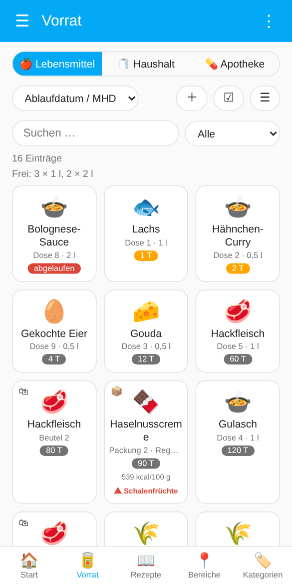
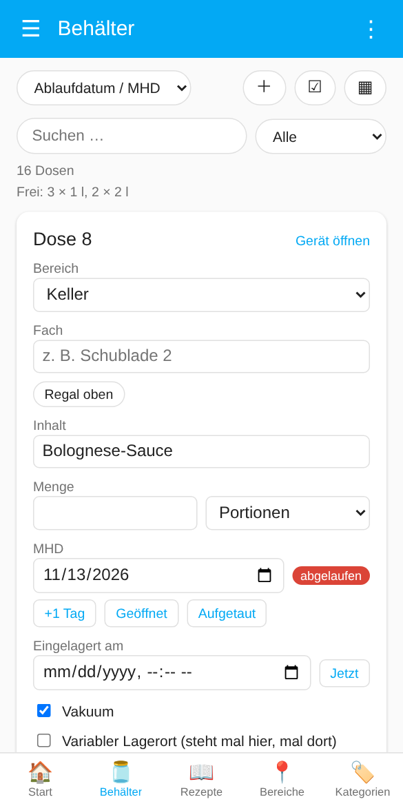

# Home Assistant Larder

**Food storage tracker** · früher *Zwilling Food Storage*


🇩🇪 Deutsch · [🇬🇧 English](README.md)

Home-Assistant-Integration für wiederverwendbare Vorratsdosen: Inhalt und Haltbarkeit festhalten, vor dem Ablauf erinnert werden und jede Dose per Scan wiederfinden.

## Highlights

- 🖥️ **[Eigenes Dashboard](docs/de/dashboard.md#dashboard-larder)** in der Seitenleiste, gemacht fürs Handy: Startseite, Vorrat als Kacheln, Liste oder Karten mit allen Details, Bereiche, Kategorien und Rezeptbuch; aktualisiert sich selbst
- 🔖 **[Zwilling-Fresh-&-Save-QR-Codes](docs/de/scanning.md#scannen-in-der-app)**: die originalen Codes auf den Deckeln funktionieren weiter, mit dem 📷-Scanner in der App (iOS und Android) oder einem [iOS-Kurzbefehl](docs/de/scanning.md#ios-kurzbefehl-für-die-originalen-zwilling-codes)
- 🏷️ **[Eigener QR-Code](docs/de/scanning.md#eigene-qr-codes)** und **[NFC-Tags](docs/de/scanning.md#nfc-tags)** für jede beliebige Dose und für [Fächer](docs/de/scanning.md#fächer), um etwas zu entnehmen oder die Inventur zu starten; QR-Codes lassen sich als [Etikettenbogen](docs/de/scanning.md#etikettenbogen) in mehreren Designs und Farben drucken
- 🛍 **[Beutel und Packungen](docs/de/containers.md#beutel-und-packungen)**: Einweg-Vakuumbeutel mit NFC-Sticker oder QR-Code, die nach dem Leeren verschwinden, und Vorrat ohne Dose (Konserven, Gläser) per Strichcode, Kassenbon-Foto oder von Hand
- 🥫 **[Vorrat](docs/de/containers.md#bestand)**: Packungen über alle Orte zusammengezählt, ältestes zuerst, Mindestbestand, der die Einkaufsliste füllt, *reicht noch …* und *bald leer*, Preise (eigene, vom Kassenbon oder [Open Prices](https://prices.openfoodfacts.org)), angebrochene Packungen, [Inventur](docs/de/containers.md#inventur) je Fach und [Rückrufwarnungen](docs/de/containers.md#rückrufwarnungen) von lebensmittelwarnung.de
- 🧻 **[Haushaltsartikel](docs/de/containers.md#haushaltsartikel)**: Klopapier, Waschmittel, Batterien und Ähnliches ohne Haltbarkeitsdatum, gezählt in Stück und eingekauft in Packungen, mit eigenen Bereichen und einem Umschalter *Lebensmittel | Haushalt*
- ✏️ **[Schnelles Befüllen](docs/de/containers.md#dosen-befüllen)**: Inhalt, Menge, MHD und Vakuum in wenigen Taps, auch für mehrere Dosen auf einmal, per [Serien-Scan](docs/de/dashboard.md#mehrere-dosen-auswählen) oder als [Vorkochen](docs/de/containers.md#vorkochen) mit freien Dosen nach [Größe](docs/de/containers.md#behältergrößen)
- 🧮 **[MHD-Schätzung](docs/de/best-before.md#mhd-schätzung)**: eingebaute Haltbarkeitstabelle, optional mit KI, mit Grenzen pro Lagerort
- 🍳 **[Rezepte](docs/de/kitchen.md#rezepte)**: Ideen aus dem, was bald abläuft, oder aus gewählten Dosen, ein Rezeptbuch und Rezepte vom Foto
- 🔔 **[Tägliche Zusammenfassung](docs/de/kitchen.md#tägliche-zusammenfassung)**: Push mit Knöpfen an mehrere Handys und als Ansage auf Alexa oder anderen Lautsprechern, optional bei der ersten Bewegung in der Küche
- 🛒 **[Einkaufsliste](docs/de/kitchen.md#einkaufsliste)**: auf Wunsch landet der Inhalt einer geleerten Dose auf einer To-do-Liste, Reste nie
- 🗓 **[Wochenplan](docs/de/kitchen.md#wochenplan)** mit Auftau-Erinnerung und [Wochenvorschlag](docs/de/kitchen.md#wochenvorschlag) aus dem, was zuerst abläuft, **[Nährwerte und Allergene](docs/de/containers.md#nährwerte)** aus dem Strichcode, **[Statistik](docs/de/dashboard.md#statistik)** über Gegessenes und Weggeworfenes mit [Monatsbericht](docs/de/kitchen.md#monatsbericht) und eine MHD-Schätzung, die [aus dem Verlauf lernt](docs/de/best-before.md#gemerkte-schätzungen-verwalten)
- 📅 **[Kalendereinträge](docs/de/kitchen.md#mhd-im-kalender)**: MHDs in deinem Kalender (Lokaler Kalender, Google …)
- 🌍 In Deutsch und Englisch verfügbar

<p align="center">



</p>

> **Neu in 4.10:** ein [Einkaufsmodus](docs/de/kitchen.md#einkaufsmodus) – die Liste nach Abteilungen, Abhaken legt es in den Vorrat – und [wiederkehrende Einkäufe](docs/de/kitchen.md#wiederkehrende-einkäufe).
>
> **Neu in 4.9:** [Gutschein vom Foto](docs/de/containers.md#gutscheine) lesen (KI).
>
> **Neu in 4.8:** [Gutscheine](docs/de/containers.md#gutscheine) mit Wert, Ablaufdatum und Ort, Erinnerung vor dem Verfall und Code nur für Administratoren.
>
> **Neu in 4.7:** [Einrichtung mit einem Klick](docs/de/containers.md#dose-anlegen) und *Los geht's*, die Einkaufsliste [nach Abteilungen sortiert](docs/de/kitchen.md#abteilungen-im-laden) und ein [Notvorrat-Check](docs/de/kitchen.md#notvorrat) nach der Empfehlung des BBK.
>
> **Neu in 4.6:** Haushaltsartikel lassen sich [regelmäßig wechseln](docs/de/containers.md#haushaltsartikel) (Wasserfilter, Staubsaugerbeutel), mit Erinnerung; die untere Leiste heißt *Vorrat*, die Bestands-Ansicht *Bestand*.
>
> **Neu in 4.5:** eine [Erinnerung für Medikamente](docs/de/kitchen.md#ablaufende-medikamente) (und Haushaltsartikel mit Datum) an gewählten Wochentagen, als Push und auf Alexa.
>
> **Neu in 4.4:** [Medikamente](docs/de/containers.md#medikamente-apotheke) als dritter Bereich *Apotheke* mit längerer Vorwarnung, optionales Datum und *haltbar nach dem Öffnen* für Haushaltsartikel.
>
> **Neu in 4.3:** [Einräumen nach dem Einkauf](docs/de/containers.md#bestand): ein Produkt nach dem anderen scannen, jedes kommt an seinen gewohnten Ort.
>
> **Neu in 4.2:** der [Strichcode-Dialog](docs/de/containers.md#bestand) zeigt, wo ein Produkt liegt, und bietet direkt *verbraucht*, *entsorgen*, *anbrechen*, *umbuchen* und *neue Packung hinzufügen*.
>
> **Neu in 4.1:** [mehrere Einkaufslisten](docs/de/kitchen.md#einkaufsliste) (Lebensmittel, Haushalt, je Produkt), [Haushalts-Statistik](docs/de/dashboard.md#statistik) mit Ausgaben je Monat, [Rückrufwarnungen](docs/de/containers.md#rückrufwarnungen) für Kosmetik und Bedarfsgegenstände.
>
> **Neu in 4.0:** [Haushaltsartikel](docs/de/containers.md#haushaltsartikel), Bereiche für Lebensmittel oder Haushalt, die Seite *Behälter* heißt jetzt **Vorrat**, Strichcodes aus Open Beauty / Products / Pet Food Facts. **Breaking Change:** Ordne nach dem Update deine Bereiche Lebensmitteln oder Haushalt zu, siehe [Lebensmittel oder Haushalt](docs/de/containers.md#lebensmittel-haushalt-oder-apotheke).
>
> **Neu in 3.x:** Einweg-**Beutel** und **Packungen** (3.0), die Bestands-Ansicht mit Mindestbestand (3.2), Inventur und angebrochene Packungen (3.4), Verbrauch und Preise (3.5), *bald leer* und Rückrufwarnungen (3.6), Fach-Tags und neue Etiketten-Optionen (3.7), Vorkochen, Behältergrößen und Wochenvorschlag (3.8). Siehe [Changelog](CHANGELOG.md).

## Dokumentation

Die Details stehen auf eigenen Seiten:

| Seite | Was drinsteht |
|---|---|
| [Dosen, Beutel, Packungen und Haushaltsartikel](docs/de/containers.md) | Dosen anlegen, Einweg-Beutel und Packungen, Haushaltsartikel, Bereiche und Labels, Befüllen, Nährwerte und Allergene |
| [Dashboard, Statistik und Daten](docs/de/dashboard.md) | Das Larder-Dashboard, mehrere Dosen auswählen, die Lovelace-Karte, Statistik, Export und Import |
| [MHD-Schätzung](docs/de/best-before.md) | Wie das MHD geschätzt wird: Tabelle, KI, gemerkte Werte |
| [Rezepte, Zusammenfassung, Wochenplan und Einkauf](docs/de/kitchen.md) | Rezeptideen und Rezeptbuch, tägliche Zusammenfassung (Blueprint), Wochenplan mit Auftau-Erinnerung, Einkaufsliste, Kalender |
| [Scannen](docs/de/scanning.md) | Scannen in der App, eigene QR-Codes und Etikettenbogen, NFC-Tags, iOS-Kurzbefehl für Zwilling-Codes |
| [Einstellungen, Reparaturhinweise und Referenz](docs/de/reference.md) | Alle Einstellungen, Reparaturhinweise, Entitäten, Dienste, Ereignisse und der Webhook |
| [Changelog](CHANGELOG.md) | Neuerungen jeder Version (englisch) |

## Warum dieses Projekt?

Alles begann mit dem Kauf der Zwilling Fresh & Save Family Box. Dabei fiel mir der QR-Code auf den Deckeln auf, der jede Box mit dem Verwaltungssystem in der Zwilling-App verknüpft. Dann musste ich feststellen, dass die App und ihre Funktionen zum 31.12.2026 eingestellt werden.

Ein Ersatz musste her, und da ich Home Assistant ohnehin im Einsatz habe, lag es nahe, dort eine Integration zu bauen.

Dann kam eine zweite Idee: Auch gewöhnliche Boxen sollten einen QR-Code bekommen. Den muss man aber umständlich ausdrucken, und weil ich noch einige NFC-Aufkleber herumliegen hatte, war die Idee der NFC-Tag-Integration geboren.

## Installation

Larder ist im Standardkatalog von HACS, das seit Home Assistant 2026.11 als **Marketplace** fest eingebaut ist.

[](https://my.home-assistant.io/redirect/hacs_repository/?owner=yan14&repository=ha-larder&category=integration)

1. **Einstellungen → Marketplace**, nach **Larder** suchen und herunterladen (oder den Knopf oben nutzen).
2. Home Assistant neu starten, falls es danach fragt.
3. Einrichten unter **Einstellungen → Geräte & Dienste → Integration hinzufügen → Larder** (siehe unten).

<details>
<summary>Home Assistant vor 2026.11 (klassisches HACS)</summary>

1. **HACS** öffnen, nach **Larder** suchen und herunterladen.
2. Home Assistant neu starten.

</details>

<details>
<summary>Notlösung: als benutzerdefiniertes Repository hinzufügen</summary>

Nur nötig, wenn Larder in der Suche noch nicht auftaucht (etwa kurz nach der Aufnahme in den Katalog).

1. **Einstellungen → Marketplace** → **Über Link hinzufügen** (klassisches HACS: Drei-Punkte-Menü → **Benutzerdefinierte Repositories**)
2. URL: `https://github.com/yan14/ha-larder`, Kategorie **Integration**
3. „Larder“ herunterladen (für ein eigenes Repository braucht es eine GitHub-Verbindung; Home Assistant zeigt dafür einen Code, den du bei GitHub eingibst).

</details>

> **Du kommst vom alten „Zwilling Food Storage“ (bis 0.10)?** Larder ist eine neue Integration (Domain `larder`). Entferne die alte Integration, füge Larder hinzu und lege deine Dosen neu an.

## Erste Schritte

1. **Integration hinzufügen** unter Einstellungen → Geräte & Dienste → Integration hinzufügen → Larder. Ein Klick, keine Fragen: Das Dashboard **Larder** steht sofort in der Seitenleiste, und seine Startseite zeigt **🚀 Los geht's** – Bereiche zuordnen, Einkaufsliste wählen, mit **＋** das Erste hinzufügen.
2. **Jeder Dose einen Bereich geben**, der sagt, wo sie lagert, z. B. „Kühlschrank“, „Gefrierschrank“ oder „Vorrat“. Die Schätzung braucht ihn. Optional den Bereichen ein `Larder: …`-Label mit der [Vorlage](docs/de/containers.md#vorlage-für-das-bereichs-label) geben.
3. **Dosen befüllen** im Dashboard: Inhalt, Menge, MHD (oder von Larder schätzen lassen).
4. **Die [Einstellungen](docs/de/reference.md#einstellungen)** einmal durchgehen: Schätzmodus, Zeiträume, Kalender, Einkaufsliste.
5. **Das [Blueprint](docs/de/kitchen.md#tägliche-zusammenfassung) importieren** für eine tägliche Zusammenfassung dessen, was bald abläuft (Push und/oder Ansage).
6. **Einen Code auf die Boxen bringen:** [eigenen QR-Code](docs/de/scanning.md#eigene-qr-codes) drucken, einen [NFC-Tag](docs/de/scanning.md#nfc-tags) aufkleben oder die originalen Zwilling-Codes behalten und mit [📷 in der App](docs/de/scanning.md#scannen-in-der-app) oder dem [iOS-Kurzbefehl](docs/de/scanning.md#ios-kurzbefehl-für-die-originalen-zwilling-codes) scannen.

## Alternativen

Diese Integration verwaltet den **physischen, wiederverwendbaren Behälter** (ein Gerät pro Dose mit eigenem QR-Code). Wenn du lieber **Produkte und Bestände** verwalten möchtest, passen vielleicht diese Projekte besser:

- [Fridge Assistant](https://github.com/MaxGramser/fridge_assistant): Inventar für Kühlschrank, Gefrierschrank und Vorrat mit Barcode-Scan, KI-Haltbarkeitsschätzung und gedruckten Etiketten.
- [Grocy](https://github.com/custom-components/grocy): die Home-Assistant-Integration für den selbst gehosteten Grocy-Server (Bestand, MHD, Einkaufslisten, Aufgaben).

## Entwicklung

Releases entstehen automatisch: Ist `version` in `manifest.json` auf `main` neu, legt ein GitHub-Workflow den Tag `v<Version>` und einen Release an. Dessen Text ist der Abschnitt `## <Version>` aus [CHANGELOG.md](CHANGELOG.md) (zusammen mit dem Versions-Bump schreiben, ein Test prüft, dass er existiert), gefolgt vom automatisch erzeugten Vergleichslink.

```
pip install -r requirements_test.txt
pytest
ruff check .    # Linter, läuft auch in der CI

npm install
npm test        # Tests für das Frontend (jsdom)
```

Das Frontend liegt in `custom_components/larder/frontend/`: `larder-dashboard.js` (Seiten und Navigation) mit Texten und Stylesheet, `larder-dashboard-items.js` (Beutel, Packungen, Vorrat), `larder-dashboard-care.js` (Inventur, Fächer, angebrochene Packungen), `larder-dashboard-cook.js` (Größen, Vorkochen, Wochenvorschlag), `larder-panel.js` (Karten und die Dialoge zum Anlegen und Befüllen) und `larder-card.js` (Lovelace-Karte).

Die Screenshots stammen aus dem echten Code mit Demo-Daten: Repository per `python -m http.server` bereitstellen und `docs/demo/dashboard.html?lang=de&view=containers` öffnen (Optionen in der Datei), für die Dialoge `docs/demo/index.html?lang=de&dialog=scan`.
