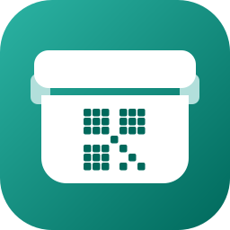
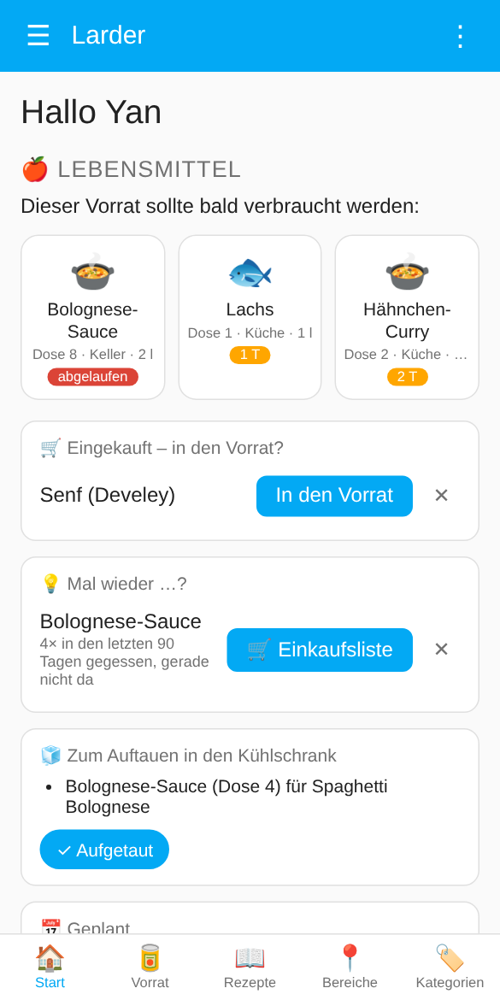

# Home Assistant Larder

**Food storage tracker** · früher *Zwilling Food Storage*



🇩🇪 Deutsch · [🇬🇧 English](README.md)

Home-Assistant-Integration für wiederverwendbare Vorratsdosen: Inhalt und Haltbarkeit festhalten, vor dem Ablauf erinnert werden und jede Dose per Scan wiederfinden.

## Highlights

- 🖥️ **[Eigenes Dashboard](docs/de/dashboard.md#dashboard-larder)** in der Seitenleiste, gemacht fürs Handy: **Start · Vorrat · Einkaufen · Rezepte · Mehr**, mit **🔍 Suche** und **📷 einem Scan-Knopf** auf jeder Seite und Schnellaktionen auf der Startseite; Kacheln, Liste oder Karten mit allen Details; aktualisiert sich selbst
- 🔖 **[Zwilling-Fresh-&-Save-QR-Codes](docs/de/scanning.md#scannen-in-der-app)** funktionieren weiter, **[eigene QR-Codes](docs/de/scanning.md#eigene-qr-codes)** als [Etikettenbogen](docs/de/scanning.md#etikettenbogen) und **[NFC-Tags](docs/de/scanning.md#nfc-tags)** – von der App in einem Schritt beschrieben; einen neuen Tag einfach scannen, Larder fragt, wofür er ist
- 📍 **[Fächer](docs/de/scanning.md#fächer)** (eine Schublade, eine Box, ein Regal) mit eigenem Tag oder Etikett: ein Scan zeigt, was dort liegt, mit −1 und Inventur; **Mehr → 🏷 Fächer & Tags** behält den Überblick
- 🛍 **[Beutel und Packungen](docs/de/containers.md#beutel-und-packungen)**: Einweg-Vakuumbeutel, die nach dem Leeren verschwinden, und Vorrat ohne Dose (Konserven, Gläser) per Strichcode, Kassenbon-Foto oder von Hand; ohne Strichcode einfach den Namen, Fleisch vom Metzger als Beutel mit NFC-Tag
- 📥 **[Einräumen](docs/de/gut-zu-wissen.md#einlagern-überall-dieselben-regeln)** überall gleich – Scannen, Einkaufsmodus, 🧾 Kassenbon oder Rechnung (auch PDF), von Hand oder *Eingekauft – in den Vorrat?*: bekannte Produkte kommen an ihren üblichen Ort, Preis und MHD (📷 vom Foto) gleich dazu, die Einkaufsliste wird abgehakt
- 🥫 **[Vorrat](docs/de/containers.md#bestand)**: Packungen über alle Orte zusammengezählt, ältestes zuerst, Mindestbestand, *reicht noch …*, *bald leer* und **🔁 nach Verbrauch nachkaufen**, Preise mit Verlauf und [Grundpreis (€/kg)](docs/de/containers.md#gruppen-inhalt-und-grundpreis), Gruppen wie *Milch* ohne Zusammenlegen, angebrochene Packungen, [Inventur](docs/de/containers.md#inventur) je Fach, [Rückrufwarnungen](docs/de/containers.md#rückrufwarnungen) und ein **[Verlauf pro Produkt](docs/de/dashboard.md#produktverlauf)**
- 🧻 **[Haushaltsartikel](docs/de/containers.md#haushaltsartikel)**, 💊 **[Medikamente](docs/de/containers.md#medikamente-apotheke)** und 🎟️ **[Gutscheine](docs/de/containers.md#gutscheine)**: in Stück und Packungen gezählt, mit eigenen Bereichen, längeren Vorwarnungen, Wechselintervallen und Erinnerungen
- ✏️ **[Schnelles Befüllen](docs/de/containers.md#dosen-befüllen)**: Inhalt, Menge, MHD und Vakuum in wenigen Taps, auch für mehrere Dosen auf einmal oder als [Vorkochen](docs/de/containers.md#vorkochen)
- 🧮 **[MHD-Schätzung](docs/de/best-before.md#mhd-schätzung)**: eingebaute Haltbarkeitstabelle, optional mit KI, die [aus deinen Korrekturen lernt](docs/de/best-before.md#gemerkte-schätzungen-verwalten)
- 🍳 **[Rezepte](docs/de/kitchen.md#rezepte)** aus dem, was bald abläuft, ein Rezeptbuch sortiert nach *Passt zum Vorrat*, Rezepte vom Foto, *Gekocht* nimmt die Zutaten aus dem Vorrat und legt Reste in eine Dose, ein [Wochenplan](docs/de/kitchen.md#wochenplan) mit Auftau-Erinnerung und ein [Wochenvorschlag](docs/de/kitchen.md#wochenvorschlag)
- 🛒 **[Einkaufen](docs/de/gut-zu-wissen.md#einkaufsliste-kurz-erklärt)**: mehrere Listen, ein [Einkaufsmodus](docs/de/kitchen.md#einkaufsmodus) mit [Abteilungen wie in deinem Laden](docs/de/kitchen.md#abteilungen-im-laden) (auch eigene), in dem Abhaken einlagert und Streichen nur entfernt; Schnell dazu, Menge und Notiz, laufende Summe, Liste aus dem Chat einfügen, [Bestellung vorbereiten](docs/de/kitchen.md#online-bestellung), [wiederkehrende Einkäufe](docs/de/kitchen.md#wiederkehrende-einkäufe) und ein [Notvorrat-Check](docs/de/kitchen.md#notvorrat)
- ♻️ **[Weniger wegwerfen](docs/de/gut-zu-wissen.md#weniger-wegwerfen)**: 🧊 Einfrieren statt wegwerfen, *Retten diese Woche*, Tiefkühl zuerst; die Haltbarkeit richtet sich nach der Lagerart des Bereichs
- 🔔 **[Benachrichtigungen](docs/de/gut-zu-wissen.md#benachrichtigungen-welcher-blueprint-wofür)**: tägliche Zusammenfassung mit Knöpfen (verbraucht, weggeworfen, MHD +2 Tage, auf die Liste) an mehrere Handys und Lautsprecher, Wochenrückblick, Monatsbericht, Erinnerungen für Medikamente und Rückrufe
- 📊 **[Statistik](docs/de/dashboard.md#statistik)** über Gegessenes und Weggeworfenes (mit Wert), [Datenpflege](docs/de/dashboard.md#datenpflege), [Übersichts-Sensoren](docs/de/reference.md#übersichts-sensoren) und [Karten](docs/de/dashboard.md#karte-für-deine-dashboards) für eigene Dashboards, [Kalendereinträge](docs/de/kitchen.md#mhd-im-kalender), [Import aus Grocy](docs/de/dashboard.md#aus-grocy-übernehmen)
- 🌍 In Deutsch, Englisch, [Französisch und Niederländisch](docs/de/gut-zu-wissen.md#sprachen) verfügbar (Französisch und Niederländisch sind Übersetzungen ohne Muttersprachler – Korrekturen willkommen)

<p align="center">



</p>

## Was ist neu?

> **6.12:** **Gruppen im Bestand** – Suche im Bestand, Gruppen alphabetisch einsortiert mit ihren Produkten darunter und Gruppen-Vorschläge in der Datenpflege (nur per Bestätigung).
>
> **6.11:** **Produkte gruppieren & umrechnen** – Gruppen wie *Milch* über Vollmilch und Fettarmer Milch (von Hand, nichts wird zusammengelegt) mit eigenem Mindestbestand, Inhalt je Stück mit Gesamtmenge und Grundpreis (€/kg), *Kiste = 6 Flaschen* und eine Menge pro Klick (−2 Scheiben). **6.11.1:** schnellerer Start ohne Warnung *Updating state … took 0.4 seconds*. **6.11.2:** Die Seite scrollt wie eine Webseite – Herunterziehen zum Aktualisieren überall, Tippen auf die Statusleiste springt nach oben; jedes Fenster hat oben rechts ein ✕.
>
> **6.10:** **Einkaufsliste 2.0** – Schnell-dazu-Chips mit dem, was ihr oft kauft, Menge und Notiz je Eintrag (*2×*, *laktosefrei*), eine laufende Summe für Offenes und Korb und das Einfügen einer ganzen Liste aus dem Chat.
>
> **6.9:** **Abteilungen wie in deinem Laden** – *Nudeln & Reis*, *Konserven*, *Backen*, *Gewürze*, *Internationale Küche*, *Süßes & Snacks* und **eigene Abteilungen**; die Einkaufsseite aktualisiert sich selbst, Rezepte mit klarer KI-Box und beschrifteten Knöpfen, dazu viele kleine Formulierungen. **6.9.1:** Beutel mit NFC-Tag beim Einräumen von Hand, und leere Dosen lassen sich umräumen, ohne sie zu befüllen. **6.9.2:** Umräumen bietet die benutzten Fächer an. **6.9.3:** Einträge von der Einkaufsliste streichen, ohne sie zu kaufen.
>
> **6.8:** **ruhigere Startseite, leichteres Befüllen** – die Startseite zeigt die zwei dringendsten Kästen und klappt den Rest ein, *Gegessen* / *Einfrieren* direkt an den Kacheln, Reparatur-Hinweise mit Links, eine kurze Erklärung und die Einkaufsliste gleich in den ersten Schritten, die Vakuum-Frage einmal und Einräumen per Name für Ware ohne Strichcode.
>
> **6.7:** **klarer für Neulinge** – ein Knopf *Einkauf einräumen* mit Scannen, Kassenbon/Rechnung und von Hand, Einstellungen in Abschnitten, Wörter auf den Knöpfen, die Lagerart jedes Bereichs, Datenpflege je Produkt, Tage in Worten (*morgen*, *in 3 Tagen*), Karten mit dem Inhalt als Titel und *Gegessen / Weggeworfen* unten, dazu *Auf die Liste* mit *Rückgängig* beim Einkaufen.
>
> **6.6:** **Online-Einkauf** – *Bestellung vorbereiten* listet, was bis zur nächsten Lieferung ausgeht (kopieren oder auf die Liste), und am **Liefertag** öffnet eine Push das Einräumen. **6.6.1:** Reparatur-Hinweise zeigen Inhalt, Ort und einen Link zu jeder Dose.
>
> **6.5:** **weniger wegwerfen** – **🧊 Einfrieren** statt wegwerfen (in der Push und im Dashboard), eine wöchentliche **Retten-Liste** mit *In den Wochenplan* und was ihr am meisten wegwerft, mit je einem Tipp.
>
> **6.4:** **Kochen mit dem Vorrat** – *Gekocht* an einem Rezept nimmt die Zutaten aus dem Vorrat, Reste kommen gleich in eine leere Dose, und *Passt zum Vorrat* zeigt, was du ohne KI kochen kannst.
>
> **6.3:** **bessere Erkennung** – gescannte Produkte nutzen die **Kategorien und Labels von Open Food Facts** (vegan, Pflanzendrink, Konfitüre …), unbekannte Produkte bekommen ihre Art mit **einem Tipp in der Datenpflege**, und eure Haltbarkeit aus dem Verlauf taucht dort ebenfalls auf.
>
> **6.2:** **Tiefkühl zuerst** – Eingefrorenes kurz vor Ende der besten Qualität kommt in Wochenvorschlag und Rezeptideen, ein **Fach-Vorschlag** (wo das Gleiche liegt, wo es zuletzt lag) und die Erkennung in **deiner Sprache**.
>
> **6.1:** **Einkauf nacharbeiten** – nach dem Einräumen eine Liste für Preis, MHD und Ort, das MHD **vorgeschlagen vom letzten Kauf**, Online-Rechnungen als **PDF** (REWE online) und der Preis in der Produktansicht änderbar. **6.1.1:** vegane Salami, Veggie-Hack & Co. werden als pflanzlich erkannt.
>
> **6.0:** Larder spricht **Französisch und Niederländisch** (übersetzt, [Korrekturen willkommen](docs/de/gut-zu-wissen.md#sprachen)), [Übernahme aus Grocy](docs/de/dashboard.md#aus-grocy-übernehmen), ein **visueller Editor** für alle vier Karten und ein [Rezept aus einem Link](docs/de/kitchen.md#rezeptbuch). Alte Altlasten sind entfernt – vor dem Update bitte das [Changelog](CHANGELOG.md) lesen. **6.0.1:** *Wildpreiselbeeren* sind wieder Marmelade statt Wild.
>
> **5.9:** **Einkaufen nach Laden** – Preise je Laden (günstigster zuerst), der Kassenbon kennt den Laden, und *Ich bin bei Aldi* zeigt nur, was du dort kaufst, in der Reihenfolge des Ladens.
>
> **5.8:** der **Gefrierschrank** im Blick (Qualität statt *abgelaufen*), eine **Kurzfassung** für jede Push und eine **eigene Lagerdauer** pro Produkt (selbstgemachte Marmelade).
>
> **5.7:** **„nach dem Öffnen … verbrauchen“** pro Produkt, mit 📷 von der Packung gelesen, deutsche Quellen (gekochter Reis, Eier) und eine wöchentliche Erinnerung an **Angebrochenes**.
>
> **5.6:** jeder Wert der Haltbarkeitstabelle nennt jetzt seine **Quelle** (USDA-FSIS, USDA FoodKeeper) – oder sagt, dass er geschätzt ist –, einige Werte korrigiert, und ein Kasten **🔓 Angebrochen** auf der Startseite.
>
> **5.5:** Haltbarkeit **nach dem Öffnen** nach USDA FoodKeeper (Ketchup 6 Monate, Mayonnaise 2), eine **Produktansicht** für Bestand, Orte, Mindestbestand und Verlauf, ein Reiter **Fächer**, Auswahl per langem Drücken, eine Monatskachel und ein Reiter **Woche** für den Wochenplan.
>
> **5.4:** alles für die **Geschwindigkeit** – Dashboard und Karten zeichnen nur neu, wenn sich etwas für Larder geändert hat, die Übersichts-Sensoren werden zusammen berechnet und Suchen laufen über einen Index.
>
> **5.3:** [Fächer und NFC-Tags](docs/de/scanning.md#fächer) ganz einfach – neuen Tag scannen und Larder fragt, wofür er ist, **🏷 Fächer & Tags** unter Mehr, 🏷 neben jedem Fach. **5.3.1:** Der Strichcode-Dialog öffnet die Karte einer Packung und füllt in eine (neue) Dose um; NFC-Sticker beschreiben ist ein eigener Schritt mit *Nochmal*.
>
> **5.2:** **Knöpfe in der Push** (verbraucht, weggeworfen, +2 Tage, auf die Liste), **nach Verbrauch nachkaufen**, ein **Wochenrückblick**, [Übersichts-Sensoren](docs/de/reference.md#übersichts-sensoren), zwei neue Karten und Blueprints für Kühlschranktür und Fächer.
>
> **5.1:** ein [Verlauf pro Produkt](docs/de/dashboard.md#produktverlauf), **📷 MHD vom Foto**, **＋1** für mehrere Packungen auf einmal und **zuletzt verwendete** Produkte unter ＋.
>
> **5.0:** Larder ist im **HACS-Standardkatalog**. Eine neue [Leiste](docs/de/dashboard.md#dashboard-larder) mit **Einkaufen** und **Mehr**, Schnellaktionen, **ein 📷 Scan-Knopf** und eine **🔍 Suche** auf jeder Seite, eine schlankere Karte und [überall dieselben Regeln](docs/de/gut-zu-wissen.md#einlagern-überall-dieselben-regeln) fürs Einräumen und Entnehmen.

<details>
<summary>Frühere Versionen (4.x und 3.x)</summary>

> **4.12:** die [Datenpflege](docs/de/dashboard.md#datenpflege) zeigt einmal im Monat fehlende Preise, Daten und Orte, *🫙 offen seit …* auf den Kacheln, und der Kassenbon hakt die Einkaufsliste ab.
>
> **4.11:** im Einkaufsmodus **scannen** zum Abhaken, **Preis und MHD** eintragen, ein **Preisverlauf** und **🧾 Kassenbon** direkt auf der Startseite.
>
> **4.10:** ein [Einkaufsmodus](docs/de/kitchen.md#einkaufsmodus) – die Liste nach Abteilungen, Abhaken legt es in den Vorrat – und [wiederkehrende Einkäufe](docs/de/kitchen.md#wiederkehrende-einkäufe).
>
> **4.9:** [Gutschein vom Foto](docs/de/containers.md#gutscheine) lesen (KI).
>
> **4.8:** [Gutscheine](docs/de/containers.md#gutscheine) mit Wert, Ablaufdatum und Ort, Erinnerung vor dem Verfall und Code nur für Administratoren.
>
> **4.7:** [Einrichtung mit einem Klick](docs/de/containers.md#dose-anlegen) und *Los geht's*, [Abteilungen](docs/de/kitchen.md#abteilungen-im-laden) für die Einkaufsliste und ein [Notvorrat-Check](docs/de/kitchen.md#notvorrat) nach der Empfehlung des BBK.
>
> **4.6:** Haushaltsartikel lassen sich [regelmäßig wechseln](docs/de/containers.md#haushaltsartikel) (Wasserfilter, Staubsaugerbeutel), mit Erinnerung; die untere Leiste heißt *Vorrat*, die Bestands-Ansicht *Bestand*.
>
> **4.5:** eine [Erinnerung für Medikamente](docs/de/kitchen.md#ablaufende-medikamente) (und Haushaltsartikel mit Datum) an gewählten Wochentagen, als Push und auf Alexa.
>
> **4.4:** [Medikamente](docs/de/containers.md#medikamente-apotheke) als dritter Bereich *Apotheke* mit längerer Vorwarnung, optionales Datum und *haltbar nach dem Öffnen* für Haushaltsartikel.
>
> **4.3:** [Einräumen nach dem Einkauf](docs/de/containers.md#bestand): ein Produkt nach dem anderen scannen, jedes kommt an seinen gewohnten Ort.
>
> **4.2:** der [Strichcode-Dialog](docs/de/containers.md#bestand) zeigt, wo ein Produkt liegt, und bietet direkt *verbraucht*, *entsorgen*, *anbrechen*, *umbuchen* und *neue Packung hinzufügen*.
>
> **4.1:** [mehrere Einkaufslisten](docs/de/kitchen.md#einkaufsliste) (Lebensmittel, Haushalt, je Produkt), [Haushalts-Statistik](docs/de/dashboard.md#statistik) mit Ausgaben je Monat, [Rückrufwarnungen](docs/de/containers.md#rückrufwarnungen) für Kosmetik und Bedarfsgegenstände.
>
> **4.0:** [Haushaltsartikel](docs/de/containers.md#haushaltsartikel), Bereiche für Lebensmittel oder Haushalt, die Seite *Behälter* heißt jetzt **Vorrat**, Strichcodes aus Open Beauty / Products / Pet Food Facts. **Breaking Change:** Ordne nach dem Update deine Bereiche Lebensmitteln oder Haushalt zu, siehe [Lebensmittel oder Haushalt](docs/de/containers.md#lebensmittel-haushalt-oder-apotheke).
>
> **3.x:** Einweg-**Beutel** und **Packungen** (3.0), die Bestands-Ansicht mit Mindestbestand (3.2), Inventur und angebrochene Packungen (3.4), Verbrauch und Preise (3.5), *bald leer* und Rückrufwarnungen (3.6), Fach-Tags und neue Etiketten-Optionen (3.7), Vorkochen, Behältergrößen und Wochenvorschlag (3.8). Siehe [Changelog](CHANGELOG.md).

</details>

## Gut zu wissen

Die Seite [Gut zu wissen](docs/de/gut-zu-wissen.md) beantwortet die häufigsten Fragen: [wo was ist](docs/de/gut-zu-wissen.md#wo-ist-was), die [Regeln fürs Einlagern](docs/de/gut-zu-wissen.md#einlagern-überall-dieselben-regeln) und [Entnehmen](docs/de/gut-zu-wissen.md#entnehmen), [welche Nachkauf-Funktion was macht](docs/de/gut-zu-wissen.md#nachkaufen-was-wann), [QR-Codes oder NFC-Tags](docs/de/gut-zu-wissen.md#qr-codes-und-nfc-tags) (leere Sticker müssen beschrieben werden), [wer was darf](docs/de/gut-zu-wissen.md#wer-darf-was), [welcher Blueprint was schickt](docs/de/gut-zu-wissen.md#benachrichtigungen-welcher-blueprint-wofür) und [was dein Home Assistant verlässt](docs/de/gut-zu-wissen.md#deine-daten).

## Dokumentation

Die Details stehen auf eigenen Seiten:

| Seite | Was drinsteht |
|---|---|
| [Gut zu wissen](docs/de/gut-zu-wissen.md) | Wo ist was, die Regeln fürs Einlagern und Entnehmen, Nachkaufen, MHD, Tags, Rechte, Benachrichtigungen, deine Daten |
| [Dosen, Beutel, Packungen und Haushaltsartikel](docs/de/containers.md) | Dosen anlegen, Beutel und Packungen, der Bestand mit Strichcode-Dialog, Einräumen und Kassenbon, Inventur, Rückrufwarnungen, Haushaltsartikel, Medikamente, Gutscheine, Bereiche, Befüllen, Vorkochen, Nährwerte und Allergene |
| [Dashboard, Statistik und Daten](docs/de/dashboard.md) | Das Larder-Dashboard (Leiste, Suche, Scannen, Startseite, Karte), mehrere Dosen auswählen, Karten für eigene Dashboards, Datenpflege, Produktverlauf, Statistik, Export und Import |
| [MHD-Schätzung](docs/de/best-before.md) | Wie das MHD geschätzt wird: Tabelle, KI, gemerkte Werte |
| [Rezepte, Zusammenfassung, Wochenplan und Einkauf](docs/de/kitchen.md) | Rezeptideen und Rezeptbuch, alle Blueprints (tägliche Zusammenfassung mit Knöpfen, Wochenrückblick, Monatsbericht, Medikamente, bald leer, Kühlschranktür), Wochenplan, Einkaufslisten, Einkaufsmodus, wiederkehrende Einkäufe, Notvorrat, Kalender |
| [Scannen](docs/de/scanning.md) | Scannen in der App, eigene QR-Codes und Etikettenbogen, NFC-Tags (Sticker beschreiben, neue Tags), Fächer, iOS-Kurzbefehl für Zwilling-Codes |
| [Einstellungen, Reparaturhinweise und Referenz](docs/de/reference.md) | Alle Einstellungen, Reparaturhinweise, Entitäten, Übersichts-Sensoren, Dienste, Ereignisse und der Webhook |
| [Changelog](CHANGELOG.md) | Neuerungen jeder Version (englisch) |

## Warum dieses Projekt?

Alles begann mit dem Kauf der Zwilling Fresh & Save Family Box. Dabei fiel mir der QR-Code auf den Deckeln auf, der jede Box mit dem Verwaltungssystem in der Zwilling-App verknüpft. Dann musste ich feststellen, dass die App und ihre Funktionen zum 31.12.2026 eingestellt werden.

Ein Ersatz musste her, und da ich Home Assistant ohnehin im Einsatz habe, lag es nahe, dort eine Integration zu bauen.

Dann kam eine zweite Idee: Auch gewöhnliche Boxen sollten einen QR-Code bekommen. Den muss man aber umständlich ausdrucken, und weil ich noch einige NFC-Aufkleber herumliegen hatte, war die Idee der NFC-Tag-Integration geboren.

## Installation

Larder ist im Standardkatalog von HACS, das seit Home Assistant 2026.11 als **Marketplace** fest eingebaut ist.

[](https://my.home-assistant.io/redirect/hacs_repository/?owner=yan14&repository=ha-larder&category=integration)

1. **Einstellungen → Marketplace**, nach **Larder** suchen und herunterladen (oder den Knopf oben nutzen).
2. Home Assistant neu starten, falls es danach fragt.
3. Einrichten unter **Einstellungen → Geräte & Dienste → Integration hinzufügen → Larder** (siehe unten).

<details>
<summary>Home Assistant vor 2026.11 (klassisches HACS)</summary>

1. **HACS** öffnen, nach **Larder** suchen und herunterladen.
2. Home Assistant neu starten.

</details>

<details>
<summary>Notlösung: als benutzerdefiniertes Repository hinzufügen</summary>

Nur nötig, wenn Larder in der Suche noch nicht auftaucht (etwa kurz nach der Aufnahme in den Katalog).

1. **Einstellungen → Marketplace** → **Über Link hinzufügen** (klassisches HACS: Drei-Punkte-Menü → **Benutzerdefinierte Repositories**)
2. URL: `https://github.com/yan14/ha-larder`, Kategorie **Integration**
3. „Larder“ herunterladen (für ein eigenes Repository braucht es eine GitHub-Verbindung; Home Assistant zeigt dafür einen Code, den du bei GitHub eingibst).

</details>

> **Du kommst vom alten „Zwilling Food Storage“ (bis 0.10)?** Larder ist eine neue Integration (Domain `larder`). Entferne die alte Integration, füge Larder hinzu und lege deine Dosen neu an.

## Erste Schritte

1. **Integration hinzufügen** unter Einstellungen → Geräte & Dienste → Integration hinzufügen → Larder. Ein Klick, keine Fragen: Das Dashboard **Larder** steht sofort in der Seitenleiste, und seine Startseite zeigt **🚀 Los geht's** – Bereiche zuordnen, Einkaufsliste wählen, mit **＋** das Erste hinzufügen.
2. **Jedem Bereich eine Seite und jeder Dose einen Bereich geben**, der sagt, wo sie lagert, z. B. „Kühlschrank“, „Gefrierschrank“ oder „Vorrat“ (Lebensmittel) oder „Bad“ (Haushalt). Die Schätzung braucht ihn. Optional den Bereichen ein `Larder: …`-Label mit der [Vorlage](docs/de/containers.md#vorlage-für-das-bereichs-label) geben.
3. **Dosen befüllen** im Dashboard: Inhalt, Menge, MHD (oder von Larder schätzen lassen). Packungen vom Einkauf kommen mit **📥 Einräumen** oder **🧾 Kassenbon** hinein.
4. **Die [Einstellungen](docs/de/reference.md#einstellungen)** einmal durchgehen: Schätzmodus, Zeiträume, Kalender, Einkaufslisten.
5. **Die [Blueprints](docs/de/gut-zu-wissen.md#benachrichtigungen-welcher-blueprint-wofür) importieren**, die du möchtest – mindestens die tägliche Zusammenfassung dessen, was bald abläuft (Push und/oder Ansage).
6. **Einen Code auf die Boxen bringen:** [eigenen QR-Code](docs/de/scanning.md#eigene-qr-codes) drucken, von der App einen [NFC-Sticker](docs/de/scanning.md#nfc-tags) beschreiben lassen (**＋ → Neuen NFC-Tag beschreiben**) oder die originalen Zwilling-Codes behalten und mit [📷 in der App](docs/de/scanning.md#scannen-in-der-app) oder dem [iOS-Kurzbefehl](docs/de/scanning.md#ios-kurzbefehl-für-die-originalen-zwilling-codes) scannen. Schubladen und Boxen bekommen einen [Fach-Tag](docs/de/scanning.md#fächer): dort einen neuen Tag scannen und das Fach wählen.
7. **[Gut zu wissen](docs/de/gut-zu-wissen.md) lesen** – fünf Minuten, die viel Suchen sparen.

## Alternativen

Diese Integration verwaltet den **physischen, wiederverwendbaren Behälter** (ein Gerät pro Dose mit eigenem QR-Code). Wenn du lieber **Produkte und Bestände** verwalten möchtest, passen vielleicht diese Projekte besser:

- [Fridge Assistant](https://github.com/MaxGramser/fridge_assistant): Inventar für Kühlschrank, Gefrierschrank und Vorrat mit Barcode-Scan, KI-Haltbarkeitsschätzung und gedruckten Etiketten.
- [Grocy](https://github.com/custom-components/grocy): die Home-Assistant-Integration für den selbst gehosteten Grocy-Server (Bestand, MHD, Einkaufslisten, Aufgaben).

## Entwicklung

Releases entstehen automatisch: Ist `version` in `manifest.json` auf `main` neu, legt ein GitHub-Workflow den Tag `v<Version>` und einen Release an. Dessen Text ist der Abschnitt `## <Version>` aus [CHANGELOG.md](CHANGELOG.md) (zusammen mit dem Versions-Bump schreiben, ein Test prüft, dass er existiert), gefolgt vom automatisch erzeugten Vergleichslink.

```
pip install -r requirements_test.txt
pytest
ruff check .    # Linter, läuft auch in der CI

npm install
npm test        # Tests für das Frontend (jsdom)
```

Das Frontend liegt in `custom_components/larder/frontend/`: `larder-dashboard.js` (Seiten, Leiste, Mehr und Navigation) mit Texten und Stylesheet, `larder-dashboard-items.js` (Beutel, Packungen, Bestand, Strichcode-Dialog, Einräumen, Kassenbon, Umfüllen), `larder-dashboard-care.js` (Inventur, Fächer, Tags, angebrochene Packungen, Sticker beschreiben), `larder-dashboard-cook.js` (Größen, Vorkochen, Wochenvorschlag), `larder-dashboard-shopping.js` (Einkaufsmodus, wiederkehrende Einkäufe), `larder-dashboard-search.js` (Suche), `larder-dashboard-history.js` (Produktverlauf, zuletzt verwendet, MHD vom Foto), `larder-dashboard-supply.js` (Notvorrat, Abteilungen), `larder-dashboard-vouchers.js`, `larder-dashboard-datacare.js`, `larder-panel.js` (Karten und die Dialoge zum Anlegen und Befüllen) und `larder-card.js` (Lovelace-Karten).

Die Screenshots stammen aus dem echten Code mit Demo-Daten: Repository per `python -m http.server` bereitstellen und `docs/demo/dashboard.html?lang=de&view=containers` öffnen (Optionen in der Datei), für die Dialoge `docs/demo/index.html?lang=de&dialog=scan`.
