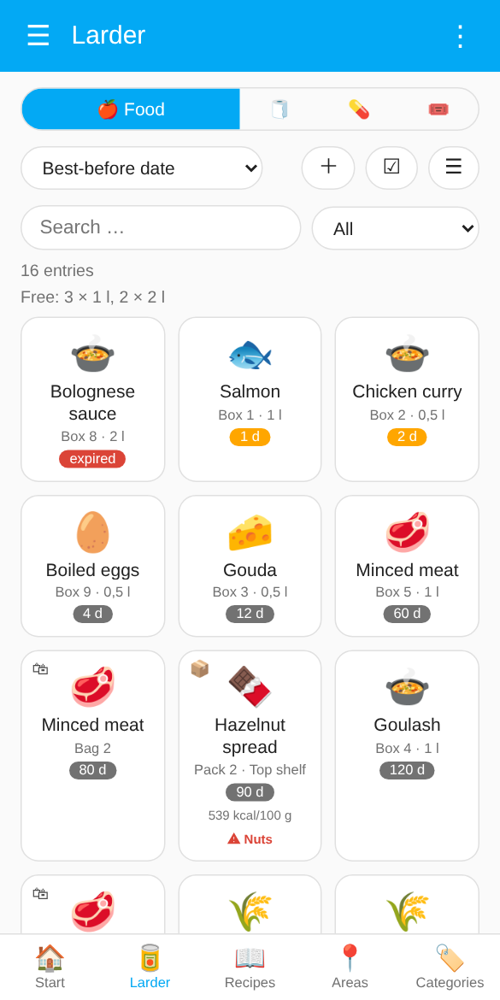
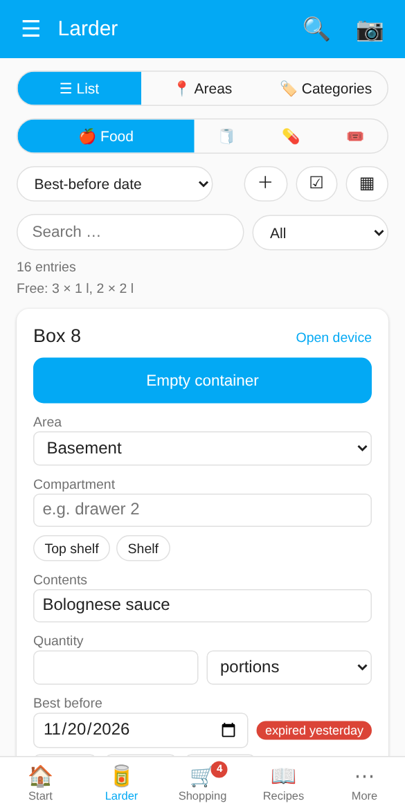

# Home Assistant Larder

**Food storage tracker** · formerly *Zwilling Food Storage*


[🇩🇪 Deutsch](README.de.md) · 🇬🇧 English

Home Assistant integration for reusable food storage containers: note what is inside and until when it keeps, get reminded before it expires, and find any container with a scan.

## Highlights

- 🖥️ **[Own dashboard](docs/en/dashboard.md#dashboard-larder)** in the sidebar, made for the phone: start page, larder as tiles, list or cards with every detail, areas, categories and a recipe book; updates itself
- 🔖 **[Zwilling Fresh & Save QR codes](docs/en/scanning.md#scanning-in-the-app)**: the original codes on the lids keep working, with the 📷 scanner in the app (iOS and Android) or an [iOS Shortcut](docs/en/scanning.md#ios-shortcut-for-the-original-zwilling-codes)
- 🏷️ **[Your own QR code](docs/en/scanning.md#your-own-qr-codes)** and **[NFC tags](docs/en/scanning.md#nfc-tags)** for any container, and for [compartments](docs/en/scanning.md#compartments) to take something or start a stocktake; QR codes print as a [label sheet](docs/en/scanning.md#label-sheet) in several designs and colours
- 🛍 **[Bags and packs](docs/en/containers.md#bags-and-packs)**: single-use vacuum bags with an NFC sticker or QR code that disappear after emptying, and stock without a container (cans, jars) by barcode, receipt photo or by hand
- 🥫 **[Stock](docs/en/containers.md#stock)**: packs summed over every place, oldest first, minimum stock that fills the shopping list, *lasts about …* and *running low*, prices (own, from the receipt or [Open Prices](https://prices.openfoodfacts.org)), opened packs, a [stocktake](docs/en/containers.md#stocktake) per compartment and [recall warnings](docs/en/containers.md#recall-warnings) from lebensmittelwarnung.de
- 🧻 **[Household items](docs/en/containers.md#household-items)**: toilet paper, detergent, batteries and the like without a best-before date, counted in pieces and bought in packs, with their own areas and a switch *Food | Household*
- ✏️ **[Quick filling](docs/en/containers.md#filling-containers)**: contents, quantity, best-before date and vacuum in a few taps, also for several containers at once, with a [serial scan](docs/en/dashboard.md#selecting-several-containers) or as [batch cooking](docs/en/containers.md#batch-cooking) with free containers by [size](docs/en/containers.md#container-sizes)
- 🧮 **[Best-before estimate](docs/en/best-before.md#best-before-estimate)**: built-in shelf-life table, optionally with AI, with limits per storage place
- 🍳 **[Recipes](docs/en/kitchen.md#recipes)**: ideas from what expires soon or from selected containers, a recipe book, and recipes read from a photo
- 🔔 **[Daily summary](docs/en/kitchen.md#daily-summary)**: push with buttons to several phones and read out on Alexa or other speakers, optionally at the first motion in the kitchen
- 🛒 **[Shopping list](docs/en/kitchen.md#shopping-list)**: on request, the contents of an emptied container go onto a to-do list, never leftovers
- 🗓 **[Meal plan](docs/en/kitchen.md#meal-plan)** with thaw reminder and a [week suggestion](docs/en/kitchen.md#week-suggestion) from what expires first, **[nutrition and allergens](docs/en/containers.md#nutrition)** from the barcode, **[statistics](docs/en/dashboard.md#statistics)** of what was eaten and thrown away with a [monthly report](docs/en/kitchen.md#monthly-report), and a best-before estimate that [learns from your history](docs/en/best-before.md#managing-remembered-estimates)
- 📅 **[Calendar entries](docs/en/kitchen.md#best-before-dates-in-your-calendar)**: best-before dates in your calendar (Local Calendar, Google …)
- 🌍 Available in English and German

<p align="center">



</p>

> **New in 5.0:** Larder is in the **HACS default catalogue**. A new [bar](docs/en/dashboard.md#dashboard-larder) with **Shopping** and **More**, quick actions on the start page, **one 📷 scan button** and a **🔍 search** on every page, a slimmer card with big buttons, and the same rules for putting things away and taking them out everywhere.
>
> **New in 4.12:** [data care](docs/en/dashboard.md#data-care) shows missing prices, dates and places once a month, *🫙 opened since …* on tiles, and the receipt ticks off the shopping list.
>
> **New in 4.11:** in the shopping mode, **scan** to tick off, enter **price and best-before date**, a **price history**, and **🧾 Receipt** right on the start page.
>
> **New in 4.10:** a [shopping mode](docs/en/kitchen.md#shopping-mode) – the list by store section, ticking off puts it into stock – and [recurring purchases](docs/en/kitchen.md#recurring-purchases).
>
> **New in 4.9:** read a [voucher from a photo](docs/en/containers.md#vouchers) (AI).
>
> **New in 4.8:** [vouchers](docs/en/containers.md#vouchers) with value, expiry date and place, a reminder before they expire, and the code for administrators only.
>
> **New in 4.7:** [one-click setup](docs/en/containers.md#adding-a-container) with *Get started*, the shopping list [sorted by store section](docs/en/kitchen.md#store-sections) and an [emergency supply check](docs/en/kitchen.md#emergency-supply) following the BBK recommendation.
>
> **New in 4.6:** household items can be [replaced regularly](docs/en/containers.md#household-items) (water filter, vacuum bags) with a reminder; the bottom bar says *Larder*, the stock view is *Stock*.
>
> **New in 4.5:** a [reminder for medicines](docs/en/kitchen.md#medicines-expiring) (and dated household items) on chosen weekdays, as push and on Alexa.
>
> **New in 4.4:** [medicines](docs/en/containers.md#medicines-pharmacy) as a third side *Pharmacy* with a longer expiry warning, optional dates and *keeps after opening* for household items.
>
> **New in 4.3:** [put away after shopping](docs/en/containers.md#stock): scan one product after another, each goes to its usual place.
>
> **New in 4.2:** the [barcode dialog](docs/en/containers.md#stock) shows where a product is and offers *used up*, *thrown away*, *open*, *move* and *add a new pack* right there.
>
> **New in 4.1:** [several shopping lists](docs/en/kitchen.md#shopping-list) (food, household, per product), [household statistics](docs/en/dashboard.md#statistics) with spending per month, [recall warnings](docs/en/containers.md#recall-warnings) for cosmetics and consumer goods.
>
> **New in 4.0:** [household items](docs/en/containers.md#household-items), areas for food or household, the *Containers* page is now called **Larder**, barcodes from Open Beauty / Products / Pet Food Facts. **Breaking change:** after the update, assign your areas to food or household, see [Food or household](docs/en/containers.md#food-household-or-pharmacy).
>
> **New in 3.x:** single-use **bags** and **packs** (3.0), the stock view with minimum stock (3.2), stocktake and opened packs (3.4), consumption and prices (3.5), *running low* and recall warnings (3.6), compartment tags and new label options (3.7), batch cooking, container sizes and the week suggestion (3.8). See the [changelog](CHANGELOG.md).

## Documentation

The details live on their own pages:

| Page | What is in it |
|---|---|
| [Containers, bags, packs and household items](docs/en/containers.md) | Adding containers, single-use bags and packs, household items, areas and labels, filling, nutrition and allergens |
| [Dashboard, statistics and data](docs/en/dashboard.md) | The Larder dashboard, selecting several containers, the Lovelace card, statistics, export and import |
| [Best-before estimate](docs/en/best-before.md) | How the best-before date is estimated: table, AI, remembered values |
| [Recipes, daily summary, meal plan and shopping](docs/en/kitchen.md) | Recipe ideas and recipe book, daily summary (blueprint), meal plan with thaw reminder, shopping list, calendar |
| [Scanning](docs/en/scanning.md) | Scanning in the app, your own QR codes and label sheets, NFC tags, iOS Shortcut for Zwilling codes |
| [Settings, repairs and reference](docs/en/reference.md) | All settings, repair hints, entities, services, events and the webhook |
| [Changelog](CHANGELOG.md) | Release notes of every version |

## Why this project?

It all started with buying the Zwilling Fresh & Save Family Box. I noticed the QR code on the lids, which links each box to the management system in the Zwilling app. Then I found out that the app and its functions will be discontinued on 31 December 2026.

So I needed a replacement, and since I already run Home Assistant, building an integration there was the obvious choice.

Then came a second idea: why not give ordinary boxes a QR code too? Printing those is tedious, though, and I still had a few NFC stickers lying around. That is how the NFC tag integration was born.

## Installation

Larder is in the default catalogue of HACS, which is built into Home Assistant as the **Marketplace** since 2026.11.

[](https://my.home-assistant.io/redirect/hacs_repository/?owner=yan14&repository=ha-larder&category=integration)

1. **Settings → Marketplace**, search for **Larder** and download it (or use the button above).
2. Restart Home Assistant if it asks you to.
3. Set it up under **Settings → Devices & services → Add integration → Larder** (see below).

<details>
<summary>Home Assistant before 2026.11 (classic HACS)</summary>

1. **HACS**, search for **Larder** and download it.
2. Restart Home Assistant.

</details>

<details>
<summary>Fallback: add it as a custom repository</summary>

Only needed if Larder does not show up in the search yet (for example right after it was added to the catalogue).

1. **Settings → Marketplace** → **Add from link** (classic HACS: three-dot menu → **Custom repositories**)
2. URL: `https://github.com/yan14/ha-larder`, category **Integration**
3. Download "Larder" (a custom repository needs a GitHub connection; Home Assistant shows a code to enter on GitHub).

</details>

> **Coming from the old "Zwilling Food Storage" (up to 0.10)?** Larder is a new integration (domain `larder`). Remove the old one, add Larder and add your containers again.

## Getting started

1. **Add the integration** under Settings → Devices & services → Add integration → Larder. One click, no questions: the **Larder** dashboard appears in the sidebar right away, and its start page shows **🚀 Get started** – assign areas, choose a shopping list, add the first item with **＋**.
2. **Give each container an area** that says where it is stored, for example "Fridge", "Freezer" or "Pantry". The estimate needs it. Optionally add a `Larder: …` label with the [template](docs/en/containers.md#template-for-the-area-label) to the areas.
3. **Fill the containers** in the dashboard: contents, quantity, best-before date (or let Larder estimate it).
4. **Check the [settings](docs/en/reference.md#settings)** once: estimate mode, periods, calendar, shopping list.
5. **Import the [blueprint](docs/en/kitchen.md#daily-summary)** for a daily summary of what expires soon (push and/or voice).
6. **Put a code on the boxes:** print [your own QR code](docs/en/scanning.md#your-own-qr-codes), stick on an [NFC tag](docs/en/scanning.md#nfc-tags), or keep the original Zwilling codes and scan them with [📷 in the app](docs/en/scanning.md#scanning-in-the-app) or the [iOS Shortcut](docs/en/scanning.md#ios-shortcut-for-the-original-zwilling-codes).

## Alternatives

This integration tracks the **physical, reusable container** (one device per container with its own QR code). If you would rather manage **products and stock**, these projects may fit better:

- [Fridge Assistant](https://github.com/MaxGramser/fridge_assistant): inventory for fridge, freezer and pantry with barcode scanning, AI shelf-life estimates and printed labels.
- [Grocy](https://github.com/custom-components/grocy): the Home Assistant integration for the self-hosted Grocy server (stock, best-before dates, shopping lists, chores).

## Development

Releases are created automatically: when `version` in `manifest.json` is new on `main`, a GitHub workflow creates the tag `v<version>` and a release. Its text is the section `## <version>` of [CHANGELOG.md](CHANGELOG.md) (write it together with the version bump, a test checks that it exists), followed by the automatically generated comparison link.

```
pip install -r requirements_test.txt
pytest
ruff check .    # linter, also runs in CI

npm install
npm test        # tests for the frontend (jsdom)
```

The frontend lives in `custom_components/larder/frontend/`: `larder-dashboard.js` (pages and navigation) with its texts and stylesheet, `larder-dashboard-items.js` (bags, packs, stock), `larder-dashboard-care.js` (stocktake, compartments, opened packs), `larder-dashboard-cook.js` (sizes, batch cooking, week suggestion), `larder-panel.js` (cards and the add/fill dialogs) and `larder-card.js` (Lovelace card).

The screenshots come from the real code with demo data: serve the repository (`python -m http.server`) and open `docs/demo/dashboard.html?lang=en&view=containers` (options in the file) or, for the dialogs, `docs/demo/index.html?lang=en&dialog=scan`.
