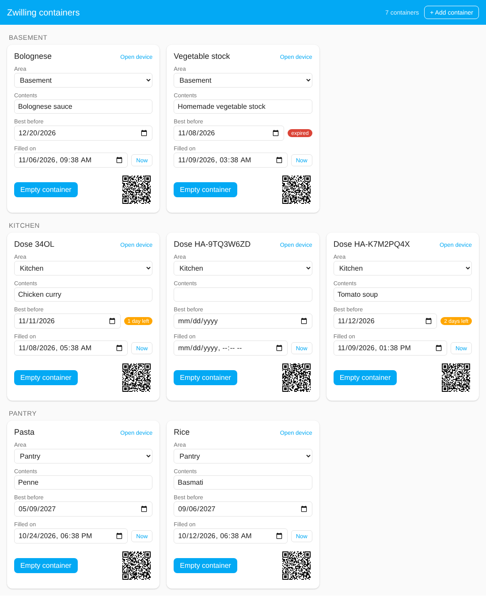
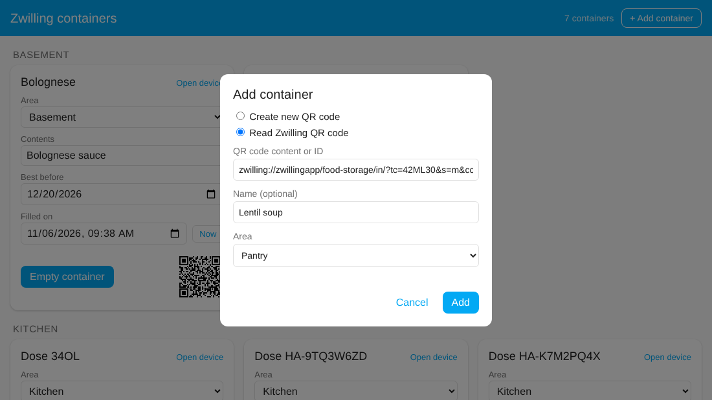

# Zwilling Food Storage


[🇩🇪 Deutsch](README.de.md) · 🇬🇧 English

Home Assistant integration for Zwilling food storage containers with a QR code. Every container becomes a device (identified by the `cc` parameter of its QR code) with:

| Entity | Type | Purpose |
| --- | --- | --- |
| **Filled on** | `datetime` | When was the container filled? |
| **Best before** | `date` | Best-before date (MHD) |
| **Contents** | `text` | What is in the container? |
| **Empty container** | `button` | Resets the whole container: **Contents** become empty, **Best before** and **Filled on** are cleared. **Vacuum** is deliberately kept, it is a property of the container, not of its contents |
| **Vacuum** | `switch` | Is the container vacuum-sealed? On by default. Switch it off for a normal box. Used for the estimate |
| **QR code** | `image` | The container's QR code as an image: scanning it with the camera app opens the device directly in the Home Assistant app |

The values survive restarts. "Empty container" is a regular button entity, so you can use it on dashboards and in automations via `button.press`.

**Clearing a single field:** the date entities of Home Assistant itself cannot be cleared from the entity dialog (the picker's "Clear" button has no effect there). Use one of these instead: empty the field in the dashboard, press **Empty container** to reset everything, or call the services `zwilling_storage.clear_best_before` / `zwilling_storage.clear_filled_at` (for example in Developer tools or an automation).

You also get:

- a **dashboard** "Zwilling containers" in the sidebar (see [below](#dashboard-zwilling-containers)) that lists all containers, lets you add containers and edit everything, and updates itself,
- a **scan webhook** for the original Zwilling QR codes (iOS Shortcut, see below).

<p align="center"></p>

## Installation via HACS

1. HACS → three-dot menu → **Custom repositories**
2. URL: `https://github.com/yan14/ha-zwilling-storage`, category **Integration**
3. Install "Zwilling Food Storage" and restart Home Assistant.

## Adding a container

Settings → Devices & services → **Add integration** → "Zwilling Food Storage". There are two ways:

**Create new QR code**

For containers without a (readable) Zwilling code. The integration generates a new, unique ID in the format `HA-XXXXXXXX` (8 characters, without the easily confused 0/O and 1/I). The `HA-` prefix keeps it clearly apart from Zwilling IDs (e.g. `34OL`), so the two cannot overlap. You can optionally give the container a name. Afterwards you find the QR code as an image on the device (see "Scanning the QR code directly").

**Read Zwilling QR code**

For existing Zwilling containers. Paste the content of the QR code, for example

```
zwilling://zwillingapp/food-storage/in/?tc=42ML30&s=m&cc=34OL
```

The ID alone (`cc`, here `34OL`) is enough as well. You can optionally give the container a name. Each container can only be added once.

Home Assistant has no camera in this dialog. On iOS you read the text with a Shortcut (next sections) and paste it.

You can also add containers in the sidebar dashboard (button **+ Add container**), see [below](#adding-a-container-from-the-dashboard). That is the quickest way once the first container exists.

## Scanning the QR code directly

Every container has the image entity **QR code**. It contains a link that makes the Home Assistant app jump straight to the container's device page (`homeassistant://navigate/config/devices/device/<device-id>`). You do not need a Shortcut for this.

1. Open the container's device in Home Assistant (or the "Zwilling containers" panel, where the QR code is shown small) and open the **QR code** entity. Save or print the image and stick it on the container. The content of the code is also available in the `qr_content` attribute of the entity.
2. Scan the sticker with the camera app. iOS offers to open the link in the Home Assistant app, and the app shows the container.

The code points to the device ID in Home Assistant. If you delete the container and add it again, it gets a new device ID and the sticker has to be printed again. If you have several Home Assistant servers in the app, it asks which one you mean when opening.

## Dashboard "Zwilling containers"

As soon as at least one container exists, a sidebar entry **Zwilling containers** (German UI: "Zwilling Dosen") appears. It needs no configuration and shows every container on a card (screenshot at the top):

*The screenshots show demo data. The panel adapts to your Home Assistant theme and language (English and German).*

- All containers of the integration, grouped by **area** (the area of the device) and sorted by name.
- Per container: area, **contents**, **best before** (with a hint "expired" or "n days left" starting 3 days before), **filled on**, the **Empty container** button and the QR code as a small image.
- Contents, best-before date and filled-on date can be edited right in the panel. "Now" sets "Filled on" to the current time.
- The **area** of a container can be changed with the dropdown on its card, no detour through the device page needed.
- The **Vacuum** checkbox switches the vacuum property of the container.
- With the [estimate](#best-before-estimate-built-in-table-and-optional-ai) enabled, **Estimate best before** appears under the date as soon as contents are entered and no date is set.
- **+ Add container** (top right) adds a container: either *Create new QR code* or *Read Zwilling QR code*, with optional name and area. It uses the same flow as Settings → Devices & services.
- New containers, changed values and changed areas show up immediately, no reload needed.

The panel is visible to all users, but only **administrators** can add containers and change areas (the same restriction as in the settings). Other users see the area as text. It is not a classic Lovelace dashboard and cannot be edited with the card editor. In return it updates itself.

### Adding a container from the dashboard

**+ Add container** opens a dialog:

<p align="center"></p>

- **Create new QR code** generates a new unique ID. Afterwards open the card (or the device) and print the QR code.
- **Read Zwilling QR code** needs the content of the original code or just the ID. When you come from the iOS Shortcut, the field is already filled in.
- Name and area are optional. You can change both later (the area right on the card).

## Best-before estimate (built-in table and optional AI)

The integration can suggest a best-before date. There are two sources, and you decide which one is used (Settings → Devices & services → **Zwilling Food Storage** → **Configure**):

| Mode | What happens |
|---|---|
| **Off** | No estimates, the button is hidden. |
| **Table only** (default) | A built-in shelf-life table. Works offline, needs no AI service, costs nothing. |
| **Table, otherwise AI** | Table first. If the table has no entry for the contents or cannot place the area, the AI is asked. |
| **AI only** | Always the AI (needs the *AI Task* integration, see below). |

Values you corrected yourself always come first (see "Remembering").

### The table

More than 50 entries for common food: dishes and leftovers, soups, raw meat, fish, cold cuts, dairy, cheese, eggs, fruit and vegetables, bread and cake, pasta, rice, flour, nuts, coffee, tea, spices and more. For each entry it knows the shelf life in **fridge**, **0 °C compartment**, **freezer** and **pantry**. Where a food does not belong in a place (for example lettuce in the freezer or raw meat in the pantry) it says so and does **not** make up a date.

How a container is matched:

- **Contents** are matched by keywords in German and English, e.g. "Tomatensuppe", "Penne", "leftover chicken curry". The most specific match wins ("boiled eggs" beats "eggs").
- **Storage place** comes from the area: a temperature sensor on the area first, then a temperature in a label or the area name (for example "about -18 °C"), then words such as *fridge*, *0 °C compartment*, *freezer*, *freezer compartment* (a bit less cold, so shorter), *pantry*, *cellar*. If it cannot place the area, it tells you instead of guessing.
- **Vacuum** extends the time (about +30 % cold, +50 % in the freezer and pantry). Perishable food in the fridge (minced meat, fish, cold cuts, leftovers, soft cheese, …) gets **no** bonus, because vacuum does not make it safer.

The values are deliberately cautious and based on common guidance (for example the USDA/FSIS cold storage chart and German consumer-advice centres). They are rules of thumb for the home, **not a food-safety guarantee**. For bought products the printed best-before date is more reliable. Write "cooked" or "opened" into the contents if it matters. Spotted a value that is off or a food that is missing? Entries are listed in `custom_components/zwilling_storage/shelf_life.py`; issues and pull requests are welcome.

### AI (optional)

The AI mode uses the **AI Task** feature of Home Assistant, so it works with whichever AI service you have set up there (for example Anthropic, OpenAI, Google or a local Ollama).

1. Set up an AI service with an *AI Task* in Home Assistant (Settings → Devices & services). This needs a Home Assistant version that includes the AI Task integration.
2. Choose **Table, otherwise AI** or **AI only** in the settings. The field "AI task" is only needed if you have more than one.

The AI receives the area name, so it understands "0 °C compartment" or "Freezer" on its own. You can give it more precise hints:

- **Temperature sensor of the area:** in the area settings you can assign a temperature sensor. If it has a valid value, it is passed on (for example a real freezer temperature). The table uses it as well.
- **Label with description:** assign a label to the area and write a hint in the label's description, for example "about -18 °C, meat and fish". Name and description are passed on.

Only the contents text, the area name with its hints, vacuum yes/no and the filling date are sent, to the AI service you chose. Depending on the provider this may cost a small amount. Nothing is sent in the table-only mode.

### Using it

Set **Vacuum** per container and assign each container to an **area** that describes where it is stored, e.g. "Fridge", "0 °C compartment", "Freezer" or "Pantry". Without an area the estimate is refused with a hint.

On the dashboard the button **Estimate best before** appears once contents are entered and the best-before date is empty. It shows where the value came from: *table*, *AI*, or *table, corrected by you* / *AI, corrected by you* if you changed the date afterwards. You can also call the service (in automations, scripts or Developer tools):

```yaml
action: zwilling_storage.estimate_best_before
target:
  entity_id: date.dose_34ol_best_before
data:
  apply: true       # false: only return the suggestion
  overwrite: false  # true: also estimate when a date is already set
response_variable: result
```

The result contains `best_before`, `days`, `tip` (a short storage tip), `source` (`table`, `ai` or `learned`), `basis` (for the table: matched food and place), `cached` and `applied`. The date is counted from **Filled on** (or from today if that is empty). **An existing best-before date is never overwritten** unless you set `overwrite`.

**Remembering.** Each result is stored for the combination of *contents + area + vacuum* and is not calculated or asked again. If you change a suggested date afterwards, your value is remembered for the same combination and wins over table and AI. The data lives in Home Assistant's `.storage/zwilling_storage.estimator`.

### Managing remembered estimates

Administrators get a second tab, **Estimates**, in the dashboard. It lists everything that is remembered for a combination of contents, area and vacuum, with its source (table, AI, or corrected by you with the original source). There you can

- **change** the days and the tip of an entry (it then counts as corrected by you),
- **delete** an entry; the next estimate for that combination is calculated anew (table or AI),
- **add** your own entry for a combination of contents, area and vacuum.

The built-in table itself is not edited here. Entries you add or change simply take precedence over it for that exact combination.

**Upgrading from 0.5:** "Estimate with AI" switched on becomes **AI only** (as before); switched off becomes **Table only**.

## iOS Shortcut for the original Zwilling codes

This way is meant for the **printed Zwilling QR codes**. For codes you created yourself you do not need it, just scan them with the camera app.

The QR code contains a link with the scheme `zwilling://`, which belongs to the discontinued Zwilling app. The **camera app is not suitable** for it: it wants to open the link in the Zwilling app and does not give you the text to copy. The Shortcut only reads out the text and does not open the link.

### 1. Find the webhook URL

Settings → Devices & services → **Zwilling Food Storage** → **Configure** on one of the containers. The dialog shows the webhook URL, built like `https://<your-HA-URL>/api/webhook/<long-secret-ID>`. The URL is the same for all containers, so you only need it once. You can close the Configure window with "Submit" afterwards, it changes nothing.

The long ID is the access protection, so treat the URL like a password. Which address is shown at the front (internal or external) depends on your Home Assistant configuration. When you are away from home the Shortcut only works with an address that is reachable from outside.

### 2. Create the Shortcut (once)

Shortcuts app → new shortcut with these actions, in this order:

1. **Scan QR/Bar Code**
2. **Get Contents of URL**:
   - URL: your webhook URL from step 1
   - Tap "Show More", method **POST**, request body **JSON**
   - "Add new field": type **Text**, key `code`, value: the result of action 1 (pick the "QR/Bar Code" variable from the variable bar)
3. **Get Dictionary Value**: key `app_url`, from "Contents of URL"
4. **Open URLs**: opens the value from action 3

Give it a name, e.g. "Scan container". Using the share icon you can add it to the Home Screen or assign it to the Action button. On the first run iOS asks for camera access and whether the Shortcut may access the URL.

### 3. Use it

Run the Shortcut and scan the QR code on the container. The Home Assistant app then opens:

- **Container known:** directly on the **device page** of this container (with Filled on, Contents and Empty container).
- **Container new:** on the dashboard "Zwilling containers", where the **Add container** dialog opens with the scanned code already filled in. Optionally enter a name and area and tap **Add**. This needs an administrator account; other users get a note with the scanned code.

If you have several Home Assistant servers in the app, it asks which one you mean when opening.

## Webhook interface

The webhook is a regular Home Assistant webhook and accepts `POST` (and `GET`).

Request, in one of these forms:

```
POST /api/webhook/<ID>   {"code": "zwilling://zwillingapp/food-storage/in/?tc=42ML30&s=m&cc=34OL"}
POST /api/webhook/<ID>   {"cc": "34OL"}
POST /api/webhook/<ID>   zwilling://zwillingapp/food-storage/in/?tc=42ML30&s=m&cc=34OL   (plain text)
GET  /api/webhook/<ID>?code=34OL
```

Response (`200`, JSON):

```json
{
  "known": true,
  "cc": "34OL",
  "name": "Dose 34OL",
  "device_id": "0a1b2c…",
  "path": "/config/devices/device/0a1b2c…",
  "app_url": "homeassistant://navigate/config/devices/device/0a1b2c…"
}
```

For an unknown container `known` is `false`, and `path` and `app_url` point to the dashboard with the add dialog (`/zwilling-storage?add=<ID>`). If the request contains no valid ID, the webhook answers with `400` and `{"error": "invalid_code"}`. The webhook only reads and never changes any values.

## Alternatives

This integration tracks the **physical, reusable container** (one device per container with its own QR code). If you would rather manage **products and stock**, these projects may fit better:

- [Fridge Assistant](https://github.com/MaxGramser/fridge_assistant): inventory for fridge, freezer and pantry with barcode scanning, AI shelf-life estimates and printed labels.
- [Grocy](https://github.com/custom-components/grocy): the Home Assistant integration for the self-hosted Grocy server (stock, best-before dates, shopping lists, chores).

## Development

```
pip install -r requirements_test.txt
pytest

npm install
npm test        # tests for the panel (jsdom)
```

The screenshots come from the real panel code with demo data: serve the repository (`python -m http.server`), open `docs/demo/index.html?lang=en` (or `de`, plus `&dialog=scan` for the dialog) and take a screenshot.
