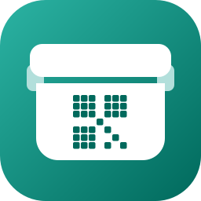
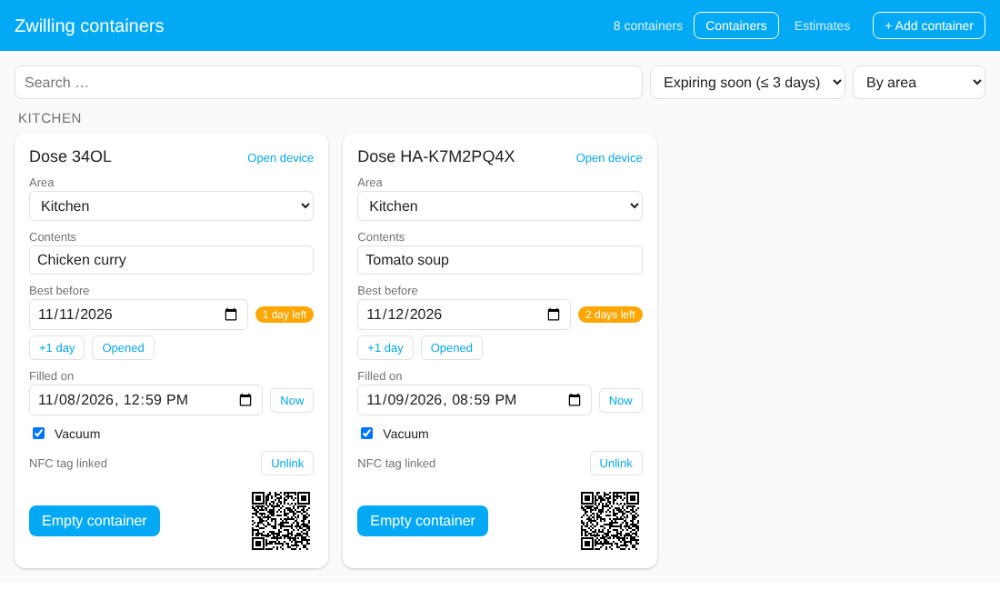
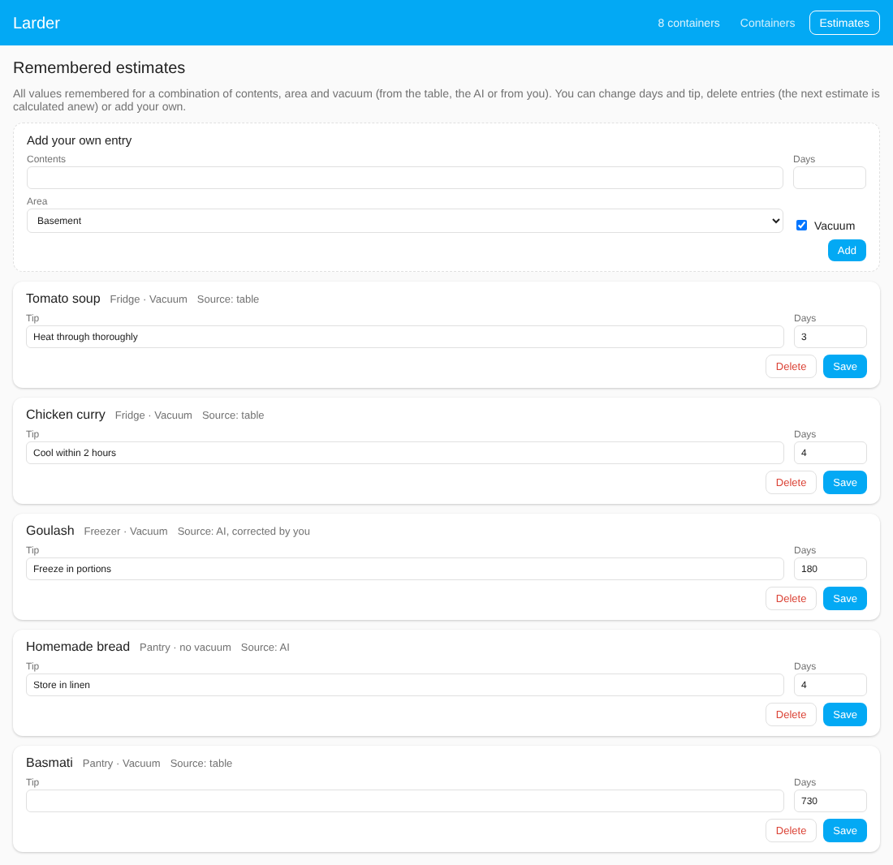
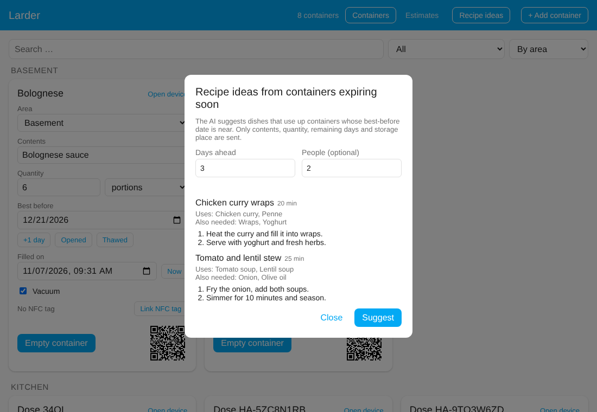
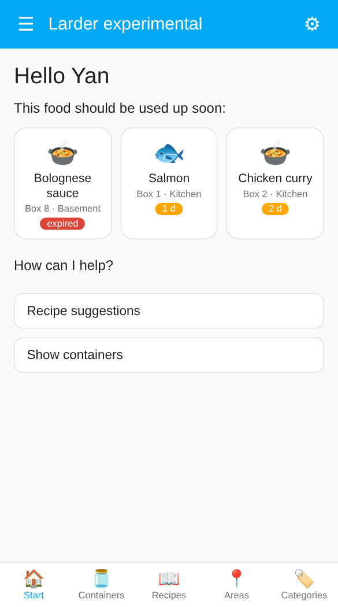
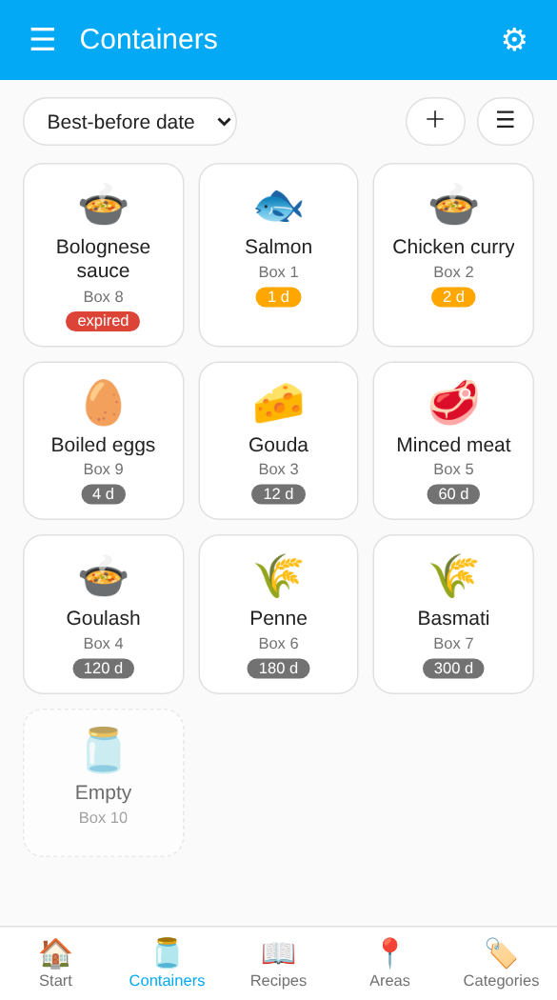
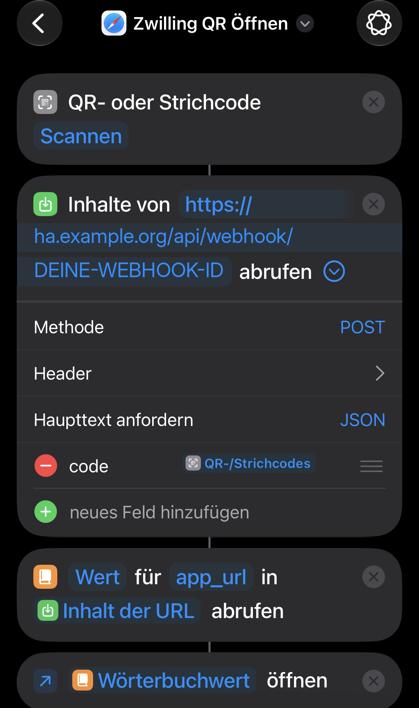

# Home Assistant Larder

**Food storage tracker** · formerly *Zwilling Food Storage*



[🇩🇪 Deutsch](README.de.md) · 🇬🇧 English

Home Assistant integration for reusable food storage containers: note what is inside and until when it keeps, get reminded before it expires, and find any container with a scan.

## Highlights

- 🖥️ **[Own dashboard](#dashboard-larder)** in the sidebar: all containers at a glance, add and edit everything, updates itself
- 🔖 **[Zwilling Fresh & Save QR codes](#ios-shortcut-for-the-original-zwilling-codes)**: the original codes on the lids keep working (iOS Shortcut)
- 🏷️ **[Your own QR code for every container](#adding-a-container)**: for any box, with a unique ID and a ready-made image
- 📲 **[NFC tag integration](#nfc-tags)**: stick a tag on the box instead of printing a code
- 🧊 **Thawed button, quantity and unit**: shorten the best-before date after thawing; note "4 portions", "5 slices" or "300 g" per container
- 🍳 **[Recipe ideas with AI](#recipe-ideas)**: dishes that use up what expires soon, in the dashboard and in the daily notification
- ✏️ **[Quick fill dialog](#filling-a-container-quickly)**: contents, quantity, best-before date and vacuum in a few taps, with suggestions from earlier contents
- 🧮 **[Best-before estimate](#best-before-estimate-built-in-table-and-optional-ai)**: built-in shelf-life table, optionally with AI
- 🔔 **[Expiry notifications](#expiry-notifications)**: daily summary via blueprint, quiet when nothing expires
- 🧪 **[Larder experimental](#larder-experimental)**: a second, tile-based dashboard with a start page, areas, categories and a recipe book (optional)
- 🛒 **[Shopping list](#shopping-list)**: on request, the contents of an emptied container go onto a to-do list, never leftovers
- 📅 **[Calendar entries](#best-before-dates-in-your-calendar)**: best-before dates appear in your calendar
- 🌍 Available in English and German

<p align="center"></p>

## Why this project?

It all started with buying the Zwilling Fresh & Save Family Box. I noticed the QR code on the lids, which links each box to the management system in the Zwilling app. Then I found out that the app and its functions will be discontinued on 31 December 2026.

So I needed a replacement, and since I already run Home Assistant, building an integration there was the obvious choice.

Then came a second idea: why not give ordinary boxes a QR code too? Printing those is tedious, though, and I still had a few NFC stickers lying around. That is how the NFC tag integration was born.

## Entities

Every container becomes a device (identified by its ID, the `cc` parameter of a Zwilling QR code) with:

| Entity | Type | Purpose |
| --- | --- | --- |
| **Filled on** | `datetime` | When was the container filled? |
| **Best before** | `date` | Best-before date (MHD) |
| **Contents** | `text` | What is in the container? |
| **Empty container** | `button` | Resets the whole container: **Contents** become empty, **Best before** and **Filled on** are cleared. **Vacuum** is deliberately kept, it is a property of the container, not of its contents |
| **Quantity** | `number` | How much is in the container, e.g. 4 (0 = not specified). Reset by **Empty container** |
| **Unit** | `select` | Unit of the quantity: portions (default), pieces, slices, grams or milliliters. Reset to portions by **Empty container**. Both show up in the dashboard, the fill dialog, the `get_expiring` result and the recipe ideas. Tip: use *portions* for finished dishes (chili, soup) and *pieces* or *slices* for countable food (eggs, ham) |
| **Vacuum** | `switch` | Is the container vacuum-sealed? On by default for new containers; change the preset under **Configure** if most of your boxes are not vacuum-sealed. Used for the estimate |
| **Shopping list** | `switch` | Should the contents go onto your shopping list when the container is emptied? Off by default, per container, and kept by **Empty container**. Only has an effect once a list is chosen under **Configure**, see [Shopping list](#shopping-list) |
| **Days until best before** | `sensor` | Days left until the best-before date (negative = expired). The attribute `status` is `ok`, `soon` (3 days or less; adjustable under **Configure** → *"Expiring soon" from*), `expired` or `none` |
| **QR code** | `image` | The container's QR code as an image: scanning it with the camera app opens the device directly in the Home Assistant app |

The values survive restarts. "Empty container" is a regular button entity, so you can use it on dashboards and in automations via `button.press`.

**Clearing a single field:** the date entities of Home Assistant itself cannot be cleared from the entity dialog (the picker's "Clear" button has no effect there). Use one of these instead: empty the field in the dashboard, press **Empty container** to reset everything, or call the services `larder.clear_best_before` / `larder.clear_filled_at` (for example in Developer tools or an automation).

## Installation via the Marketplace (HACS)

Since Home Assistant 2026.11 the community store HACS is built in as the **Marketplace**. Larder is not in the default catalogue yet, so you add it as a custom repository:

1. **Settings → Marketplace** → **Add from link**
2. URL: `https://github.com/yan14/ha-larder`, category **Integration**
3. Download "Larder" (adding a custom repository needs a GitHub connection; Home Assistant shows a code to enter on GitHub).
4. Set it up under **Settings → Devices & services → Add integration → Larder** (see below).

<details>
<summary>Home Assistant before 2026.11 (classic HACS)</summary>

1. HACS → three-dot menu → **Custom repositories**
2. URL: `https://github.com/yan14/ha-larder`, category **Integration**
3. Install "Larder" and restart Home Assistant.

</details>

> **Coming from the old "Zwilling Food Storage" (up to 0.10)?** Larder is a new integration (domain `larder`). Remove the old one, add Larder and add your containers again.

## Adding a container

Settings → Devices & services → **Add integration** → "Larder". There are two ways:

**Create new QR code**

For containers without a (readable) Zwilling code. The integration generates a new, unique ID in the format `HA-XXXXXXXX` (8 characters, without the easily confused 0/O and 1/I). The `HA-` prefix keeps it clearly apart from Zwilling IDs (e.g. `34OL`), so the two cannot overlap. You can optionally give the container a name. Afterwards you find the QR code as an image on the device (see "Scanning the QR code directly").

**Read Zwilling QR code**

For existing Zwilling containers. Paste the content of the QR code, for example

```
zwilling://zwillingapp/food-storage/in/?tc=42ML30&s=m&cc=34OL
```

The ID alone (`cc`, here `34OL`) is enough as well. You can optionally give the container a name. Each container can only be added once.

Home Assistant has no camera in this dialog. On iOS you read the text with a Shortcut (next sections) and paste it.

You can also add containers in the sidebar dashboard (button **+ Add container**), see [below](#adding-a-container-from-the-dashboard). That is the quickest way once the first container exists.

## Scanning the QR code directly

Every container has the image entity **QR code**. It contains a link that makes the Home Assistant app jump straight to the container's device page (`homeassistant://navigate/config/devices/device/<device-id>`). You do not need a Shortcut for this.

1. Open the container's device in Home Assistant (or the "Larder" panel, where the QR code is shown small) and open the **QR code** entity. Save or print the image and stick it on the container. The content of the code is also available in the `qr_content` attribute of the entity.
2. Scan the sticker with the camera app. iOS offers to open the link in the Home Assistant app, and the app shows the container.

The code points to the device ID in Home Assistant. If you delete the container and add it again, it gets a new device ID and the sticker has to be printed again. If you have several Home Assistant servers in the app, it asks which one you mean when opening.

## Dashboard "Larder"

As soon as at least one container exists, a sidebar entry **Larder** appears. It needs no configuration and shows every container on a card (screenshot at the top):

*The screenshots show demo data. The panel adapts to your Home Assistant theme and language (English and German).*

- All containers of the integration, grouped by **area** (the area of the device) and sorted by name.
- Per container: area, **contents**, **best before** (with a hint "expired" or "n days left" starting 3 days before), **filled on**, the **Empty container** button and the QR code as a small image.
- Contents, **quantity and unit**, best-before date and filled-on date can be edited right in the panel. "Now" sets "Filled on" to the current time.
- The **area** of a container can be changed with the dropdown on its card, no detour through the device page needed. With many areas the list gets long: give the areas you use for food storage the **label** `Larder` (Settings → Areas, labels & zones → open an area → Labels, create a label named "Larder" once). Labels whose name starts with `Larder:` count as well (for example `Larder: Freezer` with the [template](#template-for-the-area-label) in its description), so one label per area is enough. The dashboard then offers only these areas, in the dropdown and in the add dialog. The current area of a container always stays in its list. If no area has the label, all areas are shown.
- The **Vacuum** checkbox switches the vacuum property of the container.
- The **Add to shopping list when emptied** checkbox only appears once a [shopping list](#shopping-list) is chosen. It is also part of the fill dialog.
- With the [estimate](#best-before-estimate-built-in-table-and-optional-ai) enabled, **Estimate best before** appears under the date as soon as contents are entered and no date is set.
- **Recipe ideas** (top right, administrators, only with the *AI Task* integration) opens the [recipe dialog](#recipe-ideas).
- **+ Add container** (top right) adds a container: either *Create new QR code* or *Read Zwilling QR code*, with optional name and area. It uses the same flow as Settings → Devices & services.
- Under the date: **+1 day** moves the best-before date by a day, **Opened** shortens it to the number of days you set in the settings (default 3), and **Thawed** does the same for food you just took out of the freezer (default 2 days, do not refreeze it). Neither ever extends a date. Without a date, one is set.
- **Search, filter and sort** above the cards: search in name, contents and area; filter by *expiring soon*, *expired*, *filled* or *empty*; sort by area, best-before date (earliest first) or name. Your choice is remembered in the browser.
- Administrators also get the **Estimates** tab (see [below](#managing-remembered-estimates)).
- An empty container shows **Fill**, a quick dialog for contents, quantity, vacuum and best-before date (see [below](#filling-a-container-quickly)).
- New containers, changed values and changed areas show up immediately, no reload needed.

<p align="center"></p>


The panel is visible to all users, but only **administrators** can add containers and change areas (the same restriction as in the settings). Other users see the area as text. It is not a classic Lovelace dashboard and cannot be edited with the card editor. In return it updates itself.

### Adding a container from the dashboard

**+ Add container** opens a dialog:

<p align="center"></p>

- **Create new QR code** generates a new unique ID. Afterwards open the card (or the device) and print the QR code.
- **Read Zwilling QR code** needs the content of the original code or just the ID. When you come from the iOS Shortcut, the field is already filled in.
- Name and area are optional. You can change both later (the area right on the card).

## Best-before estimate (built-in table and optional AI)

The integration can suggest a best-before date. There are two sources, and you decide which one is used (Settings → Devices & services → **Larder** → **Configure**):

| Mode | What happens |
|---|---|
| **Off** | No estimates, the button is hidden. |
| **Table only** (default) | A built-in shelf-life table. Works offline, needs no AI service, costs nothing. |
| **Table, otherwise AI** | Table first. If the table has no entry for the contents or cannot place the area, the AI is asked. |
| **AI only** | Always the AI (needs the *AI Task* integration, see below). |

Values you corrected yourself always come first (see "Remembering").

### The table

More than 50 entries for common food: dishes and leftovers, soups, raw meat, fish, cold cuts, dairy, cheese, eggs, fruit and vegetables, bread and cake, pasta, rice, flour, nuts, coffee, tea, spices and more. For each entry it knows the shelf life in **fridge**, **0 °C compartment**, **freezer** and **pantry**. Where a food does not belong in a place (for example lettuce in the freezer or raw meat in the pantry) it says so and does **not** make up a date.

How a container is matched:

- **Contents** are matched by keywords in German and English, e.g. "Tomatensuppe", "Penne", "leftover chicken curry". The most specific match wins ("boiled eggs" beats "eggs").
- **Storage place** comes from the area: a temperature sensor on the area first, then a temperature in a label or the area name (for example "about -18 °C"), then words such as *fridge*, *0 °C compartment*, *freezer*, *freezer compartment* (a bit less cold, so shorter), *pantry*, *cellar*. If it cannot place the area, it tells you instead of guessing.
- **Vacuum** extends the time (about +30 % cold, +50 % in the freezer and pantry). Perishable food in the fridge (minced meat, fish, cold cuts, leftovers, soft cheese, …) gets **no** bonus, because vacuum does not make it safer.

The values are deliberately cautious and based on common guidance (for example the USDA/FSIS cold storage chart and German consumer-advice centres). They are rules of thumb for the home, **not a food-safety guarantee**. For bought products the printed best-before date is more reliable. Write "cooked" or "opened" into the contents if it matters. Spotted a value that is off or a food that is missing? Entries are listed in `custom_components/larder/shelf_life.py`; issues and pull requests are welcome.

### AI (optional)

The AI mode uses the **AI Task** feature of Home Assistant, so it works with whichever AI service you have set up there (for example Anthropic, OpenAI, Google or a local Ollama).

1. Set up an AI service with an *AI Task* in Home Assistant (Settings → Devices & services). This needs a Home Assistant version that includes the AI Task integration.
2. Choose **Table, otherwise AI** or **AI only** in the settings. The field "AI task" is only needed if you have more than one.

The AI receives the area name, so it understands "0 °C compartment" or "Freezer" on its own. You can give it more precise hints:

- **Temperature sensor of the area:** in the area settings you can assign a temperature sensor. If it has a valid value, it is passed on (for example a real freezer temperature). The table uses it as well.
- **Label with description:** assign a label to the area and write a hint in the label's description, for example "about -18 °C, meat and fish". Name and description are passed on.

#### Template for the area label

Free text works, but the description of an area label can also follow a fixed template. Recommended: one label per kind of storage place, named `Larder: Freezer`, `Larder: Fridge`, `Larder: Pantry` … (a plain `Larder` label is shared by all your storage areas, so do not put limits there). Larder then reads it exactly (the AI still gets the whole text):

```text
Storage: freezer
Temperature: -18 °C
Max storage: 18 months
Notes: meat and fish
```

One entry per line is easiest to read; the entries may also follow each other in one line (`Storage: freezer Temperature: -18 °C Max storage: 18 months`) or be separated by `;`. Upper or lower case does not matter, every entry is optional. German keys work as well: `Lagerort`, `Temperatur`, `Max. Lagerzeit`, `Hinweis`.

| Key | Values | Effect |
|---|---|---|
| `Storage` | `fridge`, `0 °C compartment`, `freezer`, `freezer compartment`, `pantry`, `cellar` … | Storage place for the table, wins over the area name (a temperature sensor of the area still comes first). |
| `Temperature` | e.g. `-18 °C`, `4 °C` | Places the area by temperature, as before. |
| `Max storage` | a number with `days`, `weeks`, `months` or `years` (`Tage`, `Wochen`, `Monate`, `Jahre`); a plain number means days | Upper limit for table and AI estimates in this area. Remembered estimates are capped as well, your own corrections are not. The tip says when a value was capped. With several labels the shortest limit applies. |
| `Notes` | any text | Only a hint for the AI. |

Only the contents text, the area name with its hints, vacuum yes/no and the filling date are sent, to the AI service you chose. Depending on the provider this may cost a small amount. Nothing is sent in the table-only mode.

### Using it

Set **Vacuum** per container and assign each container to an **area** that describes where it is stored, e.g. "Fridge", "0 °C compartment", "Freezer" or "Pantry". Without an area the estimate is refused with a hint.

On the dashboard the button **Estimate best before** appears once contents are entered and the best-before date is empty. It shows where the value came from: *table*, *AI*, or *table, corrected by you* / *AI, corrected by you* if you changed the date afterwards. You can also call the service (in automations, scripts or Developer tools):

```yaml
action: larder.estimate_best_before
target:
  entity_id: date.dose_34ol_best_before
data:
  apply: true       # false: only return the suggestion
  overwrite: false  # true: also estimate when a date is already set
response_variable: result
```

The result contains `best_before`, `days`, `tip` (a short storage tip), `source` (`table`, `ai` or `learned`), `basis` (for the table: matched food and place), `cached` and `applied`. The date is counted from **Filled on** (or from today if that is empty). **An existing best-before date is never overwritten** unless you set `overwrite`.

**Remembering.** Each result is stored for the combination of *contents + area + vacuum* and is not calculated or asked again. If you change a suggested date afterwards, your value is remembered for the same combination and wins over table and AI. The data lives in Home Assistant's `.storage/larder.estimator`.

**Limits for AI values.** A pure AI estimate is capped per storage place (fridge 60 days, 0 °C drawer 90 days, freezer 18 months, pantry 3 years, unknown place 1 year); the tip says when a value was capped. AI estimates you never corrected are asked again after 12 months (if the AI cannot be reached, the old value stays). Table values and your own corrections are never capped or refreshed by these defaults. Your own limit per area comes from the [area label](#template-for-the-area-label) (`Max storage: 3 years`) and applies to table and AI values.

### Filling a container quickly

<p align="center"></p>

An empty container shows a **Fill** button. It opens a small dialog: **contents** (with suggestions from what you entered before, newest first, then your remembered estimates), **quantity and unit** (optional), **vacuum**, **filled on** (preset to now), optionally a **best-before date**, and **Estimate best before automatically** (only if estimating is on and the date is empty). **Save** sets everything and estimates the date.

The dialog also opens by itself right after you add a new container in the dashboard (including after writing an NFC tag), so you can fill it straight away. It also opens after a scan: when the Shortcut opens `app_url` or you tap the NFC notification and the container is empty. For a container that already has contents the dashboard only highlights it. This works for all users, not only administrators.

### Managing remembered estimates

<p align="center"></p>

Administrators get a second tab, **Estimates**, in the dashboard. It lists everything that is remembered for a combination of contents, area and vacuum, with its source (table, AI, or corrected by you with the original source). There you can

- **change** the days and the tip of an entry (it then counts as corrected by you),
- **delete** an entry; the next estimate for that combination is calculated anew (table or AI),
- **add** your own entry for a combination of contents, area and vacuum.

The built-in table itself is not edited here. Entries you add or change simply take precedence over it for that exact combination.

**Upgrading from 0.5:** "Estimate with AI" switched on becomes **AI only** (as before); switched off becomes **Table only**.

## Expiry notifications

The service `larder.get_expiring` lists all containers whose best-before date is near or has passed and returns a ready-made text in the language of Home Assistant:

```yaml
action: larder.get_expiring
data:
  days: 3               # containers expiring within 3 days
  include_expired: true
response_variable: result
# result.count, result.expired, result.summary (text), result.items (name, content, quantity, unit, area, best_before, days_left, status)
```

The easiest way is the included blueprint, which sends a notification once a day and stays quiet when nothing expires:

[](https://my.home-assistant.io/redirect/blueprint_import/?blueprint_url=https%3A%2F%2Fgithub.com%2Fyan14%2Fha-larder%2Fblob%2Fmain%2Fblueprints%2Fautomation%2Flarder%2Fexpiry_notification.yaml)

Choose a notification action such as `notify.mobile_app_your_iphone` (Developer tools → Actions), the time and how many days ahead to look. For your own dashboards or automations there is also the sensor **Days until best before** on every container.

## Recipe ideas

<p align="center"></p>

The AI can suggest dishes that use up what expires soon. It needs the Home Assistant **AI Task** integration (the same one as for the [AI estimate](#ai-optional)); the table-only estimate mode does not matter.

**In the dashboard:** administrators get a **Recipe ideas** button (top right, next to *+ Add container*). Choose how many days ahead to look (the default comes from **Configure** → *Period for recipe ideas*, 3 days out of the box) and optionally for how many people, press **Suggest**. You get up to three recipes with the containers they use, extra ingredients (only common staples), time and short steps. Expired containers and containers without contents are never used. In **Larder experimental** the recipe page has a period selector next to *From leftovers*: the default from the settings, a fixed number of days, or **All containers (no period)**, which also includes containers without a best-before date.

**In automations:** the service `larder.suggest_recipes` returns the same.

```yaml
action: larder.suggest_recipes
data:
  days: 3        # containers expiring within 3 days (omit to use the period from the settings)
  # all_containers: true   # no period: every filled container
  servings: 2    # optional, default 2 people
  max_recipes: 3 # 1 to 5
response_variable: ideas
# ideas.recipes (title, minutes, uses, extra_ingredients, steps), ideas.summary (text),
# ideas.ingredients (the containers used), ideas.count
```

**In the daily notification:** the [blueprint](#expiry-notifications) has the switch **Add recipe ideas**. The recipes are appended to the message; if the AI fails, the normal message is still sent. Re-import the blueprint to get the new switch.

Only the contents, quantity with unit, remaining days and storage place (area name) are sent to the AI service you chose, never container names, IDs or anything else. Depending on the provider each request may cost a small amount, nothing is sent without you pressing the button or running the automation. The suggestions are ideas from a language model, not tested recipes: check that food is safe to eat, especially thawed or older food.

## Larder experimental

A second, optional dashboard that you can try next to the normal one. Turn it on under Settings → Devices & services → **Larder** → **Configure** → **Show "Larder experimental" in the sidebar**. It then appears as a second entry in the sidebar; the normal **Larder** dashboard stays unchanged. Both use the same containers, so you can switch back and forth at any time. It is called experimental because it is new and may still change.

<p>


</p>

A bar at the bottom switches between five views:

- **Start**: a greeting with your Home Assistant name, tiles for everything that should be used up soon (expired first), and shortcuts to **Recipe suggestions** (administrators with the *AI Task* integration) and to the containers that expire soon.
- **Containers**: tiles or a list (switch with the button on the right), with a symbol for the kind of food, the contents, the container name and the days left. Sort by best-before date, area, alphabet or category. Tap a filled container to open its details (the same card as in the normal dashboard), tap an empty one to fill it right away. **＋** adds a container.
- **Areas**: one tile per area with the number of containers and how many expire soon. Tapping an area shows its containers.
- **Categories**: the same for kinds of food (fish, meat, dairy, dishes and leftovers, dry goods, …). The category comes from the built-in shelf-life table and is shown as an attribute `category` of the **Contents** entity. Containers without a match are listed under "Other", empty ones under "Empty".
- **Recipes**: your own recipe book (stored in Home Assistant, `.storage/larder.recipes`). Everyone can read it; administrators add, edit and delete recipes. **From leftovers** asks the AI for ideas for what expires soon (as in [Recipe ideas](#recipe-ideas)) and lets you **save** the ones you like.

Planned: adding recipes from a photo or a file, and a button to be reminded again tomorrow. There is no menu icon of its own: the ☰ at the top is the Home Assistant sidebar.

## Shopping list

Under Settings → Devices & services → **Larder** → **Configure** you can pick a **to-do list** of Home Assistant, for example the built-in *Shopping list*, Todoist or Bring!. Each container then has a checkbox **Add to shopping list when emptied** (the `Shopping list` switch, off by default). When you press **Empty container** on a container with the checkbox on, its contents are added to the list, for example "Basmati".

- Not everything belongs on the list: leftovers like "pizza leftovers" simply stay unchecked and are never added. The setting belongs to the container and is kept when you empty it, so rice is always bought again and pizza never.
- An item that is already open on the list is not added twice. Items that are already checked off do not count, so you can buy the same thing again.
- Without a chosen list nothing happens and the checkbox is hidden. If the list is unavailable, the container is still emptied.
- Planned: several target lists (for example butcher and supermarket), and adding expired containers as well.

## Best-before dates in your calendar

Under Settings → Devices & services → **Larder** → **Configure** you can pick an existing **calendar** (Google, CalDAV, *Local Calendar* …). Every container then gets an all-day event "Best before: Pizza" on its best-before date. The event is created when a date is set, moved when the date or the contents change, and deleted when the date is cleared, the container is emptied or removed, or you pick another calendar. Your own events are recognised by a tag in the description and never touched otherwise.

**Clean-up.** On every start and whenever you save the settings, Larder checks the whole calendar, keeps exactly one event per container and removes duplicates. The service `larder.rebuild_calendar` does the same on demand and also removes events of containers that no longer exist. With `include_unmarked: true` it additionally removes events titled "Best before: …" / "MHD: …" that carry no Larder tag (for calendars that drop the description) and creates them anew.

The calendar must be able to create **and** delete events. Read-only calendars (for example an iCal link) cannot be used and are rejected when you save the settings; the *Local Calendar* integration is a good choice if you have no other one. **CalDAV** (iCloud, Nextcloud …) works: Home Assistant's CalDAV calendar can only create events by itself, so Larder reads and deletes its own events directly through the CalDAV connection.

## NFC tags

<p align="center"></p>

Instead of printing a QR code you can stick an NFC tag on the container. This uses Home Assistant's own **tags**: every scan fires a `tag_scanned` event, and the integration remembers which tag belongs to which container. Other tags in your home are ignored.

**Quickest way (in the Home Assistant app):** open the dashboard, press **+ Add container → Write a new NFC tag**, enter a name and press **Add**. Larder creates the container, creates a new tag in Home Assistant, links the two, and the app opens its tag writer: hold the phone to an empty NFC tag, done. The option only appears in the Companion app on a phone that can write NFC tags (not in a desktop browser).

If you already have a tag written with the Home Assistant app (Settings → Companion App → NFC, or Settings → Tags), link it instead:

1. **Link it to a container** in the dashboard (administrators): on the card press **Link NFC tag** and hold the phone to the tag. Or use **+ Add container → Scan NFC tag**, which creates a new container and links the tag in one go.
2. **Scan it later.** If the dashboard is open, it jumps to the container and highlights it. Otherwise the scanning phone (Companion app) gets a notification, and tapping it opens the dashboard on that container. iPhones show their own banner after reading a tag, tap it first.

For your own automations a linked scan fires the event `larder_dose_scanned` (`cc`, `device_id`, `name`, `scanned_by`). The notification can be switched off in the settings ("NFC: notify the phone"). One container has at most one tag, and a tag belongs to one container.

## iOS Shortcut for the original Zwilling codes

This way is meant for the **printed Zwilling QR codes**. For codes you created yourself you do not need it, just scan them with the camera app.

The QR code contains a link with the scheme `zwilling://`, which belongs to the discontinued Zwilling app. The **camera app is not suitable** for it: it wants to open the link in the Zwilling app and does not give you the text to copy. The Shortcut only reads out the text and does not open the link.

### 1. Find the webhook URL

Settings → Devices & services → **Larder** → **Configure** on one of the containers. The dialog shows the webhook URL, built like `https://<your-HA-URL>/api/webhook/<long-secret-ID>`. The URL is the same for all containers, so you only need it once. You can close the Configure window with "Submit" afterwards, it changes nothing.

The long ID is the access protection, so treat the URL like a password. Which address is shown at the front (internal or external) depends on your Home Assistant configuration. When you are away from home the Shortcut only works with an address that is reachable from outside.

### 2. Create the Shortcut (once)

Shortcuts app → new shortcut with these actions, in this order:

1. **Scan QR/Bar Code**
2. **Get Contents of URL**:
   - URL: your webhook URL from step 1
   - Tap "Show More", method **POST**, request body **JSON**
   - "Add new field": type **Text**, key `code`, value: the result of action 1 (pick the "QR/Bar Code" variable from the variable bar)
3. **Get Dictionary Value**: key `app_url`, from "Contents of URL"
4. **Open URLs**: opens the value from action 3

<p align="center"></p>

The screenshot shows the finished Shortcut. Replace `ha.example.org` and `DEINE-WEBHOOK-ID` with your own address and the ID from step 1.

Give it a name, e.g. "Scan container". Using the share icon you can add it to the Home Screen or assign it to the Action button. On the first run iOS asks for camera access and whether the Shortcut may access the URL.

### 3. Use it

Run the Shortcut and scan the QR code on the container. The Home Assistant app then opens:

- **Container known:** on the dashboard "Larder", where the container is highlighted. An empty container opens the **Fill** dialog straight away (see [Filling a container quickly](#filling-a-container-quickly)).
- **Container new:** on the dashboard "Larder", where the **Add container** dialog opens with the scanned code already filled in. Optionally enter a name and area and tap **Add**. This needs an administrator account; other users get a note with the scanned code.

If you have several Home Assistant servers in the app, it asks which one you mean when opening.

## Webhook interface

The webhook is a regular Home Assistant webhook and accepts `POST` (and `GET`).

Request, in one of these forms:

```
POST /api/webhook/<ID>   {"code": "zwilling://zwillingapp/food-storage/in/?tc=42ML30&s=m&cc=34OL"}
POST /api/webhook/<ID>   {"cc": "34OL"}
POST /api/webhook/<ID>   zwilling://zwillingapp/food-storage/in/?tc=42ML30&s=m&cc=34OL   (plain text)
GET  /api/webhook/<ID>?code=34OL
```

Response (`200`, JSON):

```json
{
  "known": true,
  "cc": "34OL",
  "name": "Dose 34OL",
  "device_id": "0a1b2c…",
  "path": "/larder?open=0a1b2c…",
  "app_url": "homeassistant://navigate/larder?open=0a1b2c…",
  "device_path": "/config/devices/device/0a1b2c…",
  "device_app_url": "homeassistant://navigate/config/devices/device/0a1b2c…"
}
```

For a known container `path` and `app_url` open the dashboard on that container (an empty one gets the fill dialog straight away, see "Filling a container quickly"); `device_path` and `device_app_url` point to the device page instead. For an unknown container `known` is `false`, and `path` and `app_url` point to the dashboard with the add dialog (`/larder?add=<ID>`). If the request contains no valid ID, the webhook answers with `400` and `{"error": "invalid_code"}`. The webhook only reads and never changes any values.

## Alternatives

This integration tracks the **physical, reusable container** (one device per container with its own QR code). If you would rather manage **products and stock**, these projects may fit better:

- [Fridge Assistant](https://github.com/MaxGramser/fridge_assistant): inventory for fridge, freezer and pantry with barcode scanning, AI shelf-life estimates and printed labels.
- [Grocy](https://github.com/custom-components/grocy): the Home Assistant integration for the self-hosted Grocy server (stock, best-before dates, shopping lists, chores).

## Development

Releases are created automatically: when `version` in `manifest.json` is new on `main`, a GitHub workflow creates the tag `v<version>` and a release. Its text is the section `## <version>` of [CHANGELOG.md](CHANGELOG.md) (write it together with the version bump, a test checks that it exists), followed by the automatically generated comparison link.

```
pip install -r requirements_test.txt
pytest

npm install
npm test        # tests for the panel (jsdom)
```

The screenshots come from the real panel code with demo data: serve the repository (`python -m http.server`), open `docs/demo/index.html?lang=en` (or `de`, plus `&dialog=scan` for the dialog) and take a screenshot.
