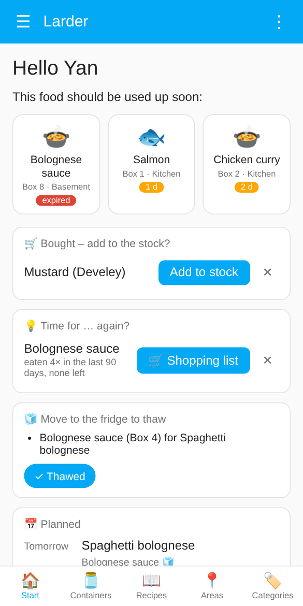
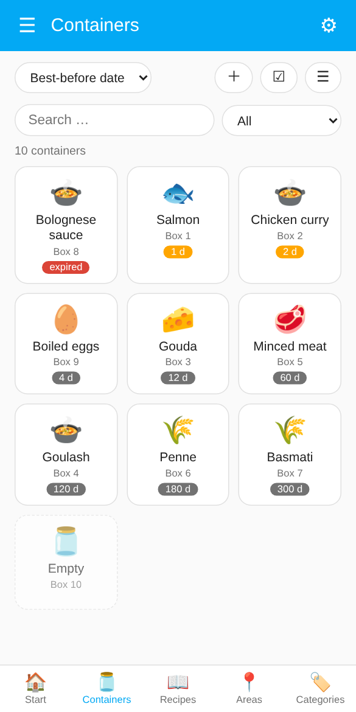
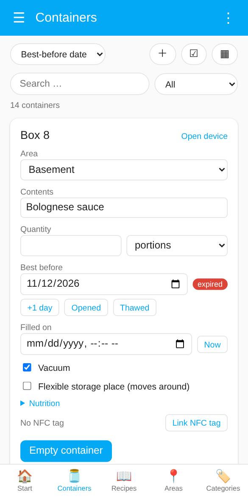
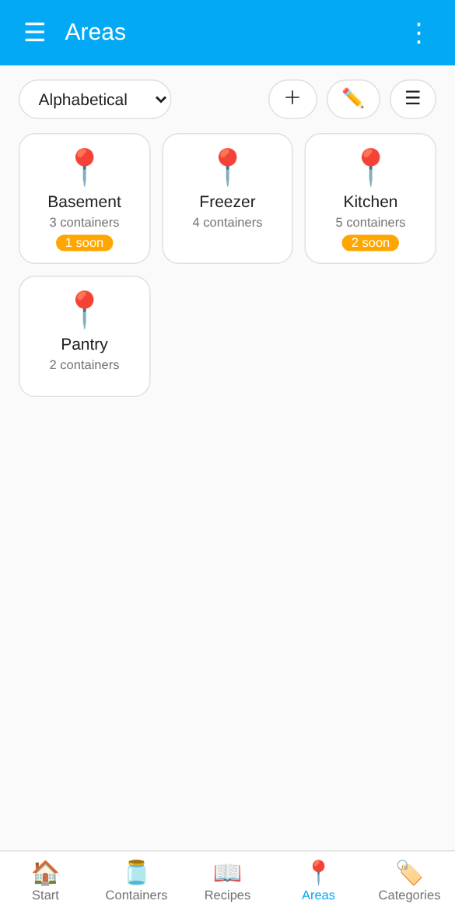
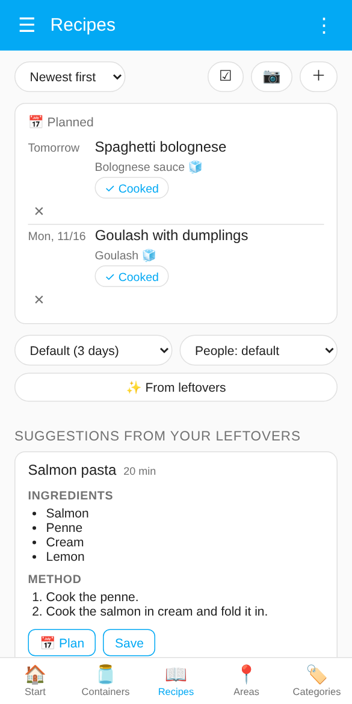
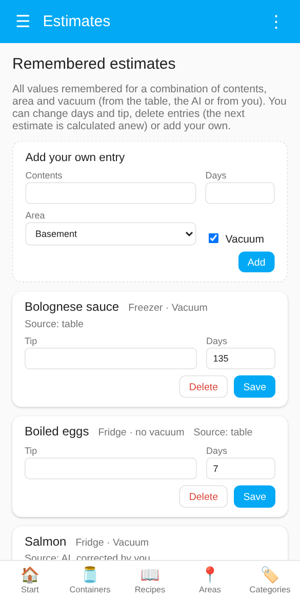
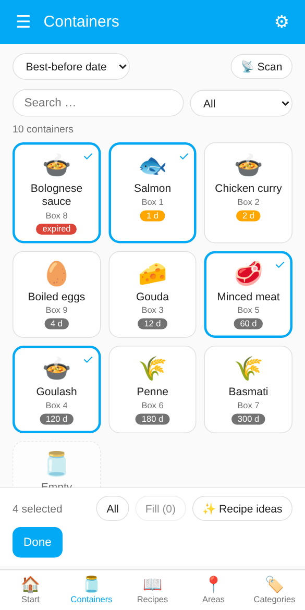
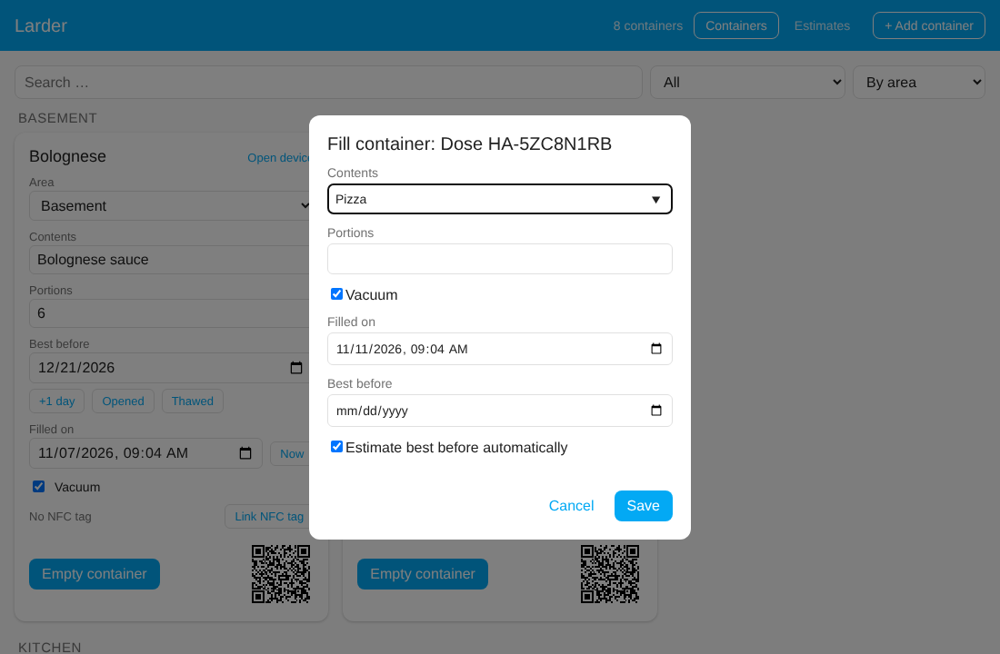
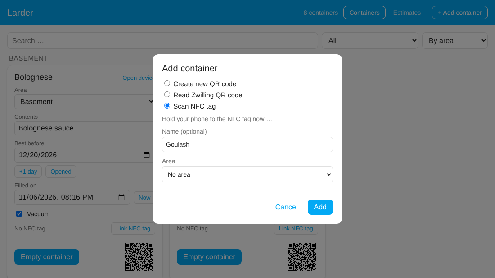

# Home Assistant Larder

**Food storage tracker** · formerly *Zwilling Food Storage*


[🇩🇪 Deutsch](README.de.md) · 🇬🇧 English

Home Assistant integration for reusable food storage containers: note what is inside and until when it keeps, get reminded before it expires, and find any container with a scan.

## Highlights

- 🖥️ **[Own dashboard](#dashboard-larder)** in the sidebar, made for the phone: start page, containers as tiles, list or cards with every detail, areas, categories and a recipe book; updates itself
- 🔖 **[Zwilling Fresh & Save QR codes](#scanning-in-the-app)**: the original codes on the lids keep working, with the 📷 scanner in the app (iOS and Android) or an [iOS Shortcut](#ios-shortcut-for-the-original-zwilling-codes)
- 🏷️ **[Your own QR code](#your-own-qr-codes)** and **[NFC tags](#nfc-tags)** for any container: scanning opens the container in the dashboard
- ✏️ **[Quick filling](#filling-containers)**: contents, quantity, best-before date and vacuum in a few taps, also for several containers at once and with a [serial scan](#selecting-several-containers)
- 🧮 **[Best-before estimate](#best-before-estimate)**: built-in shelf-life table, optionally with AI, with limits per storage place
- 🍳 **[Recipes](#recipes)**: ideas from what expires soon or from selected containers, a recipe book, and recipes read from a photo
- 🔔 **[Daily summary](#daily-summary)**: push with buttons to several phones and read out on Alexa or other speakers, optionally at the first motion in the kitchen
- 🛒 **[Shopping list](#shopping-list)**: on request, the contents of an emptied container go onto a to-do list, never leftovers
- 📅 **[Calendar entries](#best-before-dates-in-your-calendar)**: best-before dates in your calendar (Local Calendar, Google, CalDAV …)
- 🌍 Available in English and German

<p align="center">



</p>

> **New in 2.0:** the dashboard formerly known as *Larder experimental* is now the normal **Larder** dashboard. Everything of the old dashboard is in it (the cards with every field under *Containers → cards*, the remembered estimates under ⚙). See the [changelog](CHANGELOG.md).

## Contents

- [Why this project?](#why-this-project)
- [Installation](#installation) · [Getting started](#getting-started) · [Adding a container](#adding-a-container) · [Areas and labels](#areas-and-labels) · [Settings](#settings)
- [Dashboard "Larder"](#dashboard-larder) · [Selecting several containers](#selecting-several-containers) · [Filling containers](#filling-containers) · [Larder experimental](#larder-experimental)
- [Best-before estimate](#best-before-estimate) · [Recipes](#recipes) · [Daily summary](#daily-summary) · [Shopping list](#shopping-list) · [Calendar](#best-before-dates-in-your-calendar) · [Repairs](#repairs)
- [Scanning](#scanning): [in the app](#scanning-in-the-app), [own QR codes](#your-own-qr-codes), [NFC tags](#nfc-tags), [Zwilling codes (iOS Shortcut)](#ios-shortcut-for-the-original-zwilling-codes)
- [Reference](#reference): [entities](#entities), [services and events](#services-and-events), [webhook](#webhook-interface)
- [Alternatives](#alternatives) · [Development](#development)

## Why this project?

It all started with buying the Zwilling Fresh & Save Family Box. I noticed the QR code on the lids, which links each box to the management system in the Zwilling app. Then I found out that the app and its functions will be discontinued on 31 December 2026.

So I needed a replacement, and since I already run Home Assistant, building an integration there was the obvious choice.

Then came a second idea: why not give ordinary boxes a QR code too? Printing those is tedious, though, and I still had a few NFC stickers lying around. That is how the NFC tag integration was born.

## Installation

Since Home Assistant 2026.11 the community store HACS is built in as the **Marketplace**. Larder is not in the default catalogue yet, so you add it as a custom repository:

1. **Settings → Marketplace** → **Add from link**
2. URL: `https://github.com/yan14/ha-larder`, category **Integration**
3. Download "Larder" (adding a custom repository needs a GitHub connection; Home Assistant shows a code to enter on GitHub).
4. Set it up under **Settings → Devices & services → Add integration → Larder** (see below).

<details>
<summary>Home Assistant before 2026.11 (classic HACS)</summary>

1. HACS → three-dot menu → **Custom repositories**
2. URL: `https://github.com/yan14/ha-larder`, category **Integration**
3. Install "Larder" and restart Home Assistant.

</details>

> **Coming from the old "Zwilling Food Storage" (up to 0.10)?** Larder is a new integration (domain `larder`). Remove the old one, add Larder and add your containers again.

## Getting started

1. **Add your first container** under Settings → Devices & services → Add integration → Larder (see [Adding a container](#adding-a-container)). From then on the **Larder** dashboard is in the sidebar and adding more containers is quicker there (**＋** on the containers page).
2. **Give each container an area** that says where it is stored, for example "Fridge", "Freezer" or "Pantry". The estimate needs it. Optionally add a `Larder: …` label with the [template](#template-for-the-area-label) to the areas.
3. **Fill the containers** in the dashboard: contents, quantity, best-before date (or let Larder estimate it).
4. **Check the [settings](#settings)** once: estimate mode, periods, calendar, shopping list.
5. **Import the [blueprint](#daily-summary)** for a daily summary of what expires soon (push and/or voice).
6. **Put a code on the boxes:** print [your own QR code](#your-own-qr-codes), stick on an [NFC tag](#nfc-tags), or keep the original Zwilling codes and scan them with [📷 in the app](#scanning-in-the-app) or the [iOS Shortcut](#ios-shortcut-for-the-original-zwilling-codes).

## Adding a container

There are four ways. The two NFC ways need the Home Assistant app on a phone with NFC:

| Way | For |
|---|---|
| **Create new QR code** | Containers without a code; Larder creates an ID and a [QR code to print](#your-own-qr-codes) |
| **Read Zwilling QR code** | Original Zwilling containers |
| **Write a new NFC tag** | Blank NFC sticker; Larder creates the container and the tag and writes it |
| **Scan NFC tag** | Tag that is already written; Larder creates the container and links it |

### From the dashboard (recommended)

**＋** on the containers page of the dashboard offers all four ways:

<p align="center"></p>

- **Create new QR code** generates a new unique ID. Afterwards open the card (or the device) and print the QR code.
- **Read Zwilling QR code** needs the content of the original code or just the ID. When you come from [📷 in the app](#scanning-in-the-app) or the iOS Shortcut, the field is already filled in.
- **Write a new NFC tag** only appears in the app on a phone that can write tags. For **Scan NFC tag** you hold the phone to the tag. Details in [NFC tags](#nfc-tags).
- Name and area are optional. You can change both later (the area right on the card).

### Through the integration

You add the very first container this way, because the dashboard only appears afterwards: Settings → Devices & services → **Add integration** → "Larder". Only the two QR ways are offered here; link an NFC tag afterwards in the dashboard.

**Create new QR code**

For containers without a (readable) Zwilling code. The integration generates a new, unique ID in the format `HA-XXXXXXXX` (8 characters, without the easily confused 0/O and 1/I). The `HA-` prefix keeps it clearly apart from Zwilling IDs (e.g. `34OL`), so the two cannot overlap. You can optionally give the container a name. Afterwards you find the QR code as an image on the device (see [Your own QR codes](#your-own-qr-codes)).

**Read Zwilling QR code**

For existing Zwilling containers. Paste the content of the QR code, for example

```
zwilling://zwillingapp/food-storage/in/?tc=42ML30&s=m&cc=34OL
```

The ID alone (`cc`, here `34OL`) is enough as well. You can optionally give the container a name. Each container can only be added once.

Home Assistant has no camera in this dialog. Easier: add the first container with **Create new QR code**, then scan the Zwilling codes with [📷 in the app](#scanning-in-the-app). On iOS the [Shortcut](#ios-shortcut-for-the-original-zwilling-codes) also works.

## Areas and labels

Every container belongs to an **area** of Home Assistant (the area of its device). The area tells the estimate where the food is stored and groups the dashboard. Change it right on the container's card in the dashboard.

**Managing areas in the dashboard** (administrators): on the **Areas** page, **＋** adds a new area and **✏️** switches to editing. While editing, all areas of Home Assistant are listed; tap one to rename it or change its **storage kind**, which is its `Larder: …` label (other labels of the area are kept). **New label …** creates a label `Larder: <name>` right away; add the limits from the template below to its description in Home Assistant. **Open in Home Assistant** leads to the area's own page (picture, floor, deleting). Areas with a Larder label are listed even when they hold no container yet.

**Which areas the dashboard offers.** With many areas the dropdown gets long. Give the areas you use for food storage a **label** whose name is `Larder` or starts with `Larder:` (Settings → Areas, labels & zones → open an area → Labels). The dashboard then offers only these areas, in the dropdown and in the add dialog. The current area of a container always stays in its list. If no area has such a label, all areas are shown.

**Recommended:** one label per kind of storage place, named `Larder: Freezer`, `Larder: Fridge`, `Larder: 0 °C`, `Larder: Pantry` …, with the template below in its description. One label per area is enough. Do not put limits into a plain `Larder` label: it is shared by all your storage areas.

### Template for the area label

The description of a `Larder: …` label can follow a fixed template. Larder then reads it exactly (the AI still gets the whole text). The template is in English so that it looks the same in every language:

```text
Storage: freezer
Temperature: -18 °C
Max storage: 18 months
Notes: meat and fish
```

One entry per line is easiest to read; the entries may also follow each other in one line (`Storage: freezer Temperature: -18 °C Max storage: 18 months`) or be separated by `;`. Upper or lower case does not matter, every entry is optional. German keys work as well: `Lagerort`, `Temperatur`, `Max. Lagerzeit`, `Hinweis`.

| Key | Values | Effect |
|---|---|---|
| `Storage` | `fridge`, `0 °C compartment`, `freezer`, `freezer compartment`, `pantry`, `cellar` … | Storage place for the table, wins over the area name (a temperature sensor of the area still comes first). |
| `Temperature` | e.g. `-18 °C`, `4 °C` | Places the area by temperature, as before. |
| `Max storage` | a number with `days`, `weeks`, `months` or `years` (`Tage`, `Wochen`, `Monate`, `Jahre`); a plain number means days | Upper limit for table and AI estimates in this area. Remembered estimates are capped as well, your own corrections are not. The tip says when a value was capped. With several labels the shortest limit applies. |
| `Notes` | any text | Only a hint for the AI. |

A temperature sensor assigned to the area in its settings is used as well (the table uses it first, the AI gets its value).

## Settings

Settings → Devices & services → **Larder** → **Configure** (on any container; the settings apply to all containers):

| Setting | Default | What it does |
|---|---|---|
| Best-before estimate | Table only | Off, table only, table otherwise AI, AI only, see [Best-before estimate](#best-before-estimate) |
| AI task | HA default | Which *AI Task* entity to use, only needed if you have several |
| Shelf life after opening | 3 days | The **Opened** button shortens the best-before date to this many days |
| Time after thawing | 2 days | The same for the **Thawed** button |
| Period for recipe ideas | 3 days | Containers that expire within this many days are used for [recipe ideas](#recipe-ideas) (0 = today only) |
| "Expiring soon" from | 3 days | When a container counts as expiring soon: hint and filter in the dashboards, sensor `status`, default of `larder.get_expiring` |
| Vacuum preset | on | Preset of the **Vacuum** switch for new containers |
| NFC: notify the phone | on | Notification on the scanning phone after an [NFC scan](#nfc-tags) |
| Repair hints | on | Hints under Settings → System → Repairs, see [Repairs](#repairs) |
| Calendar | none | [Best-before dates in your calendar](#best-before-dates-in-your-calendar) |
| Shopping list | none | [Shopping list](#shopping-list) for emptied containers |
| Larder experimental | off | A second sidebar entry for trying new features, see [Larder experimental](#larder-experimental) |

The dialog also shows the **webhook URL** for the [iOS Shortcut](#ios-shortcut-for-the-original-zwilling-codes).

## Dashboard "Larder"

As soon as at least one container exists, a sidebar entry **Larder** appears. It needs no configuration, adapts to your Home Assistant theme and language (English and German) and updates itself. *The screenshots show demo data.*

A bar at the bottom switches between five pages:

- **Start**: a greeting with your Home Assistant name, tiles for everything that should be used up soon (expired first), and shortcuts to the recipe suggestions and the containers. In the Home Assistant app there is also **📷 Scan container** (see [Scanning in the app](#scanning-in-the-app)).
- **Containers**: all containers with a symbol for the kind of food, the contents, the container name and the days left.
  - **Search** in name, contents and area; **filter** by *expiring soon*, *expired*, *filled* or *empty*; **sort** by best-before date, area, alphabet or category (area and category are grouped). The number of containers shown is above the list.
  - The button on the right switches between **tiles**, a **list** and **cards with all details**. Your choice is remembered on the device.
  - Tap a filled container to open its card, tap an empty one to fill it right away (see [Filling containers](#filling-containers)).
  - **📷** scans a container (only in the Home Assistant app, see [Scanning in the app](#scanning-in-the-app)), **＋** adds one (see [From the dashboard](#from-the-dashboard-recommended)), **☑** starts the [selection](#selecting-several-containers).
- **Areas**: one tile per area with the number of containers and how many expire soon; tapping shows its containers. Administrators add areas with **＋** and rename them or set their storage kind with **✏️** (see [Areas and labels](#areas-and-labels)).
- **Categories**: the same for kinds of food (fish, meat, dairy, dishes and leftovers, dry goods, …). The category comes from the built-in shelf-life table and is the attribute `category` of the **Contents** entity. Containers without a match are listed under "Other", empty ones under "Empty".
- **Recipes**: your [recipe book](#recipe-book) with [recipe ideas](#recipe-ideas) and recipes read from a photo.

**The card of a container** (in the card view, or after tapping a container) shows everything and lets you edit it:

- area (dropdown; which areas are offered can be narrowed down with a label, see [Areas and labels](#areas-and-labels)), **contents**, **quantity and unit**, **best before** (with a hint "expired" or "n days left" once it expires soon), **filled on** ("Now" sets the current time),
- **+1 day** moves the best-before date by a day, **Opened** shortens it to the days set in the settings (default 3), **Thawed** does the same for food out of the freezer (default 2 days, do not refreeze). Neither ever extends a date; without a date one is set,
- **Estimate best before** (when [estimating](#best-before-estimate) is on, contents are entered and the date is empty),
- **Vacuum**, **Add to shopping list when emptied** (once a [shopping list](#shopping-list) is chosen), **Flexible storage place** with **After emptying, back to** (see [Filling containers](#filling-containers)), the **NFC tag** (link or unlink), **Open device** and **Empty container**.

**⚙** at the top (administrators) opens a menu with the [remembered estimates](#managing-remembered-estimates) and the integration settings. The ☰ is the Home Assistant sidebar.

<p>



</p>

The dashboard is visible to all users; only **administrators** can add containers, change areas, use the selection and see the estimates (the same restriction as in the settings). It is not a classic Lovelace dashboard and cannot be edited with the card editor.

**Links into the dashboard** (used by scans and notifications, also for your own automations): `/larder?open=<device id>` opens a container (an empty one with the fill dialog), `/larder?cc=<container id>` does the same by container ID and counts as a scan, `/larder?add=<code>` opens the add dialog with the code, `/larder?view=recipes` (or `start`, `containers`, `areas`, `categories`) opens a page.

### Selecting several containers

**☑** on the containers page or on the recipe page switches to selection: tap containers to select them, **All** selects everything shown. The bar at the bottom then offers

- **Fill (n)** (administrators): fills all selected *empty* containers at once with the same contents, vacuum, filled-on date and best-before date, for example after cooking a big batch or after shopping. Quantity counts per container. With the estimate switched on, each container gets its own estimate.
- **✨ Recipe ideas**: asks the AI for recipes that use exactly the selected *filled* containers, whatever their best-before date (expired ones are still left out).
- **Done** ends the selection.

**Serial scan** (administrators): during the selection **📡 Scan** adds every container you scan. In the Home Assistant app a switch **📷 QR code | 📶 NFC** appears at the top; tap or swipe it to change the method at any time:

- **QR codes** in the Home Assistant app on iOS and Android: the app's own scanner opens and stays open, scan one code after the other; each hit shows the container name and the number selected. Own QR codes and the original Zwilling codes both work; a container that has not been added yet is reported. **Switch to NFC** in the scanner (or closing it) changes to NFC; the serial scan keeps running.
- **NFC tags** linked to a container: choose **NFC** (this closes the QR scanner; while the camera is in use the iPhone does not read NFC tags). Then hold the phone to a tag; the iPhone shows a banner "Open in Home Assistant" at the top, tap it. The container is selected, and you stay on the page. Android reads the tag directly. While a serial scan is running, the phone gets no Larder notification after an NFC scan.
- **⏹ Stop scanning** ends the serial scan.

Then fill them all at once or ask for recipe ideas, which makes an inventory of a freezer or a shopping trip quick.

<p align="center"></p>


## Filling containers

<p align="center"></p>

An empty container shows a **Fill** button. It opens a small dialog: **contents** (with suggestions from what you entered before, newest first, then your remembered estimates), **quantity and unit** (optional), **vacuum**, **filled on** (preset to now), optionally a **best-before date**, and **Estimate best before automatically** (only if estimating is on and the date is empty). **Save** sets everything and estimates the date.

The dialog also opens by itself right after you add a new container in the dashboard (including after writing an NFC tag), so you can fill it straight away. It also opens after a scan (📷 in the app, own QR code, NFC tag, Shortcut) when the container is empty; a container that already has contents opens its card.

**Containers that move around:** some containers always stand in the same place, others (for example vacuum boxes) are in the fridge one day and in the 0 °C drawer the next. Switch on **Flexible storage place** on the card of such a container. The fill dialog then also asks for the **area** (administrators), so the estimate uses the right place, and **Empty container** puts the container back into the area chosen under **After emptying, back to** (for example the pantry where the empty boxes are kept). Containers without the switch keep their area and the fill dialog does not ask.

**Several containers at once:** select the empty containers (or scan them one after another) and press **Fill (n)**: the same dialog fills all of them, see [Selecting several containers](#selecting-several-containers).

## Larder experimental

An optional second sidebar entry for trying new features before they reach the normal dashboard. Turn it on under Settings → Devices & services → **Larder** → **Configure** → **Show "Larder experimental" in the sidebar**. At the moment it is the same as the **Larder** dashboard; the normal dashboard is not affected by anything that is tried out there.

*Up to version 1.12 this was the place of the tile-based dashboard, which is now the normal one.*

## Best-before estimate

The integration can suggest a best-before date. There are two sources, and you decide which one is used (Settings → Devices & services → **Larder** → **Configure**):

| Mode | What happens |
|---|---|
| **Off** | No estimates, the button is hidden. |
| **Table only** (default) | A built-in shelf-life table. Works offline, needs no AI service, costs nothing. |
| **Table, otherwise AI** | Table first. If the table has no entry for the contents or cannot place the area, the AI is asked. |
| **AI only** | Always the AI (needs the *AI Task* integration, see below). |

Values you corrected yourself always come first (see "Remembering").

### The table

More than 50 entries for common food: dishes and leftovers, soups, raw meat, fish, cold cuts, dairy, cheese, eggs, fruit and vegetables, bread and cake, pasta, rice, flour, nuts, coffee, tea, spices and more. For each entry it knows the shelf life in **fridge**, **0 °C compartment**, **freezer** and **pantry**. Where a food does not belong in a place (for example lettuce in the freezer or raw meat in the pantry) it says so and does **not** make up a date.

How a container is matched:

- **Contents** are matched by keywords in German and English, e.g. "Tomatensuppe", "Penne", "leftover chicken curry". The most specific match wins ("boiled eggs" beats "eggs"), the order of the words does not matter ("Eier gekocht" = "gekochte Eier"), and in compound words the last part counts ("Butterkekse" are cookies, "Lachsfilet" is fish). When the table gets better, remembered table values are recalculated on their next use; your own corrections stay. Dates already set on a container are not changed: estimate again (with *overwrite*) if needed.
- **Storage place** comes from the area: a temperature sensor on the area first, then the `Storage` or `Temperature` line of the [area label](#template-for-the-area-label), then a temperature in a label or the area name (for example "about -18 °C"), then words such as *fridge*, *0 °C compartment*, *freezer*, *freezer compartment* (a bit less cold, so shorter), *pantry*, *cellar*. If it cannot place the area, it tells you instead of guessing.
- **Vacuum** extends the time (about +30 % cold, +50 % in the freezer and pantry). Perishable food in the fridge (minced meat, fish, cold cuts, leftovers, soft cheese, …) gets **no** bonus, because vacuum does not make it safer.

The values are deliberately cautious and based on common guidance (for example the USDA/FSIS cold storage chart and German consumer-advice centres). They are rules of thumb for the home, **not a food-safety guarantee**. For bought products the printed best-before date is more reliable. Write "cooked" or "opened" into the contents if it matters. Spotted a value that is off or a food that is missing? Entries are listed in `custom_components/larder/shelf_life.py`; issues and pull requests are welcome.

### AI (optional)

The AI mode uses the **AI Task** feature of Home Assistant, so it works with whichever AI service you have set up there (for example Anthropic, OpenAI, Google or a local Ollama).

1. Set up an AI service with an *AI Task* in Home Assistant (Settings → Devices & services). This needs a Home Assistant version that includes the AI Task integration.
2. Choose **Table, otherwise AI** or **AI only** in the settings. The field "AI task" is only needed if you have more than one.

The AI receives the area name, so it understands "0 °C compartment" or "Freezer" on its own. You can give it more precise hints:

- **Temperature sensor of the area:** in the area settings you can assign a temperature sensor. If it has a valid value, it is passed on (for example a real freezer temperature). The table uses it as well.
- **Label with description:** assign a label to the area and write a hint in its description, for example "about -18 °C, meat and fish", or use the [template](#template-for-the-area-label). Name and description are passed on.

Only the contents text, the area name with its hints, vacuum yes/no and the filling date are sent, to the AI service you chose. Depending on the provider this may cost a small amount. Nothing is sent in the table-only mode.

### Using it

Set **Vacuum** per container and assign each container to an **area** that describes where it is stored, e.g. "Fridge", "0 °C compartment", "Freezer" or "Pantry". Without an area the estimate is refused with a hint.

On the dashboard the button **Estimate best before** appears once contents are entered and the best-before date is empty. It shows where the value came from: *table*, *AI*, or *table, corrected by you* / *AI, corrected by you* if you changed the date afterwards. You can also call the service (in automations, scripts or Developer tools):

```yaml
action: larder.estimate_best_before
target:
  entity_id: date.dose_34ol_best_before
data:
  apply: true       # false: only return the suggestion
  overwrite: false  # true: also estimate when a date is already set
response_variable: result
```

The result contains `best_before`, `days`, `tip` (a short storage tip), `source` (`table`, `ai` or `learned`), `basis` (for the table: matched food and place), `cached` and `applied`. The date is counted from **Filled on** (or from today if that is empty). **An existing best-before date is never overwritten** unless you set `overwrite`.

**Remembering.** Each result is stored for the combination of *contents + area + vacuum* and is not calculated or asked again. If you change a suggested date afterwards, your value is remembered for the same combination and wins over table and AI. The data lives in Home Assistant's `.storage/larder.estimator`.

**Limits for AI values.** A pure AI estimate is capped per storage place (fridge 60 days, 0 °C drawer 90 days, freezer 18 months, pantry 3 years, unknown place 1 year); the tip says when a value was capped. AI estimates you never corrected are asked again after 12 months (if the AI cannot be reached, the old value stays). Table values and your own corrections are never capped or refreshed by these defaults. Your own limit per area comes from the [area label](#template-for-the-area-label) (`Max storage: 3 years`) and applies to table and AI values.

### Managing remembered estimates

Administrators open the list with **⚙ → Remembered estimates** in the dashboard. It lists everything that is remembered for a combination of contents, area and vacuum, with its source (table, AI, or corrected by you with the original source). There you can

- **change** the days and the tip of an entry (it then counts as corrected by you),
- **delete** an entry; the next estimate for that combination is calculated anew (table or AI),
- **add** your own entry for a combination of contents, area and vacuum.

The built-in table itself is not edited here. Entries you add or change simply take precedence over it for that exact combination.

**Upgrading from 0.5:** "Estimate with AI" switched on becomes **AI only** (as before); switched off becomes **Table only**.

## Recipes

All recipe features use the Home Assistant **AI Task** integration (the same one as for the [AI estimate](#ai-optional)); the estimate mode does not matter. Depending on the provider each request may cost a small amount, and nothing is sent without you pressing a button or running an automation.

### Recipe ideas

The AI suggests dishes that use up what expires soon.

**In the dashboard** (administrators): on the **Recipes** page press **✨ From leftovers**. Next to it choose the period (the default comes from **Configure** → *Period for recipe ideas*, 3 days out of the box; a fixed number of days; or **All containers**, which also includes containers without a best-before date) and optionally the number of people. You get up to three recipes with the containers they use, extra ingredients (only common staples), time and short steps, and you can **save** the ones you like to the [recipe book](#recipe-book). Expired containers and containers without contents are never used.

**In automations:** the service `larder.suggest_recipes` returns the same.

```yaml
action: larder.suggest_recipes
data:
  days: 3        # containers expiring within 3 days (omit to use the period from the settings)
  # all_containers: true   # no period: every filled container
  # containers: [device_id, …]   # exactly these containers
  servings: 2    # optional, default 2 people
  max_recipes: 3 # 1 to 5
response_variable: ideas
# ideas.recipes (title, minutes, uses, extra_ingredients, steps), ideas.summary (text),
# ideas.ingredients (the containers used), ideas.count
```

**In the daily notification:** the [blueprint](#daily-summary) has the switch **Add recipe ideas**. The recipes are appended to the message; if the AI fails, the normal message is still sent. Re-import the blueprint to get the new switch.

Only the contents, quantity with unit, remaining days and storage place (area name) are sent to the AI service you chose, never container names, IDs or anything else. The suggestions are ideas from a language model, not tested recipes: check that food is safe to eat, especially thawed or older food.

**From selected containers:** select containers and press **✨ Recipe ideas**, see [Selecting several containers](#selecting-several-containers). In automations use `containers` with the device IDs.

### Recipe book

The **Recipes** page is your own recipe book (stored in Home Assistant, `.storage/larder.recipes`). Everyone can read it; administrators add (**＋**), edit and delete recipes. Sort by newest or by name; tap a recipe to see ingredients and steps.

**Recipe from a photo or file** (📷, administrators): take a photo of a recipe from a cookbook or a card, pick up to four photos (for example two pages) or a PDF. The AI reads the recipe, translates it into your language if needed and opens it for you to **check**; nothing is saved until you tap *Save*. The selected AI task must support attachments (for example Anthropic, OpenAI, Google). Photos are shrunk before uploading, are kept in Home Assistant's media folder (`media/larder/recipe_photos`) only while they are read and are deleted afterwards. Only the photo or file is sent, to the AI service you chose.

## Daily summary

The included blueprint sends a **daily summary** of what expires soon. Nothing is sent when nothing expires. Expired containers are named with their container and the note **should be emptied**, so you know which one to clear out.

[](https://my.home-assistant.io/redirect/blueprint_import/?blueprint_url=https%3A%2F%2Fgithub.com%2Fyan14%2Fha-larder%2Fblob%2Fmain%2Fblueprints%2Fautomation%2Flarder%2Fexpiry_notification.yaml)

| Option | What it does |
|---|---|
| **Push notification** | One or more notify actions, separated by commas (`notify.mobile_app_your_iphone, notify.mobile_app_partner`), or a notify group. Empty for voice only. |
| **Buttons in the push** | **Recipes** opens the recipe page of the dashboard (or of [Larder experimental](#larder-experimental), if you choose so), **Dashboard** opens Larder. Tapping the notification itself opens the dashboard as well. |
| **Voice output** | Notify actions that read the summary out loud, for example `notify.alexa_media_kitchen` (Alexa Media Player) or a group of speakers. The spoken text is made for listening: "Salmon expires today. Gouda expires tomorrow. Pizza in Box 3 has expired and should be emptied." (at most six containers, the rest is counted). With recipe ideas it adds "Idea: …". |
| **Voice options** | Extra data for the voice action. Alexa Media Player needs the type, for example `type: announce` (with chime) or `type: tts`. |
| **Speak only when someone is home** | Persons, groups or zones; the voice output is skipped when nobody is home. The push is always sent. |
| **Time** and **motion sensors** | Without motion sensors the summary is sent at the time. With motion sensors (for example the kitchen) it is sent at the **first motion after that time**, once per day, and at the **latest time** at the latest if nobody came by. |
| **Days ahead**, **include expired**, **add recipe ideas** | As before. Recipe ideas need the *AI Task* integration; if the AI fails, the message is still sent. |

Existing automations keep working; re-import the blueprint to get the new options.

**Without the blueprint:** the service `larder.get_expiring` returns the same data for your own automations:

```yaml
action: larder.get_expiring
data:
  days: 3               # containers expiring within 3 days (default: "Expiring soon" from the settings)
  include_expired: true
response_variable: result
# result.count, result.expired, result.summary (text with bullets for a push),
# result.speech (sentences to read out), result.labels (button titles),
# result.items (name, content, quantity, unit, area, best_before, days_left, status)
```

`larder.suggest_recipes` also returns `speech` ("Idea: …"). For your own dashboards there is the sensor **Days until best before** on every container.

## Shopping list

Under Settings → Devices & services → **Larder** → **Configure** you can pick a **to-do list** of Home Assistant, for example the built-in *Shopping list*, Todoist or Bring!. Each container then has a checkbox **Add to shopping list when emptied** (the `Shopping list` switch, off by default). When you press **Empty container** on a container with the checkbox on, its contents are added to the list, for example "Basmati".

- Not everything belongs on the list: leftovers like "pizza leftovers" simply stay unchecked and are never added. The setting belongs to the container and is kept when you empty it, so rice is always bought again and pizza never.
- An item that is already open on the list is not added twice. Items that are already checked off do not count, so you can buy the same thing again.
- Without a chosen list nothing happens and the checkbox is hidden. If the list is unavailable, the container is still emptied.
- Planned: several target lists (for example butcher and supermarket), and adding expired containers as well.

## Best-before dates in your calendar

Under Settings → Devices & services → **Larder** → **Configure** you can pick an existing **calendar** (Google, CalDAV, *Local Calendar* …). Every container then gets an all-day event "Best before: Pizza" on its best-before date. The event is created when a date is set, moved when the date or the contents change, and deleted when the date is cleared, the container is emptied or removed, or you pick another calendar. Your own events are recognised by a tag in the description and never touched otherwise.

**Clean-up.** On every start and whenever you save the settings, Larder checks the whole calendar, keeps exactly one event per container and removes duplicates. The service `larder.rebuild_calendar` does the same on demand and also removes events of containers that no longer exist. With `include_unmarked: true` it additionally removes events titled "Best before: …" / "MHD: …" that carry no Larder tag (for calendars that drop the description) and creates them anew.

The calendar must be able to create **and** delete events. Read-only calendars (for example an iCal link) cannot be used and are rejected when you save the settings; the *Local Calendar* integration is a good choice if you have no other one. **CalDAV** (iCloud, Nextcloud …) works: Home Assistant's CalDAV calendar can only create events by itself, so Larder reads and deletes its own events directly through the CalDAV connection.

## Repairs

Larder shows hints under **Settings → System → Repairs** when containers need attention. There is one hint per kind (listing up to ten containers), not one per container:

| Hint | When |
|---|---|
| **Containers without an area** | A container has no area, so the estimate does not know where the food is stored. |
| **Filled containers without a best-before date** | A container has contents but no date. It then appears neither in the daily summary nor in the calendar. |
| **Containers expired more than 7 days ago** | Time to empty them. |

A hint disappears by itself as soon as no container is affected any more (checked on every change and once a day). You can switch the hints off in the [settings](#settings) ("Repair hints").

## Scanning

There are four ways to get from a container to its entry in the dashboard. They can be mixed freely. For an inventory, the [serial scan](#selecting-several-containers) selects many containers in a row.

### Scanning in the app

In the Home Assistant app (**iOS and Android**) the dashboard has a **📷** button: on the start page (**📷 Scan container**) and next to **＋** on the containers, areas and categories pages. It opens the app's own QR scanner and reads **both kinds of codes**, your own and the original Zwilling codes:

- **Known container:** its card opens; an empty container opens the fill dialog right away. The event `larder_dose_scanned` fires as with any other scan.
- **Zwilling code that has not been added yet** (administrators): the dialog **Add container** opens with the code already filled in.
- **Anything else:** the scanner says "Not a Larder code" and stays open for the next try.

The button only appears in the app on a device with a camera, not in a desktop browser. Outside the app, use the camera app for your own codes and the [iOS Shortcut](#ios-shortcut-for-the-original-zwilling-codes) for Zwilling codes.

### Your own QR codes

Every container has the image entity **QR code**. Print it and stick it on the container (open the container's device or the **QR code** entity, save or print the image; the content is also in the attribute `qr_content`).

Scanning it with the camera app works **like an NFC tag**: the Home Assistant app opens the **Larder** dashboard on that container, an empty one right with the fill dialog, and the event `larder_dose_scanned` fires (with `source: qr`) for your automations. The code contains the ID of the container (`homeassistant://navigate/larder?cc=<ID>`), not the device ID, so it stays valid if you delete the container and add it again. If you have several Home Assistant servers in the app, it asks which one you mean.

The same codes work in the [serial scan](#selecting-several-containers) of the dashboard.

> Codes printed before version 2.0 still open the device page of the container. Print them again to get the new behaviour.

### NFC tags

<p align="center"></p>

Instead of printing a QR code you can stick an NFC tag on the container. This uses Home Assistant's own **tags**: every scan fires a `tag_scanned` event, and the integration remembers which tag belongs to which container. Other tags in your home are ignored.

**Quickest way (in the Home Assistant app):** open the dashboard, press **＋** on the containers page **→ Write a new NFC tag**, enter a name and press **Add**. Larder creates the container, creates a new tag in Home Assistant, links the two, and the app opens its tag writer: hold the phone to an empty NFC tag, done. The option only appears in the Companion app on a phone that can write NFC tags (not in a desktop browser).

If you already have a tag written with the Home Assistant app (Settings → Companion App → NFC, or Settings → Tags), link it instead:

1. **Link it to a container** in the dashboard (administrators): on the card press **Link NFC tag** and hold the phone to the tag. Or use **＋ → Scan NFC tag**, which creates a new container and links the tag in one go.
2. **Scan it later.** If the dashboard is open, it opens the container (an empty one with the fill dialog). Otherwise the scanning phone (Companion app) gets a notification, and tapping it opens the dashboard on that container. iPhones show their own banner after reading a tag, tap it first.

For your own automations a linked scan fires the event `larder_dose_scanned` (`cc`, `device_id`, `name`, `scanned_by`). The notification can be switched off in the settings ("NFC: notify the phone"). One container has at most one tag, and a tag belongs to one container.

### iOS Shortcut for the original Zwilling codes

This way is meant for the **printed Zwilling QR codes** when you want to scan them **without opening the Home Assistant app first** (e.g. from the Home Screen or the Action button). Inside the app, [📷](#scanning-in-the-app) does the same without any setup. For codes you created yourself you do not need it, just scan them with the camera app.

On **Android** there is no built-in equivalent; use [📷 in the app](#scanning-in-the-app).

The QR code contains a link with the scheme `zwilling://`, which belongs to the discontinued Zwilling app. The **camera app is not suitable** for it: it wants to open the link in the Zwilling app and does not give you the text to copy. The Shortcut only reads out the text and does not open the link.

#### 1. Find the webhook URL

Settings → Devices & services → **Larder** → **Configure** on one of the containers. The dialog shows the webhook URL, built like `https://<your-HA-URL>/api/webhook/<long-secret-ID>`. The URL is the same for all containers, so you only need it once. You can close the Configure window with "Submit" afterwards, it changes nothing.

The long ID is the access protection, so treat the URL like a password. Which address is shown at the front (internal or external) depends on your Home Assistant configuration. When you are away from home the Shortcut only works with an address that is reachable from outside.

#### 2. Create the Shortcut (once)

Shortcuts app → new shortcut with these actions, in this order:

1. **Scan QR/Bar Code**
2. **Get Contents of URL**:
   - URL: your webhook URL from step 1
   - Tap "Show More", method **POST**, request body **JSON**
   - "Add new field": type **Text**, key `code`, value: the result of action 1 (pick the "QR/Bar Code" variable from the variable bar)
3. **Get Dictionary Value**: key `app_url`, from "Contents of URL"
4. **Open URLs**: opens the value from action 3

<p align="center"></p>

The screenshot shows the finished Shortcut. Replace `ha.example.org` and `DEINE-WEBHOOK-ID` with your own address and the ID from step 1.

Give it a name, e.g. "Scan container". Using the share icon you can add it to the Home Screen or assign it to the Action button. On the first run iOS asks for camera access and whether the Shortcut may access the URL.

#### 3. Use it

Run the Shortcut and scan the QR code on the container. The Home Assistant app then opens:

- **Container known:** on the dashboard "Larder" with the card of the container. An empty container opens the **Fill** dialog straight away (see [Filling containers](#filling-containers)).
- **Container new:** on the dashboard "Larder", where the **Add container** dialog opens with the scanned code already filled in. Optionally enter a name and area and tap **Add**. This needs an administrator account; other users get a note with the scanned code.

If you have several Home Assistant servers in the app, it asks which one you mean when opening.

## Reference

### Entities

Every container becomes a device (identified by its ID, the `cc` parameter of a Zwilling QR code) with:

| Entity | Type | Purpose |
| --- | --- | --- |
| **Filled on** | `datetime` | When was the container filled? |
| **Best before** | `date` | Best-before date (MHD) |
| **Contents** | `text` | What is in the container? |
| **Empty container** | `button` | Resets the whole container: **Contents** become empty, **Best before** and **Filled on** are cleared. **Vacuum** is deliberately kept, it is a property of the container, not of its contents |
| **Quantity** | `number` | How much is in the container, e.g. 4 (0 = not specified). Reset by **Empty container** |
| **Unit** | `select` | Unit of the quantity: portions (default), pieces, slices, grams or milliliters. Reset to portions by **Empty container**. Both show up in the dashboard, the fill dialog, the `get_expiring` result and the recipe ideas. Tip: use *portions* for finished dishes (chili, soup) and *pieces* or *slices* for countable food (eggs, ham) |
| **Vacuum** | `switch` | Is the container vacuum-sealed? On by default for new containers; change the preset under **Configure** if most of your boxes are not vacuum-sealed. Used for the estimate |
| **Shopping list** | `switch` | Should the contents go onto your shopping list when the container is emptied? Off by default, per container, and kept by **Empty container**. Only has an effect once a list is chosen under **Configure**, see [Shopping list](#shopping-list) |
| **Flexible storage place** | `switch` | For containers that move around (fridge one day, 0 °C drawer the next). Off by default. When on, the fill dialog asks for the area, and **Empty container** puts the container back into the **storage place after emptying**. Kept by **Empty container** |
| **Storage place after emptying** | `select` | The area a flexible container goes back to when it is emptied (or *stays where it is*). Only used when **Flexible storage place** is on. The area ID is in the attribute `area_id`, so renaming the area does no harm |
| **Days until best before** | `sensor` | Days left until the best-before date (negative = expired). The attribute `status` is `ok`, `soon` (3 days or less, see [Settings](#settings)), `expired` or `none` |
| **QR code** | `image` | The container's QR code as an image: scanning it with the camera app opens the container in the Larder dashboard, see [Your own QR codes](#your-own-qr-codes) |

The values survive restarts. "Empty container" is a regular button entity, so you can use it on dashboards and in automations via `button.press`.

**Clearing a single field:** the date entities of Home Assistant itself cannot be cleared from the entity dialog (the picker's "Clear" button has no effect there). Use one of these instead: empty the field in the dashboard, press **Empty container** to reset everything, or call the services `larder.clear_best_before` / `larder.clear_filled_at` (for example in Developer tools or an automation).

### Services and events

| Service | What it does |
|---|---|
| `larder.estimate_best_before` | Estimate the best-before date of a container, see [Using it](#using-it) |
| `larder.clear_best_before` / `larder.clear_filled_at` | Clear a single date |
| `larder.mark_opened` / `larder.mark_thawed` | Shorten the best-before date after opening or thawing (`days` optional) |
| `larder.get_expiring` | List what expires soon, with a ready-made text, see [Daily summary](#daily-summary) |
| `larder.suggest_recipes` | [Recipe ideas](#recipe-ideas) from what expires soon, from all or from selected containers |
| `larder.rebuild_calendar` | Clean up the [calendar](#best-before-dates-in-your-calendar) |

The event `larder_dose_scanned` (`cc`, `device_id`, `name`, `scanned_by`) fires when a linked [NFC tag](#nfc-tags) or one of [your own QR codes](#your-own-qr-codes) is scanned (then with `source: qr`).

### Webhook interface

The webhook is a regular Home Assistant webhook and accepts `POST` (and `GET`).

Request, in one of these forms:

```
POST /api/webhook/<ID>   {"code": "zwilling://zwillingapp/food-storage/in/?tc=42ML30&s=m&cc=34OL"}
POST /api/webhook/<ID>   {"cc": "34OL"}
POST /api/webhook/<ID>   zwilling://zwillingapp/food-storage/in/?tc=42ML30&s=m&cc=34OL   (plain text)
GET  /api/webhook/<ID>?code=34OL
```

Response (`200`, JSON):

```json
{
  "known": true,
  "cc": "34OL",
  "name": "Dose 34OL",
  "device_id": "0a1b2c…",
  "path": "/larder?open=0a1b2c…",
  "app_url": "homeassistant://navigate/larder?open=0a1b2c…",
  "device_path": "/config/devices/device/0a1b2c…",
  "device_app_url": "homeassistant://navigate/config/devices/device/0a1b2c…"
}
```

For a known container `path` and `app_url` open the dashboard on that container (an empty one gets the fill dialog straight away); `device_path` and `device_app_url` point to the device page instead. For an unknown container `known` is `false`, and `path` and `app_url` point to the dashboard with the add dialog (`/larder?add=<ID>`). If the request contains no valid ID, the webhook answers with `400` and `{"error": "invalid_code"}`. The webhook only reads and never changes any values.

## Alternatives

This integration tracks the **physical, reusable container** (one device per container with its own QR code). If you would rather manage **products and stock**, these projects may fit better:

- [Fridge Assistant](https://github.com/MaxGramser/fridge_assistant): inventory for fridge, freezer and pantry with barcode scanning, AI shelf-life estimates and printed labels.
- [Grocy](https://github.com/custom-components/grocy): the Home Assistant integration for the self-hosted Grocy server (stock, best-before dates, shopping lists, chores).

## Development

Releases are created automatically: when `version` in `manifest.json` is new on `main`, a GitHub workflow creates the tag `v<version>` and a release. Its text is the section `## <version>` of [CHANGELOG.md](CHANGELOG.md) (write it together with the version bump, a test checks that it exists), followed by the automatically generated comparison link.

```
pip install -r requirements_test.txt
pytest

npm install
npm test        # tests for the panel (jsdom)
```

The screenshots come from the real code with demo data: serve the repository (`python -m http.server`) and open `docs/demo/dashboard.html?lang=en&view=containers` (options in the file) or, for the dialogs, `docs/demo/index.html?lang=en&dialog=scan`.
