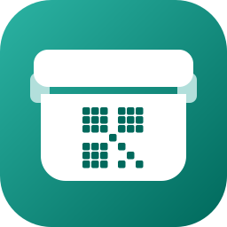
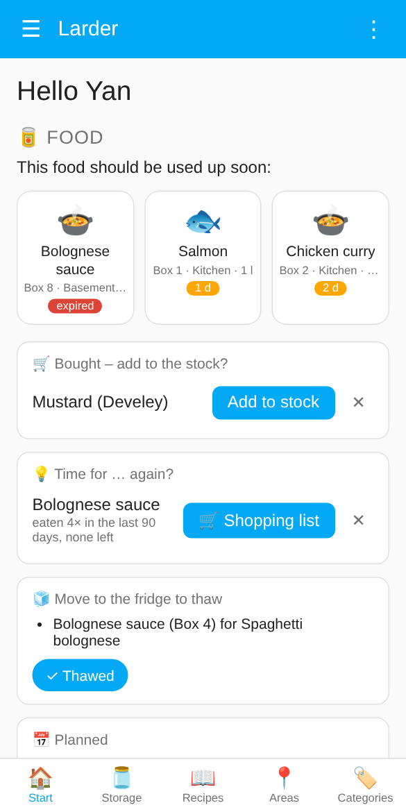

# Home Assistant Larder

**Food storage tracker** · formerly *Zwilling Food Storage*



[🇩🇪 Deutsch](README.de.md) · 🇬🇧 English

Home Assistant integration for reusable food storage containers: note what is inside and until when it keeps, get reminded before it expires, and find any container with a scan.

## Highlights

- 🖥️ **[Own dashboard](docs/en/dashboard.md#dashboard-larder)** in the sidebar, made for the phone: **Start · Larder · Shopping · Recipes · More**, with **🔍 search** and **📷 one scan button** on every page and quick actions on the start page; tiles, list or cards with every detail; updates itself
- 🔖 **[Zwilling Fresh & Save QR codes](docs/en/scanning.md#scanning-in-the-app)** keep working, **[your own QR codes](docs/en/scanning.md#your-own-qr-codes)** as a [label sheet](docs/en/scanning.md#label-sheet), and **[NFC tags](docs/en/scanning.md#nfc-tags)** – written by the app in one step; a new tag is simply scanned and Larder asks what it is for
- 📍 **[Compartments](docs/en/scanning.md#compartments)** (a drawer, a box, a shelf) with their own tag or label: a scan shows what is there, with −1 and a stocktake; **More → 🏷 Compartments & tags** keeps track of them
- 🛍 **[Bags and packs](docs/en/containers.md#bags-and-packs)**: single-use vacuum bags that disappear after emptying, and stock without a container (cans, jars) by barcode, receipt photo or by hand
- 📥 **[Putting things away](docs/en/good-to-know.md#putting-things-into-stock-the-same-rules-everywhere)** the same way everywhere – scanning, the shopping mode, the 🧾 receipt or *bought – into stock?*: known products go to their usual place, price and best-before date (📷 from a photo) right away, the shopping list is ticked off
- 🥫 **[Stock](docs/en/containers.md#stock)**: packs summed over every place, oldest first, minimum stock, *lasts about …*, *running low* and **🔁 buy again by consumption**, prices with history, opened packs, a [stocktake](docs/en/containers.md#stocktake) per compartment, [recall warnings](docs/en/containers.md#recall-warnings) and a **[history per product](docs/en/dashboard.md#product-history)**
- 🧻 **[Household items](docs/en/containers.md#household-items)**, 💊 **[medicines](docs/en/containers.md#medicines-pharmacy)** and 🎟️ **[vouchers](docs/en/containers.md#vouchers)**: counted in pieces and packs, with their own areas, longer warnings, replacement intervals and reminders
- ✏️ **[Quick filling](docs/en/containers.md#filling-containers)**: contents, quantity, best-before date and vacuum in a few taps, also for several containers at once or as [batch cooking](docs/en/containers.md#batch-cooking)
- 🧮 **[Best-before estimate](docs/en/best-before.md#best-before-estimate)**: built-in shelf-life table, optionally with AI, that [learns from your corrections](docs/en/best-before.md#managing-remembered-estimates)
- 🍳 **[Recipes](docs/en/kitchen.md#recipes)** from what expires soon, a recipe book, recipes from a photo, a [meal plan](docs/en/kitchen.md#meal-plan) with thaw reminder and a [week suggestion](docs/en/kitchen.md#week-suggestion)
- 🛒 **[Shopping](docs/en/kitchen.md#shopping-list)**: several lists, a [shopping mode](docs/en/kitchen.md#shopping-mode) by store section where ticking off puts things into stock, [recurring purchases](docs/en/kitchen.md#recurring-purchases) and an [emergency supply check](docs/en/kitchen.md#emergency-supply)
- 🔔 **[Notifications](docs/en/good-to-know.md#notifications-which-blueprint-for-what)**: a daily summary with buttons (used up, thrown away, +2 days, on the list) to several phones and speakers, a weekly review, a monthly report, reminders for medicines and recalls
- 📊 **[Statistics](docs/en/dashboard.md#statistics)** of what was eaten and thrown away (with its value), [data care](docs/en/dashboard.md#data-care), [overview sensors](docs/en/reference.md#overview-sensors) and [cards](docs/en/dashboard.md#card-for-your-dashboards) for your own dashboards, [calendar entries](docs/en/kitchen.md#best-before-dates-in-your-calendar)
- 🌍 Available in English and German

<p align="center">



</p>

## What's new

> **5.3:** [compartments and NFC tags](docs/en/scanning.md#compartments) made easy – scan a new tag and Larder asks what it is for, **🏷 Compartments & tags** under More, 🏷 next to every compartment. **5.3.1:** the barcode dialog opens the card of a pack and transfers into a (new) container; writing an NFC sticker is a step of its own with *Write again*.
>
> **5.2:** **buttons in the push** (used up, thrown away, +2 days, on the list), **buy again by consumption**, a **weekly review**, [overview sensors](docs/en/reference.md#overview-sensors), two new cards and blueprints for the fridge door and compartments.
>
> **5.1:** a [history per product](docs/en/dashboard.md#product-history), **📷 best-before date from a photo**, **＋1** for several packs at once and **recently used** products in ＋.
>
> **5.0:** Larder is in the **HACS default catalogue**. A new [bar](docs/en/dashboard.md#dashboard-larder) with **Shopping** and **More**, quick actions, **one 📷 scan button** and a **🔍 search** on every page, a slimmer card, and [the same rules](docs/en/good-to-know.md#putting-things-into-stock-the-same-rules-everywhere) for putting things away and taking them out everywhere.

<details>
<summary>Earlier versions (4.x and 3.x)</summary>

> **4.12:** [data care](docs/en/dashboard.md#data-care) shows missing prices, dates and places once a month, *🫙 opened since …* on tiles, and the receipt ticks off the shopping list.
>
> **4.11:** in the shopping mode, **scan** to tick off, enter **price and best-before date**, a **price history**, and **🧾 Receipt** right on the start page.
>
> **4.10:** a [shopping mode](docs/en/kitchen.md#shopping-mode) – the list by store section, ticking off puts it into stock – and [recurring purchases](docs/en/kitchen.md#recurring-purchases).
>
> **4.9:** read a [voucher from a photo](docs/en/containers.md#vouchers) (AI).
>
> **4.8:** [vouchers](docs/en/containers.md#vouchers) with value, expiry date and place, a reminder before they expire, and the code for administrators only.
>
> **4.7:** [one-click setup](docs/en/containers.md#adding-a-container) with *Get started*, the shopping list [sorted by store section](docs/en/kitchen.md#store-sections) and an [emergency supply check](docs/en/kitchen.md#emergency-supply) following the BBK recommendation.
>
> **4.6:** household items can be [replaced regularly](docs/en/containers.md#household-items) (water filter, vacuum bags) with a reminder; the bottom bar says *Larder*, the stock view is *Stock*.
>
> **4.5:** a [reminder for medicines](docs/en/kitchen.md#medicines-expiring) (and dated household items) on chosen weekdays, as push and on Alexa.
>
> **4.4:** [medicines](docs/en/containers.md#medicines-pharmacy) as a third side *Pharmacy* with a longer expiry warning, optional dates and *keeps after opening* for household items.
>
> **4.3:** [put away after shopping](docs/en/containers.md#stock): scan one product after another, each goes to its usual place.
>
> **4.2:** the [barcode dialog](docs/en/containers.md#stock) shows where a product is and offers *used up*, *thrown away*, *open*, *move* and *add a new pack* right there.
>
> **4.1:** [several shopping lists](docs/en/kitchen.md#shopping-list) (food, household, per product), [household statistics](docs/en/dashboard.md#statistics) with spending per month, [recall warnings](docs/en/containers.md#recall-warnings) for cosmetics and consumer goods.
>
> **4.0:** [household items](docs/en/containers.md#household-items), areas for food or household, the *Containers* page is now called **Larder**, barcodes from Open Beauty / Products / Pet Food Facts. **Breaking change:** after the update, assign your areas to food or household, see [Food or household](docs/en/containers.md#food-household-or-pharmacy).
>
> **3.x:** single-use **bags** and **packs** (3.0), the stock view with minimum stock (3.2), stocktake and opened packs (3.4), consumption and prices (3.5), *running low* and recall warnings (3.6), compartment tags and new label options (3.7), batch cooking, container sizes and the week suggestion (3.8). See the [changelog](CHANGELOG.md).

</details>

## Good to know

The [Good to know](docs/en/good-to-know.md) page answers the questions that come up most: [where is what](docs/en/good-to-know.md#where-is-what), the [rules for putting things away](docs/en/good-to-know.md#putting-things-into-stock-the-same-rules-everywhere) and [taking them out](docs/en/good-to-know.md#taking-things-out), [which buying-again feature does what](docs/en/good-to-know.md#buying-again-which-one-when), [QR codes vs. NFC tags](docs/en/good-to-know.md#qr-codes-and-nfc-tags) (blank stickers have to be written), [who may do what](docs/en/good-to-know.md#who-may-do-what), [which blueprint sends what](docs/en/good-to-know.md#notifications-which-blueprint-for-what) and [what leaves your Home Assistant](docs/en/good-to-know.md#your-data).

## Documentation

The details live on their own pages:

| Page | What is in it |
|---|---|
| [Good to know](docs/en/good-to-know.md) | Where is what, the rules for putting things away and taking them out, buying again, dates, tags, rights, notifications, your data |
| [Containers, bags, packs and household items](docs/en/containers.md) | Adding containers, bags and packs, the stock with barcode dialog, put away and receipt, stocktake, recall warnings, household items, medicines, vouchers, areas, filling, batch cooking, nutrition and allergens |
| [Dashboard, statistics and data](docs/en/dashboard.md) | The Larder dashboard (bar, search, scan, start page, card), selecting several containers, cards for your dashboards, data care, product history, statistics, export and import |
| [Best-before estimate](docs/en/best-before.md) | How the best-before date is estimated: table, AI, remembered values |
| [Recipes, daily summary, meal plan and shopping](docs/en/kitchen.md) | Recipe ideas and recipe book, all blueprints (daily summary with buttons, weekly review, monthly report, medicines, running low, fridge door), meal plan, shopping lists, shopping mode, recurring purchases, emergency supply, calendar |
| [Scanning](docs/en/scanning.md) | Scanning in the app, your own QR codes and label sheets, NFC tags (writing stickers, new tags), compartments, iOS Shortcut for Zwilling codes |
| [Settings, repairs and reference](docs/en/reference.md) | All settings, repair hints, entities, overview sensors, services, events and the webhook |
| [Changelog](CHANGELOG.md) | Release notes of every version |

## Why this project?

It all started with buying the Zwilling Fresh & Save Family Box. I noticed the QR code on the lids, which links each box to the management system in the Zwilling app. Then I found out that the app and its functions will be discontinued on 31 December 2026.

So I needed a replacement, and since I already run Home Assistant, building an integration there was the obvious choice.

Then came a second idea: why not give ordinary boxes a QR code too? Printing those is tedious, though, and I still had a few NFC stickers lying around. That is how the NFC tag integration was born.

## Installation

Larder is in the default catalogue of HACS, which is built into Home Assistant as the **Marketplace** since 2026.11.

[](https://my.home-assistant.io/redirect/hacs_repository/?owner=yan14&repository=ha-larder&category=integration)

1. **Settings → Marketplace**, search for **Larder** and download it (or use the button above).
2. Restart Home Assistant if it asks you to.
3. Set it up under **Settings → Devices & services → Add integration → Larder** (see below).

<details>
<summary>Home Assistant before 2026.11 (classic HACS)</summary>

1. **HACS**, search for **Larder** and download it.
2. Restart Home Assistant.

</details>

<details>
<summary>Fallback: add it as a custom repository</summary>

Only needed if Larder does not show up in the search yet (for example right after it was added to the catalogue).

1. **Settings → Marketplace** → **Add from link** (classic HACS: three-dot menu → **Custom repositories**)
2. URL: `https://github.com/yan14/ha-larder`, category **Integration**
3. Download "Larder" (a custom repository needs a GitHub connection; Home Assistant shows a code to enter on GitHub).

</details>

> **Coming from the old "Zwilling Food Storage" (up to 0.10)?** Larder is a new integration (domain `larder`). Remove the old one, add Larder and add your containers again.

## Getting started

1. **Add the integration** under Settings → Devices & services → Add integration → Larder. One click, no questions: the **Larder** dashboard appears in the sidebar right away, and its start page shows **🚀 Get started** – assign areas, choose a shopping list, add the first item with **＋**.
2. **Give each area a side and each container an area** that says where it is stored, for example "Fridge", "Freezer" or "Pantry" (food) or "Bathroom" (household). The estimate needs it. Optionally add a `Larder: …` label with the [template](docs/en/containers.md#template-for-the-area-label) to the areas.
3. **Fill the containers** in the dashboard: contents, quantity, best-before date (or let Larder estimate it). Packs from shopping go in with **📥 Put away** or **🧾 Receipt**.
4. **Check the [settings](docs/en/reference.md#settings)** once: estimate mode, periods, calendar, shopping lists.
5. **Import the [blueprints](docs/en/good-to-know.md#notifications-which-blueprint-for-what)** you want – at least the daily summary of what expires soon (push and/or voice).
6. **Put a code on the boxes:** print [your own QR code](docs/en/scanning.md#your-own-qr-codes), let the app write an [NFC sticker](docs/en/scanning.md#nfc-tags) (**＋ → Write a new NFC tag**), or keep the original Zwilling codes and scan them with [📷 in the app](docs/en/scanning.md#scanning-in-the-app) or the [iOS Shortcut](docs/en/scanning.md#ios-shortcut-for-the-original-zwilling-codes). Drawers and boxes get a [compartment tag](docs/en/scanning.md#compartments): scan a new tag there and choose the compartment.
7. **Read [Good to know](docs/en/good-to-know.md)** – five minutes that save a lot of searching.

## Alternatives

This integration tracks the **physical, reusable container** (one device per container with its own QR code). If you would rather manage **products and stock**, these projects may fit better:

- [Fridge Assistant](https://github.com/MaxGramser/fridge_assistant): inventory for fridge, freezer and pantry with barcode scanning, AI shelf-life estimates and printed labels.
- [Grocy](https://github.com/custom-components/grocy): the Home Assistant integration for the self-hosted Grocy server (stock, best-before dates, shopping lists, chores).

## Development

Releases are created automatically: when `version` in `manifest.json` is new on `main`, a GitHub workflow creates the tag `v<version>` and a release. Its text is the section `## <version>` of [CHANGELOG.md](CHANGELOG.md) (write it together with the version bump, a test checks that it exists), followed by the automatically generated comparison link.

```
pip install -r requirements_test.txt
pytest
ruff check .    # linter, also runs in CI

npm install
npm test        # tests for the frontend (jsdom)
```

The frontend lives in `custom_components/larder/frontend/`: `larder-dashboard.js` (pages, bar, More and navigation) with its texts and stylesheet, `larder-dashboard-items.js` (bags, packs, stock, barcode dialog, put away, receipt, transfer), `larder-dashboard-care.js` (stocktake, compartments, tags, opened packs, writing stickers), `larder-dashboard-cook.js` (sizes, batch cooking, week suggestion), `larder-dashboard-shopping.js` (shopping mode, recurring purchases), `larder-dashboard-search.js` (search), `larder-dashboard-history.js` (product history, recently used, date from a photo), `larder-dashboard-supply.js` (emergency supply, store sections), `larder-dashboard-vouchers.js`, `larder-dashboard-datacare.js`, `larder-panel.js` (cards and the add/fill dialogs) and `larder-card.js` (Lovelace cards).

The screenshots come from the real code with demo data: serve the repository (`python -m http.server`) and open `docs/demo/dashboard.html?lang=en&view=containers` (options in the file) or, for the dialogs, `docs/demo/index.html?lang=en&dialog=scan`.
