# Dosen, Beutel und Packungen

[← Übersicht](../../README.de.md) · [🇬🇧 English](../en/containers.md)

[Dose anlegen](#dose-anlegen) · [Beutel und Packungen](#beutel-und-packungen) · [Bereiche und Labels](#bereiche-und-labels) · [Dosen befüllen](#dosen-befüllen)

## Dose anlegen

Es gibt vier Wege. Für die beiden NFC-Wege brauchst du die Home Assistant App auf einem Handy mit NFC:

| Weg | Wofür |
|---|---|
| **Neuen QR-Code erstellen** | Dosen ohne Code; Larder erzeugt eine ID und einen [QR-Code zum Ausdrucken](scanning.md#eigene-qr-codes) |
| **Zwilling-QR-Code einlesen** | Originale Zwilling-Dosen |
| **Neuen NFC-Tag beschreiben** | Leerer NFC-Sticker; Larder legt Dose und Tag an und beschreibt ihn |
| **NFC-Tag scannen** | Schon beschriebener Tag; Larder legt die Dose an und verknüpft ihn |

### Im Dashboard (empfohlen)

**＋** auf der Behälter-Seite des Dashboards bietet alle vier Wege:

<p align="center">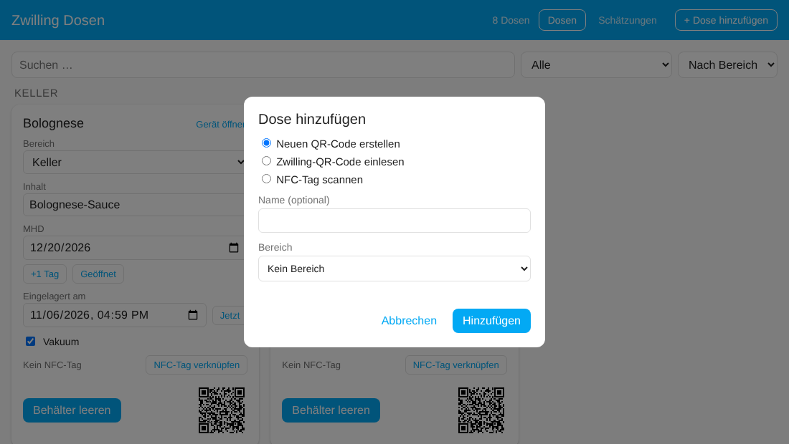</p>

- **Neuen QR-Code erstellen** erzeugt eine neue eindeutige ID. Danach die Karte (oder das Gerät) öffnen und den QR-Code ausdrucken.
- **Zwilling-QR-Code einlesen** braucht den Inhalt des originalen Codes oder nur die ID. Kommst du von [📷 in der App](scanning.md#scannen-in-der-app) oder vom iOS-Kurzbefehl, ist das Feld schon ausgefüllt.
- **Neuen NFC-Tag beschreiben** erscheint nur in der App auf einem Handy, das Tags beschreiben kann. Bei **NFC-Tag scannen** hältst du das Handy an den Tag. Details unter [NFC-Tags](scanning.md#nfc-tags).
- Name und Bereich sind optional. Beides lässt sich später ändern (den Bereich direkt auf der Karte).
- **Vakuum**, **Beim Leeren auf die Einkaufsliste** (sobald eine Einkaufsliste gewählt ist) und **Variabler Lagerort** mit **Nach dem Leeren zurück in** lassen sich gleich mit setzen; ändern kannst du sie später auf der Karte.

### Über die Integration

Die allererste Dose legst du so an, denn das Dashboard erscheint erst danach: Einstellungen → Geräte & Dienste → **Integration hinzufügen** → „Larder“. Hier gibt es nur die beiden QR-Wege; einen NFC-Tag verknüpfst du danach im Dashboard.

**Neuen QR Code erstellen**

Für Dosen ohne (lesbaren) Zwilling-Code. Die Integration erzeugt eine neue, eindeutige ID im Format `HA-XXXXXXXX` (8 Zeichen ohne die leicht verwechselbaren 0/O und 1/I). Das Präfix `HA-` hält sie klar von den Zwilling-IDs getrennt (z. B. `34OL`), eine Überschneidung ist damit ausgeschlossen. Du kannst optional einen Namen vergeben. Den QR-Code findest du danach als Bild am Gerät (siehe [Eigene QR-Codes](scanning.md#eigene-qr-codes)).

**Zwilling QR Code einlesen**

Für vorhandene Zwilling-Dosen. Dort den Inhalt des QR-Codes einfügen, z. B.

```
zwilling://zwillingapp/food-storage/in/?tc=42ML30&s=m&cc=34OL
```

Es reicht auch nur die ID (`cc`, hier `34OL`). Optional kannst du einen Namen vergeben. Jede Dose lässt sich nur einmal anlegen.

Home Assistant bietet im Dialog keine Kamera zum Scannen. Einfacher: die erste Dose mit **Neuen QR Code erstellen** anlegen und die Zwilling-Codes danach mit [📷 in der App](scanning.md#scannen-in-der-app) scannen. Unter iOS geht auch der [Kurzbefehl](scanning.md#ios-kurzbefehl-für-die-originalen-zwilling-codes).

### Dose umbenennen

Einstellungen → Geräte & Dienste → **Larder** → Eintrag der Dose → ⋮ → **Neu konfigurieren**. Die ID bleibt, gedruckte QR-Codes und NFC-Tags gelten weiter.

## Beutel und Packungen

Nicht alles steckt in einer wiederverwendbaren Dose. **＋** auf der Behälter-Seite fragt, was du anlegen möchtest:

| Art | Code | Nach dem Leeren | Typisch für |
|---|---|---|---|
| **Dose** | QR-Code oder NFC-Tag | bleibt und wird wieder befüllt | Boxen, Gläser |
| **Beutel** | NFC-Sticker oder QR-Code | verschwindet (bleibt in Verlauf und Statistik) | Vakuumbeutel mit Hackfleisch oder Wild, Gefrierbeutel |
| **Packung** | keiner | verschwindet; mit Anzahl wird sie um eins weniger | Konserven, Gläser und Packungen im Vorrat |

<p align="center">
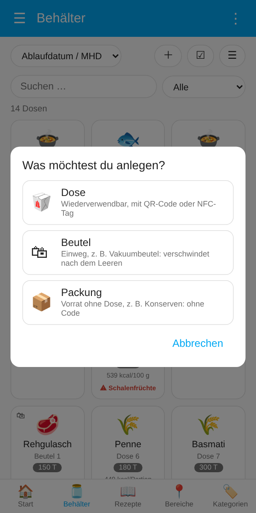
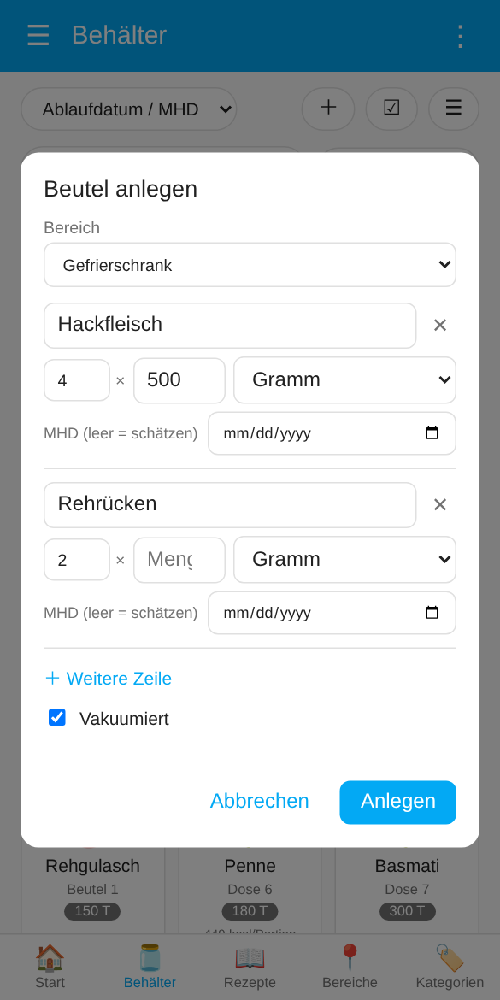
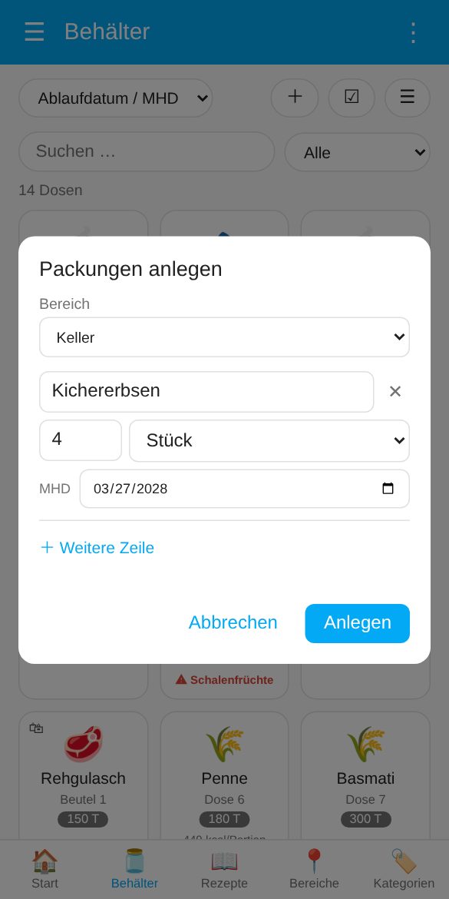
</p>

Beutel und Packungen kann jeder im Haushalt anlegen, Dosen nur Administratoren.

**Beutel.** Bereich wählen (z. B. den Gefrierschrank) und pro Inhalt eine Zeile eintragen; **×** legt mehrere Beutel mit demselben Inhalt an (4 × Hackfleisch, je 500 g). **Vakuumiert** ist vorbelegt, das MHD wird [geschätzt](best-before.md#mhd-schätzung), wenn du keins einträgst. Die Beutel heißen „Beutel 1“, „Beutel 2“ … Danach kennzeichnest du jeden Beutel:

- **📡 NFC-Sticker** führt der Reihe nach durch die neuen Beutel: **✍ Sticker beschreiben** in der Home Assistant App beschreibt einen leeren Sticker, oder du scannst einfach einen schon beschriebenen; **Überspringen** lässt einen Beutel ohne Sticker.
- **🖨 Etiketten** öffnet den [Etikettenbogen](scanning.md#etikettenbogen) für genau diese Beutel.

Ein Beutel funktioniert wie eine Dose (scannen, Portion entnehmen, **Geöffnet**, **Aufgetaut**, Rezepte, Wochenplan). Beim Leeren werden der Beutel, seine Entitäten und sein NFC-Tag aus Home Assistant entfernt (auch aus Einstellungen → Tags), damit sich nichts ansammelt. Wird ein alter Sticker oder ein altes Etikett versehentlich gescannt, sagt Larder, wann dieser Beutel geleert wurde, statt etwas anderes zu öffnen. Codes werden nie doppelt vergeben; ein Sticker, der überlebt hat, lässt sich für einen neuen Beutel wieder beschreiben oder scannen.

**Packungen.** Pro Produkt eine Zeile mit der **Anzahl** und dem aufgedruckten MHD; **📷 Strichcode scannen** (Home Assistant App) trägt Name, Marke und [Nährwerte](#nährwerte) aus Open Food Facts ein. Packungen haben keinen Code und nur wenige Entitäten (Inhalt, Fach, Menge, Einheit, MHD, Resttage, Leeren), so bleiben auch viele davon schlank. Sie tauchen überall auf, wo Dosen auftauchen: läuft bald ab, [tägliche Zusammenfassung](kitchen.md#tägliche-zusammenfassung), [Rezepte](kitchen.md#rezepte), [Statistik](dashboard.md#statistik), der Filter **Packungen** auf der Behälter-Seite (📦 auf der Kachel).

**📷 Kassenbon** (mit eingerichteter [KI](best-before.md#ki-optional)) liest ein Foto deines Kassenbons: Die Lebensmittel mit Anzahl erscheinen als Zeilen, Nicht-Lebensmittel, Pfand und Summen bleiben weg. Prüfen, MHD ergänzen (oder leer lassen) und **Anlegen** drücken. Das optionale **Fach** im Dialog gilt für alle Zeilen.

- **−1** auf der Karte entnimmt eine Packung; die letzte entfernt den Eintrag.
- **Verschieben / aufteilen** bringt einen Teil oder alle Packungen eines Eintrags in einen anderen Bereich und ein anderes Fach (z. B. 2 von 5 Ketchup nach *Vorrat · Schrank*). Liegt dort schon dieselbe Ware mit demselben MHD, werden die Packungen zusammengelegt; sonst entsteht ein neuer Eintrag mit denselben Daten.
- **Mindestbestand** auf der Karte (z. B. mindestens 4 Ketchup) gilt für das Produkt, also für alle Packungen mit diesem Inhalt an allen Orten, und bleibt gemerkt, auch wenn die letzte Packung weg ist. Sobald weniger da ist, kommt das Produkt auf die [Einkaufsliste](kitchen.md#einkaufsliste) (mit Marke und Packung, nicht doppelt).
- **In Dose umfüllen** öffnet eine Packung: leere Dose wählen, Inhalt und Nährwerte wandern hinein, und das MHD wird für die geöffnete Ware neu geschätzt (höchstens das aufgedruckte Datum).

<p align="center">
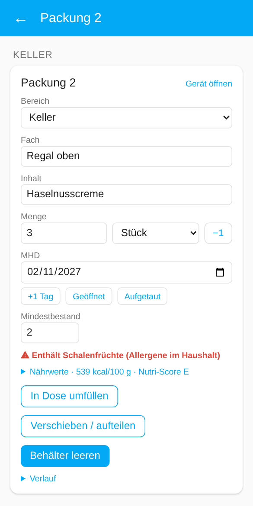
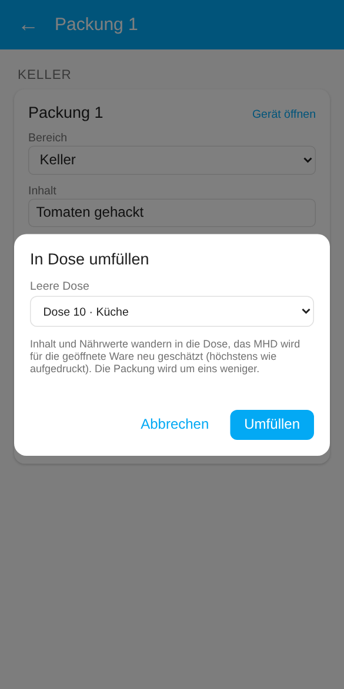
</p>

### Vorrat

<p align="center">
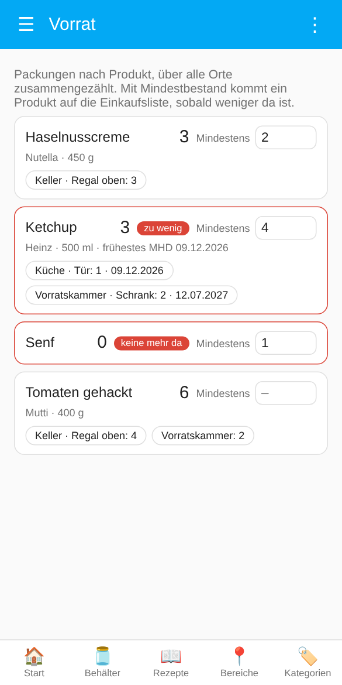
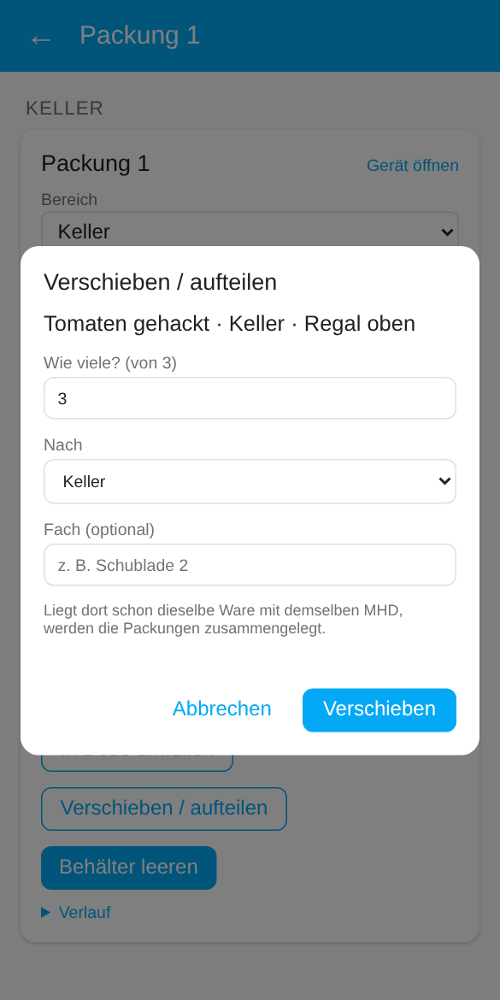
</p>

**⋮ → 🥫 Vorrat** im Dashboard zeigt alle Packungen nach Produkt, über alle Orte zusammengezählt, mit Marke, Packung und wo sie liegen (Antippen eines Orts öffnet die Packung). Den **Mindestbestand** jedes Produkts stellst du direkt dort ein; was darunter liegt, ist mit *zu wenig* oder *keine mehr da* markiert. Produkte mit Mindestbestand bleiben in der Liste, auch wenn keins mehr da ist. **Ältestes zuerst:** Die Orte eines Produkts sind nach MHD sortiert, das früheste steht beim Produkt, und die Karte einer Packung warnt, wenn dieselbe Ware woanders mit früherem MHD liegt.

**Entnehmen per Strichcode.** Den Strichcode einer Packung mit **📷** (Startseite, Behälter-Seite) oder **📷 Strichcode** in der Vorrats-Ansicht scannen (Home Assistant App). Larder zeigt alle Orte, an denen das Produkt liegt, mit Anzahl und MHD, **das älteste zuerst**. Hast du gerade eine neuere in der Hand, nimmst du sie an ihrem Ort mit **−1**; die letzte Packung eines Eintrags leert ihn. Ist das Produkt nicht im Vorrat, lässt es sich gleich als Packung anlegen.

<p align="center">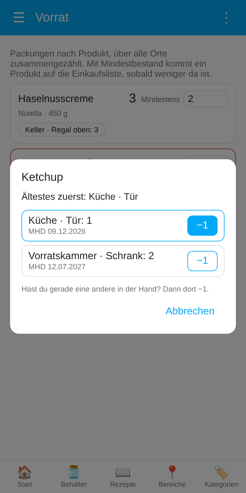</p>

**Von der Einkaufsliste zurück in den Vorrat.** Hakst du auf der Einkaufsliste etwas ab, das Larder dort eingetragen hat (Mindestbestand oder geleerte Dose), fragt die Startseite **🛒 Eingekauft – in den Vorrat?**. **In den Vorrat** öffnet den Packungs-Dialog mit Inhalt, Marke, Anzahl und dem Ort, an dem das Produkt sonst liegt; **✕** verwirft den Hinweis.

## Bereiche und Labels

Jede Dose gehört zu einem **Bereich** von Home Assistant (dem Bereich ihres Geräts). Der Bereich sagt der Schätzung, wo das Essen lagert, und gruppiert das Dashboard. Ändern kannst du ihn direkt auf der Karte der Dose im Dashboard.

**Bereiche im Dashboard verwalten** (Administratoren): auf der Seite **Bereiche** legt **＋** einen neuen Bereich an, **✏️** schaltet ins Bearbeiten. Dann stehen dort alle Bereiche von Home Assistant; antippen, um einen umzubenennen oder seine **Lagerart** zu ändern, also sein Label `Larder: …` (andere Labels des Bereichs bleiben). **Neues Label …** legt gleich ein Label `Larder: <Name>` an; die Grenzen aus der Vorlage unten trägst du in Home Assistant in seine Beschreibung ein. **In Home Assistant öffnen** führt zur Seite des Bereichs (Bild, Etage, Löschen). Bereiche mit Larder-Label erscheinen auch, solange noch keine Dose darin steht.

**Welche Bereiche das Dashboard anbietet.** Bei vielen Bereichen wird die Auswahl lang. Gib den Bereichen, die du für Vorräte nutzt, eine **Beschriftung** (ein Label), deren Name `Larder` ist oder mit `Larder:` beginnt (Einstellungen → Bereiche, Beschriftungen & Zonen → Bereich öffnen → Beschriftungen). Das Dashboard bietet dann nur diese Bereiche an, im Auswahlfeld und im Hinzufügen-Dialog. Der aktuelle Bereich einer Dose bleibt immer in ihrer Liste. Hat kein Bereich ein solches Label, werden alle Bereiche gezeigt.

**Empfohlen:** ein Label pro Art von Lagerort, benannt `Larder: Freezer`, `Larder: Fridge`, `Larder: 0 °C`, `Larder: Pantry` …, mit der Vorlage unten in der Beschreibung. Ein Label pro Bereich reicht. In ein einfaches Label `Larder` gehören keine Grenzen: Das teilen sich alle Vorrats-Bereiche.

### Vorlage für das Bereichs-Label

Die Beschreibung eines `Larder: …`-Labels kann einer festen Vorlage folgen. Larder liest sie dann genau aus (die KI bekommt weiterhin den ganzen Text). Die Vorlage ist englisch, damit sie in jeder Sprache gleich aussieht:

```text
Storage: freezer
Temperature: -18 °C
Max storage: 18 months
Notes: meat and fish
```

Am übersichtlichsten ist eine Angabe pro Zeile; die Angaben dürfen aber auch hintereinander in einer Zeile stehen (`Storage: freezer Temperature: -18 °C Max storage: 18 months`) oder mit `;` getrennt sein. Groß-/Kleinschreibung ist egal, jede Angabe ist optional. Deutsche Schlüssel gehen auch: `Lagerort`, `Temperatur`, `Max. Lagerzeit`, `Hinweis`.

| Schlüssel | Werte | Wirkung |
|---|---|---|
| `Storage` | `fridge`, `0 °C compartment`, `freezer`, `freezer compartment`, `pantry`, `cellar` … (auch deutsch: Kühlschrank, Gefrierfach, Vorrat …) | Lagerort für die Tabelle, gewinnt gegen den Bereichsnamen (ein Temperatursensor am Bereich hat weiter Vorrang). |
| `Temperature` | z. B. `-18 °C`, `4 °C` | Ordnet den Bereich wie bisher über die Temperatur ein. |
| `Max storage` | Zahl mit `days`, `weeks`, `months` oder `years` (`Tage`, `Wochen`, `Monate`, `Jahre`); eine Zahl allein sind Tage | Obergrenze für Tabellen- und KI-Schätzungen in diesem Bereich. Gemerkte Schätzungen werden ebenfalls begrenzt, deine eigenen Korrekturen nicht. Der Tipp nennt die Begrenzung. Bei mehreren Labels gilt die kürzeste Grenze. |
| `Notes` | beliebiger Text | Nur ein Hinweis für die KI. |

Ein Temperatursensor, den du dem Bereich in seinen Einstellungen zuweist, wird ebenfalls genutzt (die Tabelle zuerst, die KI bekommt seinen Wert).

## Dosen befüllen

<p align="center">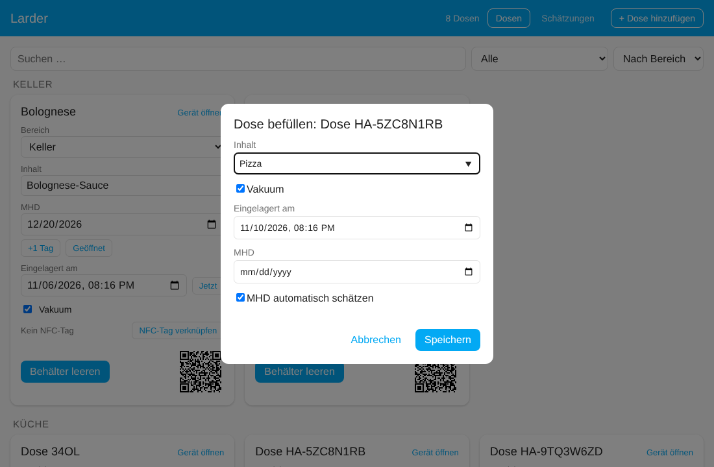</p>

Eine leere Dose zeigt den Button **Befüllen**. Er öffnet einen kleinen Dialog: **Inhalt** (mit Vorschlägen aus früheren Eingaben, neueste zuerst, danach deine gemerkten Schätzungen), **Menge und Einheit** (optional), **Vakuum**, **Befüllt am** (vorbelegt mit jetzt), optional ein **MHD** und **MHD automatisch schätzen** (nur wenn die Schätzung aktiv und das MHD leer ist). **Speichern** setzt alles und schätzt das MHD.

**Gekaufte Ware:** In der Home Assistant App scannt der Knopf **EAN** neben dem Inhalt den Strichcode auf der Packung und trägt den Produktnamen aus [Open Food Facts](https://de.openfoodfacts.org) ein (freie Produktdatenbank, braucht Internet). Marke, Packungsgröße, EAN und die [Nährwerte](#nährwerte) werden mit übernommen. Das MHD steht auf der Packung; trag es im Dialog ein. Nichts gefunden oder offline: Inhalt wie gewohnt eintippen.

**Inhalt per Foto:** Mit eingerichteter [KI](best-before.md#ki-optional) macht **📷** neben dem Inhalt ein Foto vom Essen (oder nimmt eins aus der Galerie) und trägt ein, was die KI erkennt, z. B. „Gulasch mit Kartoffeln“. Kurz prüfen und ggf. korrigieren.

### Nährwerte

<p align="center">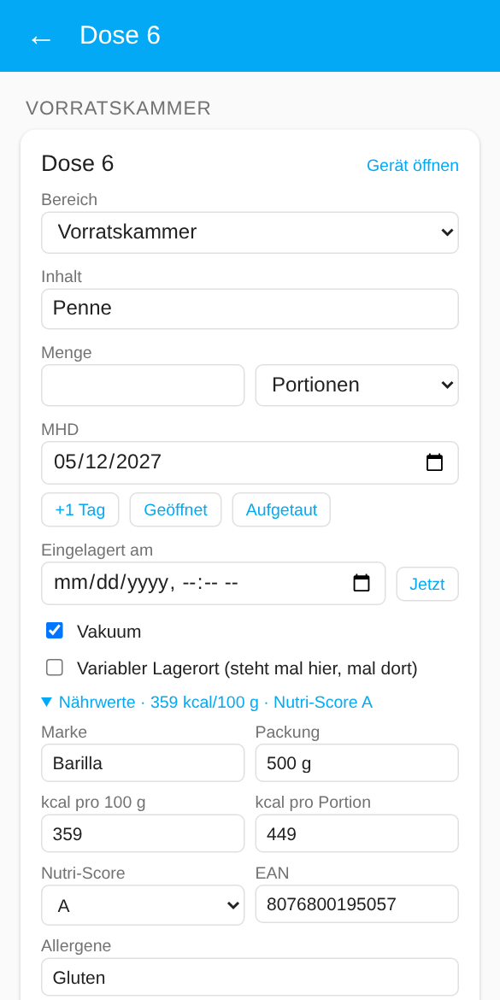</p>

Die Karte einer gefüllten Dose hat einen aufklappbaren Bereich **Nährwerte**: **Marke**, **Packung**, **kcal pro 100 g**, **kcal pro Portion**, **Nutri-Score** (A–E), **EAN**, **Allergene** und **Nährwerte** als Freitext (Fett, Kohlenhydrate, Zucker, Eiweiß, Salz …). Nach einem Strichcode-Scan kommen sie aus Open Food Facts (als Quelle angezeigt, Daten unter der ODbL); sonst trägst du sie selbst ein, z. B. bei Selbstgekochtem. Jedes Feld lässt sich ändern.

- Die **kcal** stehen auch auf der Kachel und in der Liste (pro Portion, wenn bekannt, sonst pro 100 g).
- Die Angaben gehören zum Inhalt: **Behälter leeren** löscht sie, ebenso ein Befüllen mit anderem Inhalt ohne Scan. Sie kommen in den [Verlauf](dashboard.md#export-und-import) und in die Bestands-CSV.
- Für Automationen sind sie Attribute der Entität **Inhalt**: `brand`, `package`, `ean`, `kcal_100g`, `kcal_portion`, `nutri_score`, `allergens`, `nutrients`, `source` (und `allergen_warning`, siehe unten).

### Allergene im Haushalt

In den [Einstellungen](reference.md#einstellungen) wählst du die Allergene, auf die ihr achtet (die 14 Hauptallergene, z. B. Gluten, Milch, Schalenfrüchte). Dosen, deren **Allergene** (aus Open Food Facts oder selbst eingetragen) oder deren **Inhalt** dazu passen („Haselnusscreme“ → Schalenfrüchte, „Milchreis“ → Milch), bekommen ein **⚠** mit dem Allergen auf der Kachel, in der Liste, auf der Karte und in der [Lovelace-Karte](dashboard.md#karte-für-deine-dashboards). [Rezeptideen](kitchen.md#rezeptideen) lassen solche Dosen weg (außer du hast sie selbst gewählt), und die KI wird angewiesen, diese Allergene bei weiteren Zutaten zu meiden. Die erkannten Allergene stehen im Attribut `allergen_warning` der Entität **Inhalt**.

> Nur ein Hinweis, keine Garantie: Die Erkennung hängt davon ab, was eingetragen ist.

Nach dem Speichern bietet ein kurzer Hinweis **🖨 Etikett** für genau die eben befüllte(n) Dose(n) an (praktisch für Gefrierbeutel und Beutel); er öffnet den [Etikettenbogen](scanning.md#etikettenbogen) mit deinem letzten Format und Design.

Der Dialog öffnet sich auch von selbst direkt nach dem Anlegen einer neuen Dose im Dashboard (auch nach dem Beschreiben eines NFC-Tags), sodass du sie gleich befüllen kannst. Ebenso nach einem Scan (📷 in der App, eigener QR-Code, NFC-Tag, Kurzbefehl), wenn die Dose leer ist; eine Dose mit Inhalt öffnet ihre Karte.

**Dosen, die umziehen:** Manche Dosen stehen immer am selben Ort, andere (z. B. Vakuumdosen) mal im Kühlschrank, mal im 0-Grad-Fach. Schalte bei solchen Dosen auf der Karte **Variabler Lagerort** ein. Dann fragt der Befüll-Dialog auch nach dem **Bereich** (Administratoren), damit die Schätzung den richtigen Ort nimmt, und **Behälter leeren** stellt die Dose zurück in den Bereich unter **Nach dem Leeren zurück in** (z. B. den Vorratsraum, in dem die leeren Dosen stehen). Dosen ohne den Schalter behalten ihren Bereich, und der Dialog fragt nicht. Bei variablen Dosen fragt der Dialog auch nach dem **Fach**; kommt die Dose nach dem Leeren zurück, wird das Fach geleert.

**Mehrere Dosen auf einmal:** Die leeren Dosen auswählen (oder nacheinander scannen) und **Befüllen (n)** drücken: Derselbe Dialog befüllt alle, siehe [Mehrere Dosen auswählen](dashboard.md#mehrere-dosen-auswählen).

### Mehrere Inhalte in einer Dose

In einer Dose kann Verschiedenes liegen, z. B. unterschiedliche Wurst. Trenne die Inhalte mit Komma: `Salami, Kochschinken, Leberwurst` (Semikolon geht auch; `1,5 kg` bleibt ein Inhalt).

- Die **Schätzung** schlägt jeden Inhalt einzeln nach und nimmt das **kürzeste** MHD; der Tipp sagt, welcher Inhalt es bestimmt („Lachs“ bestimmt das MHD). Kennt die Tabelle einen der Inhalte nicht, zählt das als kein Treffer (im Modus *Tabelle, sonst KI* antwortet dann die KI für den Inhalt, der zuerst verdirbt).
- Die **Einkaufsliste** bekommt jeden Inhalt als eigenen Eintrag.
- Die **Kategorie** bleibt, wenn alle Inhalte von derselben Art sind (Wurst), sonst ist sie **Gemischt**.

Es gibt ein MHD pro Dose: Was darin liegt, wird zusammen verbraucht oder weggeworfen.
