# Dashboard, Statistik und Daten

[← Übersicht](../../README.de.md) · [🇬🇧 English](../en/dashboard.md)

[Dashboard „Larder“](#dashboard-larder) · [Statistik](#statistik) · [Export und Import](#export-und-import)

## Dashboard „Larder“

Gleich nach dem Hinzufügen der Integration erscheint in der Seitenleiste der Eintrag **Larder**; solange noch nichts in Larder ist, zeigt die Startseite **🚀 Los geht's** mit drei Schritten (Bereiche zuordnen, Einkaufsliste wählen, das Erste hinzufügen), erledigte abgehakt. Seit 6.8 sagt ein Satz oben, was Larder macht, **So funktioniert's** erklärt Dose, Beutel, Packung, Haushaltsartikel, Medikament und Gutschein, und die Einkaufsliste wählst du direkt im zweiten Schritt. Er braucht keine Konfiguration, passt sich an Theme und Sprache von Home Assistant an (Deutsch, Englisch, Französisch und Niederländisch) und aktualisiert sich selbst. *Die Screenshots zeigen Demo-Daten.*

<p align="center">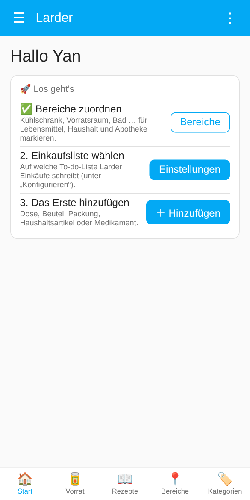</p>

Eine Leiste unten wechselt zwischen fünf Seiten: **Start · Vorrat · Einkaufen · Rezepte · Mehr** (seit 5.0; *Einkaufen* zeigt die Zahl der offenen Einträge auf den Einkaufslisten). Oben auf jeder Seite stehen **🔍 Suchen** und – in der Home Assistant App – **📷 Scannen**:

- **🔍 Suchen**: ein Produkt eintippen zeigt jeden Treffer mit Anzahl, Orten und MHD. Ein Produkt in Packungen öffnet dieselbe Ansicht wie nach dem Scannen seines Strichcodes (−1, anbrechen, verschieben, eine Packung mehr), eine Dose oder ein Gutschein seine Karte. Ziffern eines Strichcodes suchen ihn wie ein Scan.
- **📷 Scannen** erkennt, was gescannt wurde: Strichcode → die Packungen dieses Produkts, QR-Code oder NFC einer Dose → ihre Karte, Fach-Etikett → die [Fach-Ansicht](scanning.md#fächer) (siehe [Scannen in der App](scanning.md#scannen-in-der-app)).

- **Start**: eine Begrüßung mit deinem Home-Assistant-Namen, darunter die **Schnellaktionen** 📥 Einkauf einräumen · 🍳 Rezeptidee (seit 6.7 ein einziger Knopf zum Einräumen mit drei Wegen darin: **📷 Scannen**, **🧾 Kassenbon oder Rechnung**, **✍️ Von Hand**; das 📷 oben bleibt zum Nachschauen und Entnehmen), Kacheln für alles, was bald verbraucht werden sollte (Abgelaufenes zuerst), und eine Abkürzung zum Vorrat. Darunter erscheinen Kästen nur, wenn es etwas zu tun gibt: eine [Rückrufwarnung](containers.md#rückrufwarnungen), **⏳ Bald leer**, **🛒 Eingekauft – in den Vorrat?** (ein Tipp legt bekannte Produkte an ihren üblichen Ort), **💡 Mal wieder …?** (oft gegessen, gerade nicht da), **🔓 Angebrochen** (was offen ist, seit wann und wie lange es noch hält, das Kürzeste zuerst; seit 5.6), **🧊 Auftauen** für ein [geplantes Gericht](kitchen.md#wochenplan), die geplanten Gerichte, **🔁 Wechseln** bei Haushaltsartikeln, einmal im Monat **🧹 [Datenpflege](#datenpflege)** und eine kleine **📊 Monatskachel** (z. B. *November: 2 weggeworfen, ca. 4 €*, seit 5.5), die zur [Statistik](#statistik) führt. Seit 6.8 bleibt die Startseite kurz: Unter den Kacheln stehen die zwei dringendsten Kästen (z. B. *Auftauen*, *Bald leer*), alles andere – auch ruhige Abschnitte wie *Haushalt*, die Monatskachel und die Datenpflege – steckt eingeklappt in **n weitere Bereiche** (mit den Namen darin; das Gerät merkt sich, ob es offen ist). Unter jeder Kachel von *bald verbrauchen* stehen **😋 Gegessen** (bei Abgelaufenem **🗑 Weggeworfen**) und, wenn es sich einfrieren lässt, **🧊 Einfrieren**. Mit [Haushaltsartikeln](containers.md#haushaltsartikel) hat die Seite zwei Abschnitte, *Lebensmittel* und *Haushalt*.
- **Vorrat** (4.0–4.5 *Lager*, bis 3.x *Behälter*): alles Eingelagerte mit einem Symbol für die Art des Essens, dem Inhalt, dem Namen der Dose und den Resttagen.
  - **Suche** in Name, Inhalt und Bereich; **Filter** nach *läuft bald ab*, *abgelaufen*, *befüllt*, *leer*, *Beutel* oder *Packungen*; **Sortierung** nach MHD, Bereich, Bereich und Fach, Alphabet oder Kategorie (Bereich, Bereich und Fach sowie Kategorie gruppiert; *Bereich und Fach* zeigt genau, was in jedem Fach liegt). Über der Liste steht, wie viele Dosen angezeigt werden.
  - Der Knopf rechts wechselt zwischen **Kacheln**, **Liste** und **Karten mit allen Details**. Die Wahl merkt sich das Gerät.
  - Eine gefüllte Dose öffnet beim Antippen ihre Karte, eine leere lässt sich gleich befüllen (siehe [Dosen befüllen](containers.md#dosen-befüllen)).
  - **＋** legt eine an (siehe [Im Dashboard](containers.md#im-dashboard-empfohlen)), **☑** oder **langes Drücken** auf eine Kachel (seit 5.5) startet die [Auswahl](#mehrere-dosen-auswählen).
  - Oben wechselt **Liste · Bereiche · Fächer · Kategorien** die Gruppierung (bis 4.12 eigene Seiten in der Leiste); alle vier haben den Umschalter **Lebensmittel | Haushalt | Apotheke** (siehe [Haushaltsartikel](containers.md#haushaltsartikel)).
- **Bereiche**: eine Kachel pro Bereich mit der Anzahl der Dosen und wie viele bald ablaufen; Antippen zeigt seine Dosen. Administratoren legen mit **＋** Bereiche an und benennen sie mit **✏️** um oder ändern ihre Lagerart (siehe [Bereiche und Labels](containers.md#bereiche-und-labels)).
- **Fächer** (seit 5.5): jedes Fach mit der Anzahl der Dosen und wie viele bald ablaufen, **🏷**, wenn es einen NFC-Tag hat; Antippen öffnet die [Fach-Ansicht](scanning.md#fächer) (Tag, Etikett, Inventur). **🏷 Fächer & Tags** verwaltet Tags und Etiketten für mehrere auf einmal.
- **Kategorien**: dasselbe für Arten von Lebensmitteln (Fisch, Fleisch, Milchprodukte, Vegan & Tofu, Soßen & Gewürze, Gerichte und Reste, Trockenware, …). Die Kategorie stammt aus der eingebauten Haltbarkeitstabelle und ist das Attribut `category` der Entität **Inhalt**. Dosen ohne Treffer stehen unter „Sonstiges“, Dosen mit [mehreren Inhalten](containers.md#mehrere-inhalte-in-einer-dose) verschiedener Art unter „Gemischt“, leere unter „Leer“.
- **Einkaufen**: der [Einkaufsmodus](kitchen.md#einkaufsmodus).
- **Rezepte**: dein [Rezeptbuch](kitchen.md#rezeptbuch) mit [Rezeptideen](kitchen.md#rezeptideen) und Rezepten, die die KI von einem Foto liest. Der Reiter **📅 Woche** (seit 5.5) enthält den [Wochenplan](kitchen.md#wochenplan) und den Wochenvorschlag; die nächsten Tage bleiben unter Rezepte sichtbar.

**Die Karte einer Dose** (in der Kartenansicht oder nach dem Antippen) zeigt oben die häufigen Aktionen als große Knöpfe – **−1**, **Anbrechen** (Packungen), **Leeren / Aufgebraucht** und **Verschieben** –, darunter Inhalt, Menge, MHD und Ort; alles Seltene (Preis, Abteilung, Liste, Mindestbestand, Nährwerte, Wechselintervall, Umwandeln …) liegt unter **Mehr**. Bei Packungen fragt **−1** *Aufgebraucht* oder *🗑 Weggeworfen* (wie im Strichcode-Dialog), damit Weggeworfenes in Verlauf, Statistik und Wert landet. **🏷** neben dem Fach öffnet das [Fach](scanning.md#fächer), **📷** neben dem MHD liest es vom Foto, und **📦 …: Bestand & Verlauf** öffnet die [Produktansicht](#produktverlauf). Im Einzelnen:

- Bereich (Auswahlfeld; welche Bereiche angeboten werden, lässt sich mit einem Label eingrenzen, siehe [Bereiche und Labels](containers.md#bereiche-und-labels)), **Fach** (optional, z. B. „Schublade 2“ im Gefrierschrank; steht auf der Kachel, ist durchsuchbar und wird mit dem Bereich sortiert), **Inhalt**, **Menge und Einheit** (**−1** entnimmt eine Portion, ein Stück oder eine Scheibe; bei der letzten fragt es, ob die Dose geleert werden soll), **MHD** (mit Hinweis „abgelaufen“ oder „noch n Tage“, sobald es bald abläuft; **📷** liest das aufgedruckte Datum vom Foto, seit 5.1), **Eingelagert am** („Jetzt“ setzt die aktuelle Zeit),
- **+1 Tag** verschiebt das MHD um einen Tag, **Geöffnet** kürzt es auf die Haltbarkeit des Inhalts nach dem Öffnen (Werte von USDA FoodKeeper, z. B. Ketchup 6 Monate im Kühlschrank; sonst die KI, sonst die Einstellung, Standard 3 Tage) und zeigt, woher der Wert kommt, **Aufgetaut** macht dasselbe für Essen aus dem Gefrierfach (Standard 2 Tage, nicht wieder einfrieren). Beides verlängert nie ein Datum; ohne Datum wird eines gesetzt,
- **MHD schätzen** (wenn die [Schätzung](best-before.md#mhd-schätzung) aktiv ist, ein Inhalt eingetragen und das MHD leer ist),
- **Vakuum**, **Beim Leeren auf die Einkaufsliste** (sobald eine [Einkaufsliste](kitchen.md#einkaufsliste) gewählt ist), **Variabler Lagerort** mit **Nach dem Leeren zurück in** (siehe [Dosen befüllen](containers.md#dosen-befüllen)), der **NFC-Tag** einer Dose (unter dem MHD: **NFC-Tag verknüpfen** für einen beschriebenen Tag, **✍ Neuen Sticker beschreiben** für einen leeren, oder lösen; siehe [NFC-Tags](scanning.md#nfc-tags)), und unter **Mehr** **Gerät öffnen** (führt in Home Assistant). Seit 6.7 heißt die Karte nach ihrem **Inhalt** (*Lachs*, darunter klein *Dose 1*; leer: *Leer · Dose 1*), und unten stehen **Inhalt ist weg? 😋 Gegessen · 🗑 Weggeworfen** statt eines großen Knopfs *Behälter leeren* oben; die Antwort kommt in den **Verlauf** der Dose (aufklappbare Liste unten auf der Karte, die letzten zehn Befüllungen).

**Mehr** (bis 4.12 das Menü **⋮**) sammelt alles Weitere in drei Abschnitten: *Alltag* (📥 Einkauf einräumen, 📝 Zuletzt eingeräumt, 📋 Inventur, Vorkochen, 🖨 Etiketten drucken), *Überblick* (🗃️ Bestand, 📊 Statistik, 🧊 Gefrierschrank – alles Eingefrorene, am längsten zuerst, mit *eingefroren seit* und *beste Qualität bis* (seit 5.8), ♻️ Retten diese Woche, 🛟 Notvorrat, 🧹 Datenpflege) und *Einrichtung* (🏷 Fächer & Tags für alle; für Administratoren 📍 Bereiche bearbeiten, 🏪 Abteilungen, Dosengrößen, 📦 Export und Import, 🔄 Aus Grocy übernehmen, 🧠 Haltbarkeiten (gelernt) – die [gemerkten Schätzungen](best-before.md#gemerkte-schätzungen-verwalten) – und die Einstellungen der Integration). Alte Links wie `?view=areas` funktionieren weiter. Das ☰ links ist die Seitenleiste von Home Assistant.

<p>
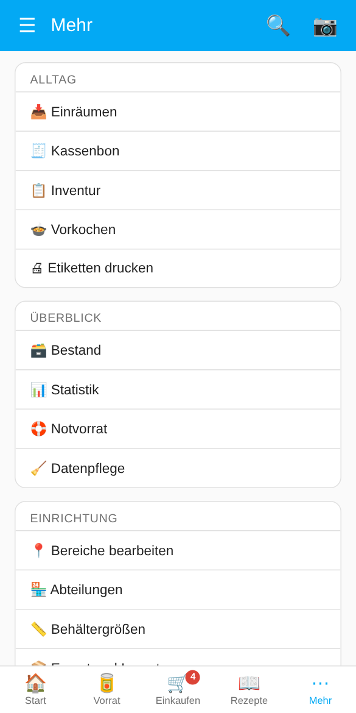
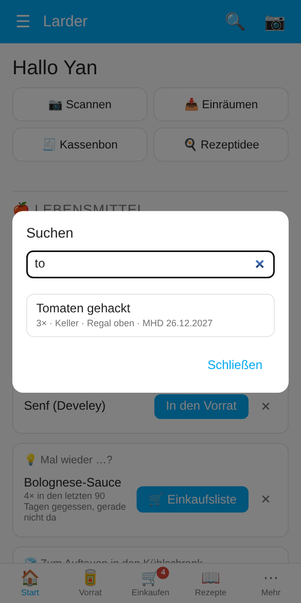
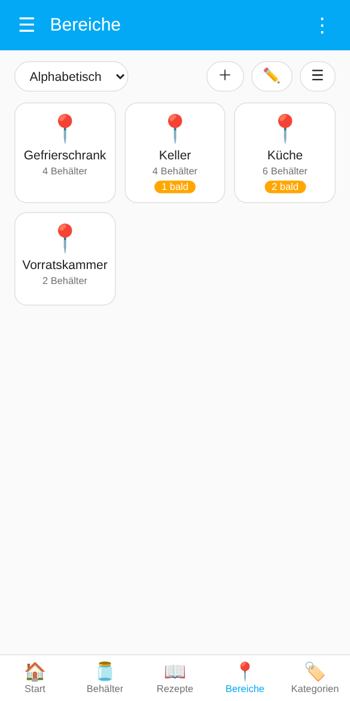
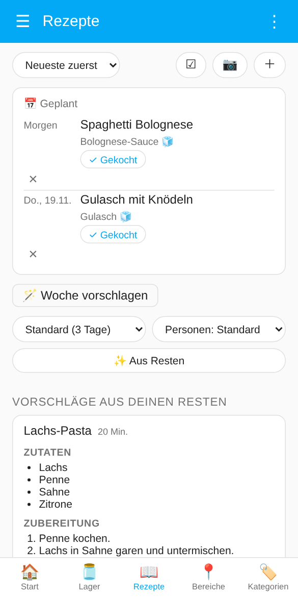
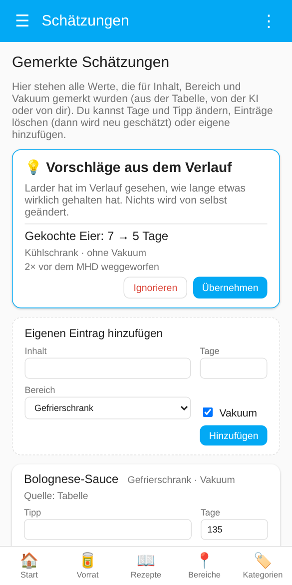
</p>

Das Dashboard ist für alle Nutzer sichtbar; nur **Administratoren** können Dosen hinzufügen, Bereiche ändern, die Auswahl nutzen und die Schätzungen sehen (dieselbe Einschränkung wie in den Einstellungen). Es ist kein klassisches Lovelace-Dashboard und lässt sich nicht mit dem Karten-Editor bearbeiten.

**Links ins Dashboard** (für Scans und Benachrichtigungen, auch für eigene Automationen): `/larder?open=<Geräte-ID>` öffnet eine Dose (eine leere mit dem Befüll-Dialog), `/larder?cc=<ID der Dose>` macht dasselbe über die ID der Dose und zählt als Scan, `/larder?add=<Code>` öffnet den Hinzufügen-Dialog mit dem Code, `/larder?view=recipes` (oder `start`, `containers`, `areas`, `categories`) öffnet eine Seite.

### Mehrere Dosen auswählen

**☑** auf der Seite **Vorrat** oder der Rezeptseite, oder langes Drücken auf eine Kachel, schaltet in die Auswahl: Dosen antippen wählt sie aus, **Alle** wählt alles Angezeigte. Die Leiste unten bietet dann

- **Befüllen (n)** (Administratoren): befüllt alle gewählten *leeren* Dosen auf einmal mit demselben Inhalt, Vakuum, Befüllt am und MHD, z. B. nach dem Vorkochen oder dem Einkauf. Die Menge gilt pro Dose. Ist die Schätzung aktiv, bekommt jede Dose ihre eigene.
- **✨ Rezeptideen**: fragt die KI nach Rezepten mit genau den gewählten *befüllten* Dosen, egal wann sie ablaufen (abgelaufene bleiben trotzdem draußen).
- **🗑 Leeren (n)** (Administratoren): leert die gewählten gefüllten Dosen, nachdem es **Gegessen** oder **Weggeworfen** gefragt hat (für den Verlauf).
- **🖨 Etiketten**: ein [A4-Etikettenbogen](scanning.md#etikettenbogen) mit den QR-Codes der gewählten Dosen.
- **Fertig** beendet die Auswahl.

**Serien-Scan** (Administratoren): Während der Auswahl fügt **📡 Scannen** jede gescannte Dose hinzu. In der Home-Assistant-App erscheint oben ein Umschalter **📷 QR-Code | 📶 NFC**; antippen oder wischen wechselt jederzeit die Methode:

- **QR-Codes** in der Home-Assistant-App unter iOS und Android: Der Scanner der App öffnet sich und bleibt offen, du scannst einen Code nach dem anderen; jeder Treffer zeigt den Namen der Dose und wie viele ausgewählt sind. Eigene QR-Codes und die originalen Zwilling-Codes funktionieren beide; eine noch nicht angelegte Dose wird gemeldet. **Zu NFC wechseln** im Scanner (oder Schließen) wechselt zu NFC; der Serien-Scan läuft weiter.
- **NFC-Tags**, die mit einer Dose verknüpft sind: **NFC** wählen (das schließt den QR-Scanner; solange die Kamera läuft, liest das iPhone keine NFC-Tags). Dann das Handy an einen Tag halten; das iPhone zeigt oben das Banner „In Home Assistant öffnen“, das antippen. Die Dose wird ausgewählt, und du bleibst auf der Seite. Android liest den Tag direkt. Während ein Serien-Scan läuft, bekommt das Handy nach einem NFC-Scan keine Larder-Benachrichtigung.
- **⏹ Scan beenden** beendet den Serien-Scan. Danach listet ein Kasten **Inventur** die gefüllten Dosen, die *nicht* gescannt wurden (vielleicht schon gegessen, aber nicht geleert); **Diese auswählen** wählt sie aus, z. B. um sie mit **🗑 Leeren** zu leeren.

Danach alle auf einmal befüllen oder Rezeptideen holen. So geht eine Inventur der Gefriertruhe oder das Einräumen nach dem Einkauf schnell.

<p align="center">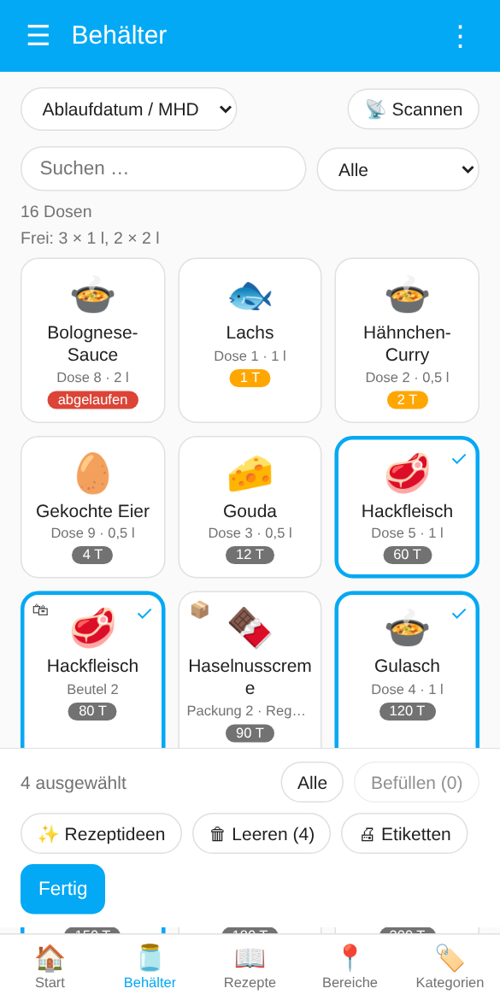</p>


### Karte für deine Dashboards

Die Karte **Larder** zeigt auf jedem Dashboard die Dosen, die bald ablaufen, die dringendsten zuerst. Die Integration lädt sie selbst (keine Ressource nötig), sie steht in der Kartenauswahl; Antippen einer Dose öffnet sie im Larder-Dashboard.

```yaml
type: custom:larder-card
title: Läuft bald ab   # optional
days: 3                # optional, Standard: Einstellung „Läuft bald ab“
show_expired: true     # optional
limit: 8               # optional
area: kueche           # optional, Bereichs-ID
```

Die zweite Karte, **Larder: Vorrat**, zeigt, was unter dem [Mindestbestand](containers.md#bestand) ist (mit 🛒 für die Einkaufsliste), Eingekauftes, das noch nicht im Vorrat angelegt ist, und angebrochene Packungen. Antippen einer Zeile öffnet die Bestands-Ansicht bzw. die Packung.

```yaml
type: custom:larder-stock-card
title: Vorrat         # optional
show_bought: true     # optional
show_opened: true     # optional
```

Seit 5.3 gibt es zwei weitere: **Larder: Einkaufen** zeigt die offenen Einträge je Einkaufsliste mit einem Knopf zum Einkaufsmodus, **Larder: Fach** was in einem Bereich oder Fach liegt (Ablaufendes zuerst, **−1** für Packungen) – z. B. auf einem Tablet am Kühlschrank.

```yaml
type: custom:larder-shopping-card
title: Einkaufen      # optional
```

```yaml
type: custom:larder-place-card
area: gefrierschrank  # Bereichs-ID
compartment: Schublade 2 # optional
title: Gefrierschrank # optional
```

Seit 6.0 hat jede Karte einen **visuellen Editor**: in der Kartenauswahl oder mit *Bearbeiten* erscheinen die Optionen als Formular (Überschrift, Tage, Bereich, Fach …); YAML geht weiterhin.

Für Automationen gibt es außerdem [Übersichts-Sensoren](reference.md#übersichts-sensoren) (abgelaufen, läuft bald ab, Bestandswert, offene Einkaufseinträge, Notvorrat).

### Datenpflege

Einmal im Monat, solange etwas fehlt, zeigt die Startseite **🧹 Datenpflege** (✕ blendet es bis zum nächsten Monat aus; **Mehr → 🧹 Datenpflege** zeigt es jederzeit): angebrochene Packungen ohne Datum, Packungen ohne MHD, Produkte ohne Preis, Einträge ohne Bereich oder Fach und oft verbrauchte Produkte ohne Mindestbestand. Seit 6.3 auch Lebensmittel, die die [Haltbarkeitstabelle](best-before.md#welche-zeile-zählt) nicht erkennt (antippen und die Art wählen, z. B. *Saft / Smoothie*), und die **Vorschläge aus eurem Verlauf** (*vor dem Datum weggeworfen* / *lange danach noch gegessen*, in den Schätzungen übernehmen). Seit 6.7 steht jedes Produkt nur noch **einmal** da, mit allem, was fehlt (*fehlt: MHD · Preis · Bereich/Fach*); Antippen öffnet **einen Dialog** mit genau diesen Feldern (Preis, MHD, Bereich und Fach, Mindestbestand, Art für die Haltbarkeit) und **Karte öffnen**. Leeres bleibt einfach offen. Mit vollständigen Daten werden Statistik, *reicht noch …*, Einkaufsvorschläge und der Bestandswert genauer. Angebrochene Packungen zeigen auf der Kachel **🫙 offen seit 12.11.**, damit klar ist, warum das Datum kürzer ist als aufgedruckt.

<p align="center">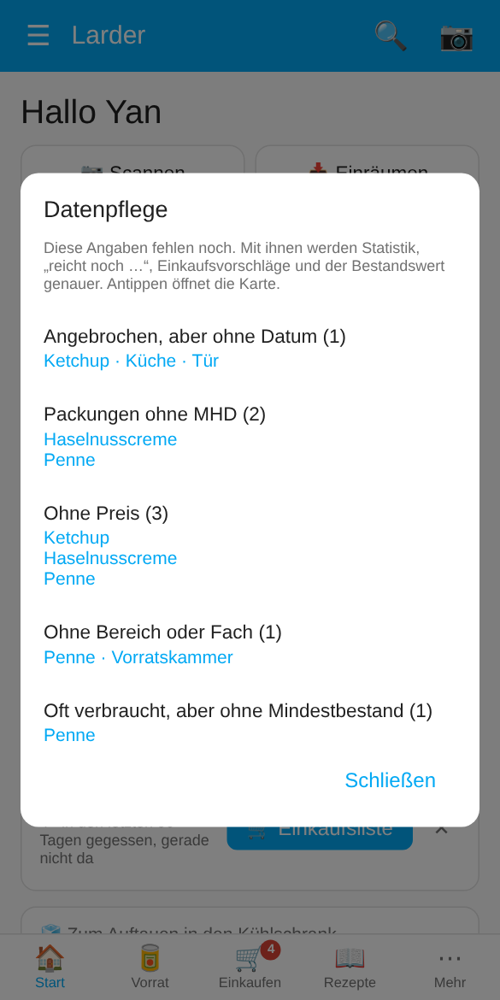</p>

### Produktverlauf

**Produktansicht (seit 5.5).** Ein Produktname in der Bestands-Ansicht, **📦 Bestand & Verlauf** im Strichcode-Dialog (auch über die 🔍 Suche) und **📦 …: Bestand & Verlauf** auf einer Karte öffnen alles zu einem Produkt an einer Stelle: wie viele wo liegen (mit **−1** je Ort und Antippen für die Karte), **Mindestens**, **🔁 Nach Verbrauch nachkaufen**, Preis und Wert, darunter der Verlauf. Er zeigt, was mit einem **Produkt** über alle Dosen, Beutel und Packungen passiert ist – *Schinken war letzte Woche in Dose 3 und ist diese Woche in Dose 7*. Oben: wie oft im letzten Jahr, wie lange es im Schnitt gehalten hat, wie viel weggeworfen wurde (mit Wert, wenn der Preis bekannt ist), die Preise im Verlauf und ein Hinweis, z. B. *2 von 6 Mal weggeworfen – lieber kleinere Mengen kaufen oder einfrieren?*. Darunter jeder geleerte oder aufgebrauchte Eintrag mit Datum, gegessen oder weggeworfen, wo er lag und wie lange. Einträge mit gleichem Inhalt zählen als ein Produkt (Groß- und Kleinschreibung egal); ein umbenanntes Produkt beginnt einen eigenen Verlauf.

<p align="center">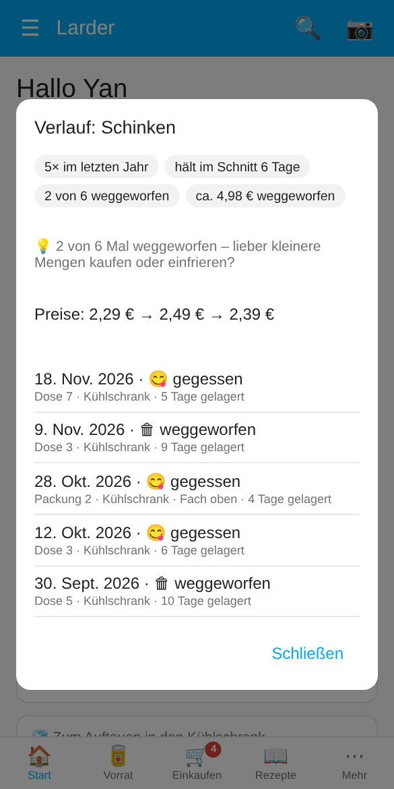</p>

**Zuletzt verwendet.** **＋** und die leere 🔍 Suche zeigen die zuletzt angelegten Produkte als Chips. Ein Tipp legt eine Packung an ihren üblichen Ort (wo sie jetzt liegt, sonst wo sie zuletzt lag), auch wenn keine mehr da ist; danach Preis und MHD wie beim Einräumen.

## Statistik

<p align="center">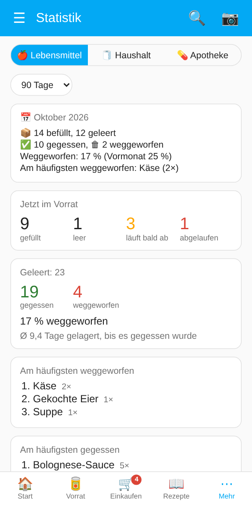</p>

Ganz oben steht der **Bericht des Vormonats** (siehe [Monatsbericht](kitchen.md#monatsbericht)).

**Mehr → 📊 Statistik** im Dashboard zeigt für die letzten 30 oder 90 Tage, ein Jahr oder alles:

- **Jetzt im Vorrat**: gefüllt, leer, läuft bald ab, abgelaufen (und gefüllt ohne MHD).
- **Geleert**: wie viel gegessen und weggeworfen wurde, den Anteil weggeworfen, den Wert des Weggeworfenen (bei Packungen mit Preis) und die durchschnittliche Lagerdauer, bis etwas gegessen wurde.
- **Am häufigsten weggeworfen**, **am häufigsten gegessen** (bei [mehreren Inhalten](containers.md#mehrere-inhalte-in-einer-dose) zählt jeder einzeln) und **weggeworfen nach Bereich**.
- **🗑 Was ihr am meisten wegwerft** (seit 6.5): die Top 5 mit Anzahl, Wert und je einem Tipp – *Mindestbestand senken* (wenn es einen gibt), *die Hälfte gleich einfrieren* (wenn es sich einfrieren lässt), sonst *kleinere Packung kaufen*.
- **Letzte Monate** als Balken: gegessen (grün) und weggeworfen (rot).

Die Zahlen kommen aus dem [Verlauf](#export-und-import), sie wachsen also, wenn du Dosen mit **Gegessen** oder **Weggeworfen** leerst. Ohne Angabe geleerte Dosen zählen als weggeworfen, wenn sie abgelaufen waren.

**Haushalt (seit 4.1):** Der Umschalter oben zeigt die Haushalts-Seite: was [Haushaltsartikel](containers.md#haushaltsartikel) im Schnitt **pro Monat** kosten, die Ausgaben (ohne Preise: Stück) je Monat der letzten sechs Monate und je Produkt Verbrauch und Ausgaben pro Monat, z. B. *Klopapier: 8 Rollen · 4,00 €*. Gerechnet wird aus den entnommenen Stück (−1, Inventur, letztes Stück) mit Packungsgröße und Preis je Packung zu diesem Zeitpunkt; der Schnitt zählt ab dem ersten Monat mit Entnahmen. Produkte ohne bekannten Preis sind markiert.

<p align="center">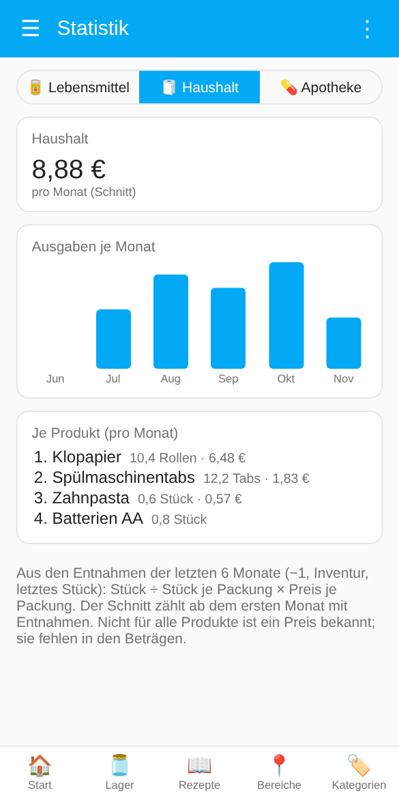</p>

Für eigene Dashboards und Automationen liefert der Service `larder.get_statistics` dieselben Daten (`days` optional). Zum Beispiel als Template-Sensor:

```yaml
template:
  - triggers:
      - trigger: time_pattern
        hours: "/1"
    actions:
      - action: larder.get_statistics
        data:
          days: 30
        response_variable: stats
    sensor:
      - name: Larder weggeworfen (30 Tage)
        state: "{{ stats.waste_percent if stats.waste_percent is not none else 0 }}"
        unit_of_measurement: "%"
        attributes:
          gefuellt: "{{ stats.containers.filled }}"
          abgelaufen: "{{ stats.containers.expired }}"
```

## Export und Import

Im Dashboard **Mehr → 📦 Export und Import** (Administratoren):

- **📄 Bestand als Tabelle (CSV)**: alle Dosen mit Name, ID, Bereich, Fach, Inhalt, Menge, Einheit, Eingelagert am, MHD, Tage übrig, Status, Vakuum und den Nährwerten (Marke, Packung, EAN, kcal, Nutri-Score, Allergene, Nährwerte). Auf Deutsch mit Semikolon, damit Excel sie direkt öffnet.
- **🕘 Verlauf (CSV)**: jede geleerte Befüllung mit Dose, Inhalt, Menge, Eingelagert am, MHD, Geleert am, Tage gelagert, ob sie abgelaufen war und ob sie gegessen oder weggeworfen wurde. Ohne die Frage geleerte Dosen (Automation, Geräteseite) haben kein Ergebnis.
- **💾 Gemerkte Schätzungen (Sicherung)**: alle [gemerkten MHD-Werte](best-before.md#gemerkte-schätzungen-verwalten) als JSON-Datei.
- **Schätzungen einlesen**: liest so eine Datei wieder ein, z. B. nach einer Neuinstallation oder auf einem zweiten Home Assistant. Eigene Korrekturen bleiben, wenn die Datei für dieselbe Kombination nur einen Tabellen- oder KI-Wert hat; mit **Vorhandene Schätzungen vorher löschen** ersetzt die Datei alles. Ungültige Einträge werden übersprungen und gezählt.

Die Downloads öffnen sich über einen Link, der fünf Minuten gilt, auch in der Home Assistant App.

### Aus Grocy übernehmen

Du kommst von [Grocy](https://grocy.info)? **Mehr → 📥 Aus Grocy übernehmen** (Administratoren) übernimmt den Bestand einmalig: Jeder Bestandseintrag wird eine [Packung](containers.md#beutel-und-packungen) mit Produktname, Menge, MHD, Strichcodes und *angebrochen*; Grocys *Tage nach dem Öffnen* werden zum [eigenen Wert](best-before.md#mhd-schätzung) des Produkts. Grocy hat keine Exportdatei, deshalb liest Larder Grocys eigene REST-API: Adresse (z. B. `http://192.168.1.20:9283`) und einen API-Schlüssel aus Grocy (*Einstellungen → API-Schlüssel verwalten*) eingeben. Der Schlüssel wird nur für die Abfrage verwendet und nicht gespeichert. Eine **Vorschau** zeigt, was gefunden wurde; Grocy-Orte mit dem Namen eines Home-Assistant-Bereichs werden zugeordnet, die übrigen wählst du. Produkte behalten ihre eigenen Namen – nichts wird mit ähnlichen Larder-Produkten zusammengelegt. Zweimal ausführen legt die Packungen doppelt an.

Für Fehlerberichte sammelt **Diagnose herunterladen** (⋮ am Eintrag einer Dose unter Einstellungen → Geräte & Dienste → Larder) die Einstellungen, die Dose und ihre Entitäten. Die geheime Webhook-ID und die gemerkten Schätzungen selbst sind nicht enthalten.
