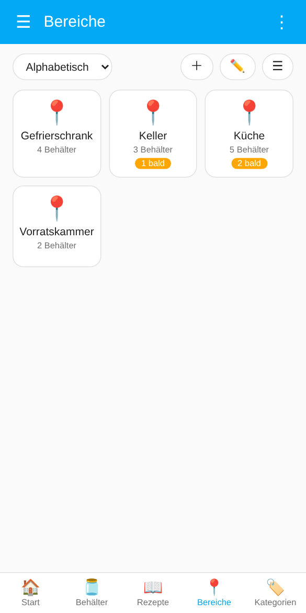
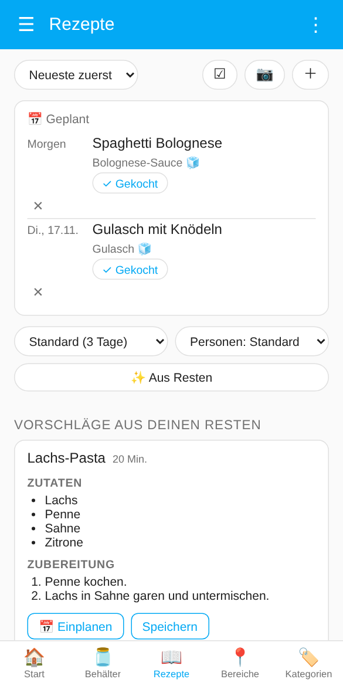
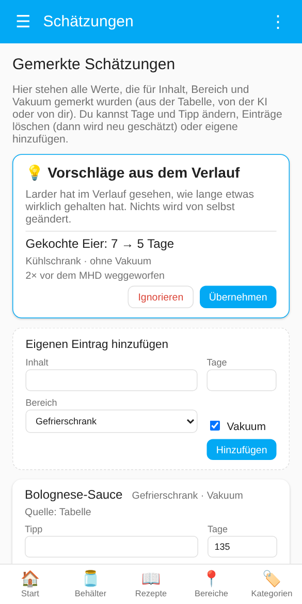
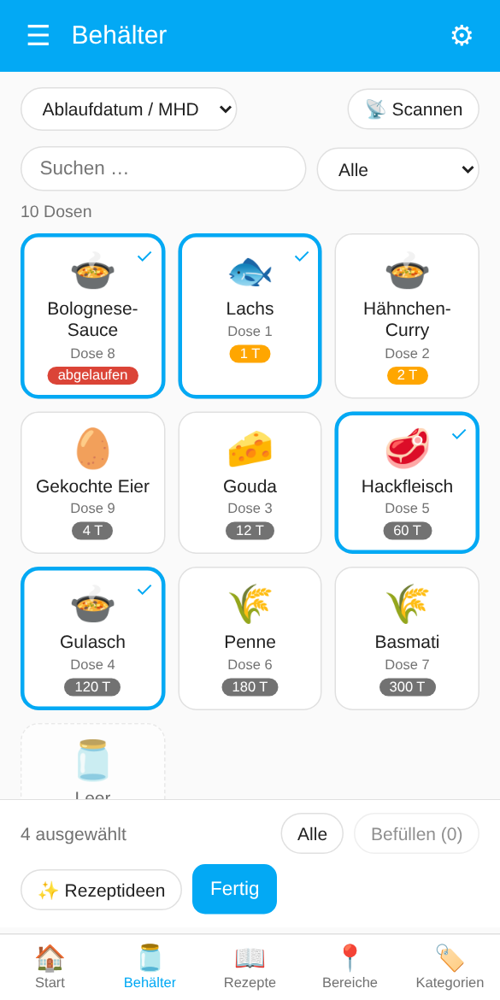
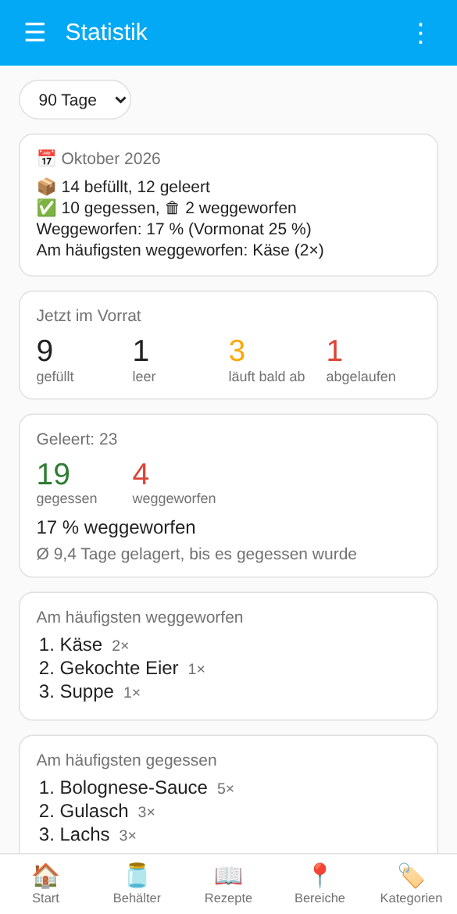

# Dashboard, Statistik und Daten

[← Übersicht](../../README.de.md) · [🇬🇧 English](../en/dashboard.md)

[Dashboard „Larder“](#dashboard-larder) · [Statistik](#statistik) · [Export und Import](#export-und-import)

## Dashboard „Larder“

Sobald mindestens eine Dose angelegt ist, erscheint in der Seitenleiste der Eintrag **Larder**. Er braucht keine Konfiguration, passt sich an Theme und Sprache von Home Assistant an (Deutsch und Englisch) und aktualisiert sich selbst. *Die Screenshots zeigen Demo-Daten.*

Eine Leiste unten wechselt zwischen fünf Seiten:

- **Start**: eine Begrüßung mit deinem Home-Assistant-Namen, Kacheln für alles, was bald verbraucht werden sollte (Abgelaufenes zuerst), und Abkürzungen zu den Rezeptvorschlägen und den Behältern. In der Home Assistant App gibt es dort auch **📷 Dose scannen** (siehe [Scannen in der App](scanning.md#scannen-in-der-app)).
- **Behälter**: alle Dosen mit einem Symbol für die Art des Essens, dem Inhalt, dem Namen der Dose und den Resttagen.
  - **Suche** in Name, Inhalt und Bereich; **Filter** nach *läuft bald ab*, *abgelaufen*, *befüllt*, *leer*, *Beutel* oder *Packungen*; **Sortierung** nach MHD, Bereich, Bereich und Fach, Alphabet oder Kategorie (Bereich, Bereich und Fach sowie Kategorie gruppiert; *Bereich und Fach* zeigt genau, was in jedem Fach liegt). Über der Liste steht, wie viele Dosen angezeigt werden.
  - Der Knopf rechts wechselt zwischen **Kacheln**, **Liste** und **Karten mit allen Details**. Die Wahl merkt sich das Gerät.
  - Eine gefüllte Dose öffnet beim Antippen ihre Karte, eine leere lässt sich gleich befüllen (siehe [Dosen befüllen](containers.md#dosen-befüllen)).
  - **📷** scannt eine Dose (nur in der Home Assistant App, siehe [Scannen in der App](scanning.md#scannen-in-der-app)), **＋** legt eine an (siehe [Im Dashboard](containers.md#im-dashboard-empfohlen)), **☑** startet die [Auswahl](#mehrere-dosen-auswählen).
- **Bereiche**: eine Kachel pro Bereich mit der Anzahl der Dosen und wie viele bald ablaufen; Antippen zeigt seine Dosen. Administratoren legen mit **＋** Bereiche an und benennen sie mit **✏️** um oder ändern ihre Lagerart (siehe [Bereiche und Labels](containers.md#bereiche-und-labels)).
- **Kategorien**: dasselbe für Arten von Lebensmitteln (Fisch, Fleisch, Milchprodukte, Gerichte und Reste, Trockenware, …). Die Kategorie stammt aus der eingebauten Haltbarkeitstabelle und ist das Attribut `category` der Entität **Inhalt**. Dosen ohne Treffer stehen unter „Sonstiges“, Dosen mit [mehreren Inhalten](containers.md#mehrere-inhalte-in-einer-dose) verschiedener Art unter „Gemischt“, leere unter „Leer“.
- **Rezepte**: dein [Rezeptbuch](kitchen.md#rezeptbuch) mit [Rezeptideen](kitchen.md#rezeptideen) und Rezepten, die die KI von einem Foto liest.

**Die Karte einer Dose** (in der Kartenansicht oder nach dem Antippen) zeigt alles und lässt es dich ändern:

- Bereich (Auswahlfeld; welche Bereiche angeboten werden, lässt sich mit einem Label eingrenzen, siehe [Bereiche und Labels](containers.md#bereiche-und-labels)), **Fach** (optional, z. B. „Schublade 2“ im Gefrierschrank; steht auf der Kachel, ist durchsuchbar und wird mit dem Bereich sortiert), **Inhalt**, **Menge und Einheit** (**−1** entnimmt eine Portion, ein Stück oder eine Scheibe; bei der letzten fragt es, ob die Dose geleert werden soll), **MHD** (mit Hinweis „abgelaufen“ oder „noch n Tage“, sobald es bald abläuft), **Eingelagert am** („Jetzt“ setzt die aktuelle Zeit),
- **+1 Tag** verschiebt das MHD um einen Tag, **Geöffnet** kürzt es auf die in den Einstellungen gesetzte Zahl Tage (Standard 3), **Aufgetaut** macht dasselbe für Essen aus dem Gefrierfach (Standard 2 Tage, nicht wieder einfrieren). Beides verlängert nie ein Datum; ohne Datum wird eines gesetzt,
- **MHD schätzen** (wenn die [Schätzung](best-before.md#mhd-schätzung) aktiv ist, ein Inhalt eingetragen und das MHD leer ist),
- **Vakuum**, **Beim Leeren auf die Einkaufsliste** (sobald eine [Einkaufsliste](kitchen.md#einkaufsliste) gewählt ist), **Variabler Lagerort** mit **Nach dem Leeren zurück in** (siehe [Dosen befüllen](containers.md#dosen-befüllen)), der **NFC-Tag** (verknüpfen oder lösen), **Gerät öffnen** und **Behälter leeren**. Vor dem Leeren fragt die Karte **😋 Gegessen** oder **🗑 Weggeworfen**; die Antwort kommt in den **Verlauf** der Dose (aufklappbare Liste unten auf der Karte, die letzten zehn Befüllungen).

**⋮** oben öffnet ein Menü: **📊 Statistik** und **🖨 Etiketten drucken** für alle, **📦 Export und Import**, die [gemerkten Schätzungen](best-before.md#gemerkte-schätzungen-verwalten) und die Einstellungen der Integration für Administratoren. Das ☰ links ist die Seitenleiste von Home Assistant.

<p>



</p>

Das Dashboard ist für alle Nutzer sichtbar; nur **Administratoren** können Dosen hinzufügen, Bereiche ändern, die Auswahl nutzen und die Schätzungen sehen (dieselbe Einschränkung wie in den Einstellungen). Es ist kein klassisches Lovelace-Dashboard und lässt sich nicht mit dem Karten-Editor bearbeiten.

**Links ins Dashboard** (für Scans und Benachrichtigungen, auch für eigene Automationen): `/larder?open=<Geräte-ID>` öffnet eine Dose (eine leere mit dem Befüll-Dialog), `/larder?cc=<ID der Dose>` macht dasselbe über die ID der Dose und zählt als Scan, `/larder?add=<Code>` öffnet den Hinzufügen-Dialog mit dem Code, `/larder?view=recipes` (oder `start`, `containers`, `areas`, `categories`) öffnet eine Seite.

### Mehrere Dosen auswählen

**☑** auf der Behälter- oder der Rezeptseite schaltet in die Auswahl: Dosen antippen wählt sie aus, **Alle** wählt alles Angezeigte. Die Leiste unten bietet dann

- **Befüllen (n)** (Administratoren): befüllt alle gewählten *leeren* Dosen auf einmal mit demselben Inhalt, Vakuum, Befüllt am und MHD, z. B. nach dem Vorkochen oder dem Einkauf. Die Menge gilt pro Dose. Ist die Schätzung aktiv, bekommt jede Dose ihre eigene.
- **✨ Rezeptideen**: fragt die KI nach Rezepten mit genau den gewählten *befüllten* Dosen, egal wann sie ablaufen (abgelaufene bleiben trotzdem draußen).
- **🗑 Leeren (n)** (Administratoren): leert die gewählten gefüllten Dosen, nachdem es **Gegessen** oder **Weggeworfen** gefragt hat (für den Verlauf).
- **🖨 Etiketten**: ein [A4-Etikettenbogen](scanning.md#etikettenbogen) mit den QR-Codes der gewählten Dosen.
- **Fertig** beendet die Auswahl.

**Serien-Scan** (Administratoren): Während der Auswahl fügt **📡 Scannen** jede gescannte Dose hinzu. In der Home-Assistant-App erscheint oben ein Umschalter **📷 QR-Code | 📶 NFC**; antippen oder wischen wechselt jederzeit die Methode:

- **QR-Codes** in der Home-Assistant-App unter iOS und Android: Der Scanner der App öffnet sich und bleibt offen, du scannst einen Code nach dem anderen; jeder Treffer zeigt den Namen der Dose und wie viele ausgewählt sind. Eigene QR-Codes und die originalen Zwilling-Codes funktionieren beide; eine noch nicht angelegte Dose wird gemeldet. **Zu NFC wechseln** im Scanner (oder Schließen) wechselt zu NFC; der Serien-Scan läuft weiter.
- **NFC-Tags**, die mit einer Dose verknüpft sind: **NFC** wählen (das schließt den QR-Scanner; solange die Kamera läuft, liest das iPhone keine NFC-Tags). Dann das Handy an einen Tag halten; das iPhone zeigt oben das Banner „In Home Assistant öffnen“, das antippen. Die Dose wird ausgewählt, und du bleibst auf der Seite. Android liest den Tag direkt. Während ein Serien-Scan läuft, bekommt das Handy nach einem NFC-Scan keine Larder-Benachrichtigung.
- **⏹ Scan beenden** beendet den Serien-Scan. Danach listet ein Kasten **Inventur** die gefüllten Dosen, die *nicht* gescannt wurden (vielleicht schon gegessen, aber nicht geleert); **Diese auswählen** wählt sie aus, z. B. um sie mit **🗑 Leeren** zu leeren.

Danach alle auf einmal befüllen oder Rezeptideen holen. So geht eine Inventur der Gefriertruhe oder das Einräumen nach dem Einkauf schnell.

<p align="center"></p>


### Karte für deine Dashboards

Die Karte **Larder** zeigt auf jedem Dashboard die Dosen, die bald ablaufen, die dringendsten zuerst. Die Integration lädt sie selbst (keine Ressource nötig), sie steht in der Kartenauswahl; Antippen einer Dose öffnet sie im Larder-Dashboard.

```yaml
type: custom:larder-card
title: Läuft bald ab   # optional
days: 3                # optional, Standard: Einstellung „Läuft bald ab“
show_expired: true     # optional
limit: 8               # optional
area: kueche           # optional, Bereichs-ID
```

## Statistik

<p align="center"></p>

Ganz oben steht der **Bericht des Vormonats** (siehe [Monatsbericht](kitchen.md#monatsbericht)).

**⋮ → 📊 Statistik** im Dashboard zeigt für die letzten 30 oder 90 Tage, ein Jahr oder alles:

- **Jetzt im Vorrat**: gefüllt, leer, läuft bald ab, abgelaufen (und gefüllt ohne MHD).
- **Geleert**: wie viel gegessen und weggeworfen wurde, den Anteil weggeworfen und die durchschnittliche Lagerdauer, bis etwas gegessen wurde.
- **Am häufigsten weggeworfen**, **am häufigsten gegessen** (bei [mehreren Inhalten](containers.md#mehrere-inhalte-in-einer-dose) zählt jeder einzeln) und **weggeworfen nach Bereich**.
- **Letzte Monate** als Balken: gegessen (grün) und weggeworfen (rot).

Die Zahlen kommen aus dem [Verlauf](#export-und-import), sie wachsen also, wenn du Dosen mit **Gegessen** oder **Weggeworfen** leerst. Ohne Angabe geleerte Dosen zählen als weggeworfen, wenn sie abgelaufen waren.

Für eigene Dashboards und Automationen liefert der Service `larder.get_statistics` dieselben Daten (`days` optional). Zum Beispiel als Template-Sensor:

```yaml
template:
  - triggers:
      - trigger: time_pattern
        hours: "/1"
    actions:
      - action: larder.get_statistics
        data:
          days: 30
        response_variable: stats
    sensor:
      - name: Larder weggeworfen (30 Tage)
        state: "{{ stats.waste_percent if stats.waste_percent is not none else 0 }}"
        unit_of_measurement: "%"
        attributes:
          gefuellt: "{{ stats.containers.filled }}"
          abgelaufen: "{{ stats.containers.expired }}"
```

## Export und Import

Im Dashboard **⋮ → 📦 Export und Import** (Administratoren):

- **📄 Bestand als Tabelle (CSV)**: alle Dosen mit Name, ID, Bereich, Fach, Inhalt, Menge, Einheit, Eingelagert am, MHD, Tage übrig, Status, Vakuum und den Nährwerten (Marke, Packung, EAN, kcal, Nutri-Score, Allergene, Nährwerte). Auf Deutsch mit Semikolon, damit Excel sie direkt öffnet.
- **🕘 Verlauf (CSV)**: jede geleerte Befüllung mit Dose, Inhalt, Menge, Eingelagert am, MHD, Geleert am, Tage gelagert, ob sie abgelaufen war und ob sie gegessen oder weggeworfen wurde. Ohne die Frage geleerte Dosen (Automation, Geräteseite) haben kein Ergebnis.
- **💾 Gemerkte Schätzungen (Sicherung)**: alle [gemerkten MHD-Werte](best-before.md#gemerkte-schätzungen-verwalten) als JSON-Datei.
- **Schätzungen einlesen**: liest so eine Datei wieder ein, z. B. nach einer Neuinstallation oder auf einem zweiten Home Assistant. Eigene Korrekturen bleiben, wenn die Datei für dieselbe Kombination nur einen Tabellen- oder KI-Wert hat; mit **Vorhandene Schätzungen vorher löschen** ersetzt die Datei alles. Ungültige Einträge werden übersprungen und gezählt.

Die Downloads öffnen sich über einen Link, der fünf Minuten gilt, auch in der Home Assistant App.

Für Fehlerberichte sammelt **Diagnose herunterladen** (⋮ am Eintrag einer Dose unter Einstellungen → Geräte & Dienste → Larder) die Einstellungen, die Dose und ihre Entitäten. Die geheime Webhook-ID und die gemerkten Schätzungen selbst sind nicht enthalten.
