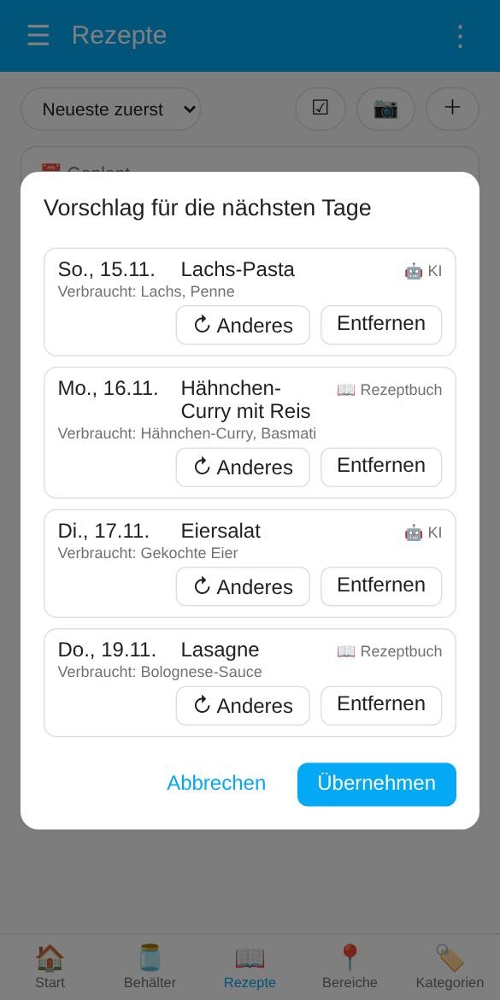
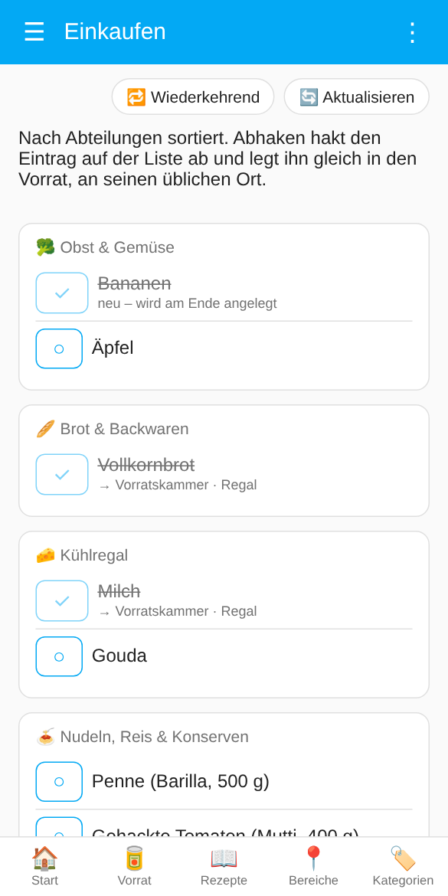
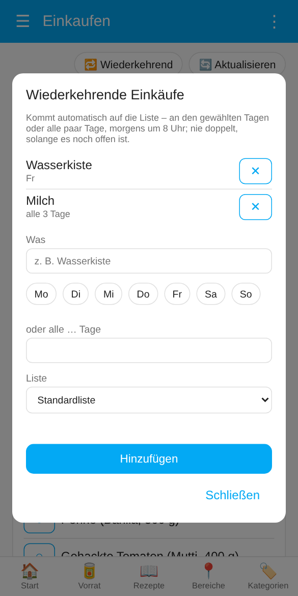
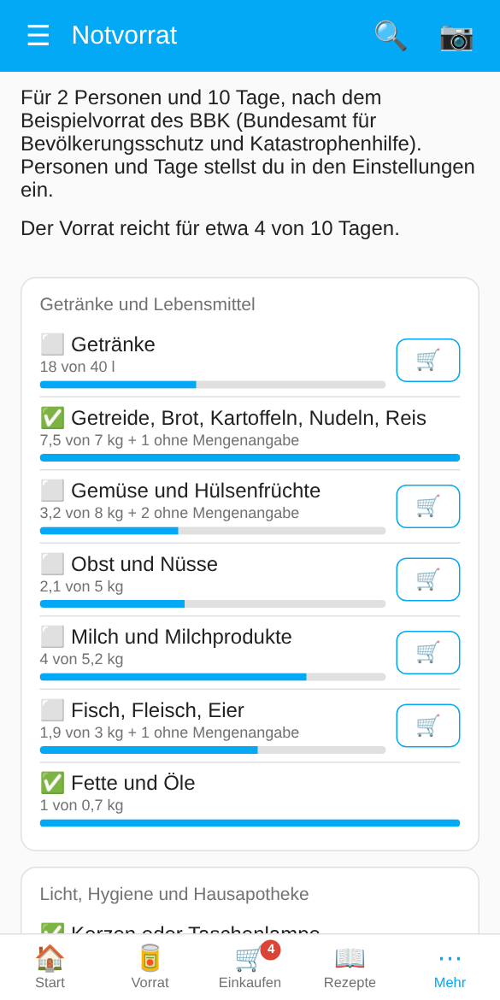
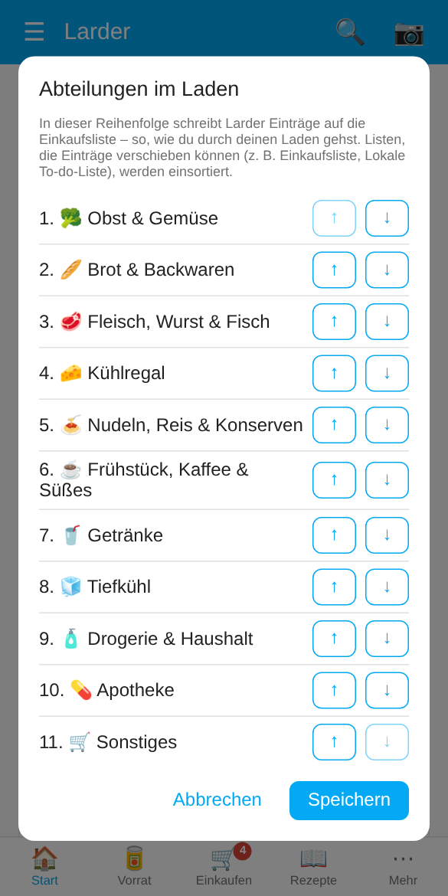

# Rezepte, Zusammenfassung, Wochenplan und Einkauf

[← Übersicht](../../README.de.md) · [🇬🇧 English](../en/kitchen.md)

[Rezepte](#rezepte) · [Tägliche Zusammenfassung](#tägliche-zusammenfassung) · [Wochenplan](#wochenplan) · [Einkaufsliste](#einkaufsliste) · [MHD im Kalender](#mhd-im-kalender)

## Rezepte

Alle Rezeptfunktionen nutzen die Home-Assistant-Integration **AI Task** (dieselbe wie für die [KI-Schätzung](best-before.md#ki-optional)); der Schätzmodus spielt keine Rolle. Je nach Anbieter kann jede Anfrage einen kleinen Betrag kosten, und ohne Knopfdruck oder Automation wird nichts gesendet.

### Rezeptideen

Die KI schlägt Gerichte vor, die aufbrauchen, was bald abläuft.

**Im Dashboard** (Administratoren): auf der Seite **Rezepte** auf **✨ Aus Resten** tippen. Darüber wählst du den Zeitraum (die Vorgabe kommt aus **Konfigurieren** → *Zeitraum für Rezeptideen*, ab Werk 3 Tage; eine feste Zahl von Tagen; oder **Alle Dosen**, dann zählen auch Dosen ohne MHD) und optional die Zahl der Personen. Du bekommst bis zu drei Rezepte mit den verwendeten Dosen, zusätzlichen Zutaten (nur gängige Vorräte), Dauer und kurzen Schritten und kannst gelungene ins [Rezeptbuch](#rezeptbuch) **speichern**. Abgelaufene Dosen und Dosen ohne Inhalt werden nie verwendet.

**In Automationen:** Der Service `larder.suggest_recipes` liefert dasselbe.

```yaml
action: larder.suggest_recipes
data:
  days: 3        # Dosen, die innerhalb von 3 Tagen ablaufen (weglassen = Zeitraum aus den Einstellungen)
  # all_containers: true   # kein Zeitraum: alle befüllten Dosen
  # containers: [device_id, …]   # genau diese Dosen
  servings: 2    # optional, Standard 2 Personen
  max_recipes: 3 # 1 bis 5
response_variable: ideas
# ideas.recipes (title, minutes, uses, extra_ingredients, steps), ideas.summary (Text),
# ideas.ingredients (die verwendeten Dosen), ideas.count
```

**In der täglichen Benachrichtigung:** Das [Blueprint](#tägliche-zusammenfassung) hat den Schalter **Add recipe ideas** („Rezeptideen anhängen“). Die Rezepte werden an die Nachricht angehängt; fällt die KI aus, kommt die normale Nachricht trotzdem. Importiere das Blueprint neu, um den Schalter zu bekommen.

An den gewählten KI-Dienst gehen nur Inhalt, Menge mit Einheit, Resttage und Lagerort (Bereichsname), nie Dosennamen, IDs oder anderes. Die Vorschläge sind Ideen eines Sprachmodells, keine getesteten Rezepte: Prüfe, ob das Essen noch bedenkenlos genießbar ist, besonders bei Aufgetautem oder Älterem.

**Aus gewählten Dosen:** Dosen auswählen und **✨ Rezeptideen** drücken, siehe [Mehrere Dosen auswählen](dashboard.md#mehrere-dosen-auswählen). In Automationen dient dazu `containers` mit den Geräte-IDs.

### Rezeptbuch

Die Seite **Rezepte** ist dein eigenes Rezeptbuch (liegt in Home Assistant unter `.storage/larder.recipes`). Alle dürfen es lesen, Administratoren legen Rezepte an (**＋**), ändern und löschen sie. Sortierung nach neueste oder Name; Antippen zeigt Zutaten und Schritte.

**Rezept aus Foto oder Datei** (📷, Administratoren): Fotografiere ein Rezept aus einem Kochbuch oder von einer Karte, wähle bis zu vier Fotos (z. B. zwei Seiten) oder ein PDF. Die KI liest das Rezept, übersetzt es bei Bedarf in deine Sprache und öffnet es zum **Prüfen**; gespeichert wird erst, wenn du auf *Speichern* tippst. Dafür muss die gewählte KI-Aufgabe Anhänge unterstützen (z. B. Anthropic, OpenAI, Google). Fotos werden vor dem Hochladen verkleinert, liegen nur während des Lesens kurz im Medienordner von Home Assistant (`media/larder/recipe_photos`) und werden danach gelöscht. Gesendet wird nur das Foto bzw. die Datei, an den KI-Dienst, den du gewählt hast.

**Kochen mit dem Vorrat** (seit 6.4):

- **🍳 Gekocht** an einem Rezept aus dem Buch zeigt, was Larder aus dem Vorrat nimmt – je Zutat die Dose oder Packung mit dem frühesten MHD (Salz, Pfeffer, Wasser und Öl gelten als immer da). Auswahl ändern oder *nicht aus dem Vorrat* wählen, dann **Aus dem Vorrat nehmen**: eine Packung weniger, eine Portion einer Dose mit mehreren, sonst wird die Dose als gegessen geleert. *Gekocht* im Wochenplan macht dasselbe.
- Danach bietet **🥡 Reste einlagern?** die leeren Dosen an; ein Tipp öffnet den Füll-Dialog mit dem Gericht als Inhalt und geschätztem MHD.
- Die Sortierung **Passt zum Vorrat** stellt die Rezepte nach vorne, deren Zutaten da sind – ganz ohne KI – mit *✓ 3/4 da · 1 läuft bald ab · fehlt: Sahne*.

**Rezept aus einem Link** (🔗, Administratoren, seit 6.0): Füge die Adresse einer Rezeptseite ein. Die meisten Rezeptseiten enthalten das Rezept maschinenlesbar (schema.org *Recipe*); Larder liest daraus Titel, Portionen, Zeit, Zutaten und Schritte – ganz ohne KI – und öffnet es zum Prüfen, der Link zur Quelle bleibt erhalten. Zutaten, die du im Bestand hast, bekommen ein ✓. Seiten ohne diese Daten werden nicht erraten; dann 📷 mit einem Screenshot nutzen.

## Tägliche Zusammenfassung

Das mitgelieferte Blueprint schickt eine **tägliche Zusammenfassung** dessen, was bald abläuft. Läuft nichts ab, kommt nichts. Abgelaufene Dosen werden mit ihrem Dosennamen und dem Hinweis **sollte geleert werden** genannt, damit du weißt, welche du ausräumen musst. Dosen, die für ein [geplantes Gericht](#wochenplan) aufgetaut werden müssen, kommen zuerst, mit dem Knopf **Aufgetaut**. Für diesen Knopf das Blueprint neu importieren.

[](https://my.home-assistant.io/redirect/blueprint_import/?blueprint_url=https%3A%2F%2Fgithub.com%2Fyan14%2Fha-larder%2Fblob%2Fmain%2Fblueprints%2Fautomation%2Flarder%2Fexpiry_notification.yaml)

| Option | Wirkung |
|---|---|
| **Push notification** | Eine oder mehrere notify-Aktionen, durch Komma getrennt (`notify.mobile_app_dein_iphone, notify.mobile_app_partner`), oder eine notify-Gruppe. Leer lassen für nur Sprache. |
| **Buttons in the push** | **Rezepte** öffnet die Rezeptseite des Dashboards, **Dashboard** öffnet Larder. Antippen der Benachrichtigung selbst öffnet ebenfalls das Dashboard. |
| **One push per entry with buttons** (5.2) | Statt einer Zusammenfassung eine Push je ablaufendem Eintrag (höchstens die gewählte Zahl, der Rest wird in einer letzten Push gezählt) mit den Knöpfen **Verbraucht · Weggeworfen · MHD +2 Tage · Auf die Liste**. Antippen erledigt es sofort, ohne die App zu öffnen: eine Packung weniger, eine Dose geleert (mit der Antwort im Verlauf), das MHD zwei Tage später oder das Produkt auf seiner Einkaufsliste. Android zeigt die ersten drei Knöpfe. |
| **Voice output** | notify-Aktionen, die die Zusammenfassung vorlesen, z. B. `notify.alexa_media_kueche` (Alexa Media Player) oder eine Gruppe von Lautsprechern. Der Sprechtext ist zum Zuhören gemacht: „Heute läuft Lachs ab. Morgen läuft Gouda ab. Pizza in Dose 3 ist abgelaufen und sollte geleert werden.“ (höchstens sechs Dosen, der Rest wird gezählt). Mit Rezeptideen kommt „Idee: …“ dazu. |
| **Voice options** | Zusatzdaten für die Sprachausgabe. Alexa Media Player braucht den Typ, z. B. `type: announce` (mit Gong) oder `type: tts`. |
| **Speak only when someone is home** | Personen, Gruppen oder Zonen; ist niemand zu Hause, entfällt die Sprachausgabe. Der Push kommt immer. |
| **Time** und **Motion sensors** | Ohne Bewegungsmelder kommt die Zusammenfassung zur Uhrzeit. Mit Bewegungsmeldern (z. B. Küche) kommt sie bei der **ersten Bewegung nach dieser Uhrzeit**, einmal am Tag, und spätestens zur **Latest time**, falls niemand vorbeikam. |
| **Days ahead**, **Include expired**, **Add recipe ideas** | Wie bisher. Rezeptideen brauchen die Integration *AI Task*; fällt die KI aus, kommt die Nachricht trotzdem. |

Bestehende Automationen laufen weiter; importiere das Blueprint neu, um die neuen Optionen zu bekommen. Die Namen der Optionen sind englisch, die Nachrichten kommen in der Sprache von Home Assistant.

**Ohne Blueprint:** Der Service `larder.get_expiring` liefert dieselben Daten für eigene Automationen:

```yaml
action: larder.get_expiring
data:
  days: 3               # Dosen, die innerhalb von 3 Tagen ablaufen (Standard: „Läuft bald ab“ aus den Einstellungen)
  include_expired: true
response_variable: result
# result.count, result.expired, result.summary (Text mit Aufzählung für den Push),
# result.speech (Sätze zum Vorlesen), result.labels (Texte der Knöpfe),
# result.items (name, content, quantity, unit, area, best_before, days_left, status,
#   line: der Text eines Eintrags, actions: seine Knöpfe für eine Push)
```

Die Knöpfe gehen auch in eigenen Automationen: `result.items[i].actions` in `data.actions` einer Push an die Home Assistant App. Larder hört auf das Ereignis `mobile_app_notification_action` mit den Aktionen `LARDER_EATEN_<ID>`, `LARDER_THROWN_<ID>`, `LARDER_PLUS2_<ID>` und `LARDER_SHOP_<ID>` und löst danach `larder_notification_action_done` aus.

Auch `larder.suggest_recipes` liefert `speech` („Idee: …“). Für eigene Dashboards gibt es außerdem den Sensor **Tage bis MHD** an jeder Dose.

**Kurzfassung (seit 5.8).** Die Blueprints *tägliche Zusammenfassung*, *Wochenrückblick*, *Monatsbericht*, *Angebrochenes* und *ablaufende Medikamente* haben die Option **Short version**: eine kurze Zeile pro Eintrag, nur was und wann (*• Lachs: morgen*), ohne Dose, Menge und Ort. Die Dienste liefern sie als `summary_short` (Einträge von `get_expiring` als `line_short`).

**Gefrierschrank (seit 5.8).** Eingefroren bleibt Essen sicher; das Datum einer Dose im Gefrierschrank ist das Ende der **besten Qualität**. Danach schreibt die Zusammenfassung *beste Qualität seit 10 Tagen vorbei, bald verbrauchen* statt *abgelaufen, sollte geleert werden* (Einträge tragen `frozen: true`), und das Dashboard zeigt *Qualität ↓* in Orange statt Rot.

### Monatsbericht

Ein zweiter Blueprint schickt am gewählten Tag einen **Monatsbericht** für den Vormonat: befüllte und geleerte Dosen, gegessen und weggeworfen, der Anteil Weggeworfenes im Vergleich zum Vormonat was am häufigsten weggeworfen wurde und – bei Packungen mit Preis – ca. wie viel Euro. Als Push (Antippen öffnet die Statistik) und optional als Sprachausgabe. Für einen Monat ohne Bewegung wird nichts geschickt. Derselbe Bericht steht oben in der [Statistik](dashboard.md#statistik) und kommt vom Dienst `larder.get_monthly_report` (`month`: `JJJJ-MM`, Standard: Vormonat).

[](https://my.home-assistant.io/redirect/blueprint_import/?blueprint_url=https%3A%2F%2Fgithub.com%2Fyan14%2Fha-larder%2Fblob%2Fmain%2Fblueprints%2Fautomation%2Flarder%2Fmonthly_report.yaml)

### Wochenrückblick

Seit 5.2 schickt ein Blueprint einen **Wochenrückblick** am gewählten Tag zur gewählten Zeit (Standard Sonntag 18:00): gegessen und weggeworfen in den letzten 7 Tagen, ungefähr wie viel das Weggeworfene wert war, was in den nächsten 7 Tagen abläuft und optional eine Rezeptidee dazu (AI Task). Als Push und optional als Sprachausgabe. Der Dienst `larder.get_weekly_review` liefert dasselbe (`eaten`, `thrown`, `thrown_value`, `thrown_items`, `expiring`, `title`, `summary`, `speech`).

[](https://my.home-assistant.io/redirect/blueprint_import/?blueprint_url=https%3A%2F%2Fgithub.com%2Fyan14%2Fha-larder%2Fblob%2Fmain%2Fblueprints%2Fautomation%2Flarder%2Fweekly_review.yaml)

### Angebrochenes

Seit 5.7 schickt der Blueprint **Larder – opened items** einmal pro Woche (Standard Samstag 10:00) eine Push mit allem **Angebrochenen**, das in den nächsten Tagen (Standard 7) verbraucht werden muss: wie lange es schon offen ist und wann es abläuft, z. B. *Mayonnaise (1 Stück, seit 8 Wochen offen, Kühlschrank): in 5 Tagen*. Ungeöffnetes bleibt draußen (dafür gibt es die tägliche Zusammenfassung); läuft nichts Angebrochenes ab, kommt nichts.

[](https://my.home-assistant.io/redirect/blueprint_import/?blueprint_url=https%3A%2F%2Fgithub.com%2Fyan14%2Fha-larder%2Fblob%2Fmain%2Fblueprints%2Fautomation%2Flarder%2Fopened_reminder.yaml)

### Retten-Liste der Woche

Seit 6.5 schickt der Blueprint **Larder – rescue list of the week** einmal pro Woche (Standard Sonntag 17:00) eine kurze Push mit allem, was diese Woche weg muss und noch nicht eingeplant ist: was in 7 Tagen abläuft und Eingefrorenes in den letzten Wochen seiner besten Qualität ([Tiefkühl zuerst](#wochenvorschlag)). Der Knopf **In den Wochenplan** öffnet den Wochenvorschlag. **Mehr → ♻️ Retten diese Woche** zeigt dieselbe Liste im Dashboard, mit **🧊 Einfrieren** für das, was sich einfrieren lässt. Der Dienst `larder.get_rescue_list` liefert `count`, `items`, `title`, `summary`, `summary_short`, `button` und `url`.

[](https://my.home-assistant.io/redirect/blueprint_import/?blueprint_url=https%3A%2F%2Fgithub.com%2Fyan14%2Fha-larder%2Fblob%2Fmain%2Fblueprints%2Fautomation%2Flarder%2Frescue_list.yaml)

**Einfrieren statt wegwerfen** (seit 6.5): Was im Kühlschrank in 2 Tagen abläuft und sich einfrieren lässt (die Tabelle hat einen Gefrier-Wert), bekommt in der Push je Eintrag der täglichen Zusammenfassung und in der Retten-Liste den Knopf **🧊 Einfrieren**. Ein Tipp stellt es in den Gefrierschrank-Bereich und gibt ihm das Gefrier-MHD der Tabelle, ab heute gerechnet.

### Ablaufende Medikamente

Medikamente und Haushaltsartikel mit Datum (z. B. Sonnencreme) warnen viel früher als Lebensmittel (standardmäßig 60 Tage) und stehen deshalb nicht in der täglichen Zusammenfassung. Ein eigener Blueprint erinnert an den gewählten Wochentagen (z. B. jeden Montag um 9:00): Push an ein oder mehrere Handys und optional als Ansage auf Alexa (Alexa Media Player, z. B. `notify.alexa_media_kitchen` mit `type: announce`). Abgelaufene werden mit *entsorgen* genannt. Seit 4.8 nennt er auch [Gutscheine](containers.md#gutscheine), die bald ablaufen, mit ihrem Wert (Schalter *Include vouchers*; abgelaufene Gutscheine nie). Ist nichts fällig, kommt nichts; von Hand ausgeführt kommt die Nachricht trotzdem, als Test.

[](https://my.home-assistant.io/redirect/blueprint_import/?blueprint_url=https%3A%2F%2Fgithub.com%2Fyan14%2Fha-larder%2Fblob%2Fmain%2Fblueprints%2Fautomation%2Flarder%2Fmedicine_reminder.yaml)

Für eigene Automationen: `larder.get_expiring_medicines` (optional `days`, `include_expired`, `include_vouchers`) liefert `count`, `expired`, `items`, `summary` und `speech`.

### Am Kühlschrank und an den Fächern

Zwei weitere Blueprints (5.3): **Kühlschranktür-Erinnerung** – geht die Kühlschranktür auf (Kontaktsensor) und läuft heute etwas ab oder ist abgelaufen, sagt ein Lautsprecher *Bitte zuerst aufbrauchen: Lachs, Gouda* (optional nur für einen Bereich, höchstens alle paar Stunden). **Sagen, was im Fach liegt** – wird der NFC-Tag oder das QR-Etikett eines [Fachs](scanning.md#fächer) gescannt, sagt ein Lautsprecher, was darin liegt (*Gefrierschrank · Schublade 2: Lachs, Erbsen*); optional nur für bestimmte Fächer.

[](https://my.home-assistant.io/redirect/blueprint_import/?blueprint_url=https%3A%2F%2Fgithub.com%2Fyan14%2Fha-larder%2Fblob%2Fmain%2Fblueprints%2Fautomation%2Flarder%2Ffridge_door.yaml) [](https://my.home-assistant.io/redirect/blueprint_import/?blueprint_url=https%3A%2F%2Fgithub.com%2Fyan14%2Fha-larder%2Fblob%2Fmain%2Fblueprints%2Fautomation%2Flarder%2Fcompartment_announce.yaml)

### Bald leer und Rückrufe

Ein dritter Blueprint schickt einen Push, wenn ein Produkt [bald leer](containers.md#bestand) ist und wenn eine [Rückrufwarnung](containers.md#rückrufwarnungen) zu etwas im Vorrat passt; beides lässt sich einzeln ein- und ausschalten. Seit 4.6 erinnert er auf Wunsch auch, wenn ein Haushaltsartikel [gewechselt werden sollte](containers.md#haushaltsartikel) (Ereignis `larder_replace_due` mit `name`, `due`, `weeks`, `title`, `message`). Antippen öffnet die Startseite von Larder. Die Ereignisse `larder_running_low` (`name`, `count`, `min`, `lasts_days`, `message`) und `larder_recall` (`title`, `reason`, `link`, `products`, `places`, `message`) gehen auch für eigene Automationen. Von Hand ausgeführt, schickt die Automation eine Test-Benachrichtigung.

[](https://my.home-assistant.io/redirect/blueprint_import/?blueprint_url=https%3A%2F%2Fgithub.com%2Fyan14%2Fha-larder%2Fblob%2Fmain%2Fblueprints%2Fautomation%2Flarder%2Fstock_alerts.yaml)

## Wochenplan

Ein Gericht für einen Tag einplanen: **📅 Einplanen** an einer Rezeptidee oder einem Rezept aus dem Buch (auch für Nicht-Administratoren). Der Dialog fragt das Gericht, den Tag (vorbelegt: morgen) und die **Dosen**, die dafür gebraucht werden; Dosen, deren Inhalt im Rezept vorkommt, sind schon angehakt.

- Die **Startseite** zeigt, was in den nächsten sieben Tagen geplant ist, die **Rezeptseite** alle Pläne (✕ nimmt einen heraus).
- Mit einem **Kalender für den Wochenplan** in den [Einstellungen](reference.md#einstellungen) wird jeder Plan zusätzlich ein ganztägiger Termin „🍽 Spaghetti Bolognese“; wird der Plan gelöscht, verschwindet auch der Termin.
- **✓ Gekocht** an einem Plan nimmt aus jeder seiner Dosen eine Portion (wenn sie mehr als eine hat) oder leert sie als gegessen und nimmt den Plan aus der Liste.
- **Fehlende Zutaten:** Der Dialog übernimmt auch die Zutaten des Rezepts. Was in keiner deiner Dosen steckt, steht am Plan; **🛒 n fehlen → Einkaufsliste** setzt es auf die [Einkaufsliste](#einkaufsliste) (was dort schon offen ist, kommt nicht doppelt).

**Auftau-Erinnerung.** Steht eine Dose, die ein geplantes Gericht braucht, im **Gefrierschrank** (nach Name oder Label des Bereichs), erinnert Larder rechtzeitig daran, sie in den Kühlschrank zu stellen, standardmäßig am Vortag (Einstellung **Auftauen: Tage vorher**, 0–3):

- auf der Startseite unter **🧊 Zum Auftauen in den Kühlschrank**, mit dem Knopf **✓ Aufgetaut**,
- in der [täglichen Zusammenfassung](#tägliche-zusammenfassung) als erste Zeilen („🧊 Bolognese-Sauce (Dose 4) für Spaghetti Bolognese, morgen“) und in der Sprachausgabe; die Push-Nachricht bekommt den Knopf **Aufgetaut**. Dafür wird die Zusammenfassung auch geschickt, wenn nichts abläuft.

**Aufgetaut** wirkt wie der Knopf **Aufgetaut** auf der Karte (kürzt das MHD) und stellt [variable Dosen](containers.md#dosen-befüllen) in den Kühlschrank, wenn es genau einen Kühlschrank-Bereich gibt.

### Wochenvorschlag

<p align="center"></p>

**🪄 Woche vorschlagen** auf der Rezeptseite schlägt Gerichte für die nächsten Tage vor (Einstellung *Wochenplan-Vorschlag: Tage*, Standard 5), die zuerst die Dosen verbrauchen, die bald ablaufen. Tage, für die schon etwas geplant ist, werden übersprungen, schon eingeplante Dosen bleiben außen vor. Woher die Gerichte kommen, ist eine Einstellung wie bei der MHD-Schätzung: *nur Rezeptbuch*, *nur KI*, *Rezeptbuch, sonst KI* (Standard) oder *Rezeptbuch und KI zusammen*. Ein Rezept aus dem Buch passt, wenn eine seiner Zutatenzeilen den Inhalt einer Dose nennt. Je Tag siehst du das Gericht und die Dosen, die es verbraucht; **↻ Anderes** tauscht das Gericht, **Entfernen** nimmt den Tag heraus, **Übernehmen** schreibt alles in den Wochenplan (mit Auftau-Erinnerung und fehlenden Zutaten wie gewohnt).

**Tiefkühl zuerst** (seit 6.2): Eingefrorenes bleibt sicher, aber seine beste Qualität endet. Dosen im Gefrierschrank in den letzten Wochen ihrer besten Qualität (Einstellung *Tiefkühl vorziehen: Wochen vor Ende der besten Qualität*, Standard 6, 0 = aus) werden mit eingeplant – nach dem, was im Kühlschrank innerhalb einer Woche abläuft, vor lange Haltbarem – und mit 🧊 gezeigt. Eingefrorenes, das noch lange gut ist, wird nicht vorgeschlagen, damit nichts wahllos aufgetaut wird. Die Rezeptideen bekommen dieselben Dosen, markiert als *eingefroren, bald verwenden*. Übernimmst du einen Tag, kommt am Vortag die gewohnte Auftau-Erinnerung.

## Einkaufsliste

**Mal wieder …?** Die Startseite schlägt vor, was du in den letzten 90 Tagen mindestens dreimal gegessen hast, aber gerade in keiner Dose und keiner Packung ist („Bolognese, 4× gegessen …“). **🛒 Einkaufsliste** setzt es auf die Liste, **✕** blendet den Vorschlag 30 Tage aus.

Unter Einstellungen → Geräte & Dienste → **Larder** → **Konfigurieren** kannst du eine **To-do-Liste** von Home Assistant wählen, z. B. die eingebaute *Einkaufsliste*, Todoist oder Bring!. Jede Dose hat dann ein Häkchen **Beim Leeren auf die Einkaufsliste** (der Schalter `Einkaufsliste`, standardmäßig aus). Drückst du bei einer Dose mit gesetztem Häkchen **Behälter leeren**, wird ihr Inhalt auf die Liste gesetzt, z. B. „Basmati“.

- **Marke und Packung:** Sind sie bekannt (z. B. nach einem [Strichcode-Scan](containers.md#dosen-befüllen)), kommen sie mit auf die Liste: „Haferflocken (Kölln, 500 g)“. Ein offenes „Haferflocken“ gilt als derselbe Eintrag und kommt nicht doppelt. Abschaltbar in den Einstellungen; bei mehreren Inhalten („Salami, Leberwurst“) kommen nur die Namen.
- Nicht alles gehört auf die Liste: Reste wie „Pizza-Reste“ lässt du einfach ohne Häkchen, sie werden nie eingetragen. Die Einstellung gehört zur Dose und bleibt beim Leeren erhalten. So wird Reis immer nachgekauft und Pizza nie.
- Steht ein Eintrag schon offen auf der Liste, wird er nicht doppelt angelegt. Bereits abgehakte Einträge zählen nicht, du kannst dasselbe also erneut einkaufen.
- Ohne gewählte Liste passiert nichts, und das Häkchen ist ausgeblendet. Ist die Liste nicht erreichbar, wird die Dose trotzdem geleert.
- Geplant: auch abgelaufene Dosen einzutragen.

**Mehrere Listen (seit 4.1).** Alles, was Larder auf eine Liste setzt (geleerte Dosen, Mindestbestand, bald leer, Zutaten aus dem Wochenplan, *Mal wieder …?*, 🛒), kommt auf eine dieser Listen:

| Welche Liste | Wo einstellen | Wofür |
|---|---|---|
| **Einkaufsliste (Lebensmittel)** | Konfigurieren | Lebensmittel und Haushaltsartikel ohne eigene Liste |
| **Einkaufsliste für Haushaltsartikel** | Konfigurieren (optional) | Haushaltsartikel; leer = die Lebensmittel-Liste |
| **Einkaufsliste für Medikamente** (seit 4.4) | Konfigurieren (optional) | Medikamente; leer = die Lebensmittel-Liste |
| **Liste je Produkt** | auf der Karte (**Einkaufsliste**) oder im Anlegen-Dialog | dieses Produkt, z. B. *Metzger* für Leberkäse oder *Apotheke* für Pflaster; gemerkt nach Produktname, die nächste Packung landet also auch dort. **Standardliste** stellt zurück |

*Eingekauft – in den Vorrat?* beobachtet jede Liste, auf die Larder geschrieben hat, und *Marke und Packung mit auf die Einkaufsliste* gilt für alle. Wird eine gewählte Liste aus Home Assistant entfernt, nimmt das Produkt wieder die Standardliste.

### Abteilungen im Laden

Seit 4.7 gehört jedes Produkt zu einer **Abteilung**: 🥦 Obst & Gemüse, 🥖 Brot & Backwaren, 🥩 Fleisch, Wurst & Fisch, 🧀 Kühlregal, 🫙 Öl, Soßen & Trockenware, 🍝 Nudeln & Reis, 🥫 Konserven, 🧁 Backen (Mehl, Zucker …), 🧂 Gewürze, 🌏 Internationale Küche (Asia, Osteuropa, Türkei …), ☕ Frühstück & Kaffee, 🍫 Süßes & Snacks, 🥤 Getränke, 🧊 Tiefkühl, 🧴 Drogerie & Haushalt, 💊 Apotheke, 🛒 Sonstiges (die sechs nach Trockenware und *Süßes & Snacks* gibt es seit 6.9; in einer schon gespeicherten Reihenfolge stehen sie hinter ihrer alten Nachbar-Abteilung). Larder schlägt sie nach Art, Zeile der Haltbarkeitstabelle und Stichwörtern vor (Haushaltsartikel → Drogerie, Medikamente → Apotheke, *TK-* → Tiefkühl, Wasser und Saft → Getränke, Mehl und Zucker → Backen, Kokosmilch und Pelmeni → Internationale Küche); **Abteilung** auf der Karte eines Produkts überschreibt das, gemerkt nach Produktname, **Automatisch** stellt zurück.

Der [Einkaufsmodus](#einkaufsmodus) zeigt alle Listen nach Abteilungen in deiner Reihenfolge – so folgt er deinem Weg durch den Laden; selbst eingetippte Einträge werden nach ihrem Namen mit einsortiert. Die Reihenfolge stellst du einmal unter **Mehr → 🏪 Abteilungen** (Administratoren) mit ↑ und ↓ ein. Seit 6.9 legst du dort auch **eigene Abteilungen** an (z. B. *Bio-Ecke*), benennst sie mit ✏️ um oder löschst sie mit ✕; sie stehen dann in der Reihenfolge, bei den Läden und in der Auswahl **Abteilung** auf der Karte. Wird eine gelöscht, bekommen ihre Produkte wieder den Vorschlag. Auf der To-do-Liste selbst kommen neue Einträge einfach ans Ende (bis 5.3.3 hat Larder sie hinter ihre Abteilung geschoben; das brauchte einen Zugriff auf die Liste über die öffentlichen Aktionen von Home Assistant hinaus und entfällt deshalb).

### Einkaufsmodus

**🛒 Einkaufen** in der Leiste unten (seit 5.0, mit der Zahl der offenen Einträge) zeigt alle Listen, auf die Larder schreibt, nach [Abteilungen](#abteilungen-im-laden) in deiner Reihenfolge. **Abhaken** erledigt zweierlei: Der Eintrag wird auf seiner To-do-Liste abgehakt und kommt **gleich in den Vorrat**, an seinen üblichen Ort, mit Marke, Packung und Preis, soweit bekannt, und so vielen Packungen, wie Larder bestellt hat (*→ Vorratskammer · Regal (+2)*). Was Larder noch nicht kennt (*unbekannt – unten anlegen*), wird gesammelt: **＋ n neue Artikel anlegen** öffnet den Packungs-Dialog mit den Namen, Haushaltswaren (laut Produktdatenbanken) getrennt als Haushaltsartikel. *Eingekauft – in den Vorrat?* bietet sie nicht noch einmal an. Seit 6.9 aktualisiert sich die Seite selbst, sobald sich eine Liste woanders ändert; **Bestellung vorbereiten**, **Wiederkehrend** und **Aktualisieren** stehen unter **⋯ Mehr**. Seit 6.7 sagt nach dem Abhaken eine kurze Meldung, wohin es kam (*Milch → Vorratskammer · Regal*), mit **Rückgängig**: Der Eintrag ist wieder offen und die Packung wieder aus dem Vorrat. Oben setzt **Auf die Liste …** etwas direkt auf die Einkaufsliste (seine eigene Liste, sonst die Standardliste; nichts doppelt).

**Nach Laden (seit 5.9).** **📍 Wo bist du?** oben: *Überall* oder einer deiner Läden (**＋ Geschäft** legt einen an; die Wahl merkt sich das Gerät). In einem Laden zeigt die Seite, was du dort schon gekauft hast, und alles ohne bekannten Laden; was du bisher nur woanders gekauft hast, steht zugeklappt am Ende (*Woanders gekauft – bisher nicht bei Aldi*). **🏪 Abteilungen bei …** gibt dem Laden eine eigene Reihenfolge der Abteilungen (zurück mit *Allgemeine Reihenfolge*). Bei *Überall* steht unter jedem Eintrag der günstigste Laden (*💶 Aldi*). Wo ein Produkt gekauft wurde, kommt vom **Preis**: der Laden vom [Kassenbon](containers.md#im-dashboard-empfohlen) (die KI liest ihn aus dem Kopf des Bons, du kannst ihn vor dem Anlegen korrigieren) oder der Preis, den du im Einkaufsmodus bei gewähltem Laden einträgst. Bestands- und Produktansicht zeigen **🏪 Preise je Laden**, den günstigsten zuerst, und der Preisverlauf nennt den Laden.

Seit 4.11:
- **📷 Scannen** (Home-Assistant-App): den Strichcode im Laden scannen. Der passende Eintrag auf der Liste wird abgehakt und kommt in den Vorrat; ein bekanntes Produkt, das nicht auf der Liste steht, kommt trotzdem in den Vorrat (*Gescannt, nicht auf der Liste*); ein unbekanntes wird mit seinem Namen aus Open Food Facts gesammelt.
- **€ / MHD** neben einem abgehakten Eintrag: **Preis** (kommt in den Preisverlauf) und **MHD** eintragen. Ist die Packung zu einem Eintrag mit weiteren Packungen dazugekommen, bekommt sie einen eigenen, damit die anderen ihr Datum behalten.
- **📥 Einräumen** öffnet die drei Wege zum Einräumen, darunter **🧾 Kassenbon oder Rechnung**; liest stattdessen einen Kassenbon (siehe [Packungen](containers.md#beutel-und-packungen)).

### Online-Bestellung

Seit 6.6 hilft **Einkaufen → 📦 Bestellung vorbereiten** bei einer Online-Bestellung (REWE, Lieferdienste): **Liefertag** eintragen, Larder listet, was bis zur übernächsten Lieferung ausgeht (nach Verbrauch, Liefertag + Vorlauf aus den Einstellungen) und was unter dem Mindestbestand ist, mit Anzahl – *8× Milch · reicht noch 2 Tage*. **📋 Kopieren** legt die Liste in die Zwischenablage für die App des Ladens, **🛒 Auf die Einkaufsliste** setzt sie dort drauf. **Liefertag merken** behält den Tag: Der Blueprint **Larder – delivery day** schickt dann morgens eine Push, deren Knopf **📥 Einräumen** öffnet – danach die Liste für Preis und MHD. Ist der Tag vorbei, wird er vergessen. Es wird weder E-Mail noch ein Konto beim Laden gelesen. Dienst `larder.get_delivery`.

[](https://my.home-assistant.io/redirect/blueprint_import/?blueprint_url=https%3A%2F%2Fgithub.com%2Fyan14%2Fha-larder%2Fblob%2Fmain%2Fblueprints%2Fautomation%2Flarder%2Fdelivery_day.yaml)

### Wiederkehrende Einkäufe

Was du regelmäßig kaufst, aber nicht zählst, kommt von selbst auf die Liste: **🔁 Wiederkehrend** auf der Einkaufen-Seite. Name, **Wochentage** (z. B. *Fr* für die Wasserkiste) oder **alle n Tage** (Milch alle 3 Tage) und optional eine Liste. Larder trägt es morgens um 8 Uhr ein, nie doppelt, solange noch einer offen ist.

<p align="center">


</p>

## Notvorrat

**Mehr → 🛟 Notvorrat** vergleicht den Bestand mit dem Beispielvorrat des Bundesamts für Bevölkerungsschutz und Katastrophenhilfe (BBK) für 10 Tage: pro Person 20 l Getränke, 3,5 kg Getreide, Brot, Kartoffeln, Nudeln und Reis, 4 kg Gemüse und Hülsenfrüchte, 2,5 kg Obst und Nüsse, 2,6 kg Milch und Milchprodukte, 1,5 kg Fisch, Fleisch und Eier sowie 0,36 kg Fette und Öle. Darunter prüft er am Namen Kerzen oder Taschenlampe, Batterien, Radio, Klopapier, Seife, Verbandskasten, Schmerzmittel, Fieberthermometer und Desinfektionsmittel.

- **Personen** und **Tage** sind Einstellungen (Standard 2 Personen, 10 Tage); die Mengen rechnen sich mit. Der Check lässt sich ausschalten.
- Gezählt wird, was eine Mengenangabe hat: eine Packungsgröße wie *500 g* oder *6 x 1,5 l* (mal Anzahl Packungen), Dosen in Gramm oder Millilitern, Portionen mit 300 g. Einträge ohne Menge stehen als *+ n ohne Mengenangabe* dabei, das Ergebnis ist also eine Untergrenze.
- Die Seite sagt, für wie viele Tage der Vorrat reicht (die schwächste Gruppe entscheidet), und bietet für jede Lücke **🛒**: *Mineralwasser*, *Gemüsekonserven*, *Kerzen* … kommen auf die Lebensmittel-, Haushalts- oder Apotheken-Liste.

<p align="center">


</p>

## MHD im Kalender

Unter Einstellungen → Geräte & Dienste → **Larder** → **Konfigurieren** kannst du einen vorhandenen **Kalender** wählen (Google, *Lokaler Kalender* …). Jede Dose bekommt dann einen Ganztags-Termin „MHD: Pizza“ am Tag des MHD. Der Termin wird angelegt, sobald ein Datum gesetzt ist, verschoben, wenn sich Datum oder Inhalt ändern, und gelöscht, wenn das Datum gelöscht, die Dose geleert oder entfernt oder ein anderer Kalender gewählt wird. Eigene Termine werden an einer Kennung in der Beschreibung erkannt, andere Termine werden nie angefasst.

**Aufräumen.** Bei jedem Start und beim Speichern der Einstellungen prüft Larder den ganzen Kalender, behält pro Dose genau einen Termin und entfernt Doppelte. Der Dienst `larder.rebuild_calendar` macht das auf Knopfdruck und entfernt zusätzlich Termine von Dosen, die es nicht mehr gibt. Mit `include_unmarked: true` werden außerdem Termine „MHD: …“ / „Best before: …“ ohne Larder-Kennung entfernt (für Kalender, die die Beschreibung verwerfen) und neu angelegt.

Der Kalender muss Termine anlegen **und** löschen können. Reine Lese-Kalender (z. B. ein iCal-Link) gehen nicht und werden beim Speichern der Einstellungen abgelehnt; die Integration *Lokaler Kalender* ist eine gute Wahl, wenn du keinen anderen hast. **CalDAV** (iCloud, Nextcloud …) geht seit 4.10.3 nicht mehr: Der CalDAV-Kalender von Home Assistant kann nur Termine anlegen, und Larder nutzt nur noch die Kalenderfunktionen von Home Assistant (vorher griff es auf die eigene Verbindung der CalDAV-Integration zu, was für den HACS-Standardkatalog nicht erlaubt ist). Früher geschriebene Termine bleiben in diesem Kalender; lösche sie dort bei Bedarf.
