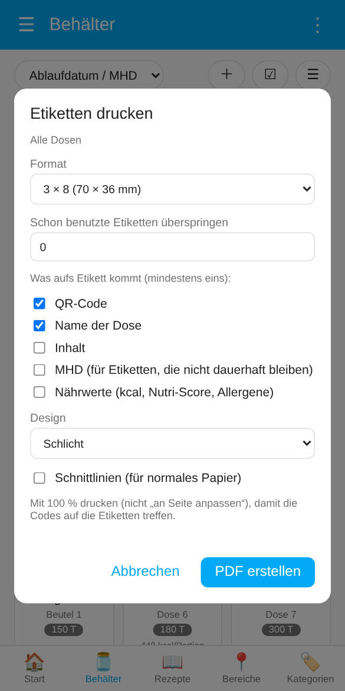
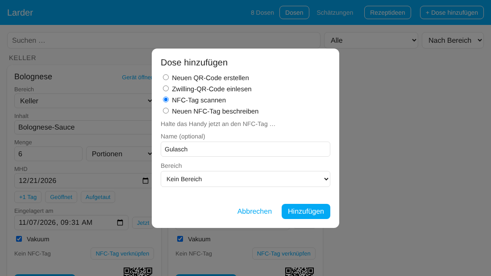
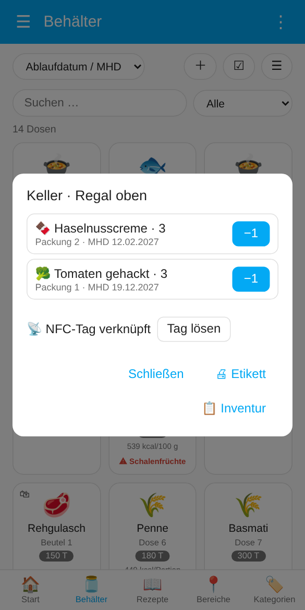
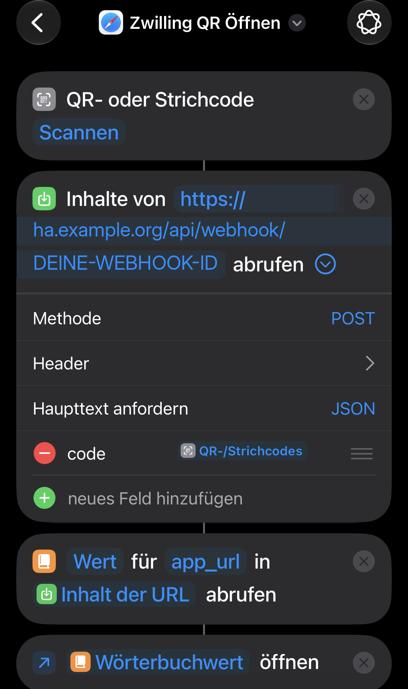

# Scannen

[← Übersicht](../../README.de.md) · [🇬🇧 English](../en/scanning.md)

[Scannen in der App](#scannen-in-der-app) · [Eigene QR-Codes](#eigene-qr-codes) · [NFC-Tags](#nfc-tags) · [iOS-Kurzbefehl für die originalen Zwilling-Codes](#ios-kurzbefehl-für-die-originalen-zwilling-codes)

Es gibt vier Wege, von einer Dose zu ihrem Eintrag im Dashboard zu kommen. Sie lassen sich beliebig mischen. Für eine Inventur wählt der [Serien-Scan](dashboard.md#mehrere-dosen-auswählen) viele Dosen nacheinander aus.

## Scannen in der App

In der Home Assistant App (**iOS und Android**) hat das Dashboard einen **📷**-Knopf: auf der Startseite (**📷 Dose scannen**) und neben **＋** auf den Seiten Behälter, Bereiche und Kategorien. Er öffnet den QR-Scanner der App und liest **beide Arten von Codes**, eigene und die originalen Zwilling-Codes:

- **Bekannte Dose:** ihre Karte öffnet sich, eine leere Dose gleich mit dem Befüllen-Dialog. Das Ereignis `larder_dose_scanned` wird wie bei jedem Scan ausgelöst.
- **Noch nicht angelegter Zwilling-Code** (Administratoren): der Dialog **Dose hinzufügen** öffnet sich, der Code ist schon eingetragen.
- **Alles andere:** der Scanner meldet „Kein Larder-Code“ und bleibt für den nächsten Versuch offen.

Der Knopf erscheint nur in der App auf einem Gerät mit Kamera, nicht im Browser am PC. Außerhalb der App nimmst du für eigene Codes die Kamera-App und für Zwilling-Codes den [iOS-Kurzbefehl](#ios-kurzbefehl-für-die-originalen-zwilling-codes).

## Eigene QR-Codes

Jede Dose hat die Bild-Entität **QR-Code**. Drucke sie aus und klebe sie auf die Dose (Gerät der Dose oder Entität **QR-Code** öffnen, Bild speichern oder drucken; der Inhalt steht auch im Attribut `qr_content`).

Scannen mit der Kamera-App funktioniert **wie ein NFC-Tag**: Die Home-Assistant-App öffnet das Dashboard **Larder** bei dieser Dose, eine leere gleich mit dem Befüll-Dialog, und für deine Automationen wird das Ereignis `larder_dose_scanned` ausgelöst (mit `source: qr`). Der Code enthält die ID der Dose (`homeassistant://navigate/larder?cc=<ID>`), nicht die Geräte-ID, und bleibt deshalb gültig, wenn du die Dose löschst und neu anlegst. Hast du mehrere Home-Assistant-Server in der App, fragt sie, welcher gemeint ist.

Dieselben Codes funktionieren im [Serien-Scan](dashboard.md#mehrere-dosen-auswählen) des Dashboards.

> Vor Version 2.0 gedruckte Codes öffnen weiterhin die Geräteseite der Dose. Druck sie neu aus, um das neue Verhalten zu bekommen.

### Etikettenbogen

Viele Etiketten auf einmal drucken: im Dashboard **⋮ → 🖨 Etiketten drucken** (alle Dosen) oder Dosen auswählen und **🖨 Etiketten**. Dann wählst du

- das **Format**: einen A4-Bogen mit 3 × 8 (70 × 36 mm), 3 × 7 (70 × 42,3 mm) oder 2 × 4 (105 × 74 mm) Etiketten, wie es sie von Avery Zweckform, Herma und anderen gibt, oder einen **Etikettendrucker** (62 × 29 mm wie Brother DK-11209, 54 × 25 mm wie Dymo 11352, 89 × 36 mm wie Dymo 99012; ein Etikett pro Seite),
- **Schon benutzte Etiketten überspringen** (nur A4), um auf einem angebrochenen Bogen weiterzumachen,
- **was aufs Etikett kommt**, mindestens eins von: **QR-Code**, **Name der Dose**, **Inhalt**, **MHD**, **Nährwerte** (kcal, Nutri-Score, Allergene, aus den [Nährwerten](containers.md#nährwerte) der Dose). Ohne QR-Code steht der Text größer in der Mitte, schön für Dosen mit [NFC-Tag](#nfc-tags). Die Schrift wird so groß wie möglich gesetzt und bricht in eine zweite Zeile um statt abgeschnitten zu werden. Nur der Inhalt passt für Dosen, in denen immer dasselbe ist (Zucker, Reis); das MHD ist für Etiketten gedacht, die nicht dauerhaft bleiben (z. B. Gefrierbeutel); nur mit dem Namen bleibt das Etikett gültig, wenn sich der Inhalt ändert,
- das **Design**: schlicht, Rahmen, eingekerbte Ecken oder **Handschrift** (Glas-Etikett mit Handschrift-Font [Kalam](https://fonts.google.com/specimen/Kalam), SIL Open Font License). die **Schriftfarbe** (Schwarz, Dunkelblau, Dunkelgrün, Dunkelrot oder Braun; QR-Code und Rahmen bleiben schwarz) oder **invertiert** (Tafel-Look: schwarzes Etikett mit weißer Schrift und weißem Rahmen, der QR-Code auf einem weißen Feld, damit er sicher lesbar ist; braucht viel Tinte, und ein normaler Drucker kann kein Weiß auf schwarzes Papier drucken),
- **Larder-Symbol in der Mitte des QR-Codes** (höchste Fehlerkorrektur; auf sehr kleinen Etiketten weggelassen, weil es dort das Scannen unsicher macht),
- **Schnittlinien**, für normales Papier.

**PDF erstellen** erzeugt einen Link, dann **PDF öffnen** antippen. In der Home Assistant App öffnet es sich im Browser, von dort druckst oder teilst du es. Mit **100 %** drucken (nicht „an Seite anpassen“), damit die Codes auf die Etiketten treffen. Der Link gilt fünf Minuten. Deine Auswahl merkt sich das Gerät.

## NFC-Tags

Statt einen QR-Code zu drucken, kannst du einen NFC-Tag auf die Dose kleben. Dafür werden die **Tags** von Home Assistant genutzt: Jeder Scan löst ein `tag_scanned`-Ereignis aus, und die Integration merkt sich, welcher Tag zu welcher Dose gehört. Andere Tags im Haus werden ignoriert.

**Der schnellste Weg (in der Home-Assistant-App):** Dashboard öffnen, **＋** auf der Behälter-Seite **→ Neuen NFC-Tag beschreiben** wählen, einen Namen eingeben und **Hinzufügen** drücken. Larder legt die Dose an, erstellt einen neuen Tag in Home Assistant und verknüpft beides. Danach öffnet die App das Beschreiben: Handy an einen leeren NFC-Tag halten, fertig. Die Option erscheint nur in der Companion-App auf einem Handy, das NFC-Tags beschreiben kann (nicht im Browser am Rechner).

Hast du schon einen mit der Home-Assistant-App beschriebenen Tag (Einstellungen → Companion-App → NFC, oder Einstellungen → Tags), verknüpfst du ihn stattdessen:

1. **Mit einer Dose verknüpfen** im Dashboard (Administratoren): Auf der Karte **NFC-Tag verknüpfen** drücken und das Handy an den Tag halten. Oder **＋ → NFC-Tag scannen**: Das legt eine neue Dose an und verknüpft den Tag gleich mit.
2. **Später scannen.** Ist das Dashboard offen, öffnet es die Dose (eine leere mit dem Befüll-Dialog). Sonst bekommt das scannende Handy (Companion-App) eine Benachrichtigung, deren Antippen das Dashboard bei dieser Dose öffnet. Das iPhone zeigt nach dem Lesen eines Tags ein eigenes Banner, das zuerst angetippt wird.

Für eigene Automationen löst ein verknüpfter Scan das Ereignis `larder_dose_scanned` aus (`cc`, `device_id`, `name`, `scanned_by`). Die Benachrichtigung lässt sich in den Einstellungen abschalten („NFC: Handy benachrichtigen“). Eine Dose hat höchstens einen Tag, und ein Tag gehört zu genau einer Dose.

### Fächer

Ein **Fach** (Bereich mit Fach, z. B. *Keller · Regal oben*, oder ein ganzer Bereich) kann einen eigenen NFC-Tag oder ein QR-Etikett bekommen. Scannen öffnet das Fach: alles, was dort liegt, das älteste MHD zuerst, mit **−1** bei Packungen und **Öffnen** bei Dosen und Beuteln, dazu **📋 Inventur** genau für dieses Fach.

- **Einrichten:** In der [Inventur](containers.md#inventur) Bereich und Fach wählen und **🏷 Fach-Tag** drücken. Dort verknüpft **📡 NFC-Tag** einen schon beschriebenen Tag (Handy daran halten) oder **✍ Sticker beschreiben** verknüpft sofort und lässt die App einen leeren Sticker beschreiben; **🖨 Etikett** druckt ein QR-Etikett für das Fach. Das kann jeder im Haushalt.
- **Scannen:** Ist das Dashboard offen, zeigt es das Fach sofort; sonst bekommt das scannende Handy eine Benachrichtigung, die es öffnet (Einstellung *NFC: Handy benachrichtigen*). Ein QR-Etikett scannst du mit **📷** im Dashboard oder mit der Handykamera.
- Das Ereignis `larder_compartment_scanned` (`area_id`, `compartment`, `name`, `items`, `source`) ist für eigene Automationen.
- Der Tag hängt am Namen des Fachs: Benennst du das Fach der Einträge um, verknüpfe den Tag neu.

## iOS-Kurzbefehl für die originalen Zwilling-Codes

Dieser Weg ist für die **aufgedruckten Zwilling-QR-Codes** gedacht, wenn du sie scannen willst, **ohne vorher die Home Assistant App zu öffnen** (z. B. vom Home-Bildschirm oder über die Aktionstaste). In der App macht [📷](#scannen-in-der-app) dasselbe ohne Einrichtung. Für selbst erstellte Codes brauchst du ihn nicht, dort scannst du einfach mit der Kamera-App.

Unter **Android** gibt es dafür keine eingebaute Entsprechung; nimm dort [📷 in der App](#scannen-in-der-app).

Der QR-Code enthält einen Link mit dem Schema `zwilling://`, der zur eingestellten Zwilling-App gehört. Die **Kamera-App ist dafür ungeeignet**: Sie will den Link in der Zwilling-App öffnen und liefert den Text nicht zum Kopieren. Der Kurzbefehl liest dagegen nur den Text aus und öffnet den Link nicht.

### 1. Webhook-URL herausfinden

Einstellungen → Geräte & Dienste → **Larder** → bei einer Dose **Konfigurieren**. Der Dialog zeigt die Webhook-URL, die nach dem Muster `https://<deine-HA-URL>/api/webhook/<lange-geheime-ID>` aufgebaut ist. Die URL gilt für alle Dosen, du brauchst sie nur einmal. Das Konfigurieren-Fenster kannst du danach mit „Senden“ schließen, es ändert nichts.

Die lange ID ist der Zugriffsschutz, behandle die URL also wie ein Passwort. Welche Adresse vorne steht (intern oder extern), richtet sich nach deiner Home-Assistant-Konfiguration. Unterwegs funktioniert der Kurzbefehl nur mit einer von außen erreichbaren Adresse.

### 2. Kurzbefehl anlegen (einmalig)

App **Kurzbefehle** → neuer Kurzbefehl mit diesen Aktionen, in dieser Reihenfolge:

1. **„QR-/Barcode scannen“** (*Scan QR/Bar Code*)
2. **„Inhalt von URL abrufen“** (*Get Contents of URL*):
   - URL: deine Webhook-URL aus Schritt 1
   - „Mehr anzeigen“ antippen, Methode **POST**, Anfragetext **JSON**
   - „Neues Feld hinzufügen“: Typ **Text**, Schlüssel `code`, Wert: das Ergebnis aus Aktion 1 (die Variable „QR-/Barcode“ aus der Variablenleiste wählen)
3. **„Wörterbuchwert abrufen“** (*Get Dictionary Value*, in der Suche nach „Wörterbuch“ suchen): Schlüssel `app_url`, aus „Inhalt von URL“. Nicht zu verwechseln mit „Gespeicherten Inhalt abrufen“, das ist eine andere Aktion.
4. **„URLs öffnen“** (*Open URLs*): öffnet den Wert aus Aktion 3

Der Screenshot zeigt den fertigen Kurzbefehl. Ersetze `ha.example.org` und `DEINE-WEBHOOK-ID` durch deine eigene Adresse und die ID aus Schritt 1.

Namen vergeben, z. B. „Dose scannen“. Über das Teilen-Symbol lässt er sich zum Home-Bildschirm hinzufügen oder auf die Aktionstaste legen. Beim ersten Lauf fragt iOS nach dem Kamerazugriff und ob der Kurzbefehl die URL aufrufen darf.

### 3. Benutzen

Kurzbefehl starten, QR-Code auf der Dose scannen. Die Home-Assistant-App öffnet sich dann:

- **Dose bekannt:** im Dashboard „Larder“ mit der Karte der Dose. Eine leere Dose öffnet gleich den Dialog **Befüllen** (siehe [Dosen befüllen](containers.md#dosen-befüllen)).
- **Dose neu:** im Dashboard „Larder“. Dort öffnet sich der Dialog **Dose hinzufügen** mit bereits eingetragenem Code. Optional Name und Bereich eingeben und **Hinzufügen** tippen. Das geht nur mit einem Administrator-Konto, andere Nutzer sehen einen Hinweis mit dem gescannten Code.

Hast du mehrere Home-Assistant-Server in der App, fragt sie beim Öffnen, welcher gemeint ist.
