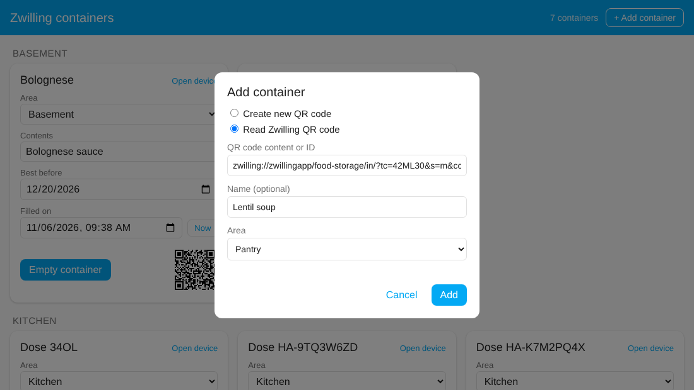
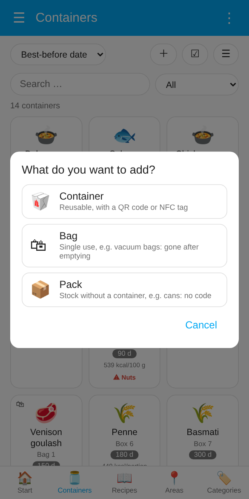
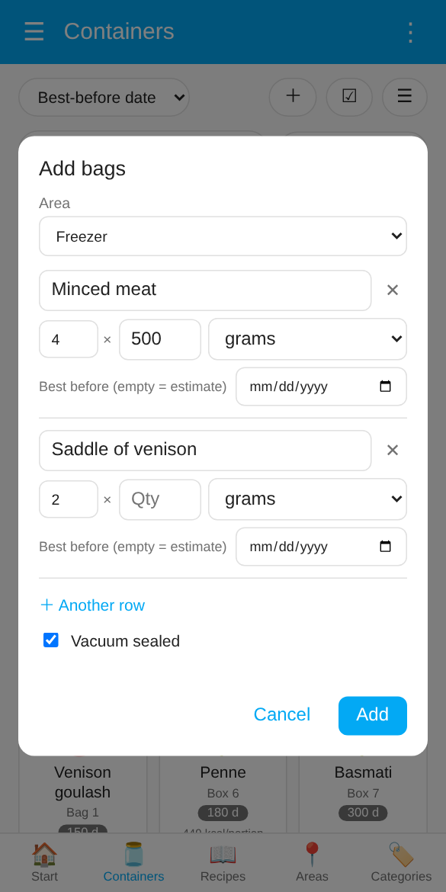
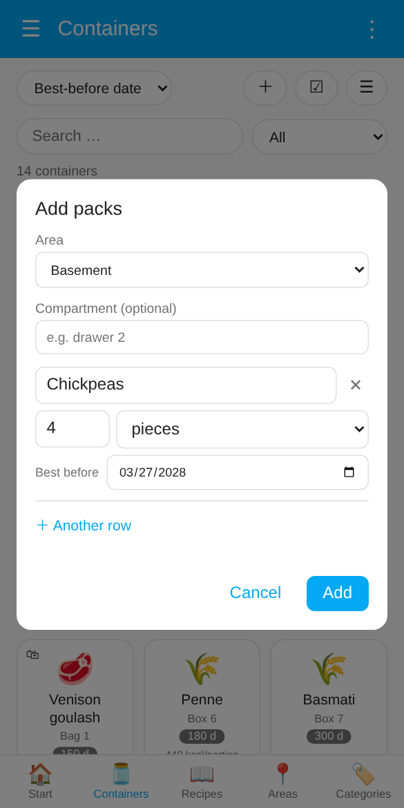
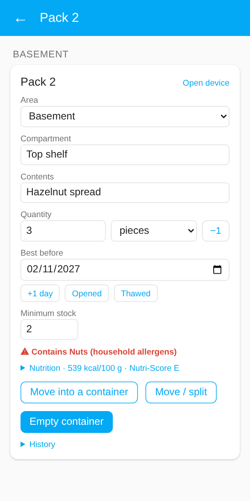
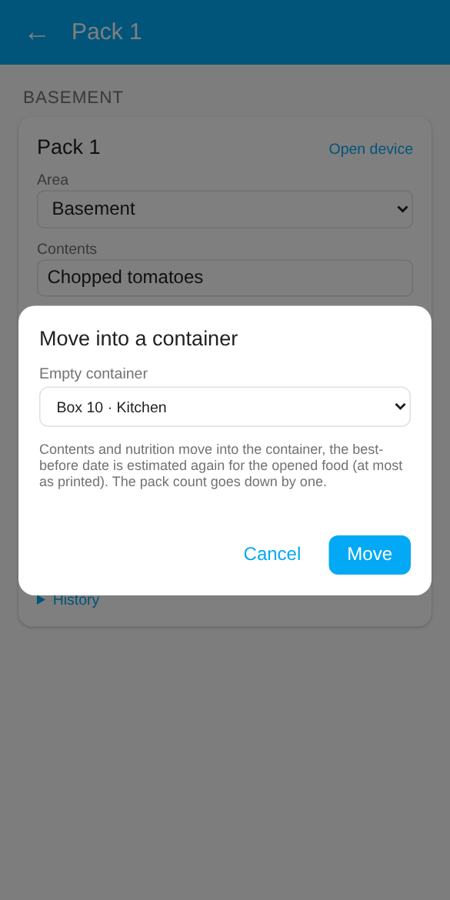
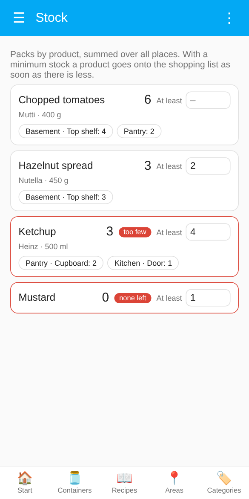
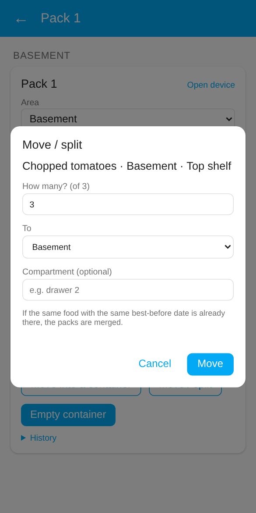
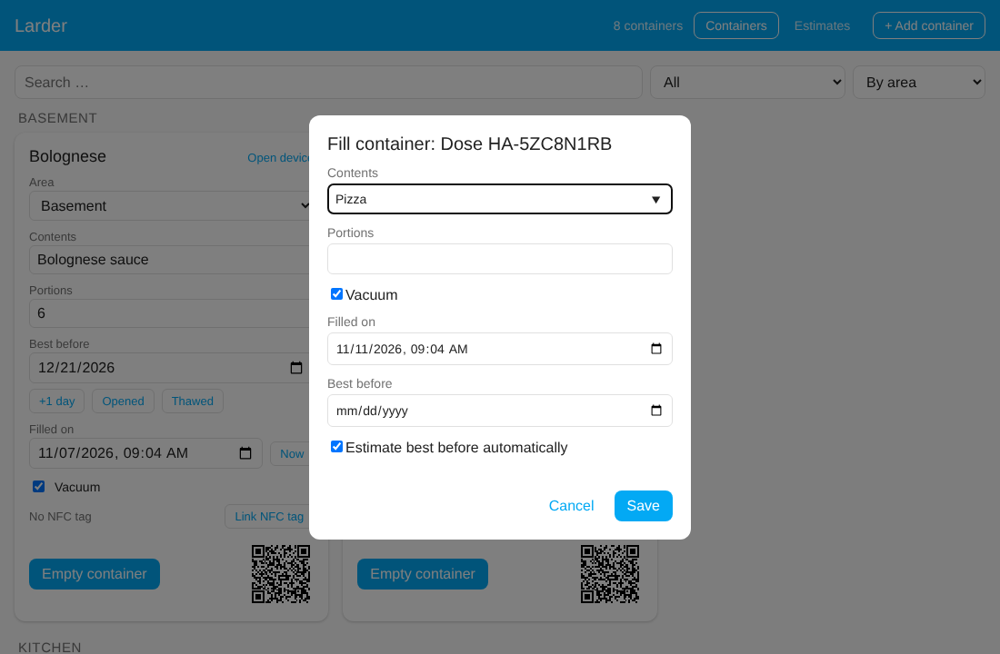
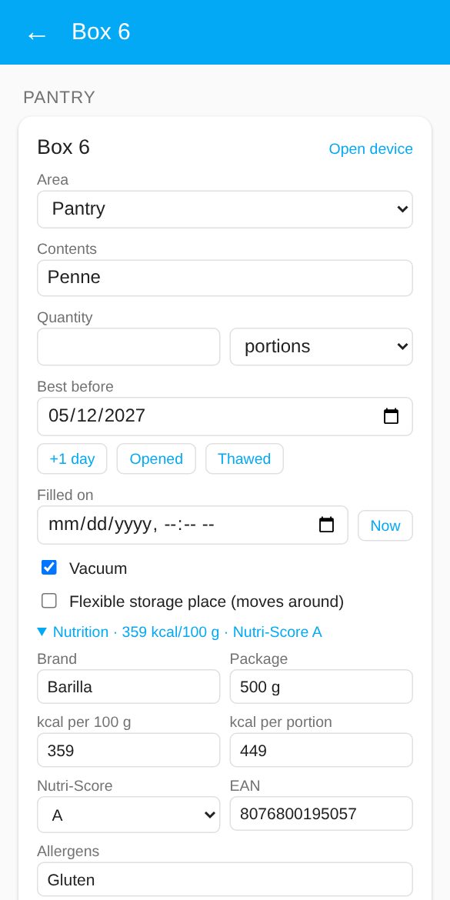

# Containers, bags and packs

[← Overview](../../README.md) · [🇩🇪 Deutsch](../de/containers.md)

[Adding a container](#adding-a-container) · [Bags and packs](#bags-and-packs) · [Areas and labels](#areas-and-labels) · [Filling containers](#filling-containers)

## Adding a container

There are four ways. The two NFC ways need the Home Assistant app on a phone with NFC:

| Way | For |
|---|---|
| **Create new QR code** | Containers without a code; Larder creates an ID and a [QR code to print](scanning.md#your-own-qr-codes) |
| **Read Zwilling QR code** | Original Zwilling containers |
| **Write a new NFC tag** | Blank NFC sticker; Larder creates the container and the tag and writes it |
| **Scan NFC tag** | Tag that is already written; Larder creates the container and links it |

### From the dashboard (recommended)

**＋** on the containers page of the dashboard offers all four ways:

<p align="center"></p>

- **Create new QR code** generates a new unique ID. Afterwards open the card (or the device) and print the QR code.
- **Read Zwilling QR code** needs the content of the original code or just the ID. When you come from [📷 in the app](scanning.md#scanning-in-the-app) or the iOS Shortcut, the field is already filled in.
- **Write a new NFC tag** only appears in the app on a phone that can write tags. For **Scan NFC tag** you hold the phone to the tag. Details in [NFC tags](scanning.md#nfc-tags).
- Name and area are optional. You can change both later (the area right on the card).
- **Vacuum**, **Add to shopping list when emptied** (once a shopping list is chosen) and **Flexible storage place** with **After emptying, back to** can be set right away; you can change them later on the card.

### Through the integration

You add the very first container this way, because the dashboard only appears afterwards: Settings → Devices & services → **Add integration** → "Larder". Only the two QR ways are offered here; link an NFC tag afterwards in the dashboard.

**Create new QR code**

For containers without a (readable) Zwilling code. The integration generates a new, unique ID in the format `HA-XXXXXXXX` (8 characters, without the easily confused 0/O and 1/I). The `HA-` prefix keeps it clearly apart from Zwilling IDs (e.g. `34OL`), so the two cannot overlap. You can optionally give the container a name. Afterwards you find the QR code as an image on the device (see [Your own QR codes](scanning.md#your-own-qr-codes)).

**Read Zwilling QR code**

For existing Zwilling containers. Paste the content of the QR code, for example

```
zwilling://zwillingapp/food-storage/in/?tc=42ML30&s=m&cc=34OL
```

The ID alone (`cc`, here `34OL`) is enough as well. You can optionally give the container a name. Each container can only be added once.

Home Assistant has no camera in this dialog. Easier: add the first container with **Create new QR code**, then scan the Zwilling codes with [📷 in the app](scanning.md#scanning-in-the-app). On iOS the [Shortcut](scanning.md#ios-shortcut-for-the-original-zwilling-codes) also works.

### Renaming a container

Settings → Devices & services → **Larder** → the container's entry → ⋮ → **Reconfigure**. The ID stays, so printed QR codes and NFC tags keep working.

## Bags and packs

Not everything lives in a reusable box. **＋** on the containers page asks what you want to add:

| Kind | Code | After emptying | Typical use |
|---|---|---|---|
| **Container** | QR code or NFC tag | stays and is filled again | boxes, jars |
| **Bag** | NFC sticker or QR code | disappears (stays in the history and statistics) | vacuum bags with minced meat or game, freezer bags |
| **Pack** | none | disappears; with a count it goes down by one | cans, jars and packets in the pantry |

<p align="center">



</p>

Bags and packs can be added by everyone in the household, containers only by administrators.

**Bags.** Choose the area (e.g. the freezer) and enter one row per content; **×** makes several bags with the same content (4 × minced meat, 500 g each). **Vacuum sealed** is preset, and the best-before date is [estimated](best-before.md#best-before-estimate) unless you enter one. The bags are named "Bag 1", "Bag 2" … Afterwards mark each bag:

- **📡 NFC stickers** goes through the new bags one after another: **✍ Write sticker** in the Home Assistant app writes a blank sticker, or simply scan a sticker that is already written; **Skip** leaves a bag without one.
- **🖨 Labels** opens the [label sheet](scanning.md#label-sheet) for exactly these bags.

A bag works like a container (scan it, take a portion, **Opened**, **Thawed**, recipes, meal plan). When you empty it, the bag, its entities and its NFC tag are removed from Home Assistant (also from Settings → Tags), so nothing piles up. If an old sticker or label is scanned by mistake, Larder says when that bag was emptied instead of opening something else. Codes are never used twice; a sticker that survived can be written or scanned again for a new bag.

**Packs.** One row per product with the **count** and the best-before date printed on the package; **📷 Scan barcode** (Home Assistant app) fills in the name, brand and [nutrition](#nutrition) from Open Food Facts. Packs have no code and only a few entities (contents, compartment, quantity, unit, best-before date, days left, empty), so even many of them stay light. They show up everywhere containers do: expiring soon, [daily summary](kitchen.md#daily-summary), [recipes](kitchen.md#recipes), [statistics](dashboard.md#statistics), the filter **Packs** on the containers page (📦 on the tile).

**📷 Receipt** (with an [AI](best-before.md#ai-optional) set up) reads a photo of your shopping receipt: the food items and their count appear as rows, non-food lines, deposits and totals are left out. Check them, add the best-before dates (or leave them empty) and press **Add**. The optional **compartment** in the dialog applies to all rows.

- **−1** on the card takes one pack; the last one removes the entry.
- **Move / split** brings some or all packs of an entry to another area and compartment (e.g. 2 of 5 ketchup to *Pantry · Cupboard*). If the same food with the same best-before date is already there, the packs are merged; otherwise a new entry with the same data is created.
- **Minimum stock** on the card (e.g. at least 4 ketchup) applies to the product, i.e. to all packs with this contents in every place, and is kept when the last pack is gone. As soon as there are fewer, the product goes onto the [shopping list](kitchen.md#shopping-list) (with brand and package, not twice).
- **Move into a container** opens a pack: choose an empty container, the contents and nutrition move into it, and the best-before date is estimated again for the opened food (at most the printed date).

<p align="center">


</p>

### Stock

<p align="center">


</p>

**⋮ → 🥫 Stock** in the dashboard lists all packs by product, summed over every place, with brand, package and where they are (tap a place to open the pack). Set the **minimum stock** of every product right there; products below it are marked *too few* or *none left*. Products with a minimum stay in the list even when none are left.

## Areas and labels

Every container belongs to an **area** of Home Assistant (the area of its device). The area tells the estimate where the food is stored and groups the dashboard. Change it right on the container's card in the dashboard.

**Managing areas in the dashboard** (administrators): on the **Areas** page, **＋** adds a new area and **✏️** switches to editing. While editing, all areas of Home Assistant are listed; tap one to rename it or change its **storage kind**, which is its `Larder: …` label (other labels of the area are kept). **New label …** creates a label `Larder: <name>` right away; add the limits from the template below to its description in Home Assistant. **Open in Home Assistant** leads to the area's own page (picture, floor, deleting). Areas with a Larder label are listed even when they hold no container yet.

**Which areas the dashboard offers.** With many areas the dropdown gets long. Give the areas you use for food storage a **label** whose name is `Larder` or starts with `Larder:` (Settings → Areas, labels & zones → open an area → Labels). The dashboard then offers only these areas, in the dropdown and in the add dialog. The current area of a container always stays in its list. If no area has such a label, all areas are shown.

**Recommended:** one label per kind of storage place, named `Larder: Freezer`, `Larder: Fridge`, `Larder: 0 °C`, `Larder: Pantry` …, with the template below in its description. One label per area is enough. Do not put limits into a plain `Larder` label: it is shared by all your storage areas.

### Template for the area label

The description of a `Larder: …` label can follow a fixed template. Larder then reads it exactly (the AI still gets the whole text). The template is in English so that it looks the same in every language:

```text
Storage: freezer
Temperature: -18 °C
Max storage: 18 months
Notes: meat and fish
```

One entry per line is easiest to read; the entries may also follow each other in one line (`Storage: freezer Temperature: -18 °C Max storage: 18 months`) or be separated by `;`. Upper or lower case does not matter, every entry is optional. German keys work as well: `Lagerort`, `Temperatur`, `Max. Lagerzeit`, `Hinweis`.

| Key | Values | Effect |
|---|---|---|
| `Storage` | `fridge`, `0 °C compartment`, `freezer`, `freezer compartment`, `pantry`, `cellar` … | Storage place for the table, wins over the area name (a temperature sensor of the area still comes first). |
| `Temperature` | e.g. `-18 °C`, `4 °C` | Places the area by temperature, as before. |
| `Max storage` | a number with `days`, `weeks`, `months` or `years` (`Tage`, `Wochen`, `Monate`, `Jahre`); a plain number means days | Upper limit for table and AI estimates in this area. Remembered estimates are capped as well, your own corrections are not. The tip says when a value was capped. With several labels the shortest limit applies. |
| `Notes` | any text | Only a hint for the AI. |

A temperature sensor assigned to the area in its settings is used as well (the table uses it first, the AI gets its value).

## Filling containers

<p align="center"></p>

An empty container shows a **Fill** button. It opens a small dialog: **contents** (with suggestions from what you entered before, newest first, then your remembered estimates), **quantity and unit** (optional), **vacuum**, **filled on** (preset to now), optionally a **best-before date**, and **Estimate best before automatically** (only if estimating is on and the date is empty). **Save** sets everything and estimates the date.

**Bought food:** in the Home Assistant app the button **EAN** next to the contents scans the barcode on the package and fills in the product name from [Open Food Facts](https://world.openfoodfacts.org) (free product database, needs internet). Brand, package size, EAN and the [nutrition](#nutrition) are taken over too. The best-before date is printed on the package; enter it in the dialog. Nothing found or offline: type the contents as usual.

**Contents from a photo:** with an [AI](best-before.md#ai-optional) set up, **📷** next to the contents takes a photo of the food (or picks one) and fills in what the AI recognises, e.g. "Goulash with potatoes". Check it and correct if needed.

### Nutrition

<p align="center"></p>

The card of a filled container has a fold-out **Nutrition** section: **brand**, **package**, **kcal per 100 g**, **kcal per portion**, **Nutri-Score** (A–E), **EAN**, **allergens** and **nutrients** as free text (fat, carbohydrates, sugar, protein, salt …). After a barcode scan they come from Open Food Facts (shown as source, data under the ODbL); otherwise enter them by hand, e.g. for home-cooked food. Every field can be changed.

- The **kcal** also appear on the tile and in the list (per portion if known, otherwise per 100 g).
- The data belong to the contents: **Empty container** clears them, filling with other contents without a scan as well. They go into the [history](dashboard.md#export-and-import) and the inventory CSV.
- For automations they are attributes of the **Contents** entity: `brand`, `package`, `ean`, `kcal_100g`, `kcal_portion`, `nutri_score`, `allergens`, `nutrients`, `source` (and `allergen_warning`, see below).

### Allergens in the household

In the [settings](reference.md#settings) choose the allergens your household watches out for (the 14 main allergens, e.g. gluten, milk, nuts). Containers whose **allergens** (from Open Food Facts or entered by hand) or whose **contents** match ("Hazelnut spread" → nuts, "Rice pudding" → milk) get a **⚠** with the allergen on the tile, in the list, on the card and in the [Lovelace card](dashboard.md#card-for-your-dashboards). [Recipe ideas](kitchen.md#recipe-ideas) leave such containers out (unless you picked them yourself) and the AI is told to avoid these allergens in extra ingredients. The matched allergens are in the attribute `allergen_warning` of the **Contents** entity.

> Only a hint, no guarantee: recognition depends on what is entered.

After saving, a short notice offers **🖨 Label** for exactly the container(s) just filled (handy for freezer bags and bags); it opens the [label sheet](scanning.md#label-sheet) with your last format and design.

The dialog also opens by itself right after you add a new container in the dashboard (including after writing an NFC tag), so you can fill it straight away. It also opens after a scan (📷 in the app, own QR code, NFC tag, Shortcut) when the container is empty; a container that already has contents opens its card.

**Containers that move around:** some containers always stand in the same place, others (for example vacuum boxes) are in the fridge one day and in the 0 °C drawer the next. Switch on **Flexible storage place** on the card of such a container. The fill dialog then also asks for the **area** (administrators), so the estimate uses the right place, and **Empty container** puts the container back into the area chosen under **After emptying, back to** (for example the pantry where the empty boxes are kept). Containers without the switch keep their area and the fill dialog does not ask. For flexible containers the dialog also asks for the **compartment**; when the container goes back after emptying, the compartment is cleared.

**Several containers at once:** select the empty containers (or scan them one after another) and press **Fill (n)**: the same dialog fills all of them, see [Selecting several containers](dashboard.md#selecting-several-containers).

### Several contents in one container

A container can hold several things, for example different cold cuts. Separate them with commas: `Salami, Kochschinken, Leberwurst` (a semicolon works too; `1,5 kg` stays one item).

- The **estimate** looks up each item on its own and takes the **shortest** best-before date; the tip says which item decides it ("Lachs" decides the best-before date). If the table does not know one of the items, it counts as no match (in *table, else AI* mode the AI then answers for the item that spoils first).
- The **shopping list** gets each item as its own entry.
- The **category** stays if all items are of the same kind (cold cuts), otherwise it is **Mixed**.

There is one best-before date per container: everything in it is used up or thrown away together.
