# Containers, bags, packs and household items

[← Overview](../../README.md) · [🇩🇪 Deutsch](../de/containers.md)

[Adding a container](#adding-a-container) · [Bags and packs](#bags-and-packs) · [Areas and labels](#areas-and-labels) · [Filling containers](#filling-containers) · [Batch cooking](#batch-cooking)

## Adding a container

There are four ways. The two NFC ways need the Home Assistant app on a phone with NFC:

| Way | For |
|---|---|
| **Create new QR code** | Containers without a code; Larder creates an ID and a [QR code to print](scanning.md#your-own-qr-codes) |
| **Read Zwilling QR code** | Original Zwilling containers |
| **Write a new NFC tag** | Blank NFC sticker; Larder creates the container and the tag and writes it |
| **Scan NFC tag** | Tag that is already written; Larder creates the container and links it |

### From the dashboard (recommended)

**＋** on the **Larder** page of the dashboard offers all four ways:

<p align="center">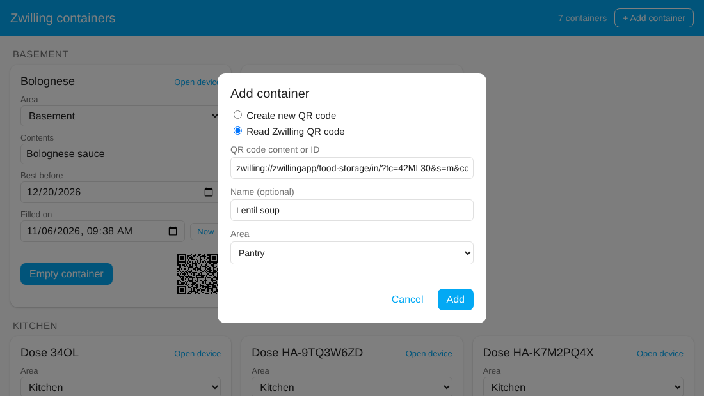</p>

- **Create new QR code** generates a new unique ID. Afterwards open the card (or the device) and print the QR code.
- **Read Zwilling QR code** needs the content of the original code or just the ID. When you come from [📷 in the app](scanning.md#scanning-in-the-app) or the iOS Shortcut, the field is already filled in.
- **Write a new NFC tag** only appears in the app on a phone that can write tags. For **Scan NFC tag** you hold the phone to the tag. Details in [NFC tags](scanning.md#nfc-tags).
- Name and area are optional. You can change both later (the area right on the card).
- **Vacuum**, **Add to shopping list when emptied** (once a shopping list is chosen) and **Flexible storage place** with **After emptying, back to** can be set right away; you can change them later on the card.

### Through the integration

Since 4.7 adding the integration (Settings → Devices & services → **Add integration** → "Larder") only creates the main entry **Larder**: no container, no questions, the dashboard is there right away. The main entry holds the settings (**Configure**); installations from before get it automatically. Adding the integration again offers the two QR ways for a container; everything else, and NFC tags, is easier in the dashboard.

**Create new QR code**

For containers without a (readable) Zwilling code. The integration generates a new, unique ID in the format `HA-XXXXXXXX` (8 characters, without the easily confused 0/O and 1/I). The `HA-` prefix keeps it clearly apart from Zwilling IDs (e.g. `34OL`), so the two cannot overlap. You can optionally give the container a name. Afterwards you find the QR code as an image on the device (see [Your own QR codes](scanning.md#your-own-qr-codes)).

**Read Zwilling QR code**

For existing Zwilling containers. Paste the content of the QR code, for example

```
zwilling://zwillingapp/food-storage/in/?tc=42ML30&s=m&cc=34OL
```

The ID alone (`cc`, here `34OL`) is enough as well. You can optionally give the container a name. Each container can only be added once.

Home Assistant has no camera in this dialog. Easier: add the first container with **Create new QR code**, then scan the Zwilling codes with [📷 in the app](scanning.md#scanning-in-the-app). On iOS the [Shortcut](scanning.md#ios-shortcut-for-the-original-zwilling-codes) also works.

### Renaming a container

Settings → Devices & services → **Larder** → the container's entry → ⋮ → **Reconfigure**. The ID stays, so printed QR codes and NFC tags keep working.

## Bags and packs

Not everything lives in a reusable box. **＋** on the **Larder** page asks what you want to add:

| Kind | Code | After emptying | Typical use |
|---|---|---|---|
| **Container** | QR code or NFC tag | stays and is filled again | boxes, jars |
| **Bag** | NFC sticker or QR code | disappears (stays in the history and statistics) | vacuum bags with minced meat or game, freezer bags |
| **Pack** | none | disappears; with a count it goes down by one | cans, jars and packets in the pantry |

<p align="center">
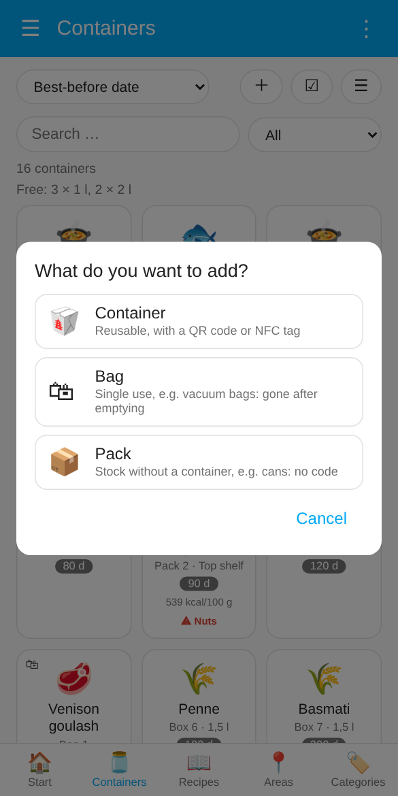
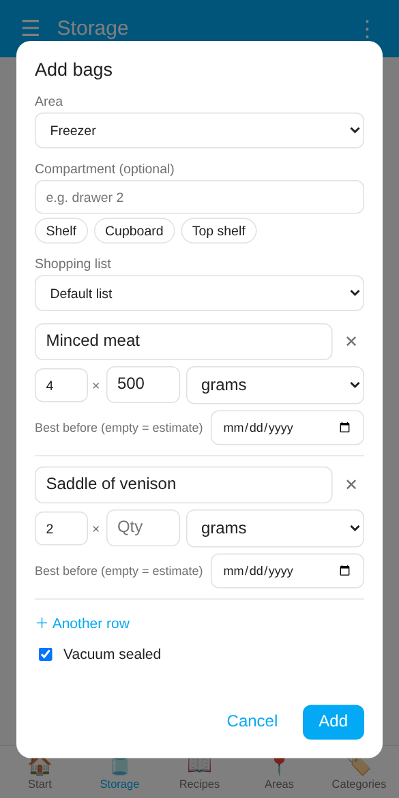
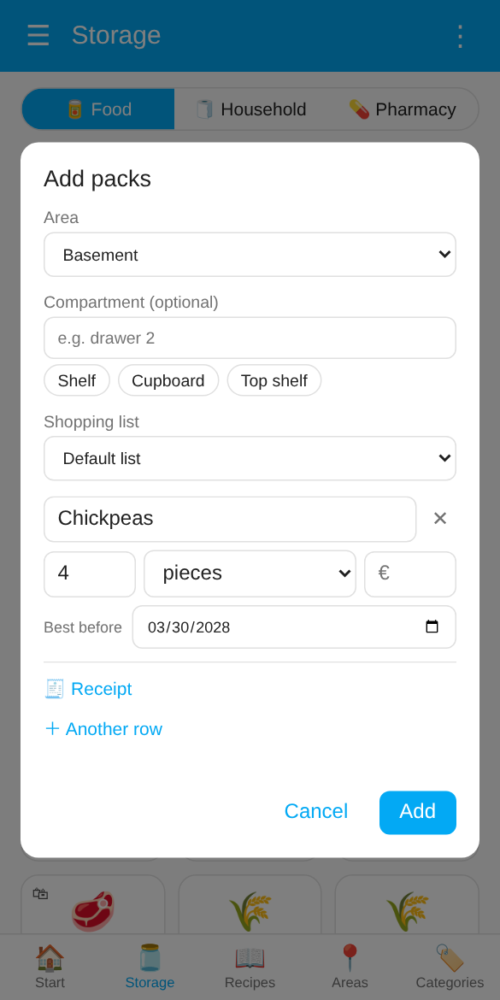
</p>

Bags and packs can be added by everyone in the household, containers only by administrators.

**Bags.** Choose the area (e.g. the freezer) and enter one row per content; **×** makes several bags with the same content (4 × minced meat, 500 g each). **Vacuum sealed** is preset, and the best-before date is [estimated](best-before.md#best-before-estimate) unless you enter one. The bags are named "Bag 1", "Bag 2" … Afterwards mark each bag:

- **📡 NFC stickers** goes through the new bags one after another: **✍ Write sticker** in the Home Assistant app writes a blank sticker, or simply scan a sticker that is already written; **Skip** leaves a bag without one.
- **🖨 Labels** opens the [label sheet](scanning.md#label-sheet) for exactly these bags.

A bag works like a container (scan it, take a portion, **Opened**, **Thawed**, recipes, meal plan). When you empty it, the bag, its entities and its NFC tag are removed from Home Assistant (also from Settings → Tags), so nothing piles up. If an old sticker or label is scanned by mistake, Larder says when that bag was emptied instead of opening something else. Codes are never used twice; a sticker that survived can be written or scanned again for a new bag.

**Packs.** One row per product with the **count** and the best-before date printed on the package; **📷 Scan barcode** (Home Assistant app) fills in the name, brand and [nutrition](#nutrition) from Open Food Facts. Packs have no code and only a few entities (contents, compartment, quantity, unit, best-before date, days left, empty), so even many of them stay light. They show up everywhere containers do: expiring soon, [daily summary](kitchen.md#daily-summary), [recipes](kitchen.md#recipes), [statistics](dashboard.md#statistics), the filter **Packs** on the containers page (📦 on the tile).

**📷 Receipt** (with an [AI](best-before.md#ai-optional) set up) reads a photo of your shopping receipt: the food items and their count appear as rows, non-food lines, deposits and totals are left out, and the price of one pack goes into the price field. Check them, add the best-before dates (or leave them empty) and press **Add**. The optional **compartment** in the dialog applies to all rows.

**Compartment suggestions:** wherever you enter a compartment (adding bags and packs, moving, the card, the fill dialog), the compartments already used in the chosen area appear as chips below the field, the most used first; tap one instead of typing. Typing filters the chips, and compartments you entered before are remembered on the device even when nothing is left in them.

- **−1** on the card takes one pack; the last one removes the entry.
- **Move / split** brings some or all packs of an entry to another area and compartment (e.g. 2 of 5 ketchup to *Pantry · Cupboard*). If the same food with the same best-before date is already there, the packs are merged; otherwise a new entry with the same data is created.
- **Minimum stock** on the card (e.g. at least 4 ketchup) applies to the product, i.e. to all packs with this contents in every place, and is kept when the last pack is gone. As soon as there are fewer, the product goes onto the [shopping list](kitchen.md#shopping-list) (with brand and package, not twice).
- **Move into a container** opens a pack: choose an empty container, the contents and nutrition move into it, and the best-before date is estimated again for the opened food (at most the printed date).

<p align="center">
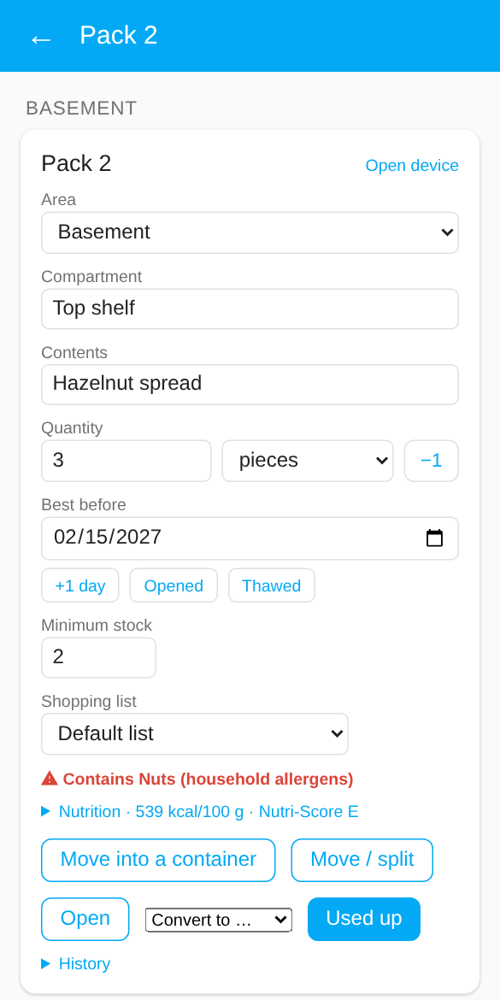
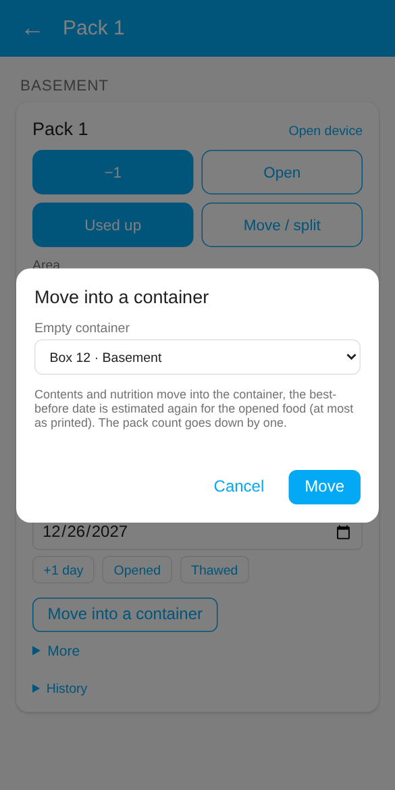
</p>

### Stock

<p align="center">
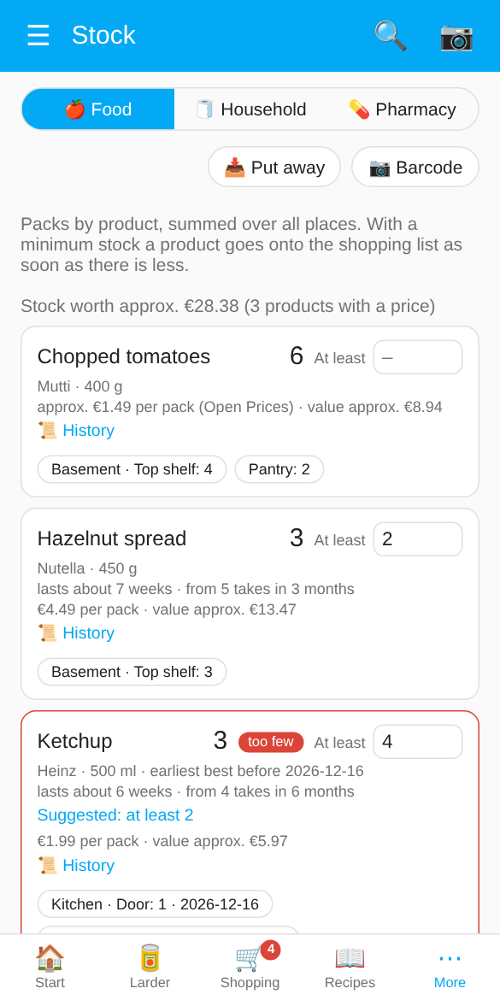
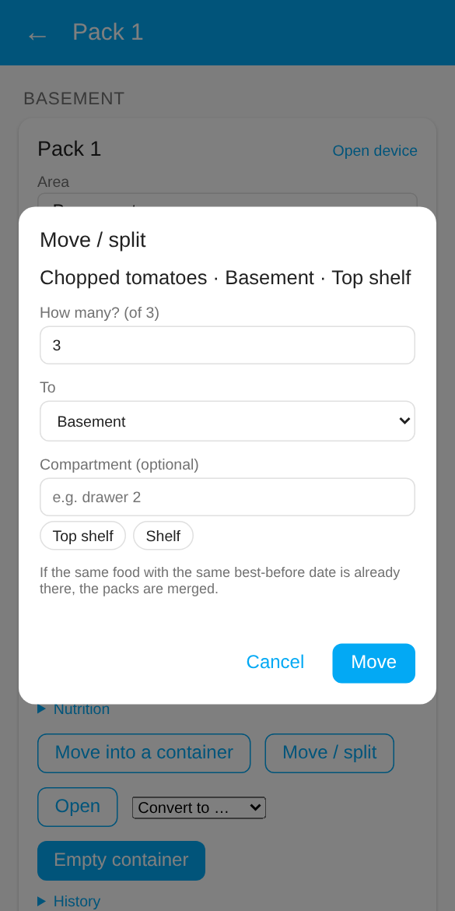
</p>

**⋮ → 🗃️ Stock** in the dashboard lists all packs by product, summed over every place, with brand, package and where they are (tap a place to open the pack). Set the **minimum stock** of every product right there; products below it are marked *too few* or *none left*. Products with a minimum stay in the list even when none are left. **Oldest first:** the places of a product are sorted by best-before date, the earliest one is shown next to the product, and the card of a pack warns when an older pack of the same food lies somewhere else.

**How long it lasts.** Every pack you take (−1, emptying, stocktake) is counted; moving or opening a pack is not. From that, the stock view and the card of a pack show **lasts about 6 weeks · from 4 takes in 6 months**. The forecast looks at the last 90 days and widens to 180 or 365 days when there are fewer than 3 takes; recent takes count more. Below the line, **Suggestion: at least 2** sets the minimum stock to what you use during the *Stock: days until the next shopping trip* (setting, 7 days by default) – with a tap, nothing changes by itself.

**Prices and value.** A pack can have a **price** (one pack): in the pack dialog, on the card, or read from the **📷 Receipt**. Larder remembers it per product. Without a price of your own, packs with a barcode get an estimate from [Open Prices](https://prices.openfoodfacts.org) (Open Food Facts, ODbL): the median of the last year in euro, marked *(Open Prices)*. The card of a pack and the stock view show the price per pack, the value of each product and the **total value**; the statistics and the monthly report add **about €X thrown away**.

**Scan a barcode.** Scan the barcode of a pack with **📷** (start page, **Larder** page) or **📷 Barcode** in the stock view (Home Assistant app). Larder shows every place where this product is, with count and best-before date, opened and **oldest first**. Each place offers, for one pack:

- **Used up**: −1 (household items: one piece); the last pack of an entry empties it.
- **Thrown away**: −1, recorded as thrown away in the history and [statistics](dashboard.md#statistics), with its value.
- **Open**: opens the pack, optionally to another place (e.g. into the fridge), see [opened packs](#stock).
- **Move**: puts it in another place without opening it.

**＋ Add a new pack** adds another pack of the same product, filled in with name, brand, barcode, price and the place where most of it already is. A product that is not in stock can be added as a pack right away. If you renamed the product, the barcode is remembered; packs added without a barcode can be linked with **🔗 Link to a product in stock**.

<p align="center">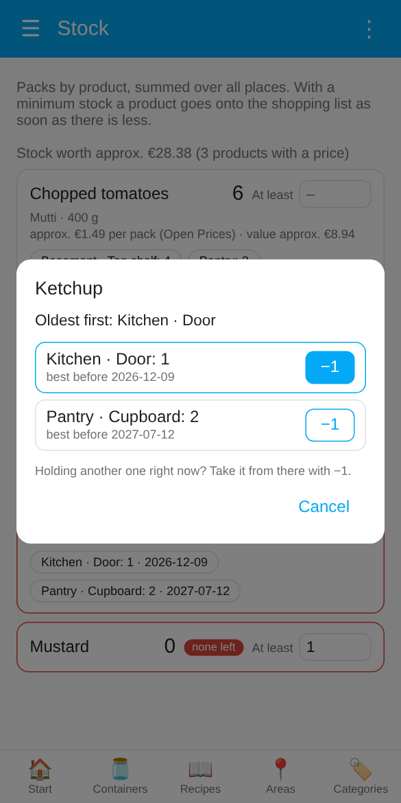</p>

**Put away after shopping.** **📥 Put away** (start page, stock view or ⋮) opens the app's barcode scanner and keeps it open: scan the bought products one after another. A product that is already in stock becomes one more pack at its usual place (where most of it is), with brand, barcode and price; the scanner confirms it right away (*Ketchup → Basement · Shelf*). It joins an entry there without a best-before date, otherwise a new entry is made; **Add date** leads to its card for the printed date. Household items get a whole pack (pieces per pack). Unknown barcodes are collected with the name from the product databases and added together at the end (**Add as packs** / **as household items**). Items of these products under *Bought – add to stock* are taken care of. Without the app's camera (e.g. in a browser) type the barcode instead.

<p align="center">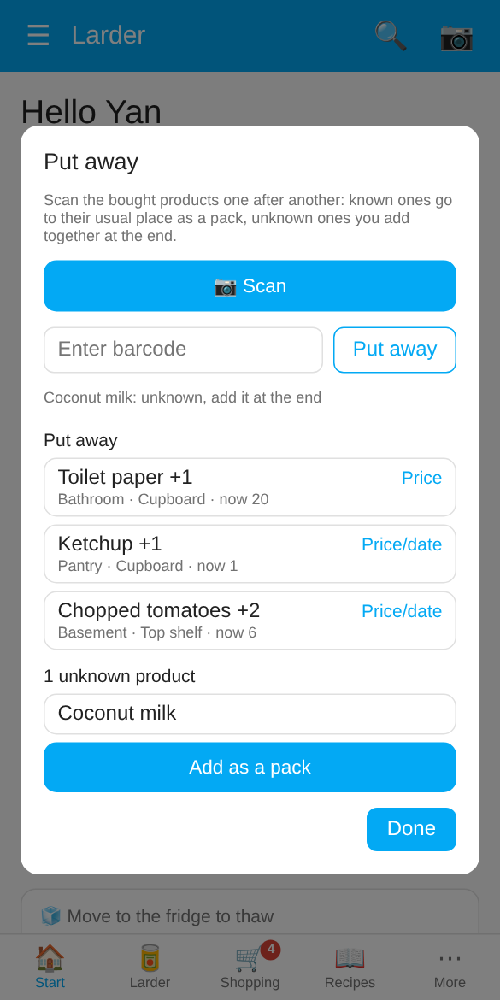</p>

**Opened packs.** **Open** on the card of a pack (ketchup, jam, UHT milk …) asks where the opened pack goes, e.g. the fridge door. With a count of more than one, one pack is split off as its own entry. It is marked **🔓 opened**, and its best-before date is estimated for the new place (table or AI, otherwise *shelf life after opening* from the settings), at most the printed date. Opened packs come first when you scan a barcode and in the stock view.

<p align="center">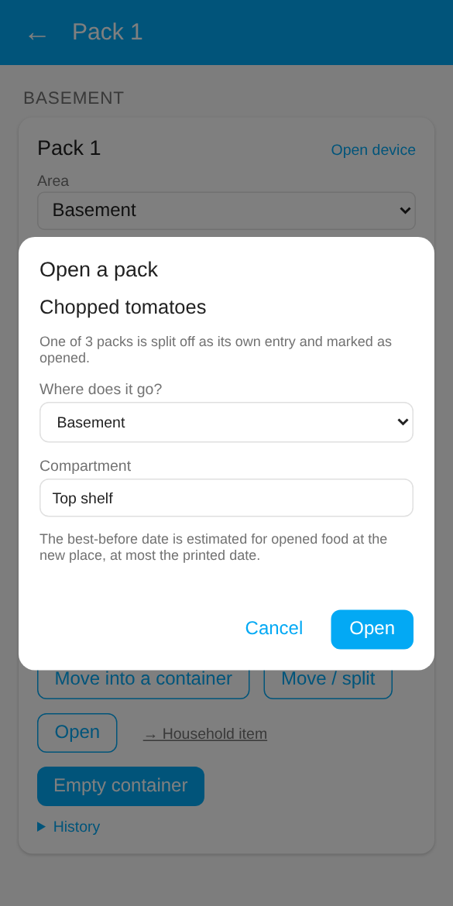</p>

**Running low.** When a product with a minimum stock will only last the *days until the next shopping trip* according to the forecast, the start page lists it under **⏳ Running low** – before it drops below the minimum. **🛒 Shopping list** adds it to the list, **✕** hides it for a week. With the setting *Running low: add to the shopping list right away* it goes onto the list at once. For a push notification there is the blueprint [Running low and recalls](kitchen.md#running-low-and-recalls) (event `larder_running_low`).

**From the shopping list back into the stock.** When you tick off an item on your shopping list that Larder put there (minimum stock or an emptied container), the start page asks **🛒 Bought – add to the stock?**. **Add to stock** opens the pack dialog with the contents, brand, count and the place where the product usually is; **✕** drops the hint.

### Recall warnings

<p align="center">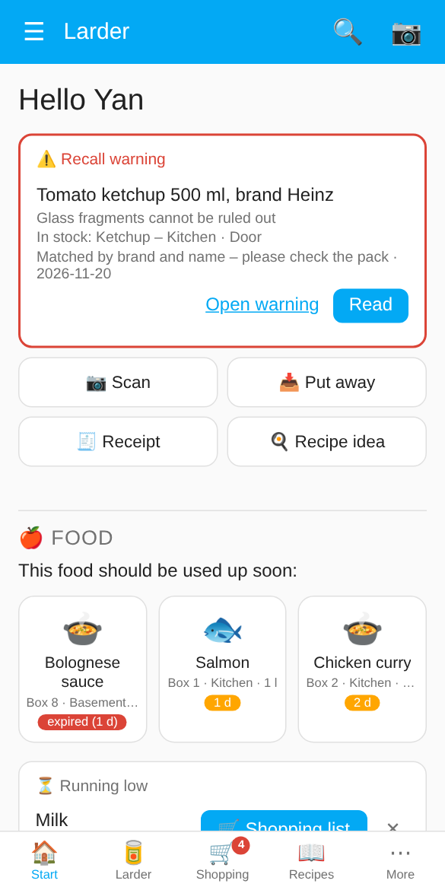</p>

Every 6 hours Larder fetches the public recalls of the last 30 days from [lebensmittelwarnung.de](https://www.lebensmittelwarnung.de) (the German states' and BVL's portal) and compares them with your containers, bags and packs. A match needs the **barcode**, or the **brand and a word of the contents**, or – without a brand – **every word** of contents with several words. The warning then sits at the top of the start page: product, reason, where it is in stock and how Larder matched it, with a link to the original warning. **Read** hides it for good. The card of the entry shows the hint too.

**Household items (since 4.1):** once there are household items, Larder also fetches the feed of all product types (cosmetics, consumer goods, baby products, tattoo inks) and compares household items with those warnings. Food is still only compared with food warnings.

A match is a hint, not a certainty: batch and best-before date are in the original warning, please check there. Only the public feed is fetched, Larder sends nothing. Switch it off or limit it to one German state in the [settings](reference.md#settings); as a push with the blueprint [Running low and recalls](kitchen.md#running-low-and-recalls) (event `larder_recall`).

### Stocktake

**⋮ → 📋 Stocktake** (for everyone in the household) goes through one area, or one compartment of it. Larder lists everything that should be there; per line:

- **✓** it is there; for packs and bags correct the **count** right in the line,
- **Gone** → eaten or thrown away (goes into the history),
- **Elsewhere** moves it to another area or compartment (containers only for administrators).

**📷 Scan** (Home Assistant app) ticks off what you scan, QR codes of containers and barcodes of packs; NFC tags tick off too while the stocktake is open. **＋ Missing pack** adds what is there but not in Larder. **Done** shows a short summary. **🏷 Compartment tag** gives the compartment its own [NFC tag or QR label](scanning.md#compartments): scanning it later opens the compartment to take something or start the stocktake.

<p align="center">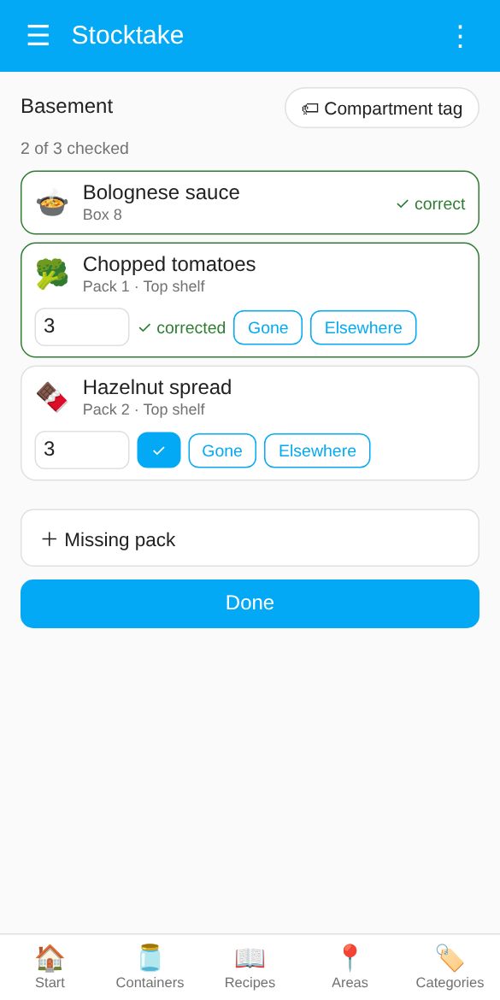</p>

## Household items

Since 4.0 Larder also keeps track of things without a best-before date: toilet paper, kitchen roll, detergent, dishwasher tabs, batteries, toothpaste. **＋ → 🧻 Household item** adds them, by hand or with **📷 Scan barcode** (see below).

- **Pieces and packs.** One row per product with the number of **packs**, the **pieces per pack** and a name for the piece (e.g. 2 × 8 *rolls*). Larder counts **pieces**: **−1** takes one roll, the stocktake counts rolls, and the **minimum stock is in pieces** too. The stock view and the card show both, e.g. *12 rolls · 1.5 packs*.
- **Shopping list in packs.** When the stock drops below the minimum, the shopping list gets the number of packs needed, rounded up: *Toilet paper (Zewa, 2 packs)*. Ticked off, it is offered on the start page under **Bought** and opens the household dialog with the pack size filled in.
- **Date optional (since 4.4).** Household items need no date, but can have one (e.g. sunscreen, batteries): **Expiry date (optional)** on the card or in the add dialog. With a date they appear under *expires soon* in the household section of the start page, with the longer warning of [medicines](#medicines-pharmacy). **Keeps after opening (months)** on the card is the jar symbol (*12M*): **Open** then sets the date to at most that period. Household items stay out of the daily summary, recipes and the food statistics; *lasts about …*, *running low*, prices and the value work as for packs.
- **Barcode.** If Open Food Facts does not know a barcode, Larder also asks its sister databases **Open Beauty Facts**, **Open Products Facts** and **Open Pet Food Facts**. A product found there is offered as a household item.
- **Converting.** A pack that should have been a household item (or the other way round) is converted with **→ Household item** / **→ Food pack** at the bottom of its card. Nothing is converted automatically.
- **Replace regularly (since 4.6).** For consumables such as a water filter, vacuum cleaner bags or toothbrush heads, **Replace every (weeks)** on the card sets an interval. The card shows when it is due; **🔁 Replaced** takes one piece and starts the interval again. From a week before it is due, the household section of the start page shows it under **🔁 Replace soon**, with the same button. On the due day the event `larder_replace_due` fires once (also in the [stock alerts blueprint](kitchen.md#running-low-and-recalls)).
- **A box with a code, e.g. for sanitary products.** Household items do not go into a container but into a **compartment**: pads and tampons, for example, in the area *Bathroom* with the compartment *Hygiene box*. In the compartment view (**Areas → Bathroom → Hygiene box**) **🏷 Compartment tag** links an NFC sticker or prints a QR code for the box ([Compartments](scanning.md#compartments)). Scanning the box shows everything in it, **−1** takes one piece; minimum stock and the shopping list work as usual. Several products fit in one box, and the label stays valid when the contents change.
- **Categories:** paper & hygiene, laundry, cleaning & dishes, personal care, batteries & bulbs, other.
- **Statistics** (since 4.1): use and spending per month, per product and in total, on the household side of [Statistics](dashboard.md#statistics). **Recall warnings** for cosmetics and consumer goods, see [Recall warnings](#recall-warnings). **A shopping list of their own**, see [Shopping list](kitchen.md#shopping-list).

**Food | Household.** The pages **Larder**, **Areas**, **Categories** and the **stock view** have a switch at the top and show one side at a time; the device remembers your choice. The **start page** shows both, in two sections: *Food* (expiring soon, running low, bought, cook again, thawing, meal plan) and *Household* (expires soon, replace soon, running low, bought).

<p align="center">
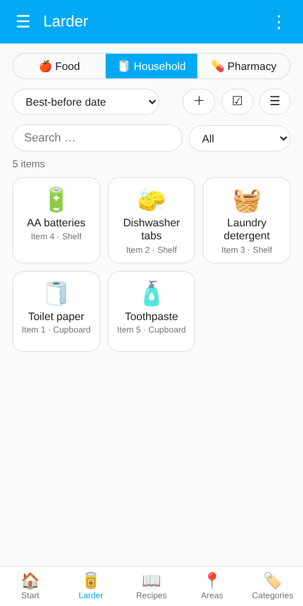
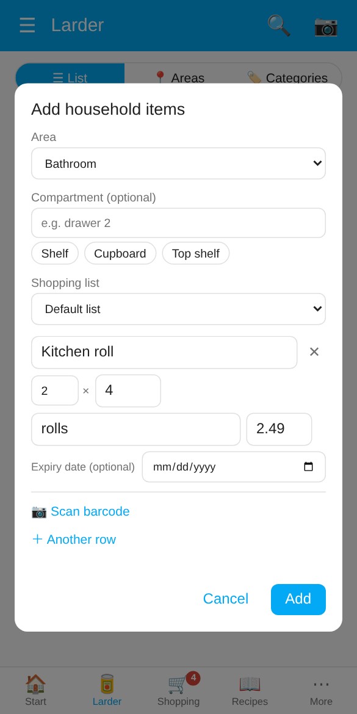
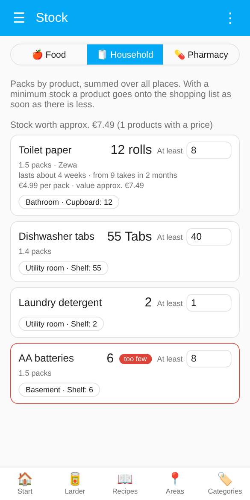
</p>

## Medicines (pharmacy)

Since 4.4 medicines have a side of their own, **Pharmacy** (💊), next to food and household. **＋ → 💊 Medicine** adds them with their **expiry date**, count (packs) and price.

- **Longer warning.** Medicines count as *expires soon* earlier than food: by default **60 days** before the expiry date (setting *“Expires soon” for medicines, household and vouchers*). They then appear on the start page in the section **💊 Pharmacy**, not in the daily summary, recipes or food statistics.
- **Own places and list.** Areas with the label `Larder: Pharmacy` (or `Larder: Apotheke`), e.g. the medicine cabinet or the first-aid kit in the car, are offered only for medicines, see [Food, household or pharmacy](#food-household-or-pharmacy). A default shopping list of its own (*Shopping list for medicines*), e.g. *Pharmacy*.
- **After opening.** **Open** on the card (or in the barcode dialog) marks one pack as opened. With *Keeps after opening (months)* on its card, the expiry date becomes the shorter of the printed date and that period, e.g. eye drops 1 month.
- **Categories:** pain & fever, colds, stomach & digestion, wounds & dressings, allergy, vitamins & minerals, other.
- Minimum stock, *running low*, moving and stocktake work as for packs. Recall warnings on lebensmittelwarnung.de do not cover medicines, so none are matched.

## Vouchers

Since 4.8 Larder keeps **vouchers**, so none expires unused. **＋ → 🎟️ Voucher** adds one with the **shop or name**, **value**, **valid until**, place (area and compartment, e.g. *Study · desk drawer*) and optionally the **code**.

- **Own page.** As soon as there is a voucher, the switch on the **Larder** page gets **🎟️ Vouchers**; above the tiles: how many there are, the open value, and what expired or was redeemed in the last 12 months.
- **Reminder.** Vouchers warn as early as medicines (60 days by default, setting *“Expires soon” for medicines, household and vouchers*): the start page has a section **🎟️ Vouchers**, and the [medicine reminder](kitchen.md#medicines-expiring) names them too (*“the Waterstones voucher worth 25 euros”*), switchable in the blueprint.
- **Redeem.** Tap a voucher: **Redeem part** lowers the remaining value (*€15 of €25 left*), **Fully redeemed** removes it, **Expired** removes it as lost (its value counts as expired). **Edit** changes value, date and code.
- **The code** is never stored in the entity state (every user could read it there): only administrators enter and see it (**Show code**).
- Vouchers can lie in any area and are not part of shopping lists, stock, recipes, recall warnings, the emergency supply or the statistics.

<p align="center">
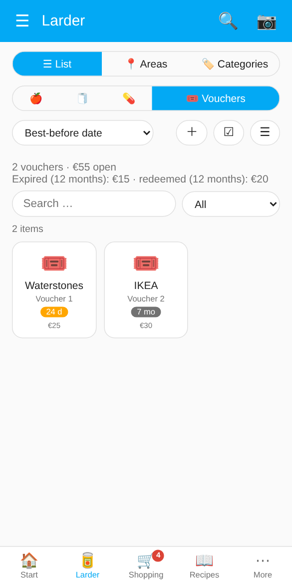
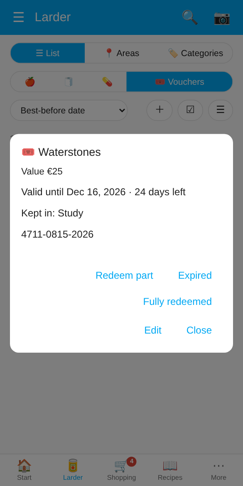
</p>

## Areas and labels

Every container belongs to an **area** of Home Assistant (the area of its device). The area tells the estimate where the food is stored and groups the dashboard. Change it right on the container's card in the dashboard.

**Managing areas in the dashboard** (administrators): on the **Areas** page, **＋** adds a new area and **✏️** switches to editing. While editing, all areas of Home Assistant are listed; tap one to rename it or change its **storage kind**, which is its `Larder: …` label (other labels of the area are kept). **New label …** creates a label `Larder: <name>` right away; add the limits from the template below to its description in Home Assistant. **Open in Home Assistant** leads to the area's own page (picture, floor, deleting). Areas with a Larder label are listed even when they hold no container yet.

**Which areas the dashboard offers.** With many areas the dropdown gets long. Give the areas you use for food storage a **label** whose name is `Larder` or starts with `Larder:` (Settings → Areas, labels & zones → open an area → Labels). The dashboard then offers only these areas, in the dropdown and in the add dialog. The current area of a container always stays in its list. If no area has such a label, all areas are shown.

**Recommended:** one label per kind of storage place, named `Larder: Freezer`, `Larder: Fridge`, `Larder: 0 °C`, `Larder: Pantry` …, with the template below in its description. One label per area is enough. Do not put limits into a plain `Larder` label: it is shared by all your storage areas.

### Food, household or pharmacy

An area can be used for food, for household items or for both. This is set with an **additional** label next to the storage-kind label:

| Labels of the area | Offered for |
|---|---|
| no Larder label | not offered (as before, once any area has a Larder label) |
| `Larder` or a storage-kind label such as `Larder: Freezer` | everything (food, household, pharmacy) |
| additionally `Larder: Household` (or `Larder: Haushalt`) | household only |
| additionally `Larder: Food` (or `Larder: Lebensmittel`) | food only |
| additionally `Larder: Pharmacy` (or `Larder: Apotheke`), since 4.4 | medicines only |

The scope labels carry no description; temperature and max. storage time stay in the storage-kind label (template below). Set the use in the dashboard: **Areas → ✏️ →** tap an area **→ Used for**. Larder creates the label when it is needed.

> **Upgrading to 4.0 (breaking change).** Until you assign the use, every Larder area is offered for food and household alike, so nothing disappears, but household items would be offered the freezer. After the update a repair hint **Larder 4.0: assign areas to food and household** (and the button **Assign use automatically** while editing areas) suggests the obvious ones: freezer, fridge and 0 °C drawer → food; bathroom, utility room, laundry → household. It **only adds labels**; existing labels and their descriptions are not changed. Everything else stays *food and household* until you change it.

<p align="center">
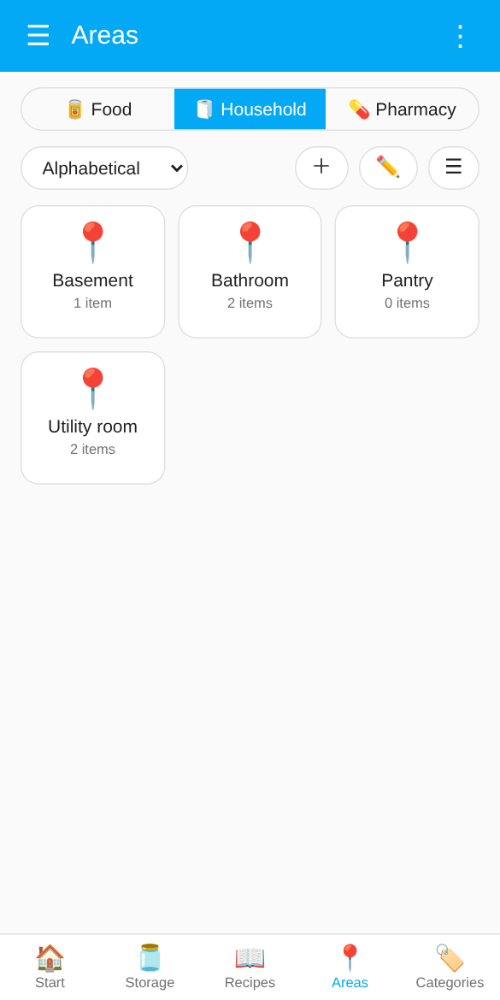
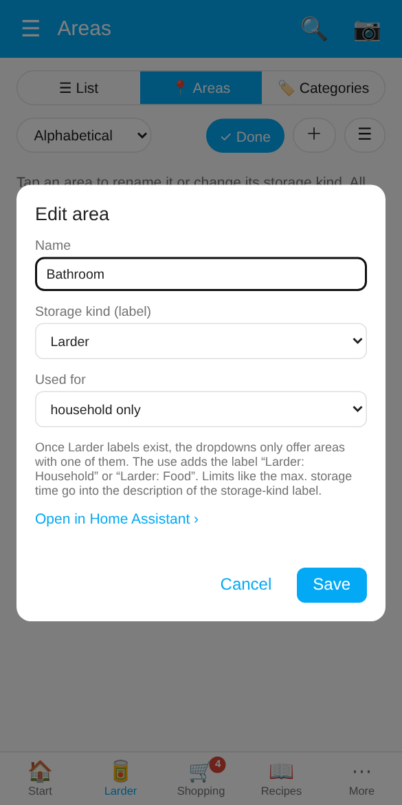
</p>

### Template for the area label

The description of a `Larder: …` label can follow a fixed template. Larder then reads it exactly (the AI still gets the whole text). The template is in English so that it looks the same in every language:

```text
Storage: freezer
Temperature: -18 °C
Max storage: 18 months
Notes: meat and fish
```

One entry per line is easiest to read; the entries may also follow each other in one line (`Storage: freezer Temperature: -18 °C Max storage: 18 months`) or be separated by `;`. Upper or lower case does not matter, every entry is optional. German keys work as well: `Lagerort`, `Temperatur`, `Max. Lagerzeit`, `Hinweis`.

| Key | Values | Effect |
|---|---|---|
| `Storage` | `fridge`, `0 °C compartment`, `freezer`, `freezer compartment`, `pantry`, `cellar` … | Storage place for the table, wins over the area name (a temperature sensor of the area still comes first). |
| `Temperature` | e.g. `-18 °C`, `4 °C` | Places the area by temperature, as before. |
| `Max storage` | a number with `days`, `weeks`, `months` or `years` (`Tage`, `Wochen`, `Monate`, `Jahre`); a plain number means days | Upper limit for table and AI estimates in this area. Remembered estimates are capped as well, your own corrections are not. The tip says when a value was capped. With several labels the shortest limit applies. |
| `Notes` | any text | Only a hint for the AI. |

A temperature sensor assigned to the area in its settings is used as well (the table uses it first, the AI gets its value).

## Filling containers

<p align="center">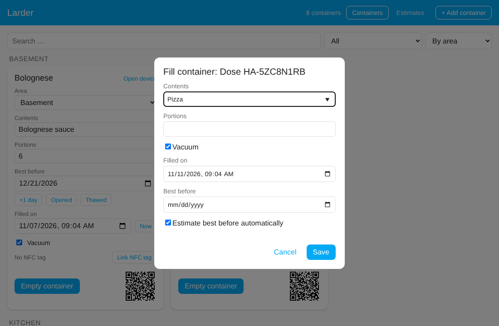</p>

An empty container shows a **Fill** button. It opens a small dialog: **contents** (with suggestions from what you entered before, newest first, then your remembered estimates), **quantity and unit** (optional), **vacuum**, **filled on** (preset to now), optionally a **best-before date**, and **Estimate best before automatically** (only if estimating is on and the date is empty). **Save** sets everything and estimates the date.

**Bought food:** in the Home Assistant app the button **EAN** next to the contents scans the barcode on the package and fills in the product name from [Open Food Facts](https://world.openfoodfacts.org) (free product database, needs internet). Brand, package size, EAN and the [nutrition](#nutrition) are taken over too. The best-before date is printed on the package; enter it in the dialog. Nothing found or offline: type the contents as usual.

**Contents from a photo:** with an [AI](best-before.md#ai-optional) set up, **📷** next to the contents takes a photo of the food (or picks one) and fills in what the AI recognises, e.g. "Goulash with potatoes". Check it and correct if needed.

### Container sizes

<p align="center">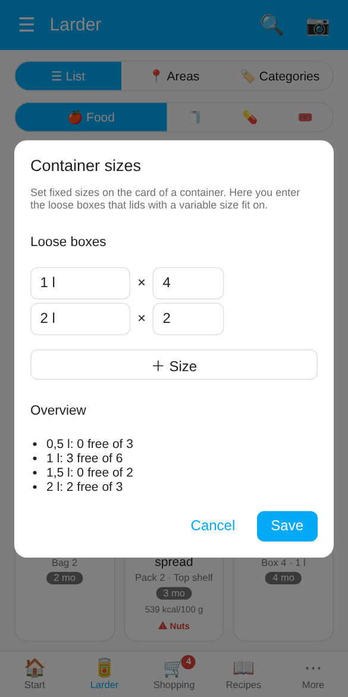</p>

A container can have a **size** (field **Size** on its card, free text like `1 l` or `500 ml`). It is shown on the tile and card.

- **Fixed size** (default): the size belongs to the container.
- **variable**: for lids that fit boxes of different sizes (e.g. Zwilling, where the code sits on the lid). The size is chosen in the fill dialog at every filling; the last size of this lid is suggested.
- **Loose boxes:** **⋮ → 📏 Container sizes** takes how many boxes of each size you own for the variable lids, e.g. 4 × 1 l, 2 × 2 l.
- **Free containers:** the **Larder** page shows *Free: 3 × 1 l, 1 × 0.5 l*: empty containers with a fixed size plus the loose boxes not filled with a variable lid. Tap it to open the sizes.

### Batch cooking

<p align="center">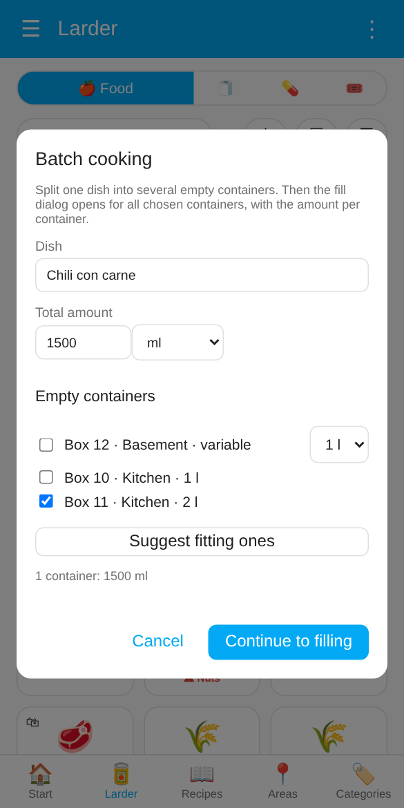</p>

**⋮ → 🍲 Batch cooking** (administrators) splits one dish into several empty containers: enter the **dish** and the **total amount** (portions, ml, g or pieces) and tick the containers. With millilitres, **Suggest fitting ones** picks the fewest containers that hold the amount, by their size; variable lids get a size from the free loose boxes. The amount is split (in millilitres as much as each container holds, otherwise evenly), then the usual fill dialog opens for all of them with the amount per container. Afterwards Larder offers to print the labels.

### Nutrition

<p align="center">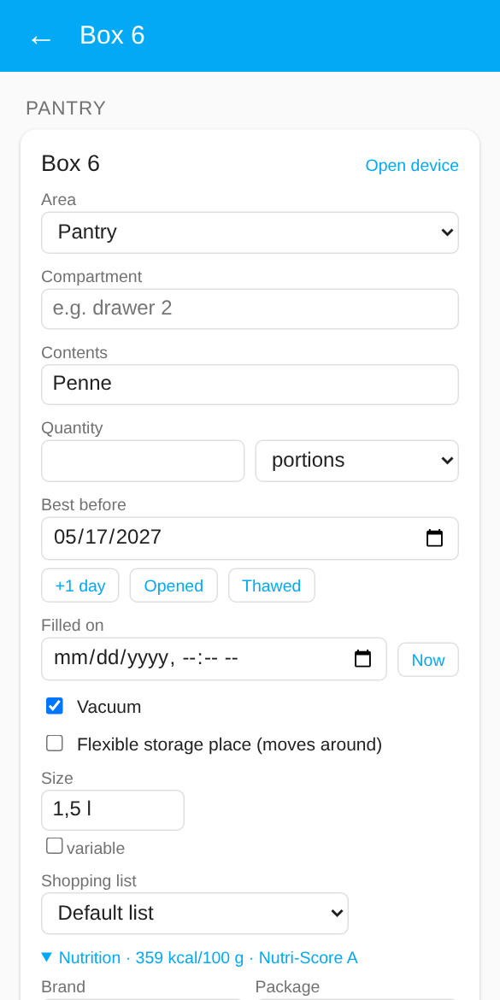</p>

The card of a filled container has a fold-out **Nutrition** section: **brand**, **package**, **kcal per 100 g**, **kcal per portion**, **Nutri-Score** (A–E), **EAN**, **allergens** and **nutrients** as free text (fat, carbohydrates, sugar, protein, salt …). After a barcode scan they come from Open Food Facts (shown as source, data under the ODbL); otherwise enter them by hand, e.g. for home-cooked food. Every field can be changed.

- The **kcal** also appear on the tile and in the list (per portion if known, otherwise per 100 g).
- The data belong to the contents: **Empty container** clears them, filling with other contents without a scan as well. They go into the [history](dashboard.md#export-and-import) and the inventory CSV.
- For automations they are attributes of the **Contents** entity: `brand`, `package`, `ean`, `kcal_100g`, `kcal_portion`, `nutri_score`, `allergens`, `nutrients`, `source` (and `allergen_warning`, see below).

### Allergens in the household

In the [settings](reference.md#settings) choose the allergens your household watches out for (the 14 main allergens, e.g. gluten, milk, nuts). Containers whose **allergens** (from Open Food Facts or entered by hand) or whose **contents** match ("Hazelnut spread" → nuts, "Rice pudding" → milk) get a **⚠** with the allergen on the tile, in the list, on the card and in the [Lovelace card](dashboard.md#card-for-your-dashboards). [Recipe ideas](kitchen.md#recipe-ideas) leave such containers out (unless you picked them yourself) and the AI is told to avoid these allergens in extra ingredients. The matched allergens are in the attribute `allergen_warning` of the **Contents** entity.

> Only a hint, no guarantee: recognition depends on what is entered.

After saving, a short notice offers **🖨 Label** for exactly the container(s) just filled (handy for freezer bags and bags); it opens the [label sheet](scanning.md#label-sheet) with your last format and design.

The dialog also opens by itself right after you add a new container in the dashboard (including after writing an NFC tag), so you can fill it straight away. It also opens after a scan (📷 in the app, own QR code, NFC tag, Shortcut) when the container is empty; a container that already has contents opens its card.

**Containers that move around:** some containers always stand in the same place, others (for example vacuum boxes) are in the fridge one day and in the 0 °C drawer the next. Switch on **Flexible storage place** on the card of such a container. The fill dialog then also asks for the **area** (administrators), so the estimate uses the right place, and **Empty container** puts the container back into the area chosen under **After emptying, back to** (for example the pantry where the empty boxes are kept). Containers without the switch keep their area and the fill dialog does not ask. For flexible containers the dialog also asks for the **compartment**; when the container goes back after emptying, the compartment is cleared.

**Several containers at once:** select the empty containers (or scan them one after another) and press **Fill (n)**: the same dialog fills all of them, see [Selecting several containers](dashboard.md#selecting-several-containers).

### Several contents in one container

A container can hold several things, for example different cold cuts. Separate them with commas: `Salami, Kochschinken, Leberwurst` (a semicolon works too; `1,5 kg` stays one item).

- The **estimate** looks up each item on its own and takes the **shortest** best-before date; the tip says which item decides it ("Lachs" decides the best-before date). If the table does not know one of the items, it counts as no match (in *table, else AI* mode the AI then answers for the item that spoils first).
- The **shopping list** gets each item as its own entry.
- The **category** stays if all items are of the same kind (cold cuts), otherwise it is **Mixed**.

There is one best-before date per container: everything in it is used up or thrown away together.
