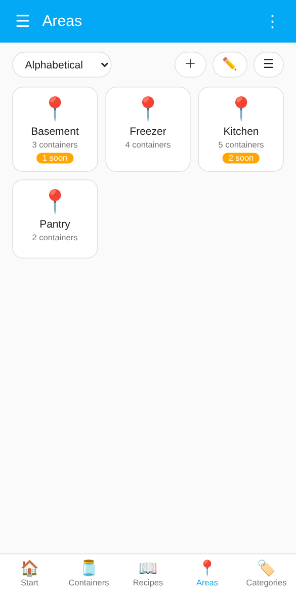
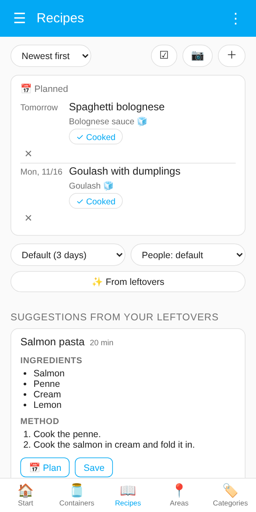
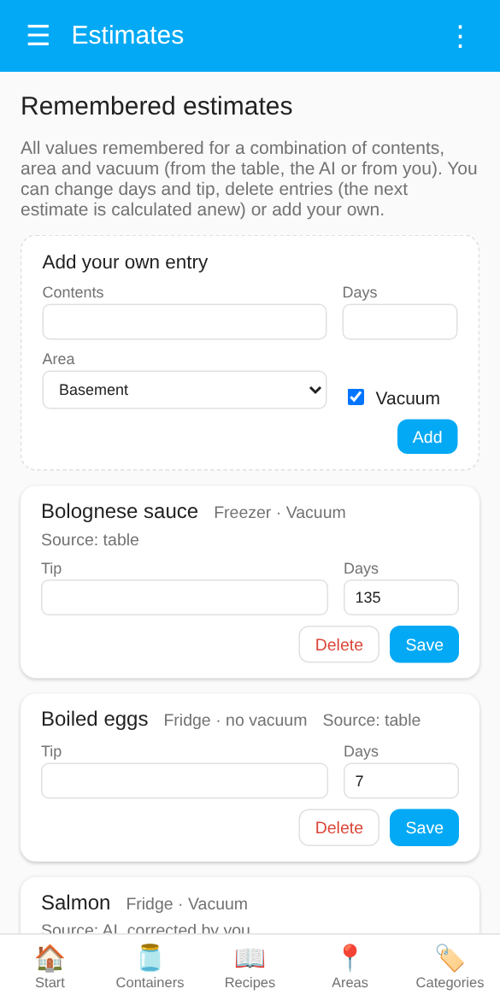
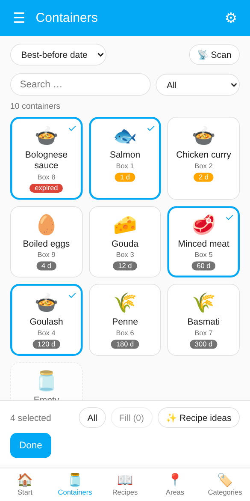
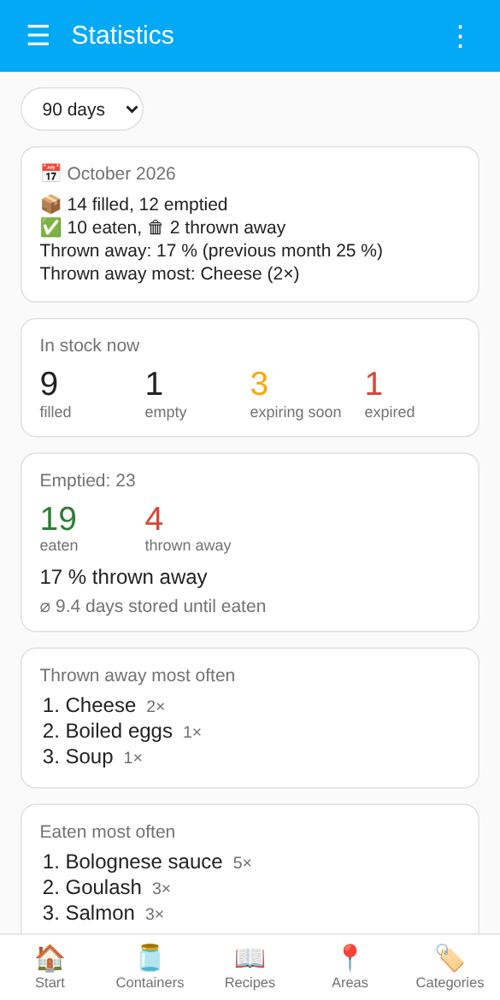

# Dashboard, statistics and data

[← Overview](../../README.md) · [🇩🇪 Deutsch](../de/dashboard.md)

[Dashboard "Larder"](#dashboard-larder) · [Statistics](#statistics) · [Export and import](#export-and-import)

## Dashboard "Larder"

As soon as at least one container exists, a sidebar entry **Larder** appears. It needs no configuration, adapts to your Home Assistant theme and language (English and German) and updates itself. *The screenshots show demo data.*

A bar at the bottom switches between five pages:

- **Start**: a greeting with your Home Assistant name, tiles for everything that should be used up soon (expired first), and shortcuts to the recipe suggestions and the containers. In the Home Assistant app there is also **📷 Scan container** (see [Scanning in the app](scanning.md#scanning-in-the-app)).
- **Containers**: all containers with a symbol for the kind of food, the contents, the container name and the days left.
  - **Search** in name, contents and area; **filter** by *expiring soon*, *expired*, *filled*, *empty*, *bags* or *packs*; **sort** by best-before date, area, area and compartment, alphabet or category (area, area and compartment, and category are grouped; *area and compartment* shows exactly what is in each compartment). The number of containers shown is above the list.
  - The button on the right switches between **tiles**, a **list** and **cards with all details**. Your choice is remembered on the device.
  - Tap a filled container to open its card, tap an empty one to fill it right away (see [Filling containers](containers.md#filling-containers)).
  - **📷** scans a container (only in the Home Assistant app, see [Scanning in the app](scanning.md#scanning-in-the-app)), **＋** adds one (see [From the dashboard](containers.md#from-the-dashboard-recommended)), **☑** starts the [selection](#selecting-several-containers).
- **Areas**: one tile per area with the number of containers and how many expire soon; tapping shows its containers. Administrators add areas with **＋** and rename them or set their storage kind with **✏️** (see [Areas and labels](containers.md#areas-and-labels)).
- **Categories**: the same for kinds of food (fish, meat, dairy, dishes and leftovers, dry goods, …). The category comes from the built-in shelf-life table and is the attribute `category` of the **Contents** entity. Containers without a match are listed under "Other", containers with [several contents](containers.md#several-contents-in-one-container) of different kinds under "Mixed", empty ones under "Empty".
- **Recipes**: your [recipe book](kitchen.md#recipe-book) with [recipe ideas](kitchen.md#recipe-ideas) and recipes read from a photo.

**The card of a container** (in the card view, or after tapping a container) shows everything and lets you edit it:

- area (dropdown; which areas are offered can be narrowed down with a label, see [Areas and labels](containers.md#areas-and-labels)), **compartment** (optional, e.g. "drawer 2" in the freezer; shown on the tile, searchable, sorted with the area), **contents**, **quantity and unit** (**−1** takes one portion, piece or slice; at the last one it asks whether to empty the container), **best before** (with a hint "expired" or "n days left" once it expires soon), **filled on** ("Now" sets the current time),
- **+1 day** moves the best-before date by a day, **Opened** shortens it to the days set in the settings (default 3), **Thawed** does the same for food out of the freezer (default 2 days, do not refreeze). Neither ever extends a date; without a date one is set,
- **Estimate best before** (when [estimating](best-before.md#best-before-estimate) is on, contents are entered and the date is empty),
- **Vacuum**, **Add to shopping list when emptied** (once a [shopping list](kitchen.md#shopping-list) is chosen), **Flexible storage place** with **After emptying, back to** (see [Filling containers](containers.md#filling-containers)), the **NFC tag** (link or unlink), **Open device** and **Empty container**. Before emptying, the card asks **😋 Eaten** or **🗑 Thrown away**; the answer goes into the container's **History** (fold-out list at the bottom of the card, the last ten fillings).

**⋮** at the top opens a menu: **📊 Statistics** and **🖨 Print labels** for everyone, **📦 Export and import**, the [remembered estimates](best-before.md#managing-remembered-estimates) and the integration settings for administrators. The ☰ on the left is the Home Assistant sidebar.

<p>



</p>

The dashboard is visible to all users; only **administrators** can add containers, change areas, use the selection and see the estimates (the same restriction as in the settings). It is not a classic Lovelace dashboard and cannot be edited with the card editor.

**Links into the dashboard** (used by scans and notifications, also for your own automations): `/larder?open=<device id>` opens a container (an empty one with the fill dialog), `/larder?cc=<container id>` does the same by container ID and counts as a scan, `/larder?add=<code>` opens the add dialog with the code, `/larder?view=recipes` (or `start`, `containers`, `areas`, `categories`) opens a page.

### Selecting several containers

**☑** on the containers page or on the recipe page switches to selection: tap containers to select them, **All** selects everything shown. The bar at the bottom then offers

- **Fill (n)** (administrators): fills all selected *empty* containers at once with the same contents, vacuum, filled-on date and best-before date, for example after cooking a big batch or after shopping. Quantity counts per container. With the estimate switched on, each container gets its own estimate.
- **✨ Recipe ideas**: asks the AI for recipes that use exactly the selected *filled* containers, whatever their best-before date (expired ones are still left out).
- **🗑 Empty (n)** (administrators): empties the selected filled containers after asking **Eaten** or **Thrown away** (for the history).
- **🖨 Labels**: an [A4 label sheet](scanning.md#label-sheet) with the QR codes of the selected containers.
- **Done** ends the selection.

**Serial scan** (administrators): during the selection **📡 Scan** adds every container you scan. In the Home Assistant app a switch **📷 QR code | 📶 NFC** appears at the top; tap or swipe it to change the method at any time:

- **QR codes** in the Home Assistant app on iOS and Android: the app's own scanner opens and stays open, scan one code after the other; each hit shows the container name and the number selected. Own QR codes and the original Zwilling codes both work; a container that has not been added yet is reported. **Switch to NFC** in the scanner (or closing it) changes to NFC; the serial scan keeps running.
- **NFC tags** linked to a container: choose **NFC** (this closes the QR scanner; while the camera is in use the iPhone does not read NFC tags). Then hold the phone to a tag; the iPhone shows a banner "Open in Home Assistant" at the top, tap it. The container is selected, and you stay on the page. Android reads the tag directly. While a serial scan is running, the phone gets no Larder notification after an NFC scan.
- **⏹ Stop scanning** ends the serial scan. Afterwards an **inventory** box lists the filled containers that were *not* scanned (maybe already eaten but not emptied); **Select these** selects them, for example to empty them with **🗑 Empty**.

Then fill them all at once or ask for recipe ideas, which makes an inventory of a freezer or a shopping trip quick.

<p align="center"></p>


### Card for your dashboards

The card **Larder** shows the containers that expire soon on any dashboard, with the most urgent first. It is loaded by the integration itself (no resource to add) and is listed in the card picker; tap a container to open it in the Larder dashboard.

```yaml
type: custom:larder-card
title: Expiring soon   # optional
days: 3                # optional, default: the setting "Expiring soon"
show_expired: true     # optional
limit: 8               # optional
area: kitchen          # optional, area ID
```

The second card, **Larder: Stock**, shows what is below its [minimum stock](containers.md#stock) (with 🛒 to put it on the shopping list), items you bought but have not added to the stock yet, and opened packs. Tapping a line opens the stock view or the pack.

```yaml
type: custom:larder-stock-card
title: Stock          # optional
show_bought: true     # optional
show_opened: true     # optional
```

## Statistics

<p align="center"></p>

At the top: the **report of the previous month** (see [Monthly report](kitchen.md#monthly-report)).

**⋮ → 📊 Statistics** in the dashboard shows, for the last 30 or 90 days, a year or everything:

- **In stock now**: filled, empty, expiring soon, expired (and filled without a date).
- **Emptied**: how many were eaten and thrown away, the share thrown away, the value thrown away (packs with a price) and the average storage time until eaten.
- **Thrown away most often**, **eaten most often** (with [several contents](containers.md#several-contents-in-one-container) each item counts) and **thrown away by area**.
- **Last months** as bars: eaten (green) and thrown away (red).

The numbers come from the [history](#export-and-import), so they grow as you empty containers with **Eaten** or **Thrown away**. Containers emptied without an answer count as thrown away if they had expired.

For your own dashboards and automations the service `larder.get_statistics` returns the same data (`days` optional). A template sensor, for example:

```yaml
template:
  - triggers:
      - trigger: time_pattern
        hours: "/1"
    actions:
      - action: larder.get_statistics
        data:
          days: 30
        response_variable: stats
    sensor:
      - name: Larder thrown away (30 days)
        state: "{{ stats.waste_percent if stats.waste_percent is not none else 0 }}"
        unit_of_measurement: "%"
        attributes:
          filled: "{{ stats.containers.filled }}"
          expired: "{{ stats.containers.expired }}"
```

## Export and import

In the dashboard **⋮ → 📦 Export and import** (administrators):

- **📄 Inventory as a table (CSV)**: all containers with name, ID, area, compartment, contents, quantity, unit, filled on, best before, days left, status, vacuum and the nutrition (brand, package, EAN, kcal, Nutri-Score, allergens, nutrients). In German with semicolons, so Excel opens it directly.
- **🕘 History (CSV)**: every emptied filling with container, contents, quantity, filled on, best before, emptied on, days stored, whether it was expired and whether it was eaten or thrown away. Containers emptied without the question (automation, device page) have no outcome.
- **💾 Remembered estimates (backup)**: all [remembered best-before values](best-before.md#managing-remembered-estimates) as a JSON file.
- **Import estimates**: reads such a file back, for example after a reinstall or on a second Home Assistant. Your own corrections are kept when the file only has a table or AI value for the same combination; with **Delete existing estimates first** the file replaces everything. Invalid entries are skipped and counted.

The downloads open via a link that is valid for five minutes, also in the Home Assistant app.

For bug reports, **Download diagnostics** (⋮ on a container's entry under Settings → Devices & services → Larder) collects the settings, the container and its entities. The secret webhook ID and the remembered estimates themselves are not included.
