# Dashboard, statistics and data

[← Overview](../../README.md) · [🇩🇪 Deutsch](../de/dashboard.md)

[Dashboard "Larder"](#dashboard-larder) · [Statistics](#statistics) · [Export and import](#export-and-import)

## Dashboard "Larder"

Right after adding the integration a sidebar entry **Larder** appears; as long as nothing is in Larder, its start page shows **🚀 Get started** with three steps (assign areas, choose a shopping list, add the first item), done ones ticked. It needs no configuration, adapts to your Home Assistant theme and language (English, German, French and Dutch) and updates itself. *The screenshots show demo data.*

<p align="center">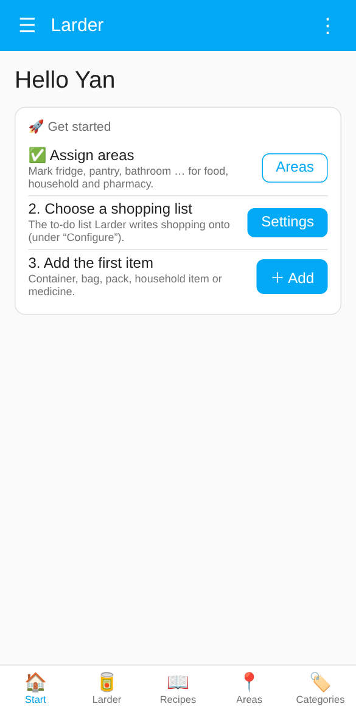</p>

A bar at the bottom switches between five pages: **Start · Larder · Shopping · Recipes · More** (since 5.0; *Shopping* shows the number of open items on the shopping lists). At the top of every page are **🔍 Search** and – in the Home Assistant app – **📷 Scan**:

- **🔍 Search**: typing a product shows every match with count, places and best-before date. A product in packs opens the same view as scanning its barcode (−1, open, move, one pack more), a container or voucher its card. The digits of a barcode look it up like a scan.
- **📷 Scan** recognises what was scanned: barcode → the packs of that product, QR code or NFC of a container → its card, compartment label → the [compartment view](scanning.md#compartments) (see [Scanning in the app](scanning.md#scanning-in-the-app)).

- **Start**: a greeting with your Home Assistant name, below it the **quick actions** 📷 Scan · 📥 Put away · 🧾 Receipt · 🍳 Recipe idea, tiles for everything that should be used up soon (expired first), and a shortcut to the larder. Below, boxes appear only when there is something to do: a [recall warning](containers.md#recall-warnings), **⏳ Running low**, **🛒 Bought – into stock?** (one tap puts known products at their usual place), **💡 Again …?** (eaten often, none left), **🔓 Opened** (what is open, since when and how long it keeps, the shortest first; since 5.6), **🧊 Thaw** for a [planned dish](kitchen.md#meal-plan), the planned dishes, **🔁 Replace** for household items, once a month **🧹 [Data care](#data-care)** and a small **📊 month tile** (e.g. *November: 2 thrown away, about €4*, since 5.5) that leads to the [statistics](#statistics). With [household items](containers.md#household-items) the page has two sections, *Food* and *Household*.
- **Larder** (*Storage* in 4.0–4.5, *Containers* before): everything in store with a symbol for the kind of food, the contents, the container name and the days left.
  - **Search** in name, contents and area; **filter** by *expiring soon*, *expired*, *filled*, *empty*, *bags* or *packs*; **sort** by best-before date, area, area and compartment, alphabet or category (area, area and compartment, and category are grouped; *area and compartment* shows exactly what is in each compartment). The number of containers shown is above the list.
  - The button on the right switches between **tiles**, a **list** and **cards with all details**. Your choice is remembered on the device.
  - Tap a filled container to open its card, tap an empty one to fill it right away (see [Filling containers](containers.md#filling-containers)).
  - **＋** adds one (see [From the dashboard](containers.md#from-the-dashboard-recommended)), **☑** or a **long press** on a tile (since 5.5) starts the [selection](#selecting-several-containers).
  - At the top, **List · Areas · Compartments · Categories** switches the grouping (separate pages in the bar up to 4.12); all four have the switch **Food | Household | Pharmacy** (see [Household items](containers.md#household-items)).
- **Areas**: one tile per area with the number of containers and how many expire soon; tapping shows its containers. Administrators add areas with **＋** and rename them or set their storage kind with **✏️** (see [Areas and labels](containers.md#areas-and-labels)).
- **Compartments** (since 5.5): every compartment with the number of containers and how many expire soon, **🏷** when it has an NFC tag; tapping opens the [compartment view](scanning.md#compartments) (tag, label, stocktake). **🏷 Compartments & tags** manages tags and labels for several at once.
- **Categories**: the same for kinds of food (fish, meat, dairy, plant-based, sauces & spices, dishes and leftovers, dry goods, …). The category comes from the built-in shelf-life table and is the attribute `category` of the **Contents** entity. Containers without a match are listed under "Other", containers with [several contents](containers.md#several-contents-in-one-container) of different kinds under "Mixed", empty ones under "Empty".
- **Shopping**: the [shopping mode](kitchen.md#shopping-mode).
- **Recipes**: your [recipe book](kitchen.md#recipe-book) with [recipe ideas](kitchen.md#recipe-ideas) and recipes read from a photo. The tab **📅 Week** (since 5.5) holds the [meal plan](kitchen.md#meal-plan) and the week suggestion; the next days stay visible under Recipes.

**The card of a container** (in the card view, or after tapping a container) shows the frequent actions as big buttons at the top – **−1**, **Open** (packs), **Empty / Used up** and **Move** –, below them contents, amount, best-before date and place; everything rarely needed (price, store section, list, minimum stock, nutrition, replacement interval, convert …) is under **More**. For packs **−1** asks *Used up* or *🗑 Thrown away* (like the barcode dialog), so what is thrown away ends up in the history, the statistics and the value. **🏷** next to the compartment opens the [compartment](scanning.md#compartments), **📷** next to the date reads it from a photo, and **📦 …: stock & history** opens the [product view](#product-history). In detail:

- area (dropdown; which areas are offered can be narrowed down with a label, see [Areas and labels](containers.md#areas-and-labels)), **compartment** (optional, e.g. "drawer 2" in the freezer; shown on the tile, searchable, sorted with the area), **contents**, **quantity and unit** (**−1** takes one portion, piece or slice; at the last one it asks whether to empty the container), **best before** (with a hint "expired" or "n days left" once it expires soon; **📷** reads the printed date from a photo, since 5.1), **filled on** ("Now" sets the current time),
- **+1 day** moves the best-before date by a day, **Opened** shortens it to the shelf life after opening of the contents (USDA FoodKeeper values, e.g. ketchup 6 months in the fridge; otherwise the AI, otherwise the setting, default 3 days) and says where the value comes from, **Thawed** does the same for food out of the freezer (default 2 days, do not refreeze). Neither ever extends a date; without a date one is set,
- **Estimate best before** (when [estimating](best-before.md#best-before-estimate) is on, contents are entered and the date is empty),
- **Vacuum**, **Add to shopping list when emptied** (once a [shopping list](kitchen.md#shopping-list) is chosen), **Flexible storage place** with **After emptying, back to** (see [Filling containers](containers.md#filling-containers)), the **NFC tag** of a container (below the date: **Link NFC tag** for a written tag, **✍ Write a new sticker** for a blank one, or unlink; see [NFC tags](scanning.md#nfc-tags)), **Open device** and **Empty container**. Before emptying, the card asks **😋 Eaten** or **🗑 Thrown away**; the answer goes into the container's **History** (fold-out list at the bottom of the card, the last ten fillings).

**More** (the **⋮** menu up to 4.12) collects everything else in three sections: *Everyday* (📥 Put away, 🧾 Receipt, 📋 Stocktake, batch cooking, 🖨 Print labels), *Overview* (🗃️ Stock, 📊 Statistics, 🧊 Freezer – everything frozen, longest first, with *frozen since* and *best quality until* (since 5.8), 🛟 Emergency supply, 🧹 Data care) and *Setup* (🏷 Compartments & tags for everyone; for administrators 📍 Edit areas, 🏪 Store sections, container sizes, 📦 Export and import, the [remembered estimates](best-before.md#managing-remembered-estimates) and the integration settings). Old links like `?view=areas` keep working. The ☰ on the left is the Home Assistant sidebar.

<p>
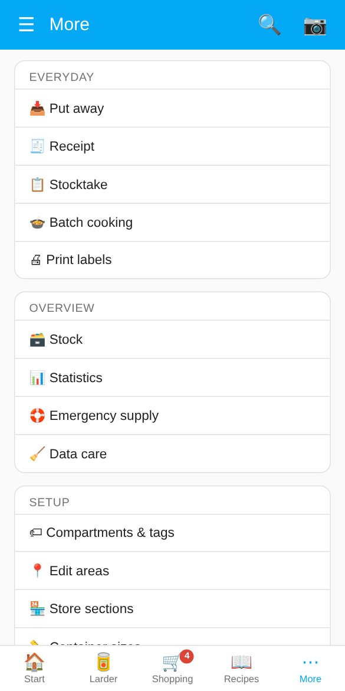
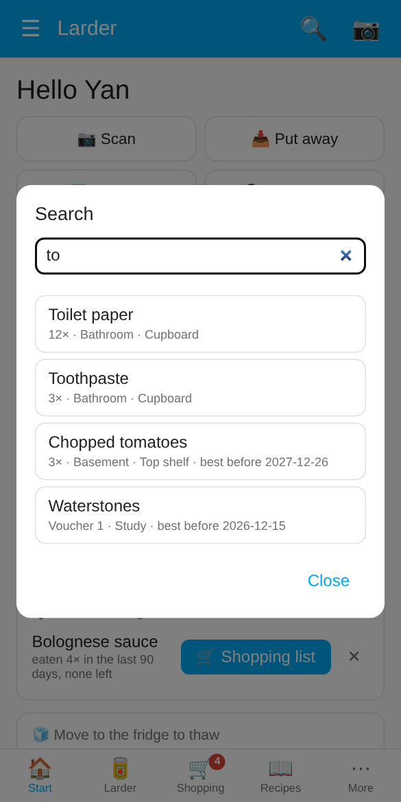
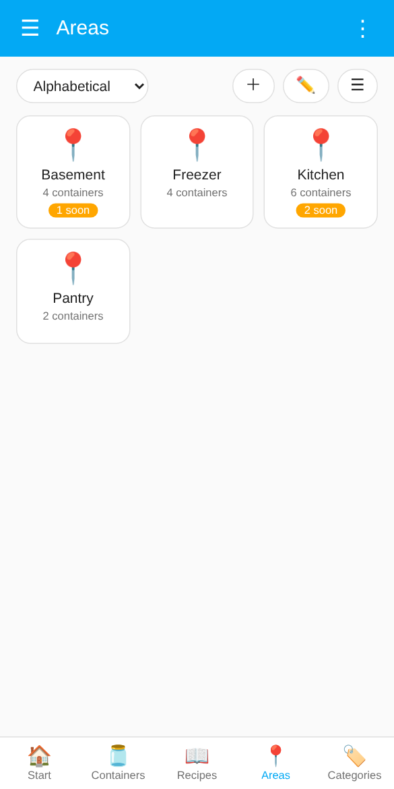
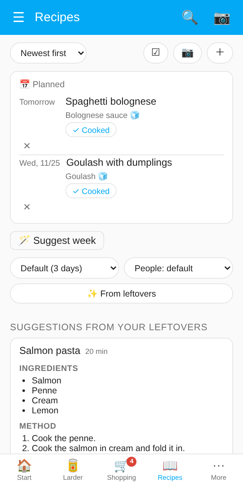
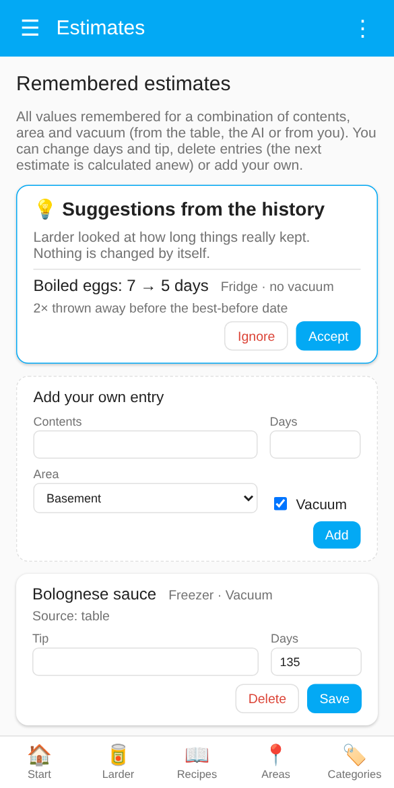
</p>

The dashboard is visible to all users; only **administrators** can add containers, change areas, use the selection and see the estimates (the same restriction as in the settings). It is not a classic Lovelace dashboard and cannot be edited with the card editor.

**Links into the dashboard** (used by scans and notifications, also for your own automations): `/larder?open=<device id>` opens a container (an empty one with the fill dialog), `/larder?cc=<container id>` does the same by container ID and counts as a scan, `/larder?add=<code>` opens the add dialog with the code, `/larder?view=recipes` (or `start`, `containers`, `areas`, `categories`) opens a page.

### Selecting several containers

**☑** on the **Larder** page or on the recipe page, or a long press on a tile, switches to selection: tap containers to select them, **All** selects everything shown. The bar at the bottom then offers

- **Fill (n)** (administrators): fills all selected *empty* containers at once with the same contents, vacuum, filled-on date and best-before date, for example after cooking a big batch or after shopping. Quantity counts per container. With the estimate switched on, each container gets its own estimate.
- **✨ Recipe ideas**: asks the AI for recipes that use exactly the selected *filled* containers, whatever their best-before date (expired ones are still left out).
- **🗑 Empty (n)** (administrators): empties the selected filled containers after asking **Eaten** or **Thrown away** (for the history).
- **🖨 Labels**: an [A4 label sheet](scanning.md#label-sheet) with the QR codes of the selected containers.
- **Done** ends the selection.

**Serial scan** (administrators): during the selection **📡 Scan** adds every container you scan. In the Home Assistant app a switch **📷 QR code | 📶 NFC** appears at the top; tap or swipe it to change the method at any time:

- **QR codes** in the Home Assistant app on iOS and Android: the app's own scanner opens and stays open, scan one code after the other; each hit shows the container name and the number selected. Own QR codes and the original Zwilling codes both work; a container that has not been added yet is reported. **Switch to NFC** in the scanner (or closing it) changes to NFC; the serial scan keeps running.
- **NFC tags** linked to a container: choose **NFC** (this closes the QR scanner; while the camera is in use the iPhone does not read NFC tags). Then hold the phone to a tag; the iPhone shows a banner "Open in Home Assistant" at the top, tap it. The container is selected, and you stay on the page. Android reads the tag directly. While a serial scan is running, the phone gets no Larder notification after an NFC scan.
- **⏹ Stop scanning** ends the serial scan. Afterwards an **inventory** box lists the filled containers that were *not* scanned (maybe already eaten but not emptied); **Select these** selects them, for example to empty them with **🗑 Empty**.

Then fill them all at once or ask for recipe ideas, which makes an inventory of a freezer or a shopping trip quick.

<p align="center">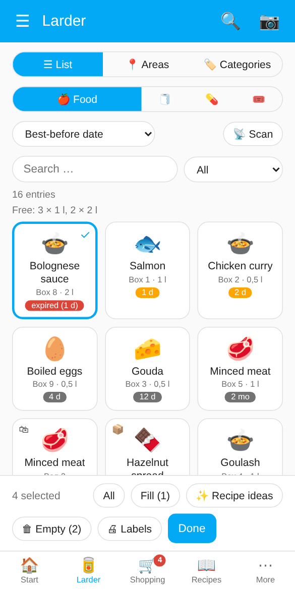</p>


### Card for your dashboards

The card **Larder** shows the containers that expire soon on any dashboard, with the most urgent first. It is loaded by the integration itself (no resource to add) and is listed in the card picker; tap a container to open it in the Larder dashboard.

```yaml
type: custom:larder-card
title: Expiring soon   # optional
days: 3                # optional, default: the setting "Expiring soon"
show_expired: true     # optional
limit: 8               # optional
area: kitchen          # optional, area ID
```

The second card, **Larder: Stock**, shows what is below its [minimum stock](containers.md#stock) (with 🛒 to put it on the shopping list), items you bought but have not added to the stock yet, and opened packs. Tapping a line opens the stock view or the pack.

```yaml
type: custom:larder-stock-card
title: Stock          # optional
show_bought: true     # optional
show_opened: true     # optional
```

Since 5.3 two more: **Larder: Shopping** shows the open items per shopping list with a button to the shopping mode, **Larder: Compartment** what is in one area or compartment (expiring first, **−1** for packs) – for example on a tablet at the fridge.

```yaml
type: custom:larder-shopping-card
title: Shopping       # optional
```

```yaml
type: custom:larder-place-card
area: freezer         # area ID
compartment: Drawer 2 # optional
title: Freezer        # optional
```

Since 6.0 every card has a **visual editor**: in the card picker or with *Edit* the options appear as a form (title, days, area, compartment …); YAML still works.

For automations there are also [overview sensors](reference.md#overview-sensors) (expired, expiring soon, stock value, open shopping items, emergency supply).

### Data care

Once a month, while something is missing, the start page shows **🧹 Data care** (✕ hides it until next month; **More → 🧹 Data care** shows it any time): opened packs without a date, packs without a best-before date, products without a price, entries without an area or compartment, and products used often but without a minimum stock. Since 6.3 also food the [shelf-life table](best-before.md#which-row-counts) does not recognise (tap it and choose the kind, e.g. *Juice / smoothie*) and the **suggestions from your history** (*thrown away before the date* / *eaten long after it*, accept them in Estimates). Tapping an entry opens its card, where you fill it in. With complete data, statistics, *lasts about …*, shopping suggestions and the stock value get more accurate. Opened packs show **🫙 opened 12 Nov** on their tile, so it is clear why the date is shorter than printed.

<p align="center">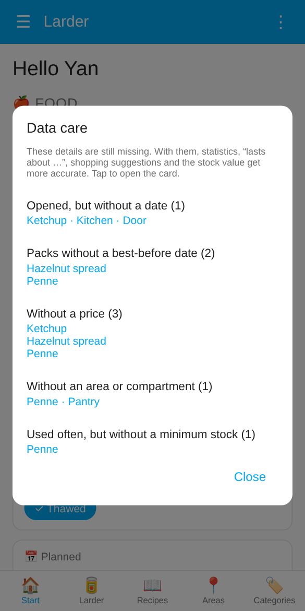</p>

### Product history

**Product view (since 5.5).** A product name in the stock view, **📦 Stock & history** in the barcode dialog (also reached from the 🔍 search) and **📦 …: stock & history** on a card open everything about a product in one place: how many are where (with **−1** per place, tap for the card), **At least**, **🔁 Buy again by consumption**, price and value, and the history below. It shows what happened to a **product** across all containers, bags and packs – *ham was in container 3 last week and is in container 7 this week*. At the top: how often in the last year, how long it lasted on average, how much was thrown away (with its value, if the price is known), the prices over time and a hint, e.g. *thrown away 2 of 6 times – buy smaller amounts or freeze some?*. Below, every emptied or used-up entry with date, eaten or thrown away, where it was and how long it was stored. Entries with the same contents count as one product (upper/lower case does not matter); a renamed product starts a history of its own.

<p align="center">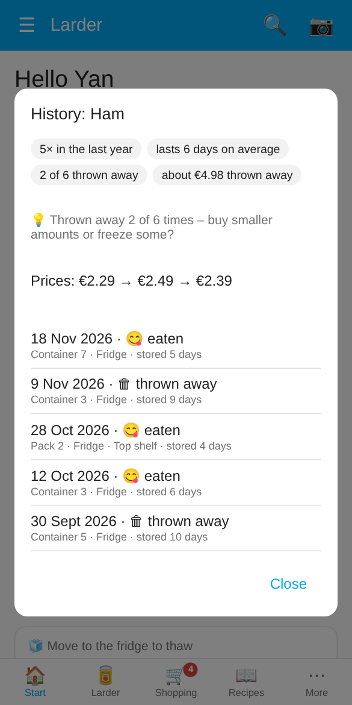</p>

**Recently used.** **＋** and the empty 🔍 search show the last products added as chips. One tap adds one pack at its usual place (where it is now, otherwise where it was last), even when none is left; then price and date as after putting away.

## Statistics

<p align="center">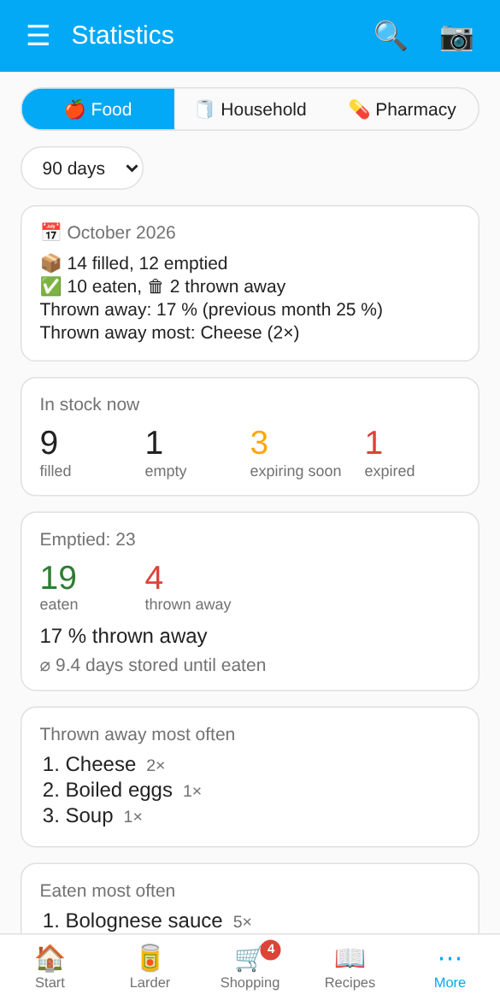</p>

At the top: the **report of the previous month** (see [Monthly report](kitchen.md#monthly-report)).

**More → 📊 Statistics** in the dashboard shows, for the last 30 or 90 days, a year or everything:

- **In stock now**: filled, empty, expiring soon, expired (and filled without a date).
- **Emptied**: how many were eaten and thrown away, the share thrown away, the value thrown away (packs with a price) and the average storage time until eaten.
- **Thrown away most often**, **eaten most often** (with [several contents](containers.md#several-contents-in-one-container) each item counts) and **thrown away by area**.
- **🗑 What you throw away most** (since 6.5): the top 5 products with how often, their value and one tip each – *lower the minimum stock* (if it has one), *freeze half of it right away* (if it keeps in the freezer), else *buy a smaller pack*.
- **Last months** as bars: eaten (green) and thrown away (red).

The numbers come from the [history](#export-and-import), so they grow as you empty containers with **Eaten** or **Thrown away**. Containers emptied without an answer count as thrown away if they had expired.

**Household (since 4.1):** the switch at the top shows the household side: what [household items](containers.md#household-items) cost **per month** on average, spending (or, without prices, pieces) per month for the last six months, and per product how much is used and spent per month, e.g. *Toilet paper: 8 rolls · €4.00*. It is worked out from the pieces taken (−1, stocktake, last piece) with the pack size and price per pack at that time; the average counts from the first month with takes. Products without a known price are marked.

<p align="center">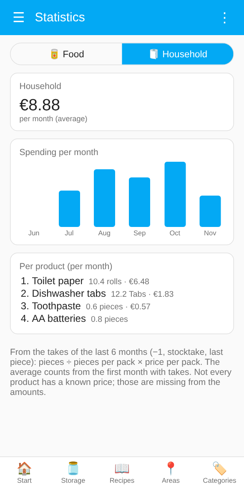</p>

For your own dashboards and automations the service `larder.get_statistics` returns the same data (`days` optional). A template sensor, for example:

```yaml
template:
  - triggers:
      - trigger: time_pattern
        hours: "/1"
    actions:
      - action: larder.get_statistics
        data:
          days: 30
        response_variable: stats
    sensor:
      - name: Larder thrown away (30 days)
        state: "{{ stats.waste_percent if stats.waste_percent is not none else 0 }}"
        unit_of_measurement: "%"
        attributes:
          filled: "{{ stats.containers.filled }}"
          expired: "{{ stats.containers.expired }}"
```

## Export and import

In the dashboard **More → 📦 Export and import** (administrators):

- **📄 Inventory as a table (CSV)**: all containers with name, ID, area, compartment, contents, quantity, unit, filled on, best before, days left, status, vacuum and the nutrition (brand, package, EAN, kcal, Nutri-Score, allergens, nutrients). In German with semicolons, so Excel opens it directly.
- **🕘 History (CSV)**: every emptied filling with container, contents, quantity, filled on, best before, emptied on, days stored, whether it was expired and whether it was eaten or thrown away. Containers emptied without the question (automation, device page) have no outcome.
- **💾 Remembered estimates (backup)**: all [remembered best-before values](best-before.md#managing-remembered-estimates) as a JSON file.
- **Import estimates**: reads such a file back, for example after a reinstall or on a second Home Assistant. Your own corrections are kept when the file only has a table or AI value for the same combination; with **Delete existing estimates first** the file replaces everything. Invalid entries are skipped and counted.

The downloads open via a link that is valid for five minutes, also in the Home Assistant app.

### Import from Grocy

Coming from [Grocy](https://grocy.info)? **More → 📥 Import from Grocy** (administrators) takes over its stock once: every stock entry becomes a [pack](containers.md#bags-and-packs) with its product name, amount, best-before date, barcodes and *opened*; Grocy's *days after opening* become the product's [own value](best-before.md#best-before-estimate). Grocy has no export file, so Larder reads Grocy's own REST API: enter the address (e.g. `http://192.168.1.20:9283`) and an API key from Grocy (*Settings → Manage API keys*). The key is only used for the request and is not stored. A **preview** shows what was found; Grocy places with the name of a Home Assistant area are matched, the others you choose. Products keep their own names – nothing is merged with similar Larder products. Running it twice adds the packs twice.

For bug reports, **Download diagnostics** (⋮ on a container's entry under Settings → Devices & services → Larder) collects the settings, the container and its entities. The secret webhook ID and the remembered estimates themselves are not included.
