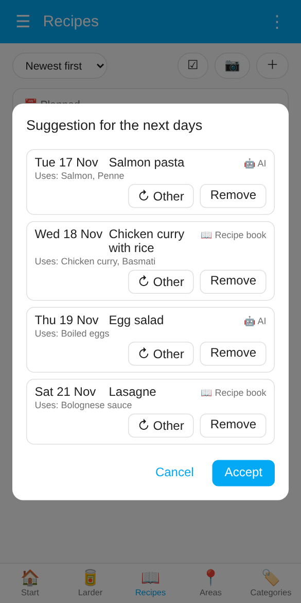
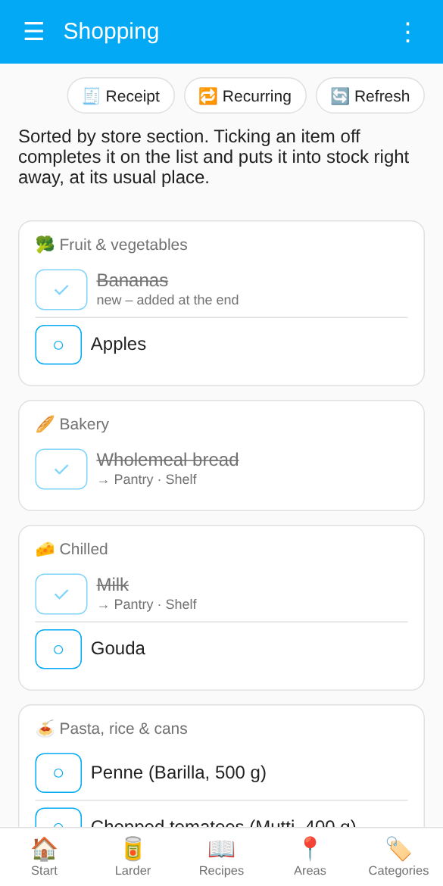
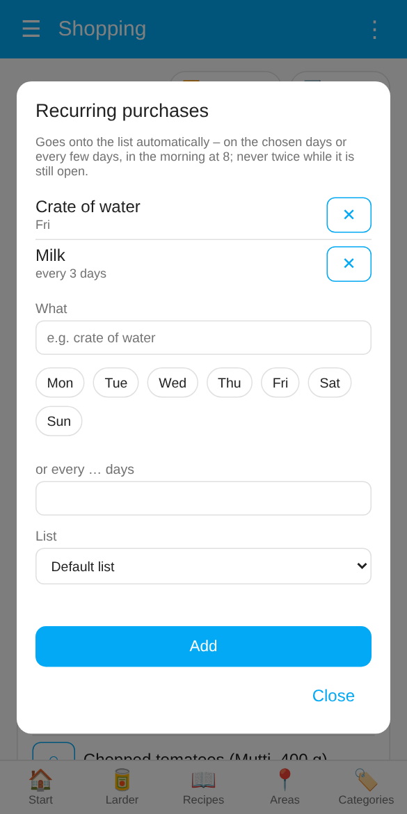
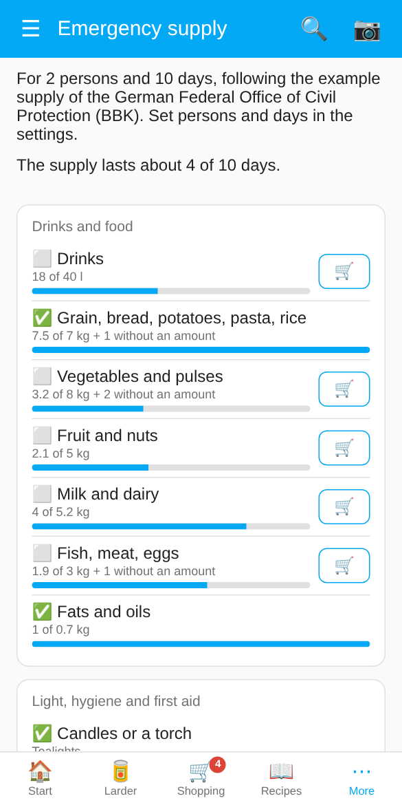
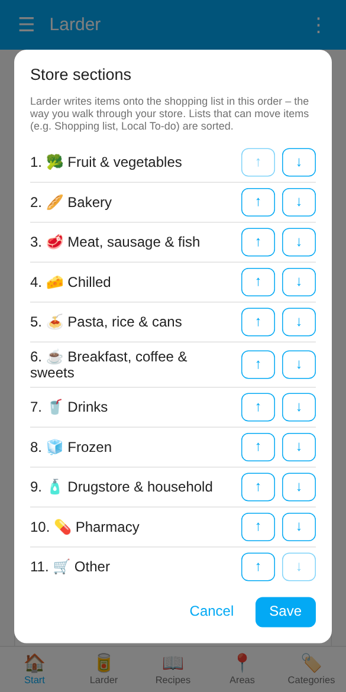

# Recipes, daily summary, meal plan and shopping

[← Overview](../../README.md) · [🇩🇪 Deutsch](../de/kitchen.md)

[Recipes](#recipes) · [Daily summary](#daily-summary) · [Meal plan](#meal-plan) · [Shopping list](#shopping-list) · [Best-before dates in your calendar](#best-before-dates-in-your-calendar)

## Recipes

All recipe features use the Home Assistant **AI Task** integration (the same one as for the [AI estimate](best-before.md#ai-optional)); the estimate mode does not matter. Depending on the provider each request may cost a small amount, and nothing is sent without you pressing a button or running an automation.

### Recipe ideas

The AI suggests dishes that use up what expires soon.

**In the dashboard** (administrators): on the **Recipes** page press **✨ From leftovers**. Next to it choose the period (the default comes from **Configure** → *Period for recipe ideas*, 3 days out of the box; a fixed number of days; or **All containers**, which also includes containers without a best-before date) and optionally the number of people. You get up to three recipes with the containers they use, extra ingredients (only common staples), time and short steps, and you can **save** the ones you like to the [recipe book](#recipe-book). Expired containers and containers without contents are never used.

**In automations:** the service `larder.suggest_recipes` returns the same.

```yaml
action: larder.suggest_recipes
data:
  days: 3        # containers expiring within 3 days (omit to use the period from the settings)
  # all_containers: true   # no period: every filled container
  # containers: [device_id, …]   # exactly these containers
  servings: 2    # optional, default 2 people
  max_recipes: 3 # 1 to 5
response_variable: ideas
# ideas.recipes (title, minutes, uses, extra_ingredients, steps), ideas.summary (text),
# ideas.ingredients (the containers used), ideas.count
```

**In the daily notification:** the [blueprint](#daily-summary) has the switch **Add recipe ideas**. The recipes are appended to the message; if the AI fails, the normal message is still sent. Re-import the blueprint to get the new switch.

Only the contents, quantity with unit, remaining days and storage place (area name) are sent to the AI service you chose, never container names, IDs or anything else. The suggestions are ideas from a language model, not tested recipes: check that food is safe to eat, especially thawed or older food.

**From selected containers:** select containers and press **✨ Recipe ideas**, see [Selecting several containers](dashboard.md#selecting-several-containers). In automations use `containers` with the device IDs.

### Recipe book

The **Recipes** page is your own recipe book (stored in Home Assistant, `.storage/larder.recipes`). Everyone can read it; administrators add (**＋**), edit and delete recipes. Sort by newest or by name; tap a recipe to see ingredients and steps.

**Recipe from a photo or file** (📷, administrators): take a photo of a recipe from a cookbook or a card, pick up to four photos (for example two pages) or a PDF. The AI reads the recipe, translates it into your language if needed and opens it for you to **check**; nothing is saved until you tap *Save*. The selected AI task must support attachments (for example Anthropic, OpenAI, Google). Photos are shrunk before uploading, are kept in Home Assistant's media folder (`media/larder/recipe_photos`) only while they are read and are deleted afterwards. Only the photo or file is sent, to the AI service you chose.

## Daily summary

The included blueprint sends a **daily summary** of what expires soon. Nothing is sent when nothing expires. Expired containers are named with their container and the note **should be emptied**, so you know which one to clear out. Containers to [thaw for a planned dish](#meal-plan) come first, with a **Thawed** button. Re-import the blueprint to get that button.

[](https://my.home-assistant.io/redirect/blueprint_import/?blueprint_url=https%3A%2F%2Fgithub.com%2Fyan14%2Fha-larder%2Fblob%2Fmain%2Fblueprints%2Fautomation%2Flarder%2Fexpiry_notification.yaml)

| Option | What it does |
|---|---|
| **Push notification** | One or more notify actions, separated by commas (`notify.mobile_app_your_iphone, notify.mobile_app_partner`), or a notify group. Empty for voice only. |
| **Buttons in the push** | **Recipes** opens the recipe page of the dashboard, **Dashboard** opens Larder. Tapping the notification itself opens the dashboard as well. |
| **One push per entry with buttons** (5.2) | Instead of one summary, a push for each expiring entry (at most the number you choose, the rest is counted in a last push) with the buttons **Used up · Thrown away · +2 days · On the list**. Tapping one does it right away, without opening the app: a pack is one less, a container is emptied (with the answer in the history), the date moves two days, or the product goes onto its shopping list. Android shows the first three buttons. |
| **Voice output** | Notify actions that read the summary out loud, for example `notify.alexa_media_kitchen` (Alexa Media Player) or a group of speakers. The spoken text is made for listening: "Salmon expires today. Gouda expires tomorrow. Pizza in Box 3 has expired and should be emptied." (at most six containers, the rest is counted). With recipe ideas it adds "Idea: …". |
| **Voice options** | Extra data for the voice action. Alexa Media Player needs the type, for example `type: announce` (with chime) or `type: tts`. |
| **Speak only when someone is home** | Persons, groups or zones; the voice output is skipped when nobody is home. The push is always sent. |
| **Time** and **motion sensors** | Without motion sensors the summary is sent at the time. With motion sensors (for example the kitchen) it is sent at the **first motion after that time**, once per day, and at the **latest time** at the latest if nobody came by. |
| **Days ahead**, **include expired**, **add recipe ideas** | As before. Recipe ideas need the *AI Task* integration; if the AI fails, the message is still sent. |

Existing automations keep working; re-import the blueprint to get the new options.

**Without the blueprint:** the service `larder.get_expiring` returns the same data for your own automations:

```yaml
action: larder.get_expiring
data:
  days: 3               # containers expiring within 3 days (default: "Expiring soon" from the settings)
  include_expired: true
response_variable: result
# result.count, result.expired, result.summary (text with bullets for a push),
# result.speech (sentences to read out), result.labels (button titles),
# result.items (name, content, quantity, unit, area, best_before, days_left, status,
#   line: the text of one entry, actions: its buttons for a push)
```

The buttons work in your own automations too: put `result.items[i].actions` into `data.actions` of a push to the Home Assistant app. Larder listens for the event `mobile_app_notification_action` with the actions `LARDER_EATEN_<id>`, `LARDER_THROWN_<id>`, `LARDER_PLUS2_<id>` and `LARDER_SHOP_<id>` and fires `larder_notification_action_done` afterwards.

`larder.suggest_recipes` also returns `speech` ("Idea: …"). For your own dashboards there is the sensor **Days until best before** on every container.

**Short version (since 5.8).** The blueprints *daily summary*, *weekly review*, *monthly report*, *opened items* and *medicines expiring* have the option **Short version**: one short line per entry, only what and when (*• Salmon: tomorrow*), without container, amount and place. The services return it as `summary_short` (entries of `get_expiring` as `line_short`).

**Freezer (since 5.8).** Frozen food stays safe; the date of a container in the freezer is the end of its **best quality**. Past it, the summary says *past its best quality for 10 days, use it soon* instead of *expired, should be emptied* (entries carry `frozen: true`), and the dashboard shows *quality ↓* in orange instead of red.

### Monthly report

A second blueprint sends a **monthly report** for the previous month on the day you choose: containers filled and emptied, eaten and thrown away, the share thrown away compared with the month before, what was thrown away most and – for packs with a price – about how many euros. As a push (tapping it opens the statistics) and optionally read out loud. Nothing is sent for a month without activity. The same report is at the top of the [statistics](dashboard.md#statistics) and comes from the service `larder.get_monthly_report` (`month`: `YYYY-MM`, default the previous month).

[](https://my.home-assistant.io/redirect/blueprint_import/?blueprint_url=https%3A%2F%2Fgithub.com%2Fyan14%2Fha-larder%2Fblob%2Fmain%2Fblueprints%2Fautomation%2Flarder%2Fmonthly_report.yaml)

### Weekly review

Since 5.2 a blueprint sends a **weekly review** on the day and time you choose (Sunday 18:00 by default): eaten and thrown away in the last 7 days, about how much the thrown-away food was worth, what expires in the next 7 days and, optionally, a recipe idea for it (AI Task). As a push and optionally read out loud. The service `larder.get_weekly_review` returns the same (`eaten`, `thrown`, `thrown_value`, `thrown_items`, `expiring`, `title`, `summary`, `speech`).

[](https://my.home-assistant.io/redirect/blueprint_import/?blueprint_url=https%3A%2F%2Fgithub.com%2Fyan14%2Fha-larder%2Fblob%2Fmain%2Fblueprints%2Fautomation%2Flarder%2Fweekly_review.yaml)

### Opened items

Since 5.7 the blueprint **Larder – opened items** sends once a week (Saturday 10:00 by default) a push with everything **opened** that has to be used up within the next days (7 by default): how long it has been open and when it runs out, e.g. *Mayonnaise (1 piece, open for 8 weeks, fridge): in 5 days*. Unopened food is left out (that is what the daily summary is for); nothing is sent when nothing opened runs out.

[](https://my.home-assistant.io/redirect/blueprint_import/?blueprint_url=https%3A%2F%2Fgithub.com%2Fyan14%2Fha-larder%2Fblob%2Fmain%2Fblueprints%2Fautomation%2Flarder%2Fopened_reminder.yaml)

### Medicines expiring

Medicines and household items with a date (e.g. sunscreen) warn much earlier than food (60 days by default) and are therefore not part of the daily summary. A blueprint of their own reminds you on the weekdays you choose (e.g. every Monday at 9:00): push to one or more phones and, optionally, read out on Alexa (Alexa Media Player, e.g. `notify.alexa_media_kitchen` with `type: announce`). Expired ones are named with *dispose of it*. Since 4.8 it also names [vouchers](containers.md#vouchers) that expire soon, with their value (switch *Include vouchers*; expired vouchers are never named). Nothing is sent when nothing is due; running it by hand sends it anyway, as a test.

[](https://my.home-assistant.io/redirect/blueprint_import/?blueprint_url=https%3A%2F%2Fgithub.com%2Fyan14%2Fha-larder%2Fblob%2Fmain%2Fblueprints%2Fautomation%2Flarder%2Fmedicine_reminder.yaml)

For your own automations: `larder.get_expiring_medicines` (optional `days`, `include_expired`, `include_vouchers`) returns `count`, `expired`, `items`, `summary` and `speech`.

### At the fridge and the compartments

Two more blueprints (5.3): **fridge door reminder** – when the fridge door opens (a contact sensor) and something expires today or has expired, a speaker says *Please use up first: salmon, gouda* (optionally only for one area, at most once every few hours). **Say what is in a compartment** – when the NFC tag or QR label of a [compartment](scanning.md#compartments) is scanned, a speaker says what is in it (*Freezer · Drawer 2: salmon, peas*); optionally only for some compartments.

[](https://my.home-assistant.io/redirect/blueprint_import/?blueprint_url=https%3A%2F%2Fgithub.com%2Fyan14%2Fha-larder%2Fblob%2Fmain%2Fblueprints%2Fautomation%2Flarder%2Ffridge_door.yaml) [](https://my.home-assistant.io/redirect/blueprint_import/?blueprint_url=https%3A%2F%2Fgithub.com%2Fyan14%2Fha-larder%2Fblob%2Fmain%2Fblueprints%2Fautomation%2Flarder%2Fcompartment_announce.yaml)

### Running low and recalls

A third blueprint sends a push when a product will soon [run low](containers.md#stock) and when a [recall warning](containers.md#recall-warnings) matches something in stock; both can be switched on or off. Since 4.6 it can also remind you when a household item is [due for replacement](containers.md#household-items) (event `larder_replace_due` with `name`, `due`, `weeks`, `title`, `message`). Tapping it opens the Larder start page. The events `larder_running_low` (`name`, `count`, `min`, `lasts_days`, `message`) and `larder_recall` (`title`, `reason`, `link`, `products`, `places`, `message`) work for your own automations too. Running the automation by hand sends a test notification.

[](https://my.home-assistant.io/redirect/blueprint_import/?blueprint_url=https%3A%2F%2Fgithub.com%2Fyan14%2Fha-larder%2Fblob%2Fmain%2Fblueprints%2Fautomation%2Flarder%2Fstock_alerts.yaml)

## Meal plan

Plan a dish for a day: **📅 Plan** on a recipe idea or a recipe from the book (also for non-administrators). The dialog takes the dish, the day (preset: tomorrow) and the **containers** it needs; the containers whose contents appear in the recipe are already ticked.

- The **start page** shows what is planned for the next seven days, the **recipe page** all plans (✕ removes one).
- With a **calendar for the meal plan** in the [settings](reference.md#settings), every plan also becomes an all-day event "🍽 Spaghetti Bolognese"; removing the plan removes the event.
- **✓ Cooked** on a plan takes one portion from each of its containers (if they have more than one) or empties them as eaten, and removes the plan from the list.
- **Missing ingredients:** the dialog also takes the ingredients of the recipe. Those that are in none of your containers are shown on the plan; **🛒 n missing → shopping list** puts them on the [shopping list](#shopping-list) (items already open there are not added twice).

**Thaw reminder.** If a container needed for a planned dish stands in the **freezer** (by the area's name or label), Larder reminds you in time to move it to the fridge, by default the day before (setting **Thawing: days ahead**, 0–3):

- on the start page under **🧊 Move to the fridge to thaw**, with a button **✓ Thawed**,
- in the [daily summary](#daily-summary) as the first lines ("🧊 Bolognese sauce (Box 4) for Spaghetti Bolognese, tomorrow") and in the voice output; the push gets a button **Thawed**. The summary is sent for this even when nothing expires.

**Thawed** works like the **Thawed** button on the card (shortens the best-before date) and moves [flexible containers](containers.md#filling-containers) to the fridge if there is exactly one fridge area.

### Week suggestion

<p align="center"></p>

**🪄 Suggest week** on the recipe page proposes dishes for the next days (setting *Week plan suggestion: days*, 5 by default) that use up the containers expiring first. Days that already have a plan are skipped, containers already planned are left out. Where the dishes come from is a setting, like the best-before estimate: *recipe book only*, *AI only*, *recipe book, otherwise AI* (default) or *recipe book and AI together*. A recipe from the book fits when one of its ingredient lines names the contents of a container. Per day you see the dish and the containers it uses; **↻ Other** swaps in another dish, **Remove** drops the day, **Accept** puts everything into the meal plan (with thaw reminders and missing ingredients as usual).

## Shopping list

**Time for … again?** The start page suggests what you ate at least three times in the last 90 days but have in no container or pack right now ("Bolognese, eaten 4× …"). **🛒 Shopping list** puts it on the list, **✕** hides the suggestion for 30 days.

Under Settings → Devices & services → **Larder** → **Configure** you can pick a **to-do list** of Home Assistant, for example the built-in *Shopping list*, Todoist or Bring!. Each container then has a checkbox **Add to shopping list when emptied** (the `Shopping list` switch, off by default). When you press **Empty container** on a container with the checkbox on, its contents are added to the list, for example "Basmati".

- **Brand and package:** if they are known (e.g. after a [barcode scan](containers.md#filling-containers)), they go onto the list too: "Oats (Kölln, 500 g)". An open "Oats" counts as the same item and is not added twice. Can be switched off in the settings; with several contents ("Salami, liver sausage") only the names are added.
- Not everything belongs on the list: leftovers like "pizza leftovers" simply stay unchecked and are never added. The setting belongs to the container and is kept when you empty it, so rice is always bought again and pizza never.
- An item that is already open on the list is not added twice. Items that are already checked off do not count, so you can buy the same thing again.
- Without a chosen list nothing happens and the checkbox is hidden. If the list is unavailable, the container is still emptied.
- Planned: adding expired containers as well.

**Several lists (since 4.1).** Everything Larder puts on a list (emptied containers, minimum stock, running low, meal plan ingredients, *Time for … again?*, 🛒) goes to one of these:

| Which list | Set where | Used for |
|---|---|---|
| **Shopping list (food)** | Configure | food, and household items without a list of their own |
| **Shopping list for household items** | Configure (optional) | household items; empty = the food list |
| **Shopping list for medicines** (since 4.4) | Configure (optional) | medicines; empty = the food list |
| **A list per product** | the card (**Shopping list**) or the add dialog | this product, e.g. *Butcher* for liver loaf or *Pharmacy* for plasters; remembered by product name, so the next pack goes there too. **Default list** goes back |

*Bought – add to stock* watches every list Larder wrote to, and *Brand and package on the shopping list* applies to all of them. If a chosen list is removed from Home Assistant, the product falls back to the default list.

### Store sections

Since 4.7 every product belongs to a **store section**: 🥦 fruit & vegetables, 🥖 bakery, 🥩 meat, sausage & fish, 🧀 chilled, 🍝 pasta, rice & cans, ☕ breakfast, coffee & sweets, 🥤 drinks, 🧊 frozen, 🧴 drugstore & household, 💊 pharmacy, 🛒 other. Larder suggests it from the kind and category (household items → drugstore, medicines → pharmacy, *TK-* → frozen, water and juice → drinks); **Store section** on the card of a product overrides it, remembered by product name, and **Automatic** goes back to the suggestion.

The [shopping mode](#shopping-mode) shows every list by section in your order, so it follows your way through the store; items you typed yourself are sorted in by their name as well. Set the order once under **More → 🏪 Store sections** (administrators) with ↑ and ↓. On the to-do list itself new items are simply added at the end (up to 5.3.3 Larder moved them behind their section; that needed access to the list beyond Home Assistant's public actions, so it was dropped).

### Shopping mode

**🛒 Shopping** in the bar at the bottom (since 5.0, with the number of open items) shows every list Larder writes to, grouped by [store section](#store-sections) in your order. **Tick an item off** and two things happen: it is completed on its to-do list, and it goes **into stock right away** at its usual place, with brand, package and price as known and as many packs as Larder asked for (*→ Pantry · Shelf (+2)*). Items Larder does not know yet (*new – added at the end*) are collected: **＋ Add n new items** opens the pack dialog with their names, household goods (by the product databases) separately as household items. *Bought – into stock?* does not offer them again.

**By store (since 5.9).** **📍 Where are you?** at the top: *Everywhere* or one of your stores (**＋** adds one; the choice is remembered on the device). At a store the page shows what you bought there before and everything without a known store; what you have only bought elsewhere so far is folded at the end (*Bought elsewhere – not at Aldi so far*). **🏪 Sections at …** gives the store its own order of sections (back to the general one with *General order*). *Everywhere* shows the cheapest store under each item (*💶 Aldi*). Where a product was bought comes from its **price**: the store read from a [receipt](containers.md#from-the-dashboard-recommended) (the AI reads it from the receipt header, you can correct it before adding), or the price entered in the shopping mode while a store is chosen. The stock view and the product view show **🏪 Prices per store**, cheapest first, and the price history names the store.

Since 4.11:
- **📷 Scan** (Home Assistant app): scan the barcode in the store. The matching item on the list is ticked off and put into stock; a known product that is not on the list goes into stock anyway (*Scanned, not on the list*); an unknown one is collected with its name from Open Food Facts.
- **€ / date** next to a ticked-off item: enter the **price** (goes into the price history) and the **best-before date**. If the pack joined an entry with more packs, it gets an entry of its own, so the others keep their date.
- **🧾 Receipt** reads a receipt instead (see [Packs](containers.md#bags-and-packs)).

### Recurring purchases

Things you buy regularly but do not count go onto the list on their own: **🔁 Recurring** on the shopping page. Give a name, the **weekdays** (e.g. *Fri* for a crate of water) or **every n days** (milk every 3 days) and optionally a list. Larder adds them in the morning at 8, never twice while one is still open.

<p align="center">


</p>

## Emergency supply

**More → 🛟 Emergency supply** compares the stock with the example supply of the German Federal Office of Civil Protection (BBK) for 10 days: per person 20 l of drinks, 3.5 kg of grain, bread, potatoes, pasta and rice, 4 kg of vegetables and pulses, 2.5 kg of fruit and nuts, 2.6 kg of milk and dairy, 1.5 kg of fish, meat and eggs, and 0.36 kg of fats and oils. Below that it checks candles or a torch, batteries, a radio, toilet paper, soap, a first aid kit, pain relief, a thermometer and disinfectant by name.

- **Persons** and **days** are settings (default 2 persons, 10 days); the amounts scale with them. The check can be switched off.
- Counted is what has an amount: a package size such as *500 g* or *6 x 1.5 l* (times the number of packs), containers in grams or millilitres, portions as 300 g. Entries without an amount are shown as *+ n without an amount*, so the result is a lower bound.
- The page says for how many days the supply lasts (the weakest group decides) and offers **🛒** for every gap: *Mineral water*, *Canned vegetables*, *Candles* … go onto the food, household or pharmacy list.

<p align="center">


</p>

## Best-before dates in your calendar

Under Settings → Devices & services → **Larder** → **Configure** you can pick an existing **calendar** (Google, *Local Calendar* …). Every container then gets an all-day event "Best before: Pizza" on its best-before date. The event is created when a date is set, moved when the date or the contents change, and deleted when the date is cleared, the container is emptied or removed, or you pick another calendar. Your own events are recognised by a tag in the description and never touched otherwise.

**Clean-up.** On every start and whenever you save the settings, Larder checks the whole calendar, keeps exactly one event per container and removes duplicates. The service `larder.rebuild_calendar` does the same on demand and also removes events of containers that no longer exist. With `include_unmarked: true` it additionally removes events titled "Best before: …" / "MHD: …" that carry no Larder tag (for calendars that drop the description) and creates them anew.

The calendar must be able to create **and** delete events. Read-only calendars (for example an iCal link) cannot be used and are rejected when you save the settings; the *Local Calendar* integration is a good choice if you have no other one. **CalDAV** (iCloud, Nextcloud …) is not supported since 4.10.3: Home Assistant's CalDAV calendar can only create events, and Larder only uses Home Assistant's calendar features (before, it reached into the CalDAV integration's own connection, which is not allowed for the HACS default catalogue). Events written earlier stay in that calendar; delete them there if you like.
