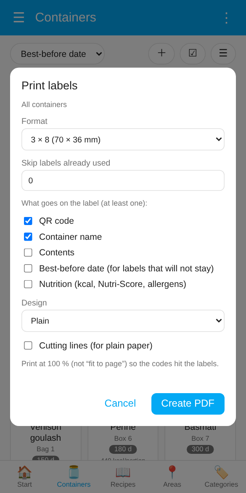
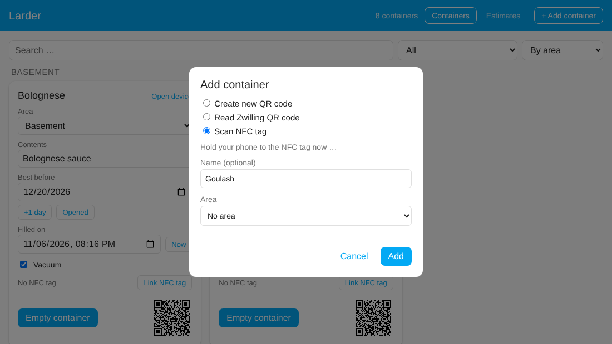
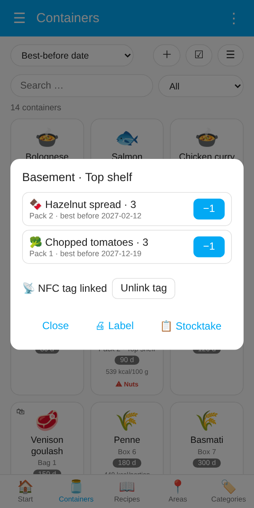
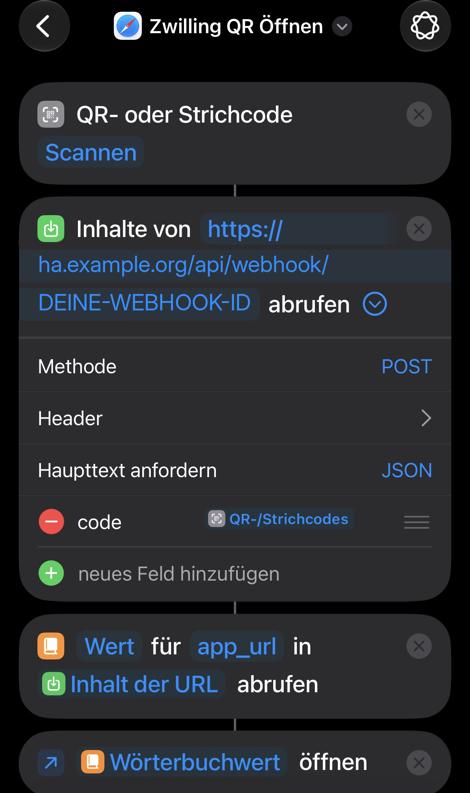

# Scanning

[← Overview](../../README.md) · [🇩🇪 Deutsch](../de/scanning.md)

[Scanning in the app](#scanning-in-the-app) · [Your own QR codes](#your-own-qr-codes) · [NFC tags](#nfc-tags) · [iOS Shortcut for the original Zwilling codes](#ios-shortcut-for-the-original-zwilling-codes)

There are four ways to get from a container to its entry in the dashboard. They can be mixed freely. For an inventory, the [serial scan](dashboard.md#selecting-several-containers) selects many containers in a row.

## Scanning in the app

In the Home Assistant app (**iOS and Android**) the dashboard has a **📷** button: on the start page (**📷 Scan container**) and next to **＋** on the containers, areas and categories pages. It opens the app's own QR scanner and reads **both kinds of codes**, your own and the original Zwilling codes:

- **Known container:** its card opens; an empty container opens the fill dialog right away. The event `larder_dose_scanned` fires as with any other scan.
- **Zwilling code that has not been added yet** (administrators): the dialog **Add container** opens with the code already filled in.
- **Anything else:** the scanner says "Not a Larder code" and stays open for the next try.

The button only appears in the app on a device with a camera, not in a desktop browser. Outside the app, use the camera app for your own codes and the [iOS Shortcut](#ios-shortcut-for-the-original-zwilling-codes) for Zwilling codes.

## Your own QR codes

Every container has the image entity **QR code**. Print it and stick it on the container (open the container's device or the **QR code** entity, save or print the image; the content is also in the attribute `qr_content`).

Scanning it with the camera app works **like an NFC tag**: the Home Assistant app opens the **Larder** dashboard on that container, an empty one right with the fill dialog, and the event `larder_dose_scanned` fires (with `source: qr`) for your automations. The code contains the ID of the container (`homeassistant://navigate/larder?cc=<ID>`), not the device ID, so it stays valid if you delete the container and add it again. If you have several Home Assistant servers in the app, it asks which one you mean.

The same codes work in the [serial scan](dashboard.md#selecting-several-containers) of the dashboard.

> Codes printed before version 2.0 still open the device page of the container. Print them again to get the new behaviour.

### Label sheet

To print many labels at once: **⋮ → 🖨 Print labels** in the dashboard (all containers), or select containers and press **🖨 Labels**. Then choose

- the **format**: an A4 sheet with 3 × 8 (70 × 36 mm), 3 × 7 (70 × 42.3 mm) or 2 × 4 (105 × 74 mm) labels, as sold by Avery Zweckform, Herma and others, or a **label printer** (62 × 29 mm like Brother DK-11209, 54 × 25 mm like Dymo 11352, 89 × 36 mm like Dymo 99012; one label per page),
- **Skip labels already used** (A4 only), to continue on a partly used sheet,
- **what goes on the label**, at least one of: **QR code**, **container name**, **contents**, **best-before date**, **nutrition** (kcal, Nutri-Score, allergens, from the [nutrition](containers.md#nutrition) of the container). Without the QR code the text is centred and larger, nice for containers with an [NFC tag](#nfc-tags). The text is sized to fill the label and wraps onto a second line instead of being cut off. The contents alone suit containers that always hold the same (sugar, rice); the date is meant for labels that do not stay on the container (e.g. freezer bags); with only the name the label stays valid when the contents change,
- the **design**: plain, frame, notched corners or **handwriting** (jar label with a handwritten font, [Kalam](https://fonts.google.com/specimen/Kalam), SIL Open Font License). the **text colour** (black, dark blue, dark green, dark red or brown; QR code and frame stay black) or **inverted** (chalkboard look: black label with white text and frame, the QR code on a white patch so it scans reliably; uses a lot of ink, and a normal printer cannot print white on black paper),
- **Larder symbol in the middle of the QR code** (highest error correction; left out on very small labels where it would make scanning unreliable),
- **Cutting lines**, for plain paper.

**Create PDF** makes a link; tap **Open PDF**. In the Home Assistant app it opens in the browser, from where you print or share it. Print at **100 %** (not "fit to page") so the codes hit the labels. The link is valid for five minutes. Your choices are remembered on the device.

## NFC tags

Instead of printing a QR code you can stick an NFC tag on the container. This uses Home Assistant's own **tags**: every scan fires a `tag_scanned` event, and the integration remembers which tag belongs to which container. Other tags in your home are ignored.

**Quickest way (in the Home Assistant app):** open the dashboard, press **＋** on the containers page **→ Write a new NFC tag**, enter a name and press **Add**. Larder creates the container, creates a new tag in Home Assistant, links the two, and the app opens its tag writer: hold the phone to an empty NFC tag, done. The option only appears in the Companion app on a phone that can write NFC tags (not in a desktop browser).

If you already have a tag written with the Home Assistant app (Settings → Companion App → NFC, or Settings → Tags), link it instead:

1. **Link it to a container** in the dashboard (administrators): on the card press **Link NFC tag** and hold the phone to the tag. Or use **＋ → Scan NFC tag**, which creates a new container and links the tag in one go.
2. **Scan it later.** If the dashboard is open, it opens the container (an empty one with the fill dialog). Otherwise the scanning phone (Companion app) gets a notification, and tapping it opens the dashboard on that container. iPhones show their own banner after reading a tag, tap it first.

For your own automations a linked scan fires the event `larder_dose_scanned` (`cc`, `device_id`, `name`, `scanned_by`). The notification can be switched off in the settings ("NFC: notify the phone"). One container has at most one tag, and a tag belongs to one container.

### Compartments

A **compartment** (an area with a compartment, e.g. *Cellar · top shelf*, or a whole area) can get its own NFC tag or QR label. Scanning it opens the compartment: everything that is there, the oldest best-before date first, with **−1** for packs and **Open** for containers and bags, plus **📋 Stocktake** for exactly this compartment.

- **Set up:** in the [stocktake](containers.md#stocktake) choose the area and compartment and press **🏷 Compartment tag**. There **📡 NFC tag** links a tag that is already written (hold the phone to it) or **✍ Write sticker** links right away and lets the app write a blank sticker; **🖨 Label** prints a QR label for the compartment. Everyone in the household can do this.
- **Scan:** with the dashboard open it shows the compartment right away; otherwise the scanning phone gets a notification that opens it (setting *NFC: notify the phone*). A QR label is scanned with **📷** in the dashboard or the phone camera.
- The event `larder_compartment_scanned` (`area_id`, `compartment`, `name`, `items`, `source`) is for your own automations.
- The tag belongs to the compartment name: if you rename the compartment of the entries, link the tag again.

## iOS Shortcut for the original Zwilling codes

This way is meant for the **printed Zwilling QR codes** when you want to scan them **without opening the Home Assistant app first** (e.g. from the Home Screen or the Action button). Inside the app, [📷](#scanning-in-the-app) does the same without any setup. For codes you created yourself you do not need it, just scan them with the camera app.

On **Android** there is no built-in equivalent; use [📷 in the app](#scanning-in-the-app).

The QR code contains a link with the scheme `zwilling://`, which belongs to the discontinued Zwilling app. The **camera app is not suitable** for it: it wants to open the link in the Zwilling app and does not give you the text to copy. The Shortcut only reads out the text and does not open the link.

### 1. Find the webhook URL

Settings → Devices & services → **Larder** → **Configure** on one of the containers. The dialog shows the webhook URL, built like `https://<your-HA-URL>/api/webhook/<long-secret-ID>`. The URL is the same for all containers, so you only need it once. You can close the Configure window with "Submit" afterwards, it changes nothing.

The long ID is the access protection, so treat the URL like a password. Which address is shown at the front (internal or external) depends on your Home Assistant configuration. When you are away from home the Shortcut only works with an address that is reachable from outside.

### 2. Create the Shortcut (once)

Shortcuts app → new shortcut with these actions, in this order:

1. **Scan QR/Bar Code**
2. **Get Contents of URL**:
   - URL: your webhook URL from step 1
   - Tap "Show More", method **POST**, request body **JSON**
   - "Add new field": type **Text**, key `code`, value: the result of action 1 (pick the "QR/Bar Code" variable from the variable bar)
3. **Get Dictionary Value**: key `app_url`, from "Contents of URL"
4. **Open URLs**: opens the value from action 3

The screenshot shows the finished Shortcut. Replace `ha.example.org` and `DEINE-WEBHOOK-ID` with your own address and the ID from step 1.

Give it a name, e.g. "Scan container". Using the share icon you can add it to the Home Screen or assign it to the Action button. On the first run iOS asks for camera access and whether the Shortcut may access the URL.

### 3. Use it

Run the Shortcut and scan the QR code on the container. The Home Assistant app then opens:

- **Container known:** on the dashboard "Larder" with the card of the container. An empty container opens the **Fill** dialog straight away (see [Filling containers](containers.md#filling-containers)).
- **Container new:** on the dashboard "Larder", where the **Add container** dialog opens with the scanned code already filled in. Optionally enter a name and area and tap **Add**. This needs an administrator account; other users get a note with the scanned code.

If you have several Home Assistant servers in the app, it asks which one you mean when opening.
